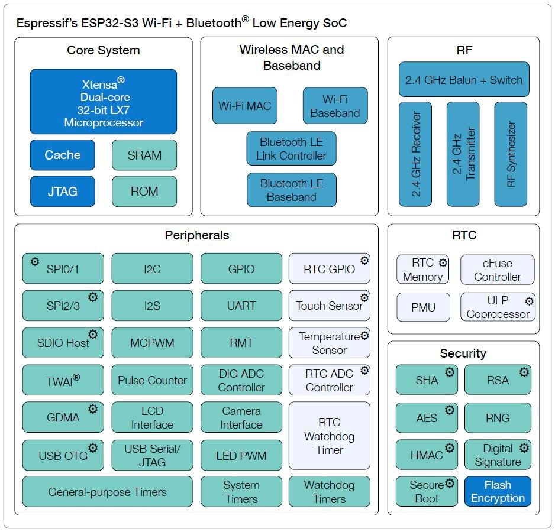

# XIAO ESP32S3 开发原理进阶（二）：从芯片底层到完整固件

上一部分我们讲了 GPIO、通信、FreeRTOS 和供电原理。

接下来深入一层：**为什么 ESP32-S3 能够运行程序？程序如何控制硬件？不同驱动如何组合成一个完整产品？**

理解这些内容，你就不只是会使用现成的 Arduino 示例，而是能够借助 Codex 开发自己的固件。

## 一、先理解 ESP32-S3 内部结构



*[ESPr Developer S3 Type-C 【スイッチサイエンス取寄品】 / SSCI-083119](https://doc.switch-science.com/media/files/e8bb30f2-a5b7-4030-931d-9a5eadc5f0a3.png) · 搜索词：Espressif ESP32-S3 functional block diagram CPU memory peripherals WiFi Bluetooth USB GPIO*

ESP32-S3 可以理解成一台高度集成的微型计算机。

它主要包含以下部分：

| 内部模块 | 工作内容 |
| --- | --- |
| CPU | 执行 C/C++ 指令 |
| SRAM | 保存运行中的变量和数据 |
| ROM | 保存芯片固化的启动代码 |
| Flash | 保存应用程序和配置 |
| PSRAM | 扩展运行内存 |
| GPIO Matrix | 将内部外设信号映射到物理引脚 |
| DMA | 在外设和内存之间传输数据 |
| Wi-Fi / BLE | 无线网络和蓝牙通信 |
| Timer | 定时、计数和周期控制 |
| Interrupt | 响应硬件和软件事件 |

其中有三个特别重要的概念：

**1. CPU：负责计算**

例如：

```c
int temperature = 25;
int threshold = 30;

if (temperature > threshold) {
    printf("Temperature high!");
}
```

这段代码最终由 CPU 执行。

**2. 内存：负责保存数据**

程序运行时，变量、任务堆栈、通信缓冲区都需要占用内存。

**3. 外设：负责与真实世界交互**

例如 GPIO 控制 LED、ADC 读取电压、I2C 读取传感器。

---

## 二、ESP32-S3 上电后发生了什么？

这是理解嵌入式开发最重要的知识之一。

- **上电复位** 电源稳定，芯片进入复位释放过程。
- **执行 ROM Bootloader** 芯片内部固化程序开始运行，读取启动配置和启动模式。
- **加载二级 Bootloader** 从 Flash 读取启动程序，初始化必要的硬件资源。
- **加载应用固件** 根据分区表找到应用程序，将相关代码映射或加载到运行环境。
- **初始化 ESP-IDF** 初始化系统组件、内存、驱动和 FreeRTOS。
- **执行 app_main()** 正式进入你编写的应用程序。

这里要理解一个区别：

- ROM Bootloader 是芯片出厂固化的代码。
- 二级 Bootloader 是工程编译出来并存放在 Flash 中的程序。
- `app_main()` 是应用程序的入口函数。

这也是为什么 ESP32-S3 不能简单理解成把代码复制到芯片就能运行。

## 三、ESP-IDF 的软件架构

ESP-IDF 并不是单纯的 C 语言库，而是一套分层的软件开发框架。

**应用层 Application** 业务逻辑、设备功能、产品交互

**组件层 Components** 音频、显示、网络、传感器、电源管理

**驱动层 Drivers** GPIO、I2C、SPI、UART、ADC、LEDC

**系统层 ESP-IDF / FreeRTOS** 任务、内存、事件、调度、系统服务

**硬件层 ESP32-S3** CPU、RAM、Flash、外设控制器

例如，你要开发一个按键控制 LED 的设备：

1. 应用层判断按键是否按下。
2. 驱动层读取 GPIO。
3. 系统层负责任务调度。
4. 硬件层真正改变引脚电平。

这种分层方式能够让代码更容易维护和复用。

## 四、GPIO Matrix：为什么一个引脚可以有多种功能？

这是 ESP32-S3 非常重要的硬件设计机制。

传统单片机有些引脚功能是固定的，而 ESP32-S3 内部具有 GPIO Matrix，可以将内部外设信号灵活映射到不同 GPIO。

例如，一个 GPIO 可以配置为：

- 普通数字输入
- 普通数字输出
- UART 数据发送
- PWM 输出
- SPI 信号
- I2C 信号
- 外部中断输入

> 图示：ESP32 S3 GPIO matrix peripheral routing block diagram

但需要注意，并不是所有 GPIO 都能随意使用。部分引脚可能受到启动配置、板载器件、USB、Flash 或 PSRAM 等功能占用。

### 举个例子：控制电机速度

电机不能简单通过 GPIO 高低电平来精确控制速度。

通常使用 PWM：

**PWM 波形示意**

示意波形，周期相同，占空比不同。

占空比越大，电机驱动器获得的平均控制电压通常越高，电机速度也可能越高。

ESP-IDF 提供 LEDC 驱动，可以输出 PWM：

```c
#include "driver/ledc.h"

void pwm_init(void)
{
    ledc_timer_config_t timer = {
        .speed_mode = LEDC_LOW_SPEED_MODE,
        .duty_resolution = LEDC_TIMER_10_BIT,
        .timer_num = LEDC_TIMER_0,
        .freq_hz = 1000,
        .clk_cfg = LEDC_AUTO_CLK
    };

    ledc_timer_config(&timer);

    ledc_channel_config_t channel = {
        .gpio_num = 1,
        .speed_mode = LEDC_LOW_SPEED_MODE,
        .channel = LEDC_CHANNEL_0,
        .timer_sel = LEDC_TIMER_0,
        .duty = 512,
        .hpoint = 0
    };

    ledc_channel_config(&channel);
}
```

这里使用 GPIO1 作为示例，实际接电机时必须通过电机驱动器，不能直接让 GPIO 驱动电机。

---

## 五、ADC、DAC 和数字信号的区别

ESP32-S3 与外界通信时，不只是高电平和低电平，还需要处理模拟信号。

| 类型 | 工作方式 | 应用 |
| --- | --- | --- |
| GPIO | 读取 0/1 | 按键、开关 |
| ADC | 模拟电压转数字值 | 电池电压、模拟传感器 |
| PWM | 数字脉冲模拟控制 | LED 亮度、电机速度 |
| I2S | 数字音频传输 | 麦克风、音频 DAC |
| SPI | 高速串行通信 | 显示屏、存储器 |
| I2C | 双线串行通信 | 温度传感器、RTC |

### ADC 的工作原理

假设某个传感器输出 0～3.3V 的模拟电压。

ADC 会将模拟电压转换成数字采样值。

例如，假设使用理想的 12 位 ADC：

$2^{12}=4096$

理论上可以表示 0～4095 的数字量。

但实际 ESP32-S3 的 ADC 存在非线性、噪声和衰减配置等因素，不能简单地把 ADC 原始读数直接当作精确电压。

### I2S 的工作原理

如果以后开发语音设备，就要重点理解 I2S。

I2S 通常包含：

- BCLK：位时钟
- WS：左右声道时钟
- DIN：接收音频数据
- DOUT：发送音频数据

例如：

**数字麦克风**

↓

**I2S 接收驱动**

↓

**ESP32-S3 内存缓冲区**

↓

**音频算法处理** 降噪、滤波、语音识别

↓

**I2S 输出 → 音频功放 → 扬声器**

这就是一个基本的数字音频系统。

---

## 六、内存管理：为什么有些 ESP32-S3 项目容易崩溃？

ESP32-S3 的程序运行需要合理使用内存。

主要有四类：

| 内存 | 用途 |
| --- | --- |
| ROM | 芯片内部固化代码 |
| SRAM | CPU 运行数据、变量、堆栈 |
| Flash | 固件、文件系统、持久化配置 |
| PSRAM | 大容量缓冲区和动态数据 |

这里有一个关键区别：

**Flash 不等于 RAM。**

例如，固件存储在 Flash 中，但运行时创建的大型数据缓冲区通常需要 RAM 或 PSRAM。

### 实际案例：音频缓冲区

假设录制 16kHz、16 位、单声道 PCM 音频：

$16000 \times 2 = 32000\text{ Bytes/s}$

也就是说：

- 1 秒音频：约 32KB
- 10 秒音频：约 320KB
- 60 秒音频：约 1.92MB

如果没有合理的缓冲区设计，很容易造成内存不足。

因此，在开发 XIAO ESP32S3 应用时，需要学会：

1. 监控剩余堆内存。
2. 合理使用 PSRAM。
3. 避免频繁动态分配内存。
4. 控制任务堆栈大小。
5. 使用 DMA 友好的内存缓冲区。

另外，DMA 对内存地址和缓存属性可能有要求，不能假设任意 PSRAM 缓冲区都能直接交给所有外设驱动使用。

---

## 七、FreeRTOS：如何让多个功能同时运行？

假设你开发一个设备，需要同时完成：

- 读取按键
- 连接 Wi-Fi
- 采集传感器
- 发送数据
- 更新显示屏

如果全部写在一个循环中，某个网络操作阻塞时，可能影响按键响应。

FreeRTOS 的解决办法是将功能拆分为任务。

**一个典型的任务架构**

- **Task 1** 按键扫描 **高响应**
- **Task 2** 传感器采集 **周期任务**
- **Task 3** Wi-Fi 通信 **异步事件**
- **Task 4** 显示刷新 **低优先级**

---

**Queue / Event Group / Semaphore** 任务之间传递数据、通知事件、协调资源

例如：

```c
#include "freertos/FreeRTOS.h"
#include "freertos/task.h"

void button_task(void *arg)
{
    while (1) {
        // 检测按键
        vTaskDelay(pdMS_TO_TICKS(20));
    }
}

void sensor_task(void *arg)
{
    while (1) {
        // 读取传感器
        vTaskDelay(pdMS_TO_TICKS(1000));
    }
}

void app_main(void)
{
    xTaskCreate(button_task, "button", 2048,
                NULL, 5, NULL);

    xTaskCreate(sensor_task, "sensor", 4096,
                NULL, 3, NULL);
}
```

这里的 2048 和 4096 是任务堆栈大小参数，ESP-IDF 中以字节为单位。

实际产品还要增加任务错误处理、资源释放、优先级设计和任务间同步。

## 八、ESP-IDF 工程为什么要采用组件化设计？

这是从学习型程序走向正式产品的关键一步。

很多初学者把所有代码都写在 `main.c` 里面，后期功能一多就很难维护。

更好的方法是把不同硬件功能拆成独立组件。

例如：

```text
xiao_firmware/
│
├── CMakeLists.txt
├── sdkconfig
│
├── main/
│   ├── main.c
│   └── CMakeLists.txt
│
├── components/
│   ├── xiao_board/
│   │   ├── board_config.h
│   │   └── board_init.c
│   │
│   ├── button/
│   │   ├── button.c
│   │   └── button.h
│   │
│   ├── led/
│   │   ├── led.c
│   │   └── led.h
│   │
│   ├── wifi/
│   │   ├── wifi_manager.c
│   │   └── wifi_manager.h
│   │
│   ├── display/
│   ├── audio/
│   ├── storage/
│   └── power/
│
└── docs/
    ├── pinout.md
    ├── architecture.md
    └── hardware.md
```

这样做有几个好处：

- 更换传感器，不需要重写整个程序。
- 更换 Wi-Fi 业务逻辑，不影响 GPIO 驱动。
- Codex 可以独立分析和修改某个组件。
- 可以把成熟的驱动复用到其他 XIAO ESP32S3 项目中。

## 九、从源码到固件，编译系统究竟做了什么？

ESP-IDF 使用 CMake 管理工程。

一次完整编译大致经历：

C / C++ 源码

↓

预处理器 展开宏、头文件

↓

编译器 GCC 生成目标文件 .o

↓

链接器 合并程序和依赖库

↓

固件文件 .bin

↓

Flash 分区烧录

ESP-IDF 还会生成分区表、Bootloader、应用程序等不同文件。

典型 Flash 分区包括：

| 分区 | 用途 |
| --- | --- |
| NVS | 保存 Wi-Fi 配置、设备参数 |
| OTA Data | 保存 OTA 启动选择信息 |
| Factory / App | 存放应用固件 |
| SPIFFS / FAT | 存放文件和资源（按需配置） |

分区布局不是固定的，需要根据固件大小、OTA 需求和存储空间规划。

## 十、调试原理：如何找到程序中的问题？

正式开发不能只依靠编译成功。

需要建立四种调试能力：

| 调试方式 | 能发现的问题 |
| --- | --- |
| 串口日志 | 程序执行流程、错误信息 |
| GDB 调试 | 变量、函数、调用堆栈 |
| Core Dump | 崩溃时的任务和运行状态 |
| 示波器 / 逻辑分析仪 | GPIO、SPI、I2C、PWM 时序 |

例如，Wi-Fi 连接失败时：

```c
ESP_LOGI("WIFI", "Starting WiFi...");
ESP_LOGI("WIFI", "Connecting...");
ESP_LOGE("WIFI", "Connection failed");
```

ESP-IDF 提供统一日志系统，可以按模块区分日志级别。

遇到 `Guru Meditation Error` 时，应重点查看异常类型、PC 地址、回溯堆栈和对应 ELF 文件，而不是直接猜测是 GPIO 接错。

---

## 十一、将所有原理转化成实际开发能力

建议把 XIAO ESP32S3 的学习拆成三个阶段。

**第一阶段** **基础硬件控制** 目标：能够独立编写底层驱动。

- GPIO 输入输出
- 按键中断
- PWM
- ADC
- I2C / SPI / UART

---

**第二阶段** **系统与网络开发** 目标：能够开发多功能固件。

- FreeRTOS
- Wi-Fi / BLE
- HTTP / MQTT
- NVS 存储
- 内存管理
- OTA 升级

---

**第三阶段** **完整产品开发** 目标：把开发板变成稳定的独立设备。

- 模块化固件
- 低功耗设计
- 故障恢复
- PCB 与外设连接
- FreeCAD 外壳
- 整机测试

## 十二、下一课：深入理解 ESP32-S3 的底层架构

我建议接下来按照真正的嵌入式工程师学习顺序继续，而不是直接堆砌代码。

**选择下一部分学习内容**

**开始下一课  →**

我的建议是先学 **CPU、寄存器、中断和时钟原理**。这部分弄明白之后，GPIO、PWM、定时器、FreeRTOS 和驱动程序就能串成一个完整的知识体系。
