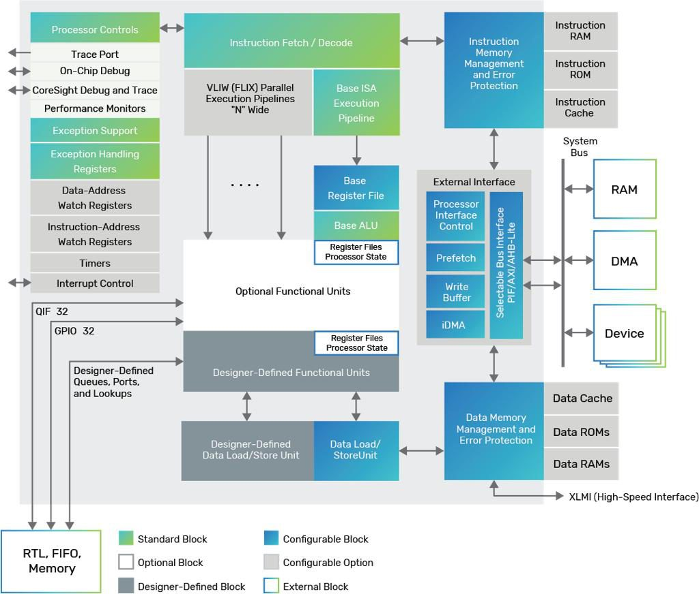
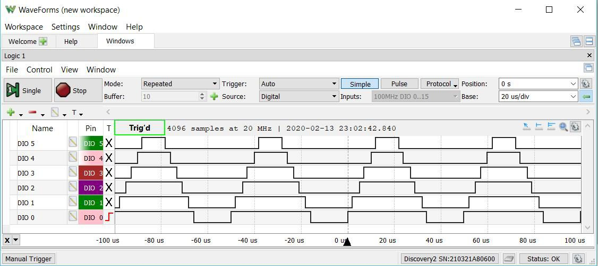

# 第三课：XIAO ESP32S3 的 CPU、寄存器、中断和时钟原理

这一课开始进入真正的单片机底层开发。

前面我们已经了解了 GPIO、通信接口、FreeRTOS 和 ESP-IDF。现在要进一步理解：

1. CPU 是如何执行一条指令的？
2. 寄存器是什么？为什么 CPU 需要寄存器？
3. 中断是如何让芯片及时响应外部事件的？
4. 时钟如何决定 CPU 和外设的运行速度？
5. ESP-IDF 如何把这些底层硬件机制封装成开发接口？
6. 在 XIAO ESP32S3 上如何编写、运行和调试相关代码？

本课以普通版 XIAO ESP32S3 为目标，使用 ESP-IDF 和 C 语言作为主要开发环境。

---

## 一、CPU 的硬件结构和工作原理

### 1. ESP32-S3 使用什么 CPU？

XIAO ESP32S3 使用 Espressif ESP32-S3 芯片，其 CPU 是：

**Xtensa LX7**

双核 32 位处理器

- **Core 0** **240** MHz 最高主频
- **Core 1** **240** MHz 最高主频

芯片规格上限；实际频率取决于电源管理、配置和运行状态。

两个核心可以同时执行不同任务，但不代表所有程序都会自动平均分配到两个核心。

例如：

- Core 0 可以运行部分系统和网络相关任务。
- Core 1 可以运行应用层的传感器处理任务。
- 两个核心也可以共同参与应用程序工作。

具体分配由 ESP-IDF、FreeRTOS 的任务调度和核心亲和性决定。

### 2. CPU 内部到底有什么？

可以把 CPU 理解为一套由多个功能单元组成的计算系统。



*[Tensilica Xtensa LX7 Processor Datasheet | Cadence](https://www.cadence.com/content/dam/cadence-www/global/en_US/images/resources/datasheets/xtensa-lx7-processor-ds-fig-1.png) · 搜索词：Cadence Xtensa LX7 CPU architecture block diagram register file ALU pipeline*

主要组成：

| 部件 | 作用 |
| --- | --- |
| 寄存器组 | 临时保存数据和运算结果 |
| ALU | 执行加减、逻辑运算 |
| 浮点运算单元 | 执行支持的浮点运算 |
| 程序计数器 PC | 指示下一条要执行的指令 |
| 指令译码单元 | 解析机器指令 |
| 流水线 | 重叠执行多条指令的不同阶段 |
| 中断控制逻辑 | 响应中断请求 |
| Load/Store 单元 | 读取和写入内存 |

需要注意，ESP32-S3 的 Xtensa LX7 还有一些特殊指令和系统寄存器，不能直接按照 ARM Cortex-M 的寄存器体系学习。

### 3. CPU 如何执行程序？

假设我们写下：

```c
int a = 10;
int b = 20;
int c = a + b;
```

CPU 实际执行时，需要经历：

- **取指 Fetch** 从程序存储器中取得下一条机器指令。
- **译码 Decode** 识别指令的操作类型、寄存器和操作数。
- **执行 Execute** ALU 执行加法或其他运算。
- **访存 Memory** 如果指令需要读取或写入内存，则访问相应地址。
- **写回 Write Back** 将结果写入寄存器或内存。

这是帮助理解 CPU 的概念模型。实际 Xtensa LX7 的指令流水线和存储器访问过程更复杂，并不是每条指令都严格经历完全相同的五个阶段。

---

## 二、寄存器：CPU 最直接的控制工具

这是本课最重要的知识点之一。

### 1. 什么是寄存器？

寄存器是 CPU 内部或外设内部用于保存少量数据、状态和控制信息的高速存储单元。

你可以把它理解成：

- RAM 是工作台。
- Flash 是仓库。
- 寄存器是手边的工具和临时记事本。

CPU 执行指令时，通常会频繁使用寄存器。

### 2. Xtensa LX7 的常见寄存器

| 寄存器 | 功能 |
| --- | --- |
| A0～A15 | 通用寄存器 |
| PC | 程序计数器 |
| PS | 处理器状态寄存器 |
| SAR | 移位量寄存器 |
| EXCCAUSE | 异常原因 |
| EPC | 异常发生时的程序计数位置 |
| INTENABLE | 中断使能状态 |
| CCOUNT | CPU 周期计数器 |

其中，A0～A15 是 Xtensa 架构中的通用寄存器名称。Xtensa 还有寄存器窗口机制，不能简单认为所有函数调用都只是使用固定的 16 个物理寄存器。

### 3. 寄存器与变量有什么区别？

看下面的程序：

```c
int count = 100;
count++;

printf("%d", count);
```

`count` 是 C 语言变量。

编译器可能把它放在：

- CPU 寄存器；
- SRAM；
- 栈；
- 其他存储位置。

如果变量使用频繁，编译器可能优先将它放在寄存器中，以减少内存访问。

所以，C 语言变量不等于硬件寄存器。

### 4. 为什么需要学习寄存器？

因为很多底层硬件功能最终都是通过寄存器控制的。

例如：

- 设置 GPIO 输出方向；
- 配置定时器；
- 使能中断；
- 设置 PWM 频率；
- 读取 ADC 转换结果；
- 配置 CPU 时钟。

ESP-IDF 的驱动 API 就是在帮助开发者安全地操作这些硬件资源。

## 三、中断：CPU 如何及时响应外部事件？

### 1. 为什么需要中断？

假设你正在开发一个 XIAO ESP32S3 控制器。

你希望实现：

- 按下按键，立即切换设备状态。
- 定时器每隔 1ms 触发一次。
- Wi-Fi 收到数据后通知程序处理。
- UART 收到数据后及时读取。

有两种实现方式。

**方式 A：轮询**

CPU 不断检查按键状态：

```c
while (1) {
    if (button_pressed()) {
        handle_button();
    }
}
```

缺点：

- CPU 需要不停检查。
- 浪费处理时间。
- 响应速度取决于轮询周期。
- 多个设备同时工作时，程序容易变复杂。

**方式 B：中断**

让硬件在事件发生时通知 CPU。

例如：

**正常执行任务** CPU 正在运行应用程序

↓

**用户按下按键**

↓

**GPIO 产生中断请求** 中断控制器接收事件

↓

**CPU 暂停当前执行流程** 保存必要的执行状态并进入中断处理程序

↓

**执行 ISR 中断服务程序** 记录事件、通知任务

↓

**返回原来的任务** 继续执行被打断的程序

ISR 是 Interrupt Service Routine 的缩写，即中断服务程序。

### 2. ESP32-S3 的中断系统

ESP32-S3 每个 CPU 核心具有 32 个中断输入，并具有中断矩阵，可以把大部分外设中断源映射到合适的 CPU 中断。

例如：

| 中断来源 | 典型用途 |
| --- | --- |
| GPIO 中断 | 按键、外部信号 |
| 定时器中断 | 精确周期控制 |
| UART 中断 | 串口接收 |
| SPI 中断 | 数据传输完成 |
| Wi-Fi 中断 | 网络硬件事件 |
| 软件中断 | 核间或系统内部事件 |

中断还具有优先级。Xtensa 架构提供多个中断级别，但普通 ESP-IDF 应用通常通过驱动和中断分配器管理，不需要自行编写汇编中断入口。

### 3. 实战：使用 GPIO 中断检测按键

这里使用一个外接按键作为示例：

- GPIO1 连接按键。
- 按键另一端接 GND。
- GPIO1 配置内部上拉。
- 按键按下时产生下降沿。

示例代码：

```c
#include <stdio.h>
#include "freertos/FreeRTOS.h"
#include "freertos/task.h"
#include "freertos/queue.h"
#include "driver/gpio.h"
#include "esp_log.h"

#define BUTTON_GPIO GPIO_NUM_1

static const char *TAG = "BUTTON";
static QueueHandle_t button_queue;

static void IRAM_ATTR button_isr(void *arg)
{
    uint32_t pin = (uint32_t)arg;
    BaseType_t task_woken = pdFALSE;

    xQueueSendFromISR(
        button_queue,
        &pin,
        &task_woken
    );

    if (task_woken) {
        portYIELD_FROM_ISR();
    }
}

static void button_task(void *arg)
{
    uint32_t pin;

    while (1) {
        if (xQueueReceive(
                button_queue,
                &pin,
                portMAX_DELAY
            )) {
            ESP_LOGI(TAG, "Button event: GPIO %lu",
                     (unsigned long)pin);
        }
    }
}

void app_main(void)
{
    button_queue = xQueueCreate(10, sizeof(uint32_t));

    configASSERT(button_queue != NULL);

    xTaskCreate(
        button_task,
        "button_task",
        3072,
        NULL,
        5,
        NULL
    );

    gpio_config_t io_conf = {
        .pin_bit_mask = 1ULL << BUTTON_GPIO,
        .mode = GPIO_MODE_INPUT,
        .pull_up_en = GPIO_PULLUP_ENABLE,
        .pull_down_en = GPIO_PULLDOWN_DISABLE,
        .intr_type = GPIO_INTR_NEGEDGE
    };

    ESP_ERROR_CHECK(gpio_config(&io_conf));

    ESP_ERROR_CHECK(gpio_install_isr_service(0));

    ESP_ERROR_CHECK(gpio_isr_handler_add(
        BUTTON_GPIO,
        button_isr,
        (void *)BUTTON_GPIO
    ));
}
```

这个程序展示了一个重要的工程设计思想：

**中断只负责快速通知，真正的业务处理放在 FreeRTOS 任务中。**

这样可以避免 ISR 执行太久，影响其他中断和系统任务。

注意：这里是教学示例，实际使用需要处理机械按键抖动、队列满、重复触发以及引脚是否被其他外设占用等情况。不能在 ISR 中直接使用普通 `ESP_LOGI()`、阻塞延时或普通队列 API。

### 4. 中断优先级和响应速度

中断优先级决定多个事件同时到达时的处理关系。

例如：

| 事件 | 处理策略 |
| --- | --- |
| 普通按键 | 普通 GPIO ISR |
| 高频采样 | 定时器或 DMA |
| 串口接收 | 使用驱动缓冲和事件通知 |
| 极高实时性事件 | 专门规划高优先级中断 |

不要认为中断优先级越高越好。

过多高优先级中断会影响低优先级任务执行，甚至造成系统实时性下降。

---

## 四、时钟系统：CPU 为什么能够按照一定速度运行？

### 1. 什么是时钟？

CPU 并不是随意执行指令，而是由时钟信号驱动。

可以把时钟理解为一个连续的节拍器。

**时钟波形**

一个周期包括高电平和低电平，实际 CPU 指令执行并不一定每周期完成一条。

频率的计算公式：

$f=\frac{1}{T}$

其中：

- $f$：频率，单位 Hz。
- $T$：周期，单位秒。

例如：

| 频率 | 一个周期 |
| --- | --- |
| 1 Hz | 1 秒 |
| 1 kHz | 1 毫秒 |
| 1 MHz | 1 微秒 |
| 240 MHz | 约 4.17 纳秒 |

ESP32-S3 的 CPU 最高工作频率为 240MHz。

这意味着时钟每秒产生 2.4 亿个周期，但并不意味着每秒可以执行 2.4 亿条任意复杂的 C 语言语句。

### 2. ESP32-S3 的时钟从哪里来？

ESP32-S3 具有多个时钟源。

其中比较重要的是：

| 时钟源 | 作用 |
| --- | --- |
| 外部 40MHz 晶振 | 提供稳定的参考时钟 |
| PLL | 倍频产生高速时钟 |
| 内部 RC 时钟 | 低成本、低功耗时钟来源 |
| 32kHz 时钟源 | RTC 低功耗计时相关用途 |

PLL 是锁相环，可以把参考时钟转换成更高频率。

例如，ESP32-S3 的 CPU 可以使用 PLL 输出的时钟。官方时钟树文档还列出了 480MHz 和 320MHz 的 PLL 输出路径。

### 3. CPU 时钟和外设时钟不是一回事

这是非常容易混淆的知识。

ESP32-S3 中：

- CPU_CLK：CPU 核心时钟。
- APB_CLK：高级外设总线时钟。
- RTC_SLOW_CLK：低功耗计时相关时钟。
- RTC_FAST_CLK：RTC 快速时钟。
- PLL 时钟：供不同模块使用的时钟来源。

例如，在 ESP-IDF 动态频率调整机制中：

| 配置情况 | CPU 频率 | APB 频率 |
| --- | --- | --- |
| 最高 CPU 频率锁定 | 240MHz | 80MHz |
| 只保持 APB 频率 | 80MHz | 80MHz |
| 最低频率运行 | 由配置决定 | 由配置决定 |

这是官方电源管理文档给出的典型配置情况。

也就是说：

**CPU 可以运行在 240MHz，而某些外设仍然使用 80MHz 的时钟。**

因此，配置 UART、定时器、SPI 等外设时，不能简单地把 CPU 主频当成外设时钟。

### 4. 动态频率调整：为什么 CPU 不一定一直运行在 240MHz？

ESP-IDF 提供 Dynamic Frequency Scaling（DFS），即动态频率调整。

例如：

- CPU 空闲时降低频率。
- 有大量计算任务时提高频率。
- 某些外设工作时保持必要的 APB 时钟。
- 进入 Light-sleep 时根据电源管理要求调整时钟。

这样可以在性能和功耗之间进行平衡。

ESP-IDF 的电源管理通过 PM Lock 管理各组件对时钟和睡眠状态的要求。

一个典型配置示例：

```c
#include "esp_pm.h"
#include "esp_err.h"

void power_management_init(void)
{
    esp_pm_config_t pm_config = {
        .max_freq_mhz = 240,
        .min_freq_mhz = 80,
        .light_sleep_enable = false
    };

    ESP_ERROR_CHECK(esp_pm_configure(&pm_config));
}
```

需要在工程启用相应的 `CONFIG_PM_ENABLE` 配置后使用。

这里设置的 80MHz 是最低 CPU 频率，不代表系统永远运行在 80MHz。

---

## 五、实战：使用硬件定时器理解时钟和中断

现在把前面的知识组合起来。

我们让 XIAO ESP32S3 每隔 1 秒产生一次硬件定时器事件。

这个实验可以帮助你理解：

- 时钟源；
- 定时器计数；
- 计数分辨率；
- 定时器中断；
- CPU 响应；
- ISR 与 FreeRTOS 任务之间的关系。

### 1. 定时器工作原理

假设定时器配置为：

$f=1,000,000\ Hz$

那么每次计数代表：

$T=\frac{1}{1,000,000}=1\mu s$

如果要每秒触发一次：

$N=1,000,000$

也就是定时器计数达到 100 万时触发事件。

### 2. ESP-IDF GPTimer 实验

```c
#include <stdio.h>

#include "esp_log.h"
#include "esp_err.h"
#include "driver/gptimer.h"

static const char *TAG = "GPTIMER";

static bool IRAM_ATTR timer_callback(
    gptimer_handle_t timer,
    const gptimer_alarm_event_data_t *edata,
    void *user_ctx)
{
    BaseType_t high_task_awoken = pdFALSE;

    vTaskNotifyGiveFromISR(
        (TaskHandle_t)user_ctx,
        &high_task_awoken
    );

    return high_task_awoken == pdTRUE;
}

static void timer_task(void *arg)
{
    while (1) {
        ulTaskNotifyTake(pdTRUE, portMAX_DELAY);

        ESP_LOGI(TAG, "Timer event received");
    }
}

void app_main(void)
{
    TaskHandle_t task_handle = NULL;

    xTaskCreate(
        timer_task,
        "timer_task",
        3072,
        NULL,
        5,
        &task_handle
    );

    gptimer_handle_t timer = NULL;

    gptimer_config_t timer_config = {
        .clk_src = GPTIMER_CLK_SRC_DEFAULT,
        .direction = GPTIMER_COUNT_UP,
        .resolution_hz = 1000000
    };

    ESP_ERROR_CHECK(
        gptimer_new_timer(&timer_config, &timer)
    );

    gptimer_event_callbacks_t callbacks = {
        .on_alarm = timer_callback
    };

    ESP_ERROR_CHECK(
        gptimer_register_event_callbacks(
            timer,
            &callbacks,
            task_handle
        )
    );

    gptimer_alarm_config_t alarm_config = {
        .alarm_count = 1000000,
        .reload_count = 0,
        .flags.auto_reload_on_alarm = true
    };

    ESP_ERROR_CHECK(
        gptimer_set_alarm_action(timer, &alarm_config)
    );

    ESP_ERROR_CHECK(gptimer_enable(timer));
    ESP_ERROR_CHECK(gptimer_start(timer));

    ESP_LOGI(TAG, "GPTimer started");
}
```

这段代码使用 GPTimer 硬件定时器和 FreeRTOS 任务通知。

运行后，串口监视器应持续出现：

```text
I (1000) GPTIMER: Timer event received
I (2000) GPTIMER: Timer event received
I (3000) GPTIMER: Timer event received
I (4000) GPTIMER: Timer event received
```

实际日志间隔会受到任务调度和日志输出影响，不能用串口日志时间来测量硬件定时器的精确度。

这里使用的是 ESP-IDF GPTimer 驱动，而不是 CPU 忙等待。定时器的分辨率为 1MHz，但真实计时精度仍取决于所选择的时钟源及其稳定性。

---

## 六、如何调试 CPU、中断和时钟？

这一部分是实际工程开发必须掌握的。

### 1. 查看程序运行日志

```bash
idf.py monitor
```

可以查看：

- 程序启动过程；
- CPU 异常；
- 中断相关错误；
- 定时器运行状态；
- FreeRTOS 任务日志。

### 2. 查看编译后的汇编代码

```bash
idf.py build
```

然后使用 Xtensa 工具链中的反汇编工具查看 ELF：

```bash
xtensa-esp32s3-elf-objdump \
  -d build/项目名称.elf
```

这里可以观察：

- C 语言被转换成什么机器指令；
- 哪些变量使用寄存器；
- 函数调用如何实现；
- 循环如何转换为跳转指令。

实际 ELF 文件名称以工程配置为准。

### 3. 查看内存和程序大小

```bash
idf.py size
idf.py size-components
```

可以观察：

- Flash 代码大小；
- 静态 RAM 占用；
- 各个组件占用情况。

### 4. 使用逻辑分析仪



*[Project | ESP-32 BLDC Robot Actuator Controller | Hackaday.io](https://cdn.hackaday.io/images/3954681581606183869.c1af91cd72d922962fb5cbb89ee2eb5c) · 搜索词：USB logic analyzer oscilloscope measuring microcontroller GPIO PWM digital signal waveform*

如果要研究中断和时钟，逻辑分析仪很有帮助。

例如让一个 GPIO 在定时任务中翻转：

```c
gpio_set_level(GPIO_NUM_1, 1);
gpio_set_level(GPIO_NUM_1, 0);
```

通过逻辑分析仪可以观察实际电平、脉冲宽度和周期。

注意：这两条语句之间的间隔并不等于一个 CPU 时钟周期。GPIO 驱动、总线访问和软件执行都会产生额外延迟。

---

## 七、把本课知识应用到 XIAO ESP32S3

现在总结一下这四部分的关系。

**CPU**

负责执行指令、处理数据和运行程序。

---

**寄存器**

负责保存运算数据、程序状态和硬件控制信息。

---

**中断**

让 CPU 及时响应按键、定时器和通信事件。

---

**时钟**

为 CPU 和各个硬件外设提供运行节拍。

这四者构成了嵌入式开发最基础的运行机制。

## 八、本课实验验收

建议在你的 XIAO ESP32S3 上完成下面四个实验：

**实验进度**/4

- [ ] **CPU 基础实验** 运行程序、观察日志，理解 app_main() 执行过程。

- [ ] **寄存器实验** 通过反汇编观察 CPU 指令和寄存器使用。

- [ ] **中断实验** 连接外接按键，产生 GPIO 下降沿中断。

- [ ] **时钟实验** 使用 GPTimer 实现 1 秒周期定时。

## 九、下一课：Flash、SRAM、PSRAM 和内存管理

下一课我们将研究另一个特别重要的主题：

**为什么 ESP32-S3 有时候会出现内存不足、程序崩溃、栈溢出和数据丢失？**

将系统讲解：

1. Flash 的物理结构和读写原理。
2. SRAM、DRAM 与 PSRAM 的区别。
3. 堆、栈、全局变量和局部变量。
4. malloc、free 和内存碎片。
5. DMA 为什么对内存地址有要求。
6. ESP-IDF 如何管理内存。
7. 如何在 XIAO ESP32S3 上查看实际内存容量和使用情况。

官方学习资料：

- [ESP32-S3 中断分配机制](https://docs.espressif.com/projects/esp-idf/en/stable/esp32s3/api-reference/system/intr_alloc.html)
- [ESP32-S3 时钟树](https://docs.espressif.com/projects/esp-idf/en/stable/esp32s3/api-reference/peripherals/clk_tree.html)
- [GPTimer 定时器](https://docs.espressif.com/projects/esp-idf/en/stable/esp32s3/api-reference/peripherals/gptimer.html)
- [动态频率和电源管理](https://docs.espressif.com/projects/esp-idf/en/stable/esp32s3/api-reference/system/power_management.html)

**学习建议：** 不要急于直接开发大型应用。先把 CPU、寄存器、中断、时钟和内存这些基础原理弄懂，再学习驱动和应用架构，后面使用 Codex 开发固件时会容易理解代码为什么这样写，而不仅仅是让它生成代码。
