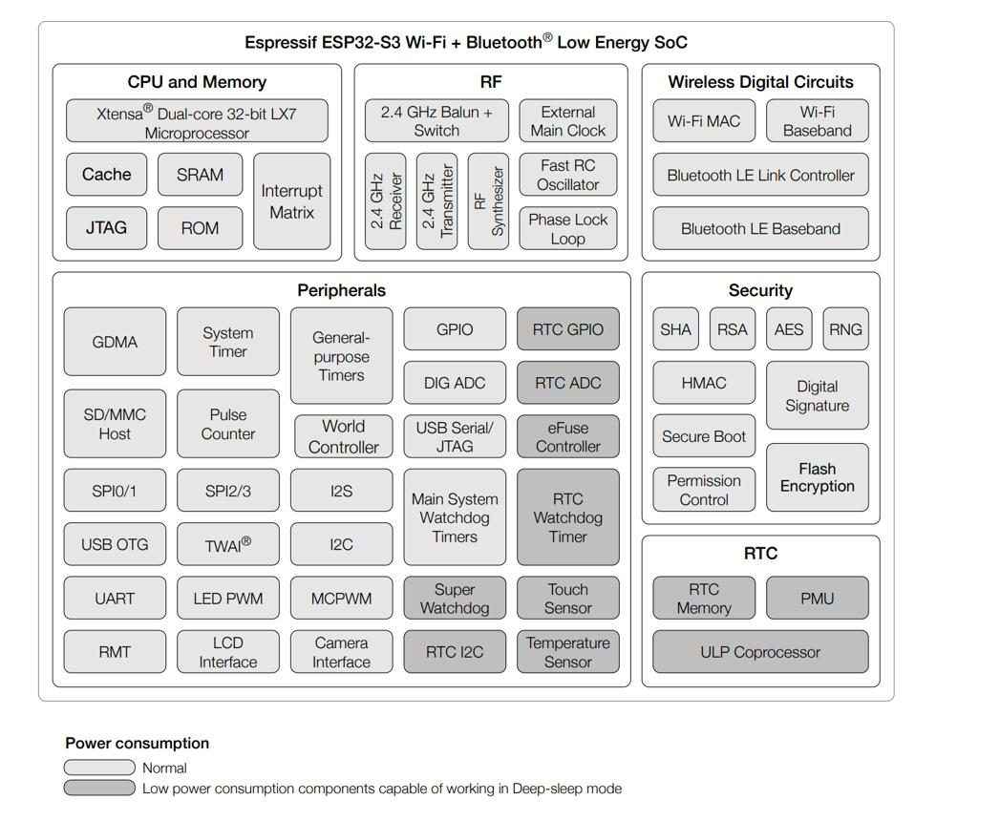

# 第四课：XIAO ESP32S3 的 Flash、SRAM、PSRAM 与内存管理

这一课进入嵌入式开发中非常重要的部分：**内存系统（Memory Architecture）**。

如果说 CPU 是负责计算的大脑，那么内存就是程序运行时的工作空间。

很多 ESP32-S3 项目出现以下问题，其实都与内存管理有关：

- 程序编译成功，但运行一段时间后崩溃。
- 摄像头或音频缓冲区创建失败。
- Wi-Fi 运行正常，但加入其他功能后内存不足。
- 出现 `Stack overflow`。
- 出现 `heap_caps_malloc failed`。
- 设备频繁重启或出现 `Guru Meditation Error`。
- 保存的配置断电后丢失。

学完这一课，你应该能够理解 XIAO ESP32S3 的内存结构，并且知道如何让 Codex 正确管理固件的内存资源。

---

## 一、ESP32-S3 的内存体系

首先看一下 ESP32-S3 的内存组成。



*[ESP Series: ESP8266/ ESP32 Related](https://www.makerfabs.com/media/wysiwyg/_4_2.png) · 搜索词：ESP32 S3 memory architecture SRAM ROM external SPI flash PSRAM architecture block diagram*

ESP32-S3 主要涉及五种存储资源：

| 存储类型 | 主要用途 | 特点 |
| --- | --- | --- |
| ROM | 芯片启动代码 | 出厂固化 |
| Flash | 固件、文件、配置 | 断电保存 |
| SRAM | CPU 运行数据 | 高速、容量有限 |
| PSRAM | 扩展运行内存 | 容量较大、速度和访问条件不同 |
| Cache | 加速外部存储器访问 | 减少 CPU 等待 |

其中最容易混淆的是：

**Flash 和 PSRAM 都可能通过 SPI 接口与芯片连接，但它们的用途完全不同。**

- Flash：主要保存程序和持久化数据。
- SRAM：主要保存 CPU 运行时数据。
- PSRAM：为运行时数据提供额外空间。

## 二、Flash：程序存放在哪里？

### 1. 什么是 Flash？

Flash 是一种非易失性存储器。

它有一个非常重要的特点：

**断电之后，里面的数据仍然可以保存。**

例如：

- 你编写的 ESP-IDF 固件。
- Wi-Fi 配置信息。
- 设备参数。
- 文件系统中的文件。
- OTA 升级固件。

这些都可能保存在 Flash 中。

### 2. XIAO ESP32S3 的 Flash

需要区分芯片支持能力和开发板实际配置。

ESP32-S3 芯片支持连接外部 SPI Flash，而 XIAO ESP32S3 普通版的官方规格采用 8MB Flash。

这 8MB 并不全部用于应用程序。

因为还需要存储：

- 二级 Bootloader。
- 分区表。
- NVS 配置。
- 应用程序。
- OTA 固件（如果启用）。
- 文件系统（如果配置）。

### 3. Flash 分区原理

ESP-IDF 通过分区表管理 Flash。

**Flash 分区示意图**

**Bootloader** 负责启动应用程序

**Partition Table** 定义 Flash 分区位置和大小

- **NVS** 设备配置
- **OTA Data** 升级启动信息
- **Factory / OTA_0** 应用固件
- **OTA_1** 备用固件

**LittleFS / FATFS** 可选文件存储区域

*这是概念示意，不代表 XIAO 出厂默认分区表。具体地址和大小应查看工程的 partition.csv。*

### 4. 为什么需要分区？

假设你有一个设备，需要支持 OTA。

设备当前运行固件 A。

如果直接覆盖正在运行的固件，一旦升级中断，设备可能无法启动。

OTA 双分区可以这样工作：

1. 设备运行 OTA_0 中的旧固件。
2. 下载新固件到 OTA_1。
3. 检查固件完整性。
4. 更新启动选择信息。
5. 重启并尝试启动新固件。
6. 新固件运行正常后确认升级。

如果新固件启动失败，还可以根据 OTA 状态回滚。

这就是工业产品常见的固件升级机制。

---

## 三、SRAM：CPU 运行时使用的高速内存

SRAM 是 ESP32-S3 运行程序时的重要内存资源。

例如：

```c
void app_main(void)
{
    int temperature = 25;

    int humidity = 60;

    int result = temperature + humidity;

    printf("%d\n", result);
}
```

这些变量在运行时需要存储空间。

其中：

- 局部变量通常放在栈或寄存器中。
- 动态分配的变量放在堆中。
- 全局变量和静态变量通常放在静态数据区。

### 1. SRAM 有哪些用途？

| 用途 | 示例 |
| --- | --- |
| 程序运行 | 函数调用 |
| 任务堆栈 | FreeRTOS Task Stack |
| 动态内存 | malloc |
| 通信缓存 | UART、Wi-Fi |
| 中断数据 | ISR 使用的数据 |
| 外设 DMA 缓冲区 | SPI、I2S 等 |

### 2. 为什么 SRAM 不够用？

例如，你创建一个很大的数组：

```c
uint8_t audio_buffer[1024 * 1024];
```

这需要约 1MB 的连续存储空间。

如果直接定义为局部变量，可能导致栈溢出。

即使定义为全局变量，也需要确保对应存储区域有足够空间。

因此，开发嵌入式设备时，不能像普通电脑程序那样随意分配大量内存。

## 四、PSRAM：为什么 XIAO ESP32S3 需要扩展内存？

这是 XIAO ESP32S3 一个很重要的硬件特点。

普通版 XIAO ESP32S3 使用 ESP32-S3R8，板载规格为：

- **8 MB** **Flash** 固件与持久化存储
- **8 MB** **PSRAM** 运行时扩展内存

这两个 8MB 是不同的存储资源，不要混淆。

### 1. 为什么需要 PSRAM？

假设开发一个图像处理设备。

一张 320 × 240 的 RGB565 图像，每个像素占 2 字节：

$320\times240\times2=153600\text{ Bytes}$

也就是约 150KB。

如果需要同时保存 5 帧图像：

$153600\times5=768000\text{ Bytes}$

这就需要约 750KB 的连续数据缓冲空间。

对于内部 SRAM 来说，这是一笔很大的内存开销。

因此，可以使用 PSRAM 存放：

- 图像帧缓冲区；
- 音频数据；
- 网络接收缓存；
- 大型数据数组；
- 较大的应用数据结构。

### 2. PSRAM 和 SRAM 有什么区别？

| 比较项目 | 内部 SRAM | 外部 PSRAM |
| --- | --- | --- |
| 物理位置 | 芯片内部 | 芯片封装内的外部存储芯片 |
| 容量 | 数百 KB 级 | XIAO 板载 8MB |
| 访问方式 | 直接访问内部存储器 | 通过外部 RAM 接口和缓存访问 |
| 延迟 | 通常较低 | 通常较高 |
| DMA 适用性 | 适合很多 DMA 场景 | 需要考虑外设及 EDMA 限制 |
| 主要用途 | 实时控制、任务栈、驱动 | 大型数据缓冲区 |

PSRAM 并不是 SRAM 的完全替代品。

例如，某些外设 DMA 要求缓冲区必须位于内部可 DMA 内存中，不能直接把任意 PSRAM 地址传给外设驱动。ESP32-S3 也支持部分 EDMA 场景使用 PSRAM，但需要满足相应条件。

### 3. 如何确认 PSRAM 是否正常？

在 ESP-IDF 中可以使用：

```c
#include <stdio.h>
#include "esp_heap_caps.h"
#include "esp_log.h"

static const char *TAG = "MEMORY";

void check_memory(void)
{
    ESP_LOGI(TAG, "PSRAM total: %u bytes",
        (unsigned)heap_caps_get_total_size(
            MALLOC_CAP_SPIRAM
        ));

    ESP_LOGI(TAG, "PSRAM free: %u bytes",
        (unsigned)heap_caps_get_free_size(
            MALLOC_CAP_SPIRAM
        ));

    ESP_LOGI(TAG, "Internal RAM free: %u bytes",
        (unsigned)heap_caps_get_free_size(
            MALLOC_CAP_INTERNAL |
            MALLOC_CAP_8BIT
        ));
}
```

在 `app_main()` 中调用：

```c
void app_main(void)
{
    check_memory();
}
```

注意：返回的可用内存不一定等于芯片标称容量。部分空间可能用于系统、静态数据、缓存及其他用途。

---

## 五、程序运行时的内存布局：堆、栈和全局变量

这是写 C 语言嵌入式程序必须掌握的知识。

一个 ESP-IDF 应用的内存可以从以下角度理解：

**典型程序内存布局**

**代码区（.text）**程序指令、函数代码，通常映射到 Flash

**只读数据区（.rodata）**字符串常量、只读数据

**全局初始化数据（.data）**已经初始化的全局变量

**全局未初始化数据（.bss）**未显式初始化的全局变量，启动时清零

- **Stack 栈** 函数调用、局部变量、返回地址等
- **Heap 堆** malloc、动态内存、运行时分配

*概念布局示意。ESP32-S3 的实际代码、数据和堆可能分布于 IRAM、DRAM、Flash 映射区和 PSRAM，不是简单的一块连续内存。*

### 1. 全局变量

```c
int temperature = 25;

int humidity;

void app_main(void)
{
    printf("%d\n", temperature);
}
```

这里：

- `temperature` 通常位于 `.data`。
- `humidity` 通常位于 `.bss`。

它们在整个程序生命周期内存在。

### 2. 局部变量和栈

```c
void calculate(void)
{
    int a = 100;
    int b = 200;

    int result = a + b;
}
```

这些局部变量通常由函数的栈帧或寄存器保存。

函数结束后，对应栈空间可以被后续调用复用。

### 3. 动态内存和堆

```c
#include <stdlib.h>

void app_main(void)
{
    int *data = malloc(100 * sizeof(int));

    if (data == NULL) {
        return;
    }

    data[0] = 123;

    free(data);
}
```

`malloc()` 从堆中申请内存，`free()` 释放申请的空间。

如果只申请不释放，就可能造成内存泄漏。

---

## 六、ESP-IDF 的内存管理机制

ESP-IDF 比普通桌面 C 程序多了一项非常重要的能力：

**根据内存的硬件属性选择分配位置。**

这套机制叫做 Capability-Based Memory Allocation，即基于内存能力的分配。

例如：

```c
#include "esp_heap_caps.h"

uint8_t *buffer = heap_caps_malloc(
    100 * 1024,
    MALLOC_CAP_SPIRAM | MALLOC_CAP_8BIT
);

if (buffer == NULL) {
    // 内存申请失败
}
```

这表示申请：

- 100KB 内存；
- 位于 PSRAM；
- 支持按字节访问。

释放：

```c
heap_caps_free(buffer);
```

### 常用内存能力标志

| 标志 | 意义 |
| --- | --- |
| `MALLOC_CAP_INTERNAL` | 内部 RAM |
| `MALLOC_CAP_SPIRAM` | 外部 PSRAM |
| `MALLOC_CAP_8BIT` | 支持 8 位读写 |
| `MALLOC_CAP_DMA` | 满足相应 DMA 内存要求 |
| `MALLOC_CAP_EXEC` | 可执行内存 |
| `MALLOC_CAP_32BIT` | 32 位访问内存 |

其中，`MALLOC_CAP_DMA` 默认不包含外部 PSRAM。部分 ESP32-S3 EDMA 场景可以申请 PSRAM DMA 内存，但要使用对应能力标志并满足驱动的对齐要求。

### 什么时候使用什么内存？

| 数据类型 | 建议位置 |
| --- | --- |
| FreeRTOS 任务栈 | 内部 RAM 优先 |
| 高频中断使用的数据 | 内部 RAM |
| 普通 GPIO 状态 | 内部 RAM |
| 图像帧缓存 | PSRAM |
| 大型音频缓存 | PSRAM 或内部 DMA RAM，视驱动而定 |
| SPI DMA 缓冲区 | 符合 DMA 要求的内存 |
| Wi-Fi 数据 | 交给系统和驱动管理，按需使用外部 RAM |
| 持久化配置 | NVS / Flash |

这里有一个非常重要的工程原则：

**不是所有数据都应该放到 PSRAM。**

实时性要求高、需要 DMA、需要在 Flash Cache 关闭期间访问的数据，应该优先考虑内部 RAM。

---

## 七、内存碎片：为什么还有空闲内存，却申请失败？

这是很多 ESP32-S3 开发者会遇到的问题。

假设一块内存总共还有 100KB 空闲空间。

你想申请一个连续的 60KB 缓冲区。

但实际内存分布可能是：

**连续内存与碎片化示意** 情况 A：连续内存

**60KB 可分配**

已占用

---

情况 B：内存碎片

虽然空闲总量可以达到 50KB，但最大的连续空闲块只有 20KB。

这就是内存碎片化。

### 1. 为什么会出现碎片？

例如程序不断进行：

```c
void *a = malloc(1000);
void *b = malloc(500);
void *c = malloc(2000);

free(b);

void *d = malloc(1500);
```

内存经过多次申请和释放后，可能出现许多不连续的小块。

### 2. 如何解决？

建议：

1. 对固定大小的数据使用静态缓冲区。
2. 尽量避免频繁申请和释放大块内存。
3. 对固定大小的数据采用内存池。
4. 及时释放不再使用的动态内存。
5. 监控最大连续可分配空间。
6. 把大块缓冲区合理分配到 PSRAM。

ESP-IDF 提供以下接口：

```c
size_t free_size =
    heap_caps_get_free_size(
        MALLOC_CAP_SPIRAM
    );

size_t largest_block =
    heap_caps_get_largest_free_block(
        MALLOC_CAP_SPIRAM
    );
```

两个指标的区别：

- `free_size`：所有符合条件的空闲空间总量。
- `largest_block`：当前最大的一块连续可分配空间。

对于摄像头、音频和图像处理项目，第二个指标尤其重要。

## 八、DMA：为什么有些内存不能直接给外设使用？

DMA 是 Direct Memory Access，直接内存访问。

它的核心作用是：

**让外设控制器在满足条件时直接与内存交换数据，减少 CPU 逐字节搬运数据的工作。**

例如，SPI 屏幕需要连续发送大量像素数据。

如果完全由 CPU 逐个处理：

```text
CPU 读取数据
    ↓
CPU 写入 SPI
    ↓
CPU 再读取数据
    ↓
CPU 再写入 SPI
```

CPU 会承担大量重复工作。

使用 DMA：

**SRAM 中的 DMA 缓冲区**

↓

**DMA 控制器** 负责数据搬运

↓

**SPI 外设**

↓

**显示屏**

CPU 可以在数据传输期间处理其他任务。

### 1. DMA 缓冲区示例

```c
#include <stdlib.h>
#include "esp_heap_caps.h"

void app_main(void)
{
    size_t size = 4096;

    uint8_t *dma_buffer =
        heap_caps_malloc(
            size,
            MALLOC_CAP_DMA |
            MALLOC_CAP_INTERNAL |
            MALLOC_CAP_8BIT
        );

    if (dma_buffer == NULL) {
        printf("DMA memory allocation failed\n");
        return;
    }

    // 在这里填充数据并交给相应的 DMA 外设驱动

    heap_caps_free(dma_buffer);
}
```

注意：

- DMA 缓冲区需要满足具体外设的地址、长度、对齐要求。
- 缓冲区在 DMA 完成前不能释放或随意修改。
- 不同外设驱动可能对 DMA 内存有额外限制。
- 如果使用 PSRAM DMA，需要确认对应 EDMA 和驱动支持。

官方内存文档：[ESP32-S3 Memory Types](https://docs.espressif.com/projects/esp-idf/en/stable/esp32s3/api-guides/memory-types.html)。

---

## 九、FreeRTOS 任务栈：为什么程序会突然重启？

每个 FreeRTOS 任务都有独立的栈。

例如：

```c
xTaskCreate(
    sensor_task,
    "sensor",
    4096,
    NULL,
    5,
    NULL
);
```

这里的 `4096` 在 ESP-IDF 中表示 4096 字节的任务栈大小。

如果任务执行过程中需要使用更多栈空间，就可能出现 Stack Overflow。

### 1. 常见原因

- 函数调用层级过深。
- 大数组定义为局部变量。
- 递归调用。
- 函数中存在大量临时变量。
- 使用栈空间较大的第三方库。

例如，不推荐这样写：

```c
void image_task(void *arg)
{
    uint8_t image[200 * 1024];

    // 图像处理
}
```

这个局部数组需要约 200KB 栈空间，通常不适合放在任务栈中。

可以改成：

```c
void image_task(void *arg)
{
    uint8_t *image = heap_caps_malloc(
        200 * 1024,
        MALLOC_CAP_SPIRAM |
        MALLOC_CAP_8BIT
    );

    if (image == NULL) {
        vTaskDelete(NULL);
        return;
    }

    // 图像处理

    free(image);

    vTaskDelete(NULL);
}
```

### 2. 如何查看任务剩余栈空间？

ESP-IDF 可以使用：

```c
UBaseType_t remaining =
    uxTaskGetStackHighWaterMark(NULL);

printf("Stack high water mark: %u bytes\n",
       (unsigned)remaining);
```

这里返回的是任务运行以来剩余栈空间的历史最低水位（以 ESP-IDF 的字节单位为准）。

如果这个数值非常小，说明任务栈可能需要调整。

注意：不同任务必须分别监控，不能只观察一个任务就认为整个系统没有栈溢出风险。

---

## 十、XIAO ESP32S3 内存监控实战

现在把上面的知识组合起来。

我们创建一个内存监控程序，定期查看：

- 内部 RAM 总量；
- 内部 RAM 剩余量；
- PSRAM 总量；
- PSRAM 剩余量；
- 最大连续空闲内存；
- 任务数量。

### 完整示例

```c
#include <stdio.h>

#include "freertos/FreeRTOS.h"
#include "freertos/task.h"

#include "esp_log.h"
#include "esp_heap_caps.h"

static const char *TAG = "MEM_MONITOR";

static void memory_monitor_task(void *arg)
{
    while (1) {

        size_t internal_free =
            heap_caps_get_free_size(
                MALLOC_CAP_INTERNAL |
                MALLOC_CAP_8BIT
            );

        size_t internal_largest =
            heap_caps_get_largest_free_block(
                MALLOC_CAP_INTERNAL |
                MALLOC_CAP_8BIT
            );

        size_t psram_total =
            heap_caps_get_total_size(
                MALLOC_CAP_SPIRAM
            );

        size_t psram_free =
            heap_caps_get_free_size(
                MALLOC_CAP_SPIRAM
            );

        size_t psram_largest =
            heap_caps_get_largest_free_block(
                MALLOC_CAP_SPIRAM
            );

        ESP_LOGI(TAG,
            "Internal free: %u bytes, largest: %u",
            (unsigned)internal_free,
            (unsigned)internal_largest
        );

        ESP_LOGI(TAG,
            "PSRAM total: %u, free: %u, largest: %u",
            (unsigned)psram_total,
            (unsigned)psram_free,
            (unsigned)psram_largest
        );

        ESP_LOGI(TAG,
            "FreeRTOS tasks: %u",
            (unsigned)uxTaskGetNumberOfTasks()
        );

        vTaskDelay(pdMS_TO_TICKS(5000));
    }
}

void app_main(void)
{
    xTaskCreate(
        memory_monitor_task,
        "memory_monitor",
        4096,
        NULL,
        3,
        NULL
    );
}
```

### 运行后观察什么？

重点看三项：

| 指标 | 正常观察目标 |
| --- | --- |
| Internal free | 内部内存是否持续减少 |
| PSRAM free | 大缓冲区释放后是否恢复 |
| Largest free block | 是否出现严重碎片化 |

这份代码可以作为以后所有 XIAO ESP32S3 项目的公共调试组件。

## 十一、常见内存故障及排查方法

| 故障现象 | 可能原因 | 排查方向 |
| --- | --- | --- |
| `malloc failed` | 可用堆内存不足 | 检查 free heap |
| `Stack overflow` | 任务栈不足 | 检查 High Water Mark |
| `Guru Meditation Error` | 非法地址访问、栈溢出等 | 查看异常回溯 |
| `LoadProhibited` | 读取非法地址 | 检查空指针和数组越界 |
| `StoreProhibited` | 写入非法地址 | 检查指针和内存生命周期 |
| PSRAM 初始化失败 | 配置、硬件或时序问题 | 检查启动日志及 sdkconfig |
| DMA 传输失败 | 缓冲区不符合 DMA 要求 | 检查内存能力和对齐 |
| 长时间运行后崩溃 | 内存泄漏、碎片化或竞态 | 监控内存趋势 |

建议掌握以下调试命令：

```bash
idf.py build
idf.py size
idf.py size-components
idf.py monitor
```

如果发生崩溃，保留完整串口日志，并使用对应的 ELF 文件进行异常地址解码。

---

## 十二、把内存管理应用到你的 XIAO ESP32S3 项目

未来你从 GitHub 引入不同开源项目时，建议 Codex 对每个工程执行统一的内存检查。

例如：

**Codex 内存审计指令**

**复制指令**

请对当前 XIAO ESP32S3 工程执行完整内存审计。

重点检查：

- Flash 分区与固件大小
- 内部 SRAM 和 PSRAM 使用
- 堆、栈和动态内存分配
- DMA 缓冲区及内存对齐
- 内存泄漏与碎片化
- FreeRTOS 任务栈水位

生成 `docs/memory-audit.md`，区分静态源码分析、配置推断和实际运行测试。

**工程建议：** 以后每增加一个音频、显示、网络或传感器组件，都让 Codex 更新内存审计，而不是等到设备运行崩溃才排查。

## 十三、本课知识总结

| 内存类型 | 记忆重点 |
| --- | --- |
| Flash | 断电不丢失，保存程序 |
| SRAM | 芯片内部高速运行内存 |
| PSRAM | 扩展运行内存 |
| Heap | 动态申请和释放 |
| Stack | 函数调用和任务运行 |
| DMA | 外设直接搬运数据 |
| NVS | 保存设备配置 |

对普通版 XIAO ESP32S3 来说，最重要的设计原则是：

1. 小型实时数据优先考虑内部 RAM。
2. 大型图像和音频缓存合理使用 PSRAM。
3. DMA 缓冲区必须满足外设要求。
4. 任务栈大小必须通过实际测试确定。
5. 长时间运行必须监控内存变化。

---

## 十四、下一课：ESP-IDF 驱动开发机制

接下来进入从底层原理到实际驱动开发的阶段。

**第五课学习路线**

- **ESP-IDF 驱动架构** 理解 Component、Driver、HAL、LL 的关系。
- **GPIO 驱动开发** 从寄存器控制到官方 GPIO API。
- **I2C / SPI / UART 驱动** 学习总线通信及设备驱动设计。
- **ADC / PWM / Timer 驱动** 采样、定时和信号控制。
- **自定义 BSP** 为 XIAO ESP32S3 建立可复用的板级支持包。

学习资料：

- [ESP-IDF 内存分配机制](https://docs.espressif.com/projects/esp-idf/en/stable/esp32s3/api-reference/system/mem_alloc.html)
- [ESP32-S3 外部 PSRAM](https://docs.espressif.com/projects/esp-idf/en/stable/esp32s3/api-guides/external-ram.html)
- [ESP32-S3 内存类型](https://docs.espressif.com/projects/esp-idf/en/stable/esp32s3/api-guides/memory-types.html)
- [XIAO ESP32S3 官方硬件资料](https://wiki.seeedstudio.com/xiao_esp32s3_getting_started/)

**我的建议：** 下一课先从 GPIO 驱动开始，亲自理解 ESP-IDF 如何将硬件寄存器、底层驱动和 C 语言 API 连接起来。这一步是以后使用 Codex 开发完整 XIAO ESP32S3 固件的基础。
