# 第五课：ESP-IDF 驱动开发机制——从寄存器到 GPIO、I2C、SPI

前面四课，我们已经学习了：

1. ESP32-S3 芯片和程序运行原理。
2. CPU、寄存器、中断和时钟。
3. Flash、SRAM、PSRAM 和内存管理。

现在进入嵌入式开发最重要的实践环节之一：**驱动开发（Driver Development）**。

这一课要解决一个核心问题：

为什么我们写一行 `gpio_set_level()`，就能让 XIAO ESP32S3 的一个引脚输出高电平？

这背后究竟发生了什么？

---

## 一、ESP-IDF 驱动体系的分层原理

ESP-IDF 并不是直接让应用程序操作所有硬件寄存器，而是提供了多层抽象。

**应用层 Application** 业务逻辑：控制 LED、读取传感器

↓

**Driver API** GPIO、I2C、SPI、UART、ADC、LEDC

↓

**HAL / LL** 硬件抽象层、底层寄存器访问

↓

**ESP32-S3 硬件寄存器** 配置 GPIO、定时器、通信控制器

↓

**物理硬件** GPIO 引脚、电路、传感器、显示屏

### 1. 为什么需要分层？

假设你要开发一个温度监控设备。

如果所有功能都直接操作寄存器：

- 需要自己配置引脚。
- 需要管理时钟。
- 需要处理中断。
- 需要实现 I2C 通信。
- 需要处理通信错误。

工作量很大，也容易出现问题。

ESP-IDF 将常见硬件操作封装成驱动 API。

例如：

```c
gpio_set_level(GPIO_NUM_1, 1);
```

这行代码就可以控制 GPIO1 的输出电平。

但需要知道：ESP-IDF 的不同外设驱动并非都严格经过相同的 HAL/LL 层次。有些驱动还会调用系统服务、中断分配器、DMA 和 FreeRTOS。

### 2. ESP-IDF 和 Arduino 的区别

| 比较 | Arduino | ESP-IDF |
| --- | --- | --- |
| 开发难度 | 较低 | 较高 |
| 底层控制 | 相对间接 | 更完整 |
| FreeRTOS | 通常由框架封装 | 原生集成 |
| 驱动配置 | 简化接口 | 细粒度配置 |
| 内存管理 | 相对隐藏 | 可精细管理 |
| 产品开发 | 快速原型 | 复杂产品和底层控制 |

例如 Arduino：

```cpp
pinMode(1, OUTPUT);
digitalWrite(1, HIGH);
```

ESP-IDF：

```c
gpio_config_t config = {
    .pin_bit_mask = 1ULL << GPIO_NUM_1,
    .mode = GPIO_MODE_OUTPUT,
    .pull_up_en = GPIO_PULLUP_DISABLE,
    .pull_down_en = GPIO_PULLDOWN_DISABLE,
    .intr_type = GPIO_INTR_DISABLE
};

ESP_ERROR_CHECK(gpio_config(&config));

ESP_ERROR_CHECK(gpio_set_level(GPIO_NUM_1, 1));
```

两者实现的硬件功能相似，但 ESP-IDF 提供更多底层控制能力。

---

## 二、GPIO 驱动：从软件命令到真实电压

GPIO 是最基础的驱动。

### 1. GPIO 内部的工作原理

一个 GPIO 引脚通常涉及以下硬件功能：

- 输入缓冲器。
- 输出驱动器。
- 上拉电阻控制。
- 下拉电阻控制。
- 输入使能。
- 输出使能。
- GPIO Matrix 信号选择。
- 中断检测逻辑。

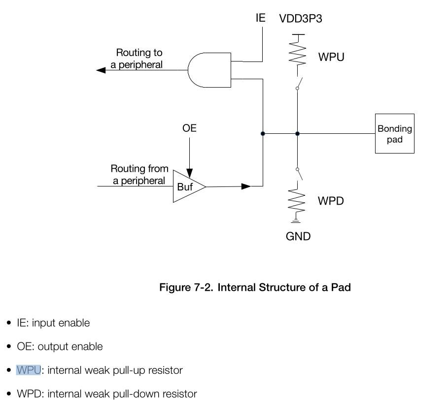

*[How big a pull-up resistor is needed to pull up an internally pulled-down GPIO (ESP32-C6)? - Electrical Engineering Stack Exchange](https://i.sstatic.net/Kszlb.png) · 搜索词：ESP32 GPIO input output circuit internal pull up pull down driver block diagram*

当程序执行：

```c
gpio_set_level(GPIO_NUM_1, 1);
```

驱动会配置相应输出路径，并让引脚输出高电平。

在 3.3V 逻辑系统中，高电平接近 3.3V，但实际电压取决于负载、电流和电气特性。

### 2. XIAO ESP32S3 引脚映射

普通版 XIAO ESP32S3 的部分引脚映射：

| XIAO 标识 | ESP32-S3 GPIO | 常见用途 |
| --- | --- | --- |
| D0 | GPIO1 | GPIO / ADC |
| D1 | GPIO2 | GPIO / ADC |
| D2 | GPIO3 | GPIO / ADC |
| D3 | GPIO4 | GPIO / ADC |
| D4 | GPIO5 | I2C SDA |
| D5 | GPIO6 | I2C SCL |
| D6 | GPIO43 | UART TX |
| D7 | GPIO44 | UART RX |
| D8 | GPIO7 | SPI SCK |
| D9 | GPIO8 | SPI MISO |
| D10 | GPIO9 | SPI MOSI |

板载 LED 使用 GPIO21，低电平点亮。

注意：引脚复用和实际可用性还要结合板卡修订版和正在使用的外设进行检查。

### 3. 实验：控制板载 LED

下面的代码使用 XIAO ESP32S3 板载 LED：

```c
#include "freertos/FreeRTOS.h"
#include "freertos/task.h"

#include "driver/gpio.h"
#include "esp_err.h"

#define LED_GPIO GPIO_NUM_21

void app_main(void)
{
    gpio_config_t config = {
        .pin_bit_mask = 1ULL << LED_GPIO,
        .mode = GPIO_MODE_OUTPUT,
        .pull_up_en = GPIO_PULLUP_DISABLE,
        .pull_down_en = GPIO_PULLDOWN_DISABLE,
        .intr_type = GPIO_INTR_DISABLE
    };

    ESP_ERROR_CHECK(gpio_config(&config));

    while (1) {
        // 板载 LED 低电平点亮
        ESP_ERROR_CHECK(
            gpio_set_level(LED_GPIO, 0)
        );

        vTaskDelay(pdMS_TO_TICKS(500));

        ESP_ERROR_CHECK(
            gpio_set_level(LED_GPIO, 1)
        );

        vTaskDelay(pdMS_TO_TICKS(500));
    }
}
```

这里最值得理解的不是闪烁，而是：

1. 配置 GPIO。
2. 配置输出模式。
3. 写入输出电平。
4. FreeRTOS 延时。
5. 重复执行。

这就是一个完整的驱动使用过程。

## 三、I2C 驱动：让 XIAO ESP32S3 与传感器通信

GPIO 主要处理简单的电平信号。

如果要连接温度传感器、加速度计、陀螺仪、RTC 时钟芯片、OLED 屏幕，就经常需要使用 I2C。

### 1. I2C 的工作原理

I2C 是一种双线串行通信协议。

它有两根主要信号线：

| 信号 | 名称 | 功能 |
| --- | --- | --- |
| SDA | Serial Data | 传输数据 |
| SCL | Serial Clock | 提供通信时钟 |

XIAO ESP32S3 普通版默认引脚：

- **D4** **GPIO5** **SDA**
- **D5** **GPIO6** **SCL**

*官方默认引脚映射；ESP32-S3 的 GPIO Matrix 允许重新分配，但必须避免引脚冲突。*

I2C 的通信结构：

**XIAO ESP32S3 主设备**

- **SDA 数据线**
- **SCL 时钟线**

↓

- **传感器 A** 地址 0x68
- **传感器 B** 地址 0x3C

这里的地址只是示例。

同一条 I2C 总线可以连接多个设备，只要设备地址不冲突，并且电气条件符合要求。

### 2. I2C 如何传输数据？

假设 ESP32-S3 想读取一个传感器的数据。

通信过程通常为：

1. 主设备发送 START。
2. 发送从设备地址。
3. 从设备返回 ACK。
4. 主设备发送寄存器地址。
5. 主设备发送重复 START。
6. 从设备返回数据。
7. 主设备发送 NACK 和 STOP。

> 图示：I2C protocol waveform start address ACK register read repeated start stop timing diagram

这里有三个重要概念：

- START：开始一次通信。
- ACK：接收方确认收到数据。
- STOP：结束一次通信。

### 3. ESP-IDF I2C 驱动开发

ESP-IDF 5.x/6.x 新版驱动使用：

```c
#include "driver/i2c_master.h"
```

下面建立一条 XIAO ESP32S3 的 I2C 主总线。

```c
#include "driver/i2c_master.h"
#include "esp_err.h"

#define I2C_SDA GPIO_NUM_5
#define I2C_SCL GPIO_NUM_6

static i2c_master_bus_handle_t bus_handle;

void i2c_init(void)
{
    i2c_master_bus_config_t bus_config = {
        .i2c_port = I2C_NUM_0,
        .sda_io_num = I2C_SDA,
        .scl_io_num = I2C_SCL,
        .clk_source = I2C_CLK_SRC_DEFAULT,
        .glitch_ignore_cnt = 7,
        .flags.enable_internal_pullup = true
    };

    ESP_ERROR_CHECK(
        i2c_new_master_bus(
            &bus_config,
            &bus_handle
        )
    );
}
```

然后连接一个 I2C 设备。

例如，一个地址为 `0x68` 的传感器：

```c
static i2c_master_dev_handle_t sensor_handle;

void sensor_init(void)
{
    i2c_device_config_t dev_config = {
        .dev_addr_length = I2C_ADDR_BIT_LEN_7,
        .device_address = 0x68,
        .scl_speed_hz = 100000
    };

    ESP_ERROR_CHECK(
        i2c_master_bus_add_device(
            bus_handle,
            &dev_config,
            &sensor_handle
        )
    );
}
```

读取一个寄存器：

```c
uint8_t reg = 0x00;
uint8_t data = 0;

ESP_ERROR_CHECK(
    i2c_master_transmit_receive(
        sensor_handle,
        &reg,
        1,
        &data,
        1,
        1000
    )
);
```

注意：`0x68` 和 `0x00` 是演示值。真实传感器必须按照它的数据手册选择地址、寄存器和读取长度。

另外，I2C 总线需要上拉电阻。模块如果已经有上拉电阻，应检查并联后的总阻值；内部上拉通常不能替代可靠的外部上拉设计。ESP32-S3 的 I2C 新驱动采用总线和设备分别注册的模型。

### 4. I2C 实际可以做什么？

> 图示：SSD1306 0.96 inch OLED I2C display module

- **OLED 屏幕** 显示设备状态、菜单、数据

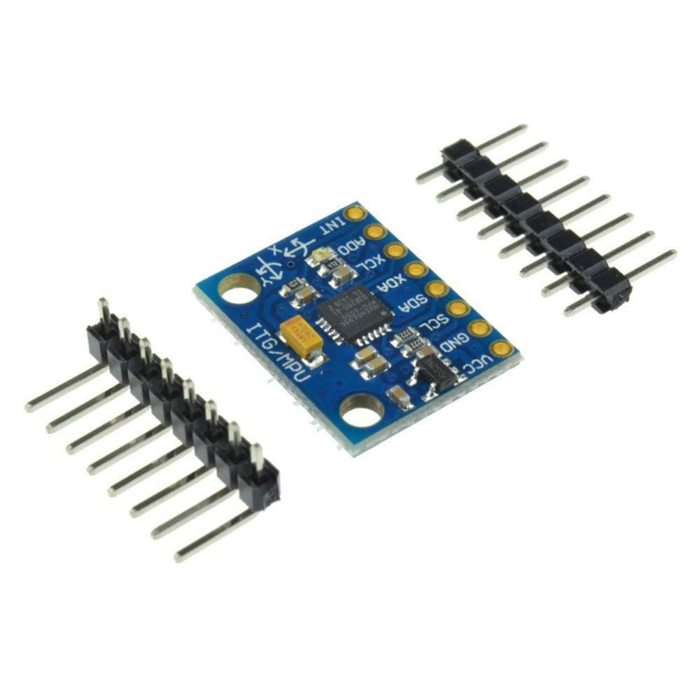

*[MPU-6050 3-Axis Accelerometer and Gyroscope Sensor Module](https://kitsguru.com/cdn/shop/products/MPU-6050Module_2048x2048.jpg?v=1736339365) · 搜索词：MPU6050 accelerometer gyroscope sensor module*

- **MPU6050** 加速度、角速度

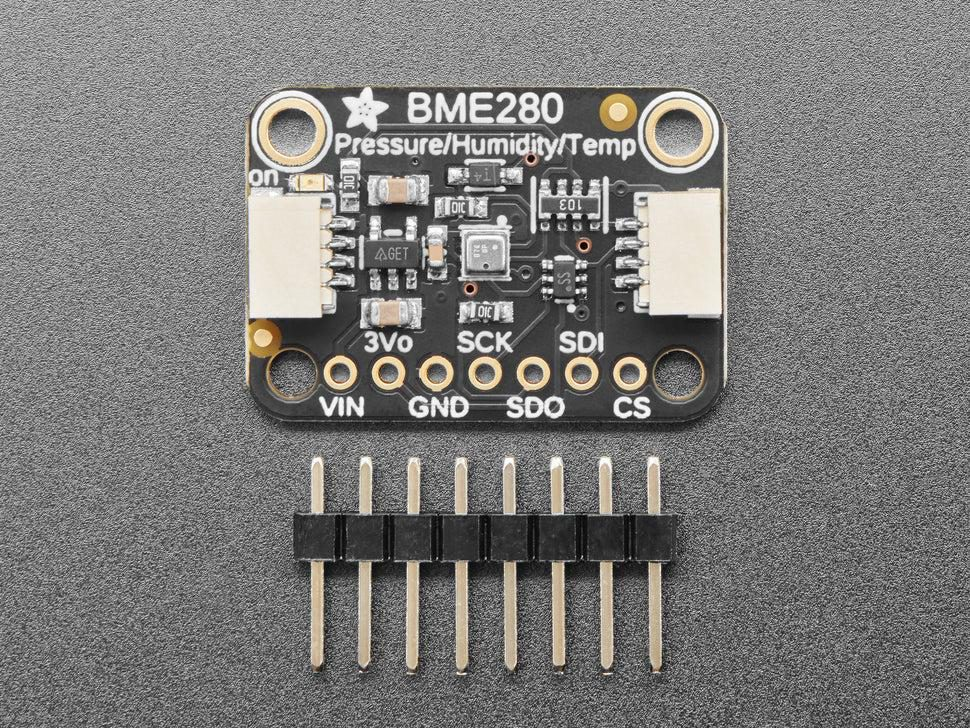

*[Adafruit BME280 Australia | I2C SPI Temperature Humidity Pressure STEMMA QT – Zaitronics](https://zaitronics.com.au/cdn/shop/files/2652-09.jpg?v=1763689332&width=1000) · 搜索词：BME280 temperature humidity pressure sensor module*

- **BME280** 温度、湿度、气压

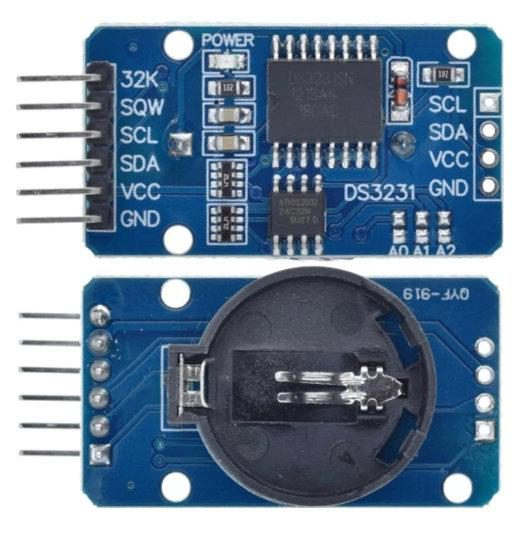

*[DS3231 Real Time Clock Module - Micro Robotics](https://www.robotics.org.za/image/catalog/generic/DS3231-MOD/DS3231-MOD-007.jpg) · 搜索词：DS3231 RTC real time clock module*

- **DS3231** 实时时钟

---

## 四、SPI 驱动：高速连接显示屏和存储设备

I2C 适合连接多个低速外设。

当需要高速传输大量数据时，SPI 通常更合适。

例如：

- TFT 显示屏。
- LCD 屏幕。
- 外部存储器。
- 高速 ADC。
- 某些传感器。

### 1. SPI 的工作原理

SPI 通常包含四条主要信号线：

| 信号 | 功能 |
| --- | --- |
| SCLK | 时钟 |
| MOSI | 主设备发送数据 |
| MISO | 主设备接收数据 |
| CS | 选择从设备 |

XIAO ESP32S3 的常用 SPI 引脚：

| XIAO 引脚 | ESP32-S3 GPIO | SPI |
| --- | --- | --- |
| D8 | GPIO7 | SCLK |
| D9 | GPIO8 | MISO |
| D10 | GPIO9 | MOSI |

> 图示：SPI communication master slave MOSI MISO SCLK CS wiring diagram

SPI 和 I2C 的主要区别：

| 对比 | I2C | SPI |
| --- | --- | --- |
| 信号线 | 2 根 | 通常 4 根 |
| 设备选择 | 地址 | CS 片选 |
| 速度 | 通常较低 | 通常较高 |
| 双向通信 | 半双工为主 | 可全双工 |
| 接线复杂度 | 较低 | 较高 |
| 常见应用 | 传感器 | 显示屏、存储器 |

### 2. ESP-IDF SPI 初始化

```c
#include "driver/spi_master.h"
#include "esp_err.h"

#define PIN_MOSI GPIO_NUM_9
#define PIN_MISO GPIO_NUM_8
#define PIN_SCLK GPIO_NUM_7
#define PIN_CS   GPIO_NUM_10

static spi_device_handle_t spi_handle;

void spi_init(void)
{
    spi_bus_config_t bus_config = {
        .mosi_io_num = PIN_MOSI,
        .miso_io_num = PIN_MISO,
        .sclk_io_num = PIN_SCLK,
        .quadwp_io_num = -1,
        .quadhd_io_num = -1,
        .max_transfer_sz = 4096
    };

    ESP_ERROR_CHECK(
        spi_bus_initialize(
            SPI2_HOST,
            &bus_config,
            SPI_DMA_CH_AUTO
        )
    );

    spi_device_interface_config_t dev_config = {
        .clock_speed_hz = 10 * 1000 * 1000,
        .mode = 0,
        .spics_io_num = PIN_CS,
        .queue_size = 4
    };

    ESP_ERROR_CHECK(
        spi_bus_add_device(
            SPI2_HOST,
            &dev_config,
            &spi_handle
        )
    );
}
```

发送数据：

```c
uint8_t data[] = {0xAA, 0x55};

spi_transaction_t transaction = {
    .length = sizeof(data) * 8,
    .tx_buffer = data
};

ESP_ERROR_CHECK(
    spi_device_transmit(
        spi_handle,
        &transaction
    )
);
```

这里 `length` 使用的是 bit，而不是 byte。

SPI 初始化包括配置总线、注册设备和提交事务。使用 DMA 时，发送和接收缓冲区必须满足相应的 DMA 内存要求。

### 3. SPI 实际应用

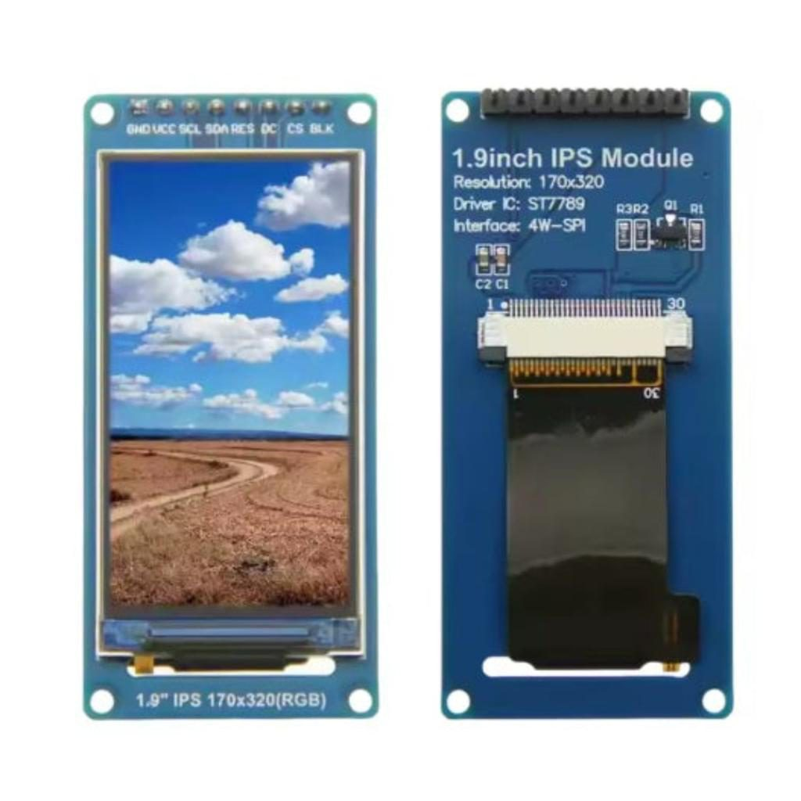

*[1.9吋 IPS TFT LCD 顯示屏 ST7789 SPI 高清模組](https://scccltd.com/cdn/shop/files/1-9-inch-ips-lcd-display-module-st7789-front-back.jpg?v=1764657049&width=1946) · 搜索词：ST7789 1.9 inch SPI TFT LCD display module*

- **TFT 显示屏** 菜单、状态、图形界面

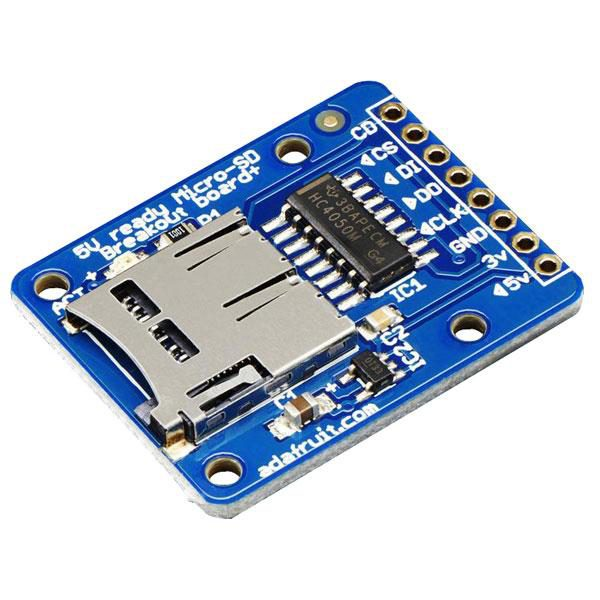

*[Adafruit 254 MicroSD Card Breakout Board | Rapid Electronics](https://static.rapidonline.com/catalogueimages/product/75/05/s75-0574p01wl.jpg) · 搜索词：micro SD card SPI breakout module*

- **MicroSD 卡** 日志、图片、数据记录

这里特别提醒：XIAO ESP32S3 的 D8、D9、D10 是常见 SPI 引脚，但某些扩展板或其他硬件版本可能已经占用这些资源。使用前要先检查原理图和引脚复用。

---

## 五、UART 驱动：让 XIAO ESP32S3 与其他设备进行串口通信

UART 是非常常见的串行通信方式。

它主要使用两根信号线：

- TX：发送数据。
- RX：接收数据。

UART 不需要像 SPI 一样使用独立时钟线，双方通过约定波特率进行通信。

### 1. UART 的通信原理

- **XIAO ESP32S3**
- **外部设备**

**TX → RX** 发送方向

**RX ← TX** 接收方向

*两个设备需要共地，并设置一致的波特率、数据位、校验位和停止位。*

XIAO ESP32S3 常用 UART 引脚：

| XIAO 引脚 | ESP32-S3 GPIO | 功能 |
| --- | --- | --- |
| D6 | GPIO43 | TX |
| D7 | GPIO44 | RX |

### 2. UART 的数据格式

常见配置为：

```text
115200 baud
8 data bits
No parity
1 stop bit
```

也就是常说的 115200、8N1。

每个字节通常需要传输：

- 1 个起始位；
- 8 个数据位；
- 1 个停止位。

因此，一个字节通常占用 10 个比特时间。

115200 波特率下，理论最大有效字节传输速度约为：

$\frac{115200}{10}=11520\text{ Bytes/s}$

这里还没有计算协议额外开销。

### 3. ESP-IDF UART 初始化

```c
#include "driver/uart.h"

#define UART_PORT UART_NUM_1
#define UART_TX GPIO_NUM_43
#define UART_RX GPIO_NUM_44

void uart_init(void)
{
    uart_config_t config = {
        .baud_rate = 115200,
        .data_bits = UART_DATA_8_BITS,
        .parity = UART_PARITY_DISABLE,
        .stop_bits = UART_STOP_BITS_1,
        .flow_ctrl = UART_HW_FLOWCTRL_DISABLE,
        .source_clk = UART_SCLK_DEFAULT
    };

    ESP_ERROR_CHECK(
        uart_driver_install(
            UART_PORT,
            2048,
            2048,
            0,
            NULL,
            0
        )
    );

    ESP_ERROR_CHECK(
        uart_param_config(
            UART_PORT,
            &config
        )
    );

    ESP_ERROR_CHECK(
        uart_set_pin(
            UART_PORT,
            UART_TX,
            UART_RX,
            UART_PIN_NO_CHANGE,
            UART_PIN_NO_CHANGE
        )
    );
}
```

发送数据：

```c
char message[] = "Hello XIAO ESP32S3\r\n";

uart_write_bytes(
    UART_PORT,
    message,
    sizeof(message) - 1
);
```

接收数据：

```c
uint8_t buffer[128];

int length = uart_read_bytes(
    UART_PORT,
    buffer,
    sizeof(buffer),
    pdMS_TO_TICKS(1000)
);

if (length > 0) {
    printf("Received %d bytes\n", length);
}
```

这里使用 UART1 作为外部通信示例，避免直接占用用于 USB 串口调试的接口。实际使用前要确认 USB CDC、UART0 和所选引脚之间的配置关系。

ESP-IDF UART 驱动还支持接收缓冲区、中断、事件队列和硬件流控。

### 4. UART 可以连接什么设备？

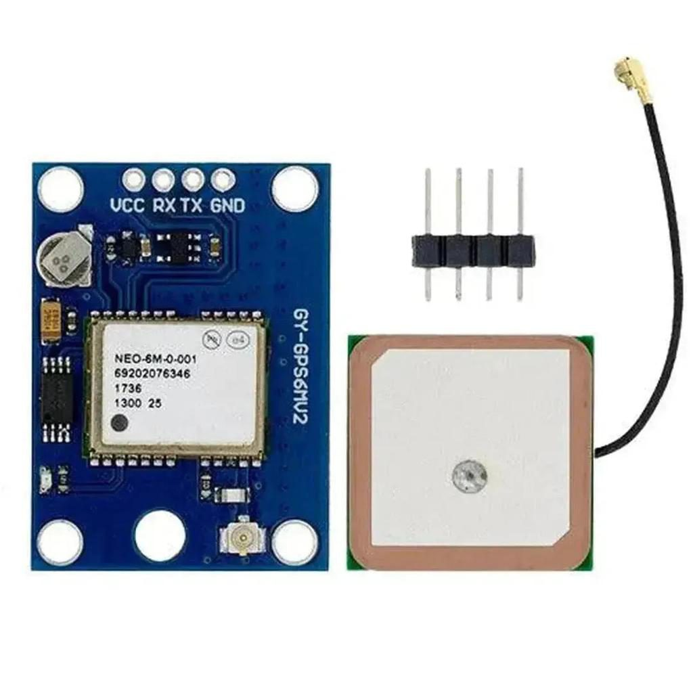

*[NEO-6M 3V-5V GPS-modul GY-NEO6MV2 Super Signal med antenn för Arduino – 38-3D](https://se.38-3d.co.uk/cdn/shop/files/GY-NEO6MV2-NEO-6M-GPS-Module.webp?v=1732525587) · 搜索词：GPS GNSS UART module NEO 6M*

- **GPS 模块** 获取位置、速度和时间

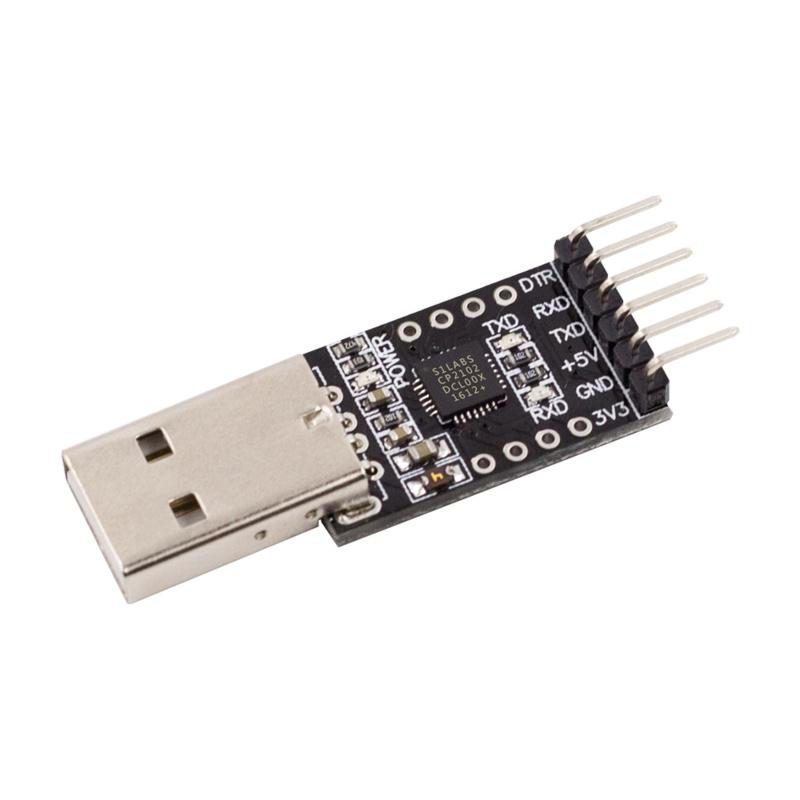

*[CP2102 USB to TTL Serial UART Bridge 3.3v-5v with DTR pin - OTRONIC](https://cdn.webshopapp.com/shops/346407/files/420564031/otronic-cp2102-usb-to-ttl-serial-uart-bridge-33v-5.jpg) · 搜索词：USB to TTL serial converter CP2102 module*

- **USB 转 TTL** 串口调试和数据通信

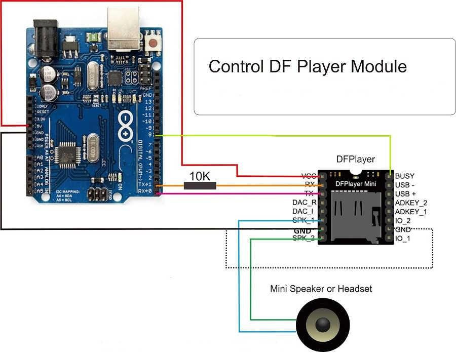

*[One moment, please...](https://voltatek.ca/img/cms/dfplayer_connections.jpg) · 搜索词：UART serial MP3 audio module DFPlayer Mini*

- **串口音频模块** 播放控制、状态反馈

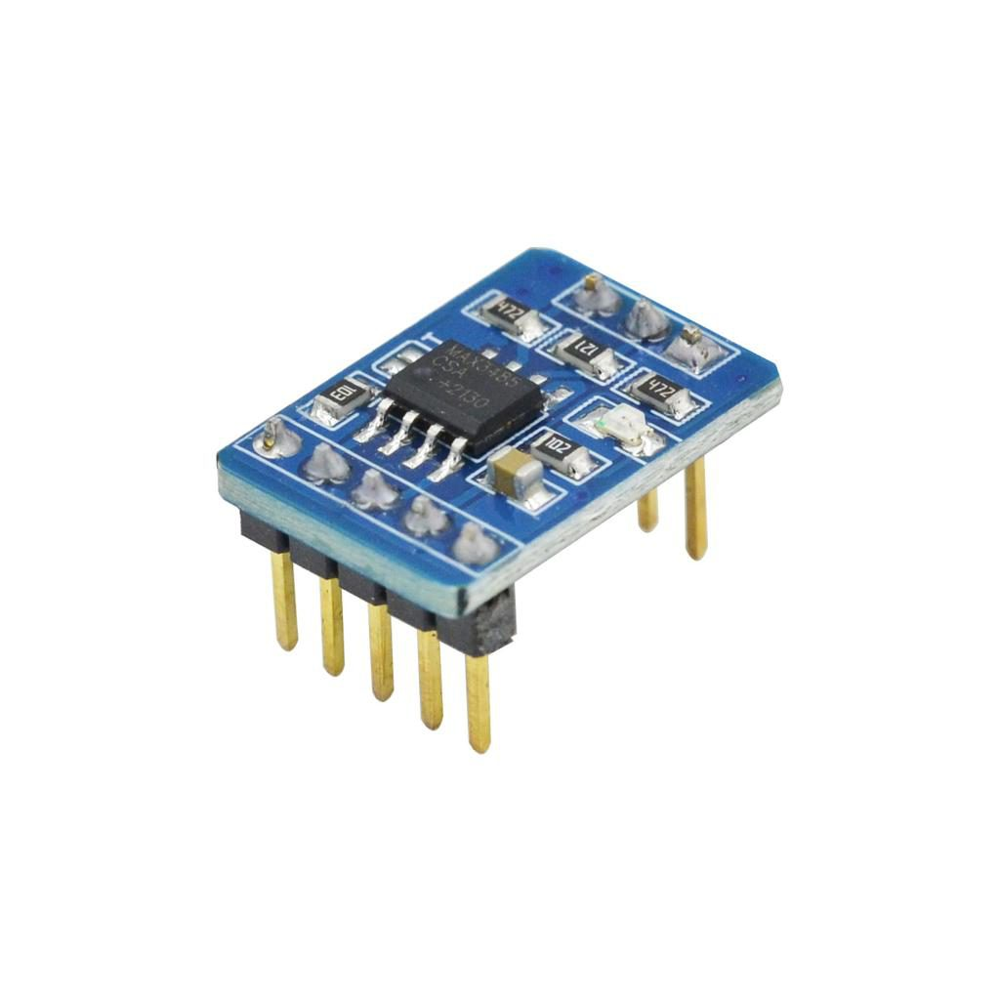

*[Modulo convertitore TTL a RS485 MAX3485 3.3V Arduino ESP32](https://sigmanortec.ro/3755/modulo-convertitore-ttl-a-rs485-max3485-33v.jpg) · 搜索词：UART RS485 MAX3485 transceiver module*

- **RS485 模块** 工业设备通信

注意：UART 是逻辑电平通信，不等于 RS232 或 RS485 电气接口。连接这些工业接口时需要相应的电平转换或收发器。

---

## 六、ADC 驱动：读取真实世界的模拟信号

GPIO 只能判断高低电平，而 ADC 可以测量模拟电压。

例如：

- 电池电压；
- 光敏电阻；
- 模拟温度传感器；
- 电位器；
- 压力传感器。

### 1. ADC 的工作原理

**模拟传感器** 输出连续变化的电压

↓

**ADC 模数转换器** 采样、量化、编码

↓

**数字采样值** 交给 CPU 计算

例如，12 位 ADC 的理论数字范围：

$0\sim 4095$

如果理想参考范围是 0～3.3V：

$V=\frac{4095}\times3.3$

但真实 ESP32-S3 ADC 有非线性和校准要求，实际电压应使用官方 ADC 校准驱动处理。

### 2. ESP-IDF ADC 示例

这里使用 GPIO1，也就是 XIAO D0。

```c
#include "esp_adc/adc_oneshot.h"
#include "esp_adc/adc_cali.h"
#include "esp_adc/adc_cali_scheme.h"

#define ADC_CHANNEL ADC_CHANNEL_0

static adc_oneshot_unit_handle_t adc_handle;

void adc_init(void)
{
    adc_oneshot_unit_init_cfg_t unit_config = {
        .unit_id = ADC_UNIT_1
    };

    ESP_ERROR_CHECK(
        adc_oneshot_new_unit(
            &unit_config,
            &adc_handle
        )
    );

    adc_oneshot_chan_cfg_t channel_config = {
        .bitwidth = ADC_BITWIDTH_DEFAULT,
        .atten = ADC_ATTEN_DB_12
    };

    ESP_ERROR_CHECK(
        adc_oneshot_config_channel(
            adc_handle,
            ADC_CHANNEL,
            &channel_config
        )
    );
}

int adc_read(void)
{
    int raw = 0;

    ESP_ERROR_CHECK(
        adc_oneshot_read(
            adc_handle,
            ADC_CHANNEL,
            &raw
        )
    );

    return raw;
}
```

这里使用 ADC1 通道 0 对应 GPIO1。ADC 通道和衰减配置应以 ESP-IDF 当前版本及芯片规格为准。

### 3. ADC 实际应用

例如检测电池电量：

```text
电池
  ↓
电阻分压
  ↓
ADC
  ↓
ESP32-S3
  ↓
电压计算
  ↓
电池状态显示
```

如果电池电压高于 ADC 输入允许范围，必须先使用分压或合适的调理电路。

---

## 七、PWM 驱动：用数字信号控制模拟效果

PWM 是 Pulse Width Modulation，即脉宽调制。

它不是直接产生任意模拟电压，而是通过改变数字脉冲的占空比，控制负载获得的平均能量。

### 1. PWM 的三个关键参数

| 参数 | 含义 |
| --- | --- |
| 频率 | 每秒重复多少个周期 |
| 周期 | 一个完整波形持续时间 |
| 占空比 | 高电平时间占周期的比例 |

例如：

$D=\frac{T_{on}}{T}\times100\%$

如果占空比为 50%，表示一个周期内一半时间输出高电平。

### 2. XIAO ESP32S3 的应用

PWM 可以用于：

- LED 调光；
- 蜂鸣器发声；
- 电机驱动；
- 舵机控制；
- 其他需要周期脉冲的设备。

ESP-IDF 使用 LEDC 驱动：

```c
#include "driver/ledc.h"

void pwm_init(void)
{
    ledc_timer_config_t timer = {
        .speed_mode = LEDC_LOW_SPEED_MODE,
        .duty_resolution = LEDC_TIMER_10_BIT,
        .timer_num = LEDC_TIMER_0,
        .freq_hz = 1000,
        .clk_cfg = LEDC_AUTO_CLK
    };

    ESP_ERROR_CHECK(
        ledc_timer_config(&timer)
    );

    ledc_channel_config_t channel = {
        .gpio_num = GPIO_NUM_1,
        .speed_mode = LEDC_LOW_SPEED_MODE,
        .channel = LEDC_CHANNEL_0,
        .timer_sel = LEDC_TIMER_0,
        .duty = 512,
        .hpoint = 0
    };

    ESP_ERROR_CHECK(
        ledc_channel_config(&channel)
    );
}
```

修改占空比：

```c
ledc_set_duty(
    LEDC_LOW_SPEED_MODE,
    LEDC_CHANNEL_0,
    800
);

ledc_update_duty(
    LEDC_LOW_SPEED_MODE,
    LEDC_CHANNEL_0
);
```

10 位分辨率下，占空比范围是 0～1023。

---

## 八、把所有驱动组合起来

现在你已经接触了：

- GPIO
- I2C
- SPI
- UART
- ADC
- PWM

这些不是孤立的技术，而是可以组合成完整产品的基础模块。

例如，一个 XIAO ESP32S3 智能控制器：

**XIAO ESP32S3** 主控芯片

- **I2C** **温湿度传感器** 采集环境数据
- **SPI** **TFT 显示屏** 显示运行状态
- **UART** **外部模块** 数据交换
- **ADC** **模拟传感器** 电压采集
- **GPIO** **功能按键** 用户操作
- **LEDC** **PWM 输出** LED 或电机控制

这就是实际产品中常见的硬件驱动组合。

## 九、为什么要建立自己的 XIAO ESP32S3 BSP？

这是本课最重要的工程设计内容。

BSP 是 Board Support Package，即板级支持包。

它的作用是把一块开发板的硬件特征统一管理起来。

例如，不应该在每个工程里都重复写：

```c
#define LED_GPIO 21
#define I2C_SDA 5
#define I2C_SCL 6
#define UART_TX 43
#define UART_RX 44
```

而应该建立统一的板级配置。

### 1. 推荐的 BSP 目录

```text
XIAO-ESP32S3-Projects/
│
├── components/
│   └── xiao_esp32s3_bsp/
│       ├── CMakeLists.txt
│       ├── include/
│       │   ├── xiao_board.h
│       │   ├── xiao_pins.h
│       │   └── xiao_config.h
│       │
│       └── src/
│           ├── xiao_board.c
│           ├── xiao_gpio.c
│           ├── xiao_i2c.c
│           ├── xiao_spi.c
│           ├── xiao_uart.c
│           ├── xiao_adc.c
│           └── xiao_pwm.c
│
├── main/
│   └── app_main.c
│
└── docs/
    ├── pinout.md
    ├── driver_architecture.md
    └── hardware_constraints.md
```

### 2. 统一引脚定义

例如 `xiao_pins.h`：

```c
#pragma once

#include "driver/gpio.h"

// XIAO ESP32S3 普通版

#define XIAO_LED_GPIO GPIO_NUM_21

#define XIAO_D0 GPIO_NUM_1
#define XIAO_D1 GPIO_NUM_2
#define XIAO_D2 GPIO_NUM_3
#define XIAO_D3 GPIO_NUM_4

#define XIAO_I2C_SDA GPIO_NUM_5
#define XIAO_I2C_SCL GPIO_NUM_6

#define XIAO_UART_TX GPIO_NUM_43
#define XIAO_UART_RX GPIO_NUM_44

#define XIAO_SPI_SCK GPIO_NUM_7
#define XIAO_SPI_MISO GPIO_NUM_8
#define XIAO_SPI_MOSI GPIO_NUM_9
```

这只是初始映射。正式 BSP 还应该包含引脚冲突检查、板卡修订版、外设占用记录和接口配置，不能把所有功能同时默认启用。

### 3. BSP 的实际价值

以后开发一个新的项目：

```text
新项目
  ↓
调用 XIAO BSP
  ↓
初始化 GPIO
  ↓
初始化 I2C
  ↓
初始化 SPI
  ↓
初始化 UART
  ↓
开始业务开发
```

这样每个项目就不需要重新开发底层硬件驱动。

对于你正在整理的 GitHub 项目库，BSP 还可以作为兼容性适配层：把第三方项目的引脚定义、驱动接口和硬件配置转换成统一规范。

---

## 十、驱动开发中最容易犯的错误

以下问题在实际项目中非常常见。

| 问题 | 原因 | 解决办法 |
| --- | --- | --- |
| I2C 找不到设备 | 地址、上拉或接线错误 | 检查地址和逻辑分析仪波形 |
| SPI 屏幕无显示 | SPI 模式、CS、DC 配置错误 | 对照屏幕数据手册 |
| UART 接收乱码 | 波特率或电平不一致 | 检查串口参数和共地 |
| ADC 电压不准确 | 非线性、衰减和校准问题 | 使用 ADC 校准驱动 |
| PWM 不工作 | LEDC 通道、定时器或引脚冲突 | 检查 LEDC 配置 |
| GPIO 无响应 | 引脚被其他功能占用 | 检查 GPIO Matrix 和板卡原理图 |
| DMA 传输失败 | 内存位置或对齐不符合要求 | 使用合适的 DMA 缓冲区 |

特别注意：

**XIAO ESP32S3 的引脚资源有限，同一个 GPIO 不应该同时分配给多个互相冲突的外设。**

官方普通版引脚资料：

[Seeed Studio XIAO ESP32S3 官方引脚说明](https://wiki.seeedstudio.com/xiao_esp32s3_getting_started/)

---

## 十一、本课实践：建立自己的驱动实验工程

建议不要一次写一个很大的综合程序，而是建立独立实验。

**XIAO ESP32S3 驱动实践清单**/

- [ ] **GPIO 实验** 板载 LED 闪烁、外接按键输入。

- [ ] **I2C 实验** 连接 OLED 或温度传感器，完成读写。

- [ ] **SPI 实验** 连接 SPI 屏幕或测试 SPI 数据传输。

- [ ] **UART 实验** 与 USB-TTL 模块进行双向数据通信。

- [ ] **ADC 实验** 使用电位器测试模拟电压采集。

- [ ] **PWM 实验** 使用 PWM 控制外接 LED 亮度。

- [ ] **BSP 实验** 把上述驱动统一封装成板级支持组件。

## 十二、如何让 Codex 帮你开发驱动？

建议在 Codex Desktop 中建立一个独立任务：

**Codex 驱动开发任务**

**复制**

请在 `XIAO-ESP32S3-Projects` 中建立普通版 XIAO ESP32S3 专用 ESP-IDF BSP。

要求：

- GPIO、I2C、SPI、UART、ADC、LEDC 六类驱动。
- 每个驱动独立组件和测试示例。
- 统一引脚配置和冲突检查。
- 使用当前 ESP-IDF 版本的 API。
- 提供 CMake 配置、README 和硬件接线表。
- 执行静态检查与编译验证。
- 不自动烧录开发板。
- 不混入 Sense 专属外设配置。

---

## 十三、下一课：FreeRTOS 深入原理

你现在已经掌握了 CPU、寄存器、中断、时钟、内存和基础外设驱动。

下一课开始研究如何让多个硬件功能协同运行。

**第六课：FreeRTOS 深入原理**

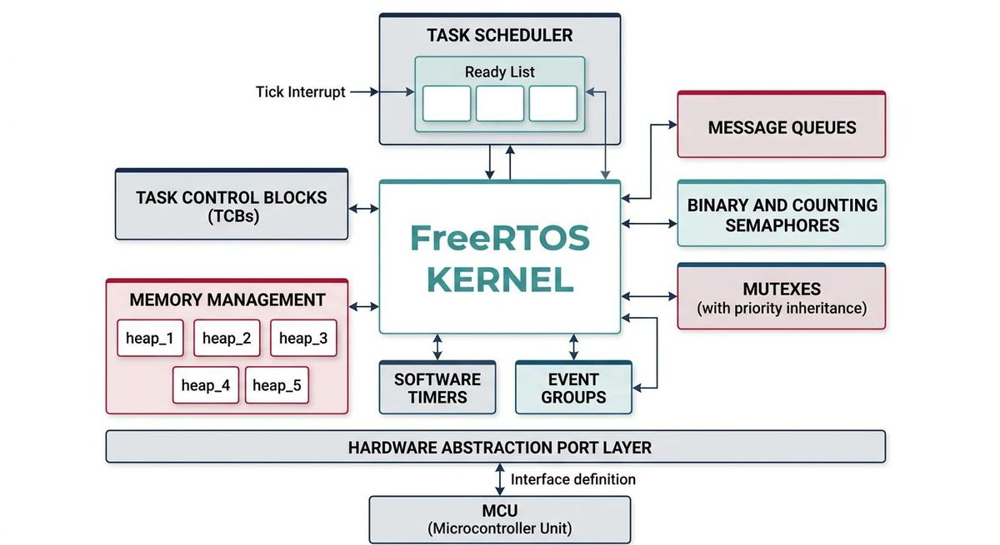

*[Embedded Systems Series Part 3: RTOS Fundamentals (FreeRTOS/Zephyr) - Wasil Zafar](https://www.wasilzafar.com/images/series/embedded-systems/freertos-architecture-kernel-components.webp) · 搜索词：FreeRTOS task scheduler queues semaphore embedded operating system architecture diagram*

主要学习：

1. 什么是实时操作系统 RTOS？
2. FreeRTOS 任务和任务调度器。
3. 任务优先级与时间片。
4. Queue 队列和任务间通信。
5. Semaphore 信号量和 Mutex 互斥锁。
6. Event Group 事件组。
7. 软件定时器。
8. 双核任务调度和 CPU 亲和性。
9. 如何设计 XIAO ESP32S3 多任务固件。

**下一课的核心目标：** 让你能够将 GPIO、传感器、Wi-Fi、显示屏和其他外设分别设计成独立任务，再通过 FreeRTOS 组织成一个完整的嵌入式系统。

官方资料：

- [GPIO 驱动](https://docs.espressif.com/projects/esp-idf/en/stable/esp32s3/api-reference/peripherals/gpio.html)
- [I2C 驱动](https://docs.espressif.com/projects/esp-idf/en/stable/esp32s3/api-reference/peripherals/i2c.html)
- [SPI 驱动](https://docs.espressif.com/projects/esp-idf/en/stable/esp32s3/api-reference/peripherals/spi_master.html)
- [UART 驱动](https://docs.espressif.com/projects/esp-idf/en/stable/esp32s3/api-reference/peripherals/uart.html)
- [ADC 驱动](https://docs.espressif.com/projects/esp-idf/en/stable/esp32s3/api-reference/peripherals/adc_oneshot.html)
