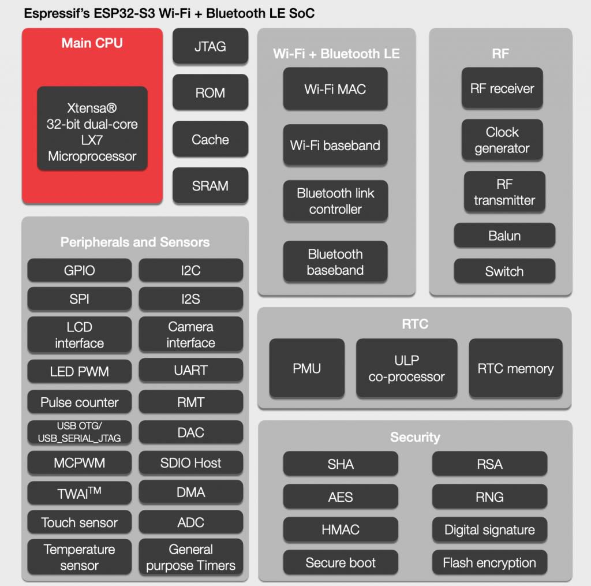

# 第六课：FreeRTOS 深入原理——让 XIAO ESP32S3 同时执行多个任务

前面我们已经学习了 CPU、寄存器、中断、时钟、内存以及 GPIO、I2C、SPI、UART 等驱动。

现在进入嵌入式系统开发的核心：**实时操作系统（RTOS）**。

本课主要解决一个问题：

假设你的 XIAO ESP32S3 需要同时完成以下工作：

- 按键检测
- LED 控制
- Wi-Fi 网络连接
- 传感器数据采集
- OLED 屏幕刷新
- 数据上传
- 系统状态监控

如何让这些功能相互独立，又能协调运行？

答案就是 FreeRTOS。

## 一、什么是 FreeRTOS？

FreeRTOS 是一个面向嵌入式设备的实时操作系统。

ESP-IDF 已经集成 FreeRTOS，不需要你单独安装。

它的核心作用是：

1. 管理多个任务。
2. 分配 CPU 执行时间。
3. 管理任务优先级。
4. 实现任务之间的通信。
5. 协调多个任务访问共享资源。
6. 提供定时器和同步机制。

可以把它理解为一位 CPU 调度管理员。

**ESP32-S3 CPU** Core 0 + Core 1

↓

**FreeRTOS Scheduler** 任务调度器

- **Task A** 按键检测
- **Task B** 传感器采集
- **Task C** Wi-Fi 通信
- **Task D** 屏幕刷新

需要注意：多任务不等于所有任务真的同时执行。单个 CPU 核心在某一时刻通常执行一个任务，调度器通过切换任务实现并发；ESP32-S3 的两个核心则可以真正并行执行不同任务。

---

## 二、任务 Task 的工作原理

FreeRTOS 中最基本的单位就是 Task。

一个 Task 可以理解为一个独立的程序执行流程。

例如：

```c
void led_task(void *arg)
{
    while (1) {
        // 控制 LED

        vTaskDelay(pdMS_TO_TICKS(500));
    }
}
```

它与普通 C 函数有一个重要区别：

普通函数执行结束就返回，而一个长期运行的 FreeRTOS 任务通常会持续运行，直到被删除。

### 1. 创建任务

```c
xTaskCreate(
    led_task,
    "led_task",
    2048,
    NULL,
    5,
    NULL
);
```

每个参数的含义：

| 参数 | 含义 |
| --- | --- |
| `led_task` | 任务函数 |
| `"led_task"` | 任务名称 |
| `2048` | 任务栈大小，ESP-IDF 中单位为字节 |
| `NULL` | 传给任务的参数 |
| `5` | 任务优先级 |
| `NULL` | 不保存任务句柄 |

任务创建成功后，调度器会在合适的时候运行它。

### 2. 任务的五种状态

- **Running** 正在执行
- **Ready** 准备执行
- **Blocked** 等待事件或延时
- **Suspended** 被挂起
- **Deleted** 已删除

*Deleted 是任务生命周期结束后的状态概念，不是与 Running、Ready 完全对等的调度状态。*

例如：

```c
vTaskDelay(pdMS_TO_TICKS(1000));
```

执行这一行后，当前任务会进入 Blocked 状态，等待 1 秒左右。

这段时间 CPU 可以执行其他 Ready 任务。

**这就是多任务系统能够提高 CPU 利用率的原因。**

## 三、任务优先级：CPU 应该先执行谁？

FreeRTOS 使用优先级决定任务的执行顺序。

通常情况下：

**优先级高的 Ready 任务，会优先于优先级低的 Ready 任务执行。**

例如：

| 任务 | 优先级 | 功能 |
| --- | --- | --- |
| 按键任务 | 5 | 处理用户操作 |
| 传感器任务 | 4 | 采集传感器 |
| 网络任务 | 3 | 上传数据 |
| 显示任务 | 2 | 刷新 OLED |
| 状态监控 | 1 | 统计系统信息 |

注意，优先级数字越大，优先级越高。

### 1. 高优先级任务如何抢占低优先级任务？

假设：

- Task A 优先级为 3。
- Task B 优先级为 5。

Task A 正在执行时，如果 Task B 变成 Ready 状态，调度器通常会让 Task B 抢占 Task A。

当 Task B 阻塞或主动让出 CPU 后，Task A 才可能继续运行。

### 2. 时间片调度

如果两个任务：

- 优先级相同；
- 都处于 Ready 状态；
- 没有被其他因素限制；

FreeRTOS 可以通过时间片轮转让它们共享 CPU 时间。

例如：

**单核时间片示意**

**Task A**

**Task B**

**Task A**

**Task B**

*概念示意。实际任务切换取决于优先级、阻塞、抢占及调度配置。*

### 3. 为什么不能把所有任务都设置为最高优先级？

假设显示任务、传感器任务、网络任务全部使用最高优先级。

如果其中某个任务一直不阻塞，也不主动让出 CPU，那么其他任务可能长期无法运行。

这可能造成：

- 按键响应延迟；
- Wi-Fi 处理受影响；
- 系统任务无法及时执行；
- 看门狗超时；
- 系统卡死。

因此，优先级设计应该根据任务的实时性要求决定，而不是越高越好。

---

## 四、Queue 队列：任务之间如何交换数据？

这是 FreeRTOS 最常用的通信机制之一。

假设：

一个任务负责读取温度，另一个任务负责显示温度。

它们不应该直接随意访问对方的局部变量。

可以使用 Queue。

### 1. 队列的工作原理

**Sensor Task** 采集温度数据：25.6℃

↓

**FreeRTOS Queue**

按照队列规则保存待处理数据

↓

**Display Task** 读取温度并刷新屏幕

Queue 可以实现：

- 一个任务向另一个任务发送数据；
- 多个任务向一个任务发送数据；
- 任务等待数据到达；
- 数据按照队列规则进行传递。

### 2. 实际代码：温度采集与显示任务

首先定义队列：

```c
#include "freertos/FreeRTOS.h"
#include "freertos/queue.h"
#include "freertos/task.h"

static QueueHandle_t temperature_queue;
```

创建温度采集任务：

```c
void sensor_task(void *arg)
{
    float temperature = 25.0f;

    while (1) {

        // 这里暂时模拟传感器读数
        temperature += 0.1f;

        xQueueOverwrite(
            temperature_queue,
            &temperature
        );

        vTaskDelay(pdMS_TO_TICKS(1000));
    }
}
```

创建显示任务：

```c
void display_task(void *arg)
{
    float temperature;

    while (1) {

        if (xQueueReceive(
                temperature_queue,
                &temperature,
                portMAX_DELAY
            ) == pdPASS) {

            printf(
                "Temperature: %.2f C\n",
                temperature
            );
        }
    }
}
```

在 `app_main()` 中创建队列和任务：

```c
void app_main(void)
{
    temperature_queue = xQueueCreate(
        1,
        sizeof(float)
    );

    configASSERT(temperature_queue != NULL);

    xTaskCreate(
        sensor_task,
        "sensor_task",
        3072,
        NULL,
        4,
        NULL
    );

    xTaskCreate(
        display_task,
        "display_task",
        3072,
        NULL,
        3,
        NULL
    );
}
```

这里有一个知识点：

`xQueueOverwrite()` 适用于长度为 1 的队列，它会覆盖旧数据，保留最新值。

这适合温度、湿度等只关心最新状态的数据。

如果你需要完整记录每一次采样，就应该使用普通队列，并设计队列满时的处理策略。

---

## 五、Semaphore 信号量：如何同步任务？

Semaphore 中文叫信号量。

它主要解决一个问题：

**一个任务完成某件事情后，如何通知另一个任务？**

例如：

- 按键发生中断；
- GPIO 检测到信号；
- 传感器完成采样；
- 某个外设完成数据传输。

### 1. 二值信号量

二值信号量只有两种状态：

- 可用；
- 不可用。

可以把它理解为一个通知开关。

**GPIO 中断发生**

↓

**释放 Binary Semaphore**

↓

**任务被唤醒** 执行按键业务逻辑

### 2. 示例代码

创建信号量：

```c
static SemaphoreHandle_t button_sem;

void app_main(void)
{
    button_sem = xSemaphoreCreateBinary();

    configASSERT(button_sem != NULL);

    xTaskCreate(
        button_task,
        "button_task",
        3072,
        NULL,
        5,
        NULL
    );
}
```

任务等待信号量：

```c
void button_task(void *arg)
{
    while (1) {

        if (xSemaphoreTake(
                button_sem,
                portMAX_DELAY
            ) == pdTRUE) {

            printf("Button event!\n");
        }
    }
}
```

在中断中释放信号量：

```c
static void IRAM_ATTR button_isr(void *arg)
{
    BaseType_t higher_priority_task_woken = pdFALSE;

    xSemaphoreGiveFromISR(
        button_sem,
        &higher_priority_task_woken
    );

    if (higher_priority_task_woken) {
        portYIELD_FROM_ISR();
    }
}
```

这里必须记住：

- 普通任务使用 `xSemaphoreGive()`。
- ISR 中使用 `xSemaphoreGiveFromISR()`。
- ISR 不能调用会阻塞的普通 FreeRTOS API。

二值信号量适合通知事件，但它不适合保存大量事件数据。如果需要记录每次按键事件，可以考虑队列或任务通知计数。

---

## 六、Mutex 互斥锁：防止多个任务同时操作同一个资源

现在假设你有两个任务：

- Task A 要向 OLED 写入数据。
- Task B 也要向 OLED 写入数据。

如果两个任务同时操作屏幕，可能出现显示内容混乱。

这就需要 Mutex。

### 1. Mutex 的工作原理

- **Task A**
- **Task B**

↓

**Mutex 锁** 同一时刻只有一个任务持有锁

↓

**OLED 屏幕** 共享硬件资源

### 2. 代码示例

```c
static SemaphoreHandle_t oled_mutex;

void app_main(void)
{
    oled_mutex = xSemaphoreCreateMutex();

    configASSERT(oled_mutex != NULL);
}
```

任务访问屏幕：

```c
void oled_update(void)
{
    if (xSemaphoreTake(
            oled_mutex,
            pdMS_TO_TICKS(1000)
        ) == pdTRUE) {

        // OLED 写入操作

        xSemaphoreGive(oled_mutex);
    }
}
```

Mutex 与 Binary Semaphore 的区别：

| 比较 | Binary Semaphore | Mutex |
| --- | --- | --- |
| 主要用途 | 事件通知、同步 | 保护共享资源 |
| 所有权 | 没有任务所有权 | 有持有者 |
| 优先级继承 | 不提供 | 支持 |
| ISR 中释放 | 可以使用专用 API | 不允许 |
| 典型应用 | 中断通知 | I2C 总线共享 |

Mutex 必须由获得锁的任务释放。

不要在持有 Mutex 时执行很长时间的阻塞操作，否则其他任务可能长期等待。

---

## 七、Event Group 事件组：多个条件如何协调？

在实际产品中，经常会出现多个条件必须同时满足才能执行某个功能的情况。

例如：

设备只有在以下条件全部满足后，才允许开始工作：

- Wi-Fi 已连接；
- 传感器初始化成功；
- 配置文件已经加载；
- 用户完成设备启动确认。

这时可以使用 Event Group。

### 1. 工作原理

Event Group 使用多个 bit 表示不同事件。

例如：

| Bit | 含义 |
| --- | --- |
| Bit 0 | Wi-Fi 已连接 |
| Bit 1 | 传感器初始化完成 |
| Bit 2 | 配置加载完成 |
| Bit 3 | 用户确认启动 |

**事件状态示意**

*当四个事件全部完成时，系统才允许进入运行状态。*

### 2. 示例代码

创建事件组：

```c
static EventGroupHandle_t system_events;

#define WIFI_READY_BIT     BIT0
#define SENSOR_READY_BIT   BIT1
#define CONFIG_READY_BIT   BIT2
#define USER_READY_BIT     BIT3

void app_main(void)
{
    system_events = xEventGroupCreate();

    configASSERT(system_events != NULL);
}
```

各个任务设置事件：

```c
// Wi-Fi 连接成功
xEventGroupSetBits(
    system_events,
    WIFI_READY_BIT
);

// 传感器初始化完成
xEventGroupSetBits(
    system_events,
    SENSOR_READY_BIT
);

// 配置读取完成
xEventGroupSetBits(
    system_events,
    CONFIG_READY_BIT
);
```

等待所有条件：

```c
EventBits_t bits = xEventGroupWaitBits(
    system_events,
    WIFI_READY_BIT |
    SENSOR_READY_BIT |
    CONFIG_READY_BIT |
    USER_READY_BIT,
    pdFALSE,
    pdTRUE,
    portMAX_DELAY
);
```

其中 `pdTRUE` 表示需要等待所有指定事件，而不是只等待其中一个。

Event Group 特别适合系统初始化、联网状态管理和多个任务之间的条件同步。

---

## 八、Software Timer：软件定时器

前面我们学习了 GPTimer，它是硬件定时器。

FreeRTOS 还提供软件定时器。

两者的区别：

| 比较 | GPTimer | FreeRTOS Software Timer |
| --- | --- | --- |
| 实现 | 硬件定时器 | 定时器服务任务 |
| 精度 | 取决于硬件时钟 | 受调度影响 |
| 用途 | 精确计时、周期采样 | 周期业务、状态检查 |
| 回调执行环境 | 中断上下文 | Timer Service Task |

### 1. 软件定时器示例

```c
#include "freertos/FreeRTOS.h"
#include "freertos/timers.h"

static TimerHandle_t status_timer;

static void status_timer_callback(TimerHandle_t timer)
{
    printf("System status check\n");
}

void app_main(void)
{
    status_timer = xTimerCreate(
        "status_timer",
        pdMS_TO_TICKS(1000),
        pdTRUE,
        NULL,
        status_timer_callback
    );

    configASSERT(status_timer != NULL);

    xTimerStart(status_timer, 0);
}
```

这里：

- `1000ms` 是定时周期；
- `pdTRUE` 表示周期性定时器；
- `status_timer_callback` 是超时回调。

要注意，软件定时器回调运行在 Timer Service Task 中，不应该执行耗时操作、长时间阻塞或等待其他任务。它更适合发通知、更新状态和安排后续工作。

---

## 九、ESP32-S3 双核调度原理

这是 XIAO ESP32S3 与很多单核微控制器的重要区别。

ESP32-S3 有两个 Xtensa LX7 CPU 核心。

ESP-IDF 的 FreeRTOS 支持双核 SMP 调度。

SMP 是 Symmetric Multiprocessing，即对称多处理。

### 1. 双核如何运行？

假设你有四个任务：

| 任务 | 功能 |
| --- | --- |
| Task A | 按键检测 |
| Task B | 传感器采集 |
| Task C | Wi-Fi 业务 |
| Task D | 数据处理 |

两个核心可以分别运行不同任务：

- **CPU Core 0** --- **Task A** 按键检测 --- **Task C** 应用网络处理
- **CPU Core 1** --- **Task B** 传感器采集 --- **Task D** 数据处理

*仅为一种任务划分示意。实际系统任务分布取决于核心亲和性、优先级和系统配置，Wi-Fi 驱动等系统任务也会占用 CPU。*

### 2. 如何指定任务运行在哪个核心？

ESP-IDF 提供：

```c
xTaskCreatePinnedToCore()
```

示例：

```c
void sensor_task(void *arg)
{
    while (1) {
        printf("Sensor task\n");

        vTaskDelay(pdMS_TO_TICKS(1000));
    }
}

void display_task(void *arg)
{
    while (1) {
        printf("Display task\n");

        vTaskDelay(pdMS_TO_TICKS(500));
    }
}

void app_main(void)
{
    xTaskCreatePinnedToCore(
        sensor_task,
        "sensor_task",
        3072,
        NULL,
        4,
        NULL,
        1
    );

    xTaskCreatePinnedToCore(
        display_task,
        "display_task",
        3072,
        NULL,
        3,
        NULL,
        0
    );
}
```

最后一个参数：

- `0`：固定在 Core 0。
- `1`：固定在 Core 1。
- `tskNO_AFFINITY`：不固定核心，允许调度器安排。

**重要：双核不等于速度自动翻倍。**

如果两个任务共享同一 I2C 总线、同一个全局变量或者同一个屏幕，就需要同步机制。

另外，盲目指定核心可能降低系统效率。正式项目应先分析任务执行时间、阻塞时间、优先级和系统任务分布，再决定是否固定核心。

---

## 十、任务通知：轻量级任务通信

除了 Queue 和 Semaphore，FreeRTOS 还有一个非常实用的功能：

Task Notification。

它可以让一个任务直接向另一个任务发送通知。

例如：

- GPIO 中断通知按键任务；
- DMA 完成通知数据处理任务；
- 网络任务通知应用任务；
- 传感器采集任务通知显示任务。

### 1. 示例

任务句柄：

```c
static TaskHandle_t sensor_task_handle;
```

任务创建：

```c
xTaskCreate(
    sensor_task,
    "sensor_task",
    3072,
    NULL,
    4,
    &sensor_task_handle
);
```

发送通知：

```c
xTaskNotifyGive(sensor_task_handle);
```

接收通知：

```c
ulTaskNotifyTake(
    pdTRUE,
    portMAX_DELAY
);
```

和 Queue 相比，Task Notification 的开销通常更低，但它不能直接替代需要保存多条数据的队列。

可以这样记忆：

| 机制 | 最适合的场景 |
| --- | --- |
| Queue | 传递一组数据 |
| Binary Semaphore | 事件同步 |
| Mutex | 保护共享资源 |
| Event Group | 等待多个条件 |
| Software Timer | 周期性触发业务 |
| Task Notification | 轻量任务通知 |

---

## 十一、完整实战：建立一个 XIAO ESP32S3 多任务系统

现在把上面的知识整合起来。

我们建立一个小型设备，具有三个任务：

1. LED 任务：控制板载 LED。
2. 按键任务：等待用户事件。
3. 状态任务：每隔 5 秒输出系统状态。

这里使用 FreeRTOS 任务通知模拟按键事件，后续可以将它连接到真正的 GPIO 中断。

### 工程结构

```text
freertos_demo/
├── CMakeLists.txt
├── main/
│   ├── CMakeLists.txt
│   └── main.c
└── sdkconfig
```

### 完整示例代码

```c
#include <stdio.h>

#include "freertos/FreeRTOS.h"
#include "freertos/task.h"

#include "driver/gpio.h"
#include "esp_log.h"

#define LED_GPIO GPIO_NUM_21

static const char *TAG = "XIAO_RTOS";

static TaskHandle_t led_task_handle;

static volatile bool led_state = false;

// LED 任务
static void led_task(void *arg)
{
    gpio_set_level(LED_GPIO, 1);

    while (1) {

        // 等待按键任务发来的通知
        ulTaskNotifyTake(
            pdTRUE,
            portMAX_DELAY
        );

        led_state = !led_state;

        // XIAO 板载 LED 低电平点亮
        gpio_set_level(
            LED_GPIO,
            led_state ? 0 : 1
        );

        ESP_LOGI(TAG, "LED state: %s",
                 led_state ? "ON" : "OFF");
    }
}

// 模拟按键任务
static void button_task(void *arg)
{
    while (1) {

        // 模拟按键，每隔 3 秒触发
        vTaskDelay(pdMS_TO_TICKS(3000));

        xTaskNotifyGive(led_task_handle);
    }
}

// 系统状态任务
static void status_task(void *arg)
{
    while (1) {

        ESP_LOGI(TAG, "System running");

        ESP_LOGI(TAG,
            "Free heap: %u",
            (unsigned)esp_get_free_heap_size()
        );

        vTaskDelay(pdMS_TO_TICKS(5000));
    }
}

void app_main(void)
{
    gpio_config_t config = {
        .pin_bit_mask = 1ULL << LED_GPIO,
        .mode = GPIO_MODE_OUTPUT,
        .pull_up_en = GPIO_PULLUP_DISABLE,
        .pull_down_en = GPIO_PULLDOWN_DISABLE,
        .intr_type = GPIO_INTR_DISABLE
    };

    ESP_ERROR_CHECK(gpio_config(&config));

    xTaskCreate(
        led_task,
        "led_task",
        3072,
        NULL,
        4,
        &led_task_handle
    );

    xTaskCreate(
        button_task,
        "button_task",
        3072,
        NULL,
        3,
        NULL
    );

    xTaskCreate(
        status_task,
        "status_task",
        3072,
        NULL,
        2,
        NULL
    );

    ESP_LOGI(TAG, "FreeRTOS system started");
}
```

这里使用的 `led_state` 只由 LED 任务修改，因此不需要用 Mutex 保护。示例中的按键是软件模拟的，不能把它误认为已经完成真实按键输入。

### 运行结果预期

```text
I (1000) XIAO_RTOS: System running
I (3000) XIAO_RTOS: LED state: ON
I (5000) XIAO_RTOS: System running
I (6000) XIAO_RTOS: LED state: OFF
I (9000) XIAO_RTOS: LED state: ON
```

这段程序虽然功能简单，但已经包含了一个嵌入式系统的基本架构：

- 独立任务；
- 任务优先级；
- 任务通知；
- GPIO 驱动；
- 系统状态监控。

---

## 十二、FreeRTOS 实际开发中必须注意的五个问题

### 1. 任务栈溢出

每个任务都有自己的栈空间。

如果任务中存在大型数组、深层函数调用或递归，可能造成栈溢出。

建议使用：

```c
uxTaskGetStackHighWaterMark(NULL);
```

持续观察任务的历史最低剩余栈空间。

### 2. 优先级反转

假设：

- 低优先级任务持有 Mutex；
- 高优先级任务等待 Mutex；
- 中优先级任务不断执行。

高优先级任务可能被中优先级任务间接拖延。

FreeRTOS Mutex 支持优先级继承机制，可以缓解这种问题。

### 3. 死锁

两个任务互相等待对方释放资源，就可能形成死锁。

例如：

```text
Task A 持有 Lock 1，等待 Lock 2
Task B 持有 Lock 2，等待 Lock 1
```

解决方法：

- 统一锁的获取顺序；
- 避免嵌套加锁；
- 设置合理的超时时间；
- 不要长时间持有锁。

### 4. ISR 中不能执行阻塞操作

中断处理程序应尽可能短。

正确方式：

```text
硬件中断
   ↓
ISR 记录事件
   ↓
通知 FreeRTOS 任务
   ↓
任务执行复杂操作
```

不要在 ISR 中进行网络请求、打印大量日志或等待外设。

### 5. 多核共享数据问题

如果 Core 0 和 Core 1 同时访问同一个全局变量，就可能出现竞态条件。

例如：

```c
static int counter = 0;
```

两个核心同时执行：

```c
counter++;
```

这并不保证安全，因为自增通常不是一个不可分割的操作。

需要根据场景使用：

- Mutex；
- 临界区；
- 原子操作；
- Queue；
- Task Notification。

---

## 十三、如何调试 FreeRTOS 系统？

建议掌握以下四种方法。

| 工具或接口 | 用途 |
| --- | --- |
| `uxTaskGetSystemState()` | 获取任务状态 |
| `uxTaskGetStackHighWaterMark()` | 检查任务栈 |
| `uxTaskGetNumberOfTasks()` | 统计任务数量 |
| `vTaskGetRunTimeStats()` | 统计任务 CPU 运行时间 |

例如查看任务数量：

```c
printf(
    "Task count: %u\n",
    (unsigned)uxTaskGetNumberOfTasks()
);
```

查看当前任务栈：

```c
printf(
    "Stack remaining: %u bytes\n",
    (unsigned)uxTaskGetStackHighWaterMark(NULL)
);
```

任务运行时间统计需要启用相应的 FreeRTOS 配置，并配置运行时间统计时钟源。

此外，还可以使用 ESP-IDF 的 OpenOCD/GDB 调试工具分析任务堆栈和异常。

官方文档：

[ESP-IDF FreeRTOS 实现说明](https://docs.espressif.com/projects/esp-idf/en/stable/esp32s3/api-reference/system/freertos_idf.html)[FreeRTOS API 参考](https://docs.espressif.com/projects/esp-idf/en/stable/esp32s3/api-reference/system/freertos.html)

---

## 十四、建立 XIAO ESP32S3 的标准任务架构

以后开发复杂固件，不建议把所有功能都写在 `app_main()` 里。

可以采用以下结构：

```text
XIAO_ESP32S3_Firmware/
│
├── main/
│   └── app_main.c
│
├── components/
│   ├── xiao_bsp/
│   │
│   ├── task_manager/
│   │   ├── task_button.c
│   │   ├── task_sensor.c
│   │   ├── task_display.c
│   │   ├── task_network.c
│   │   └── task_monitor.c
│   │
│   ├── communication/
│   │   ├── queue_manager.c
│   │   ├── event_manager.c
│   │   └── mutex_manager.c
│   │
│   └── drivers/
│       ├── gpio/
│       ├── i2c/
│       ├── spi/
│       └── uart/
│
├── docs/
│   ├── task_architecture.md
│   ├── memory_usage.md
│   └── system_design.md
│
└── sdkconfig
```

这样 Codex 可以分别开发和测试每个任务，减少不同功能之间的耦合。

## 十五、本课实验验收

**FreeRTOS 实验进度**/

---

## 十六、下一课：Wi-Fi、BLE 和网络通信原理

学到这里，你已经掌握了：

- CPU 与内存；
- 中断与时钟；
- GPIO 和外设驱动；
- FreeRTOS 多任务；
- 队列、信号量和 Mutex；
- 双核任务调度。

下一步就是让 XIAO ESP32S3 真正连接外部世界。

**第七课：ESP32-S3 网络通信系统**



*[Il nuovo ESP32-S3 di Espressif | Elettronica Open Source](https://it.emcelettronica.com/wp-content/uploads/2021/01/diagramma-a-blocchi--1024x1015.png) · 搜索词：ESP32 S3 WiFi Bluetooth BLE IoT communication architecture diagram*

课程内容：

1. Wi-Fi 射频和无线通信原理。
2. STA、AP 和 AP+STA 模式。
3. TCP、UDP、HTTP、MQTT。
4. BLE 广播、扫描、GATT 服务和特征。
5. Wi-Fi 与 BLE 共存机制。
6. ESP-IDF 网络事件系统。
7. FreeRTOS 网络任务架构。
8. OTA 固件远程升级。
9. XIAO ESP32S3 连接局域网和云端。

**下一阶段的目标：** 让 XIAO ESP32S3 从一个能够控制 GPIO 的单片机，逐步变成一个可以联网、通信、远程控制和独立运行的智能设备。

我建议继续按照这个顺序学习，不急于直接做大型应用。这样以后让 Codex 编写完整固件时，你就能够判断它生成的任务架构、驱动和通信逻辑是否合理。
