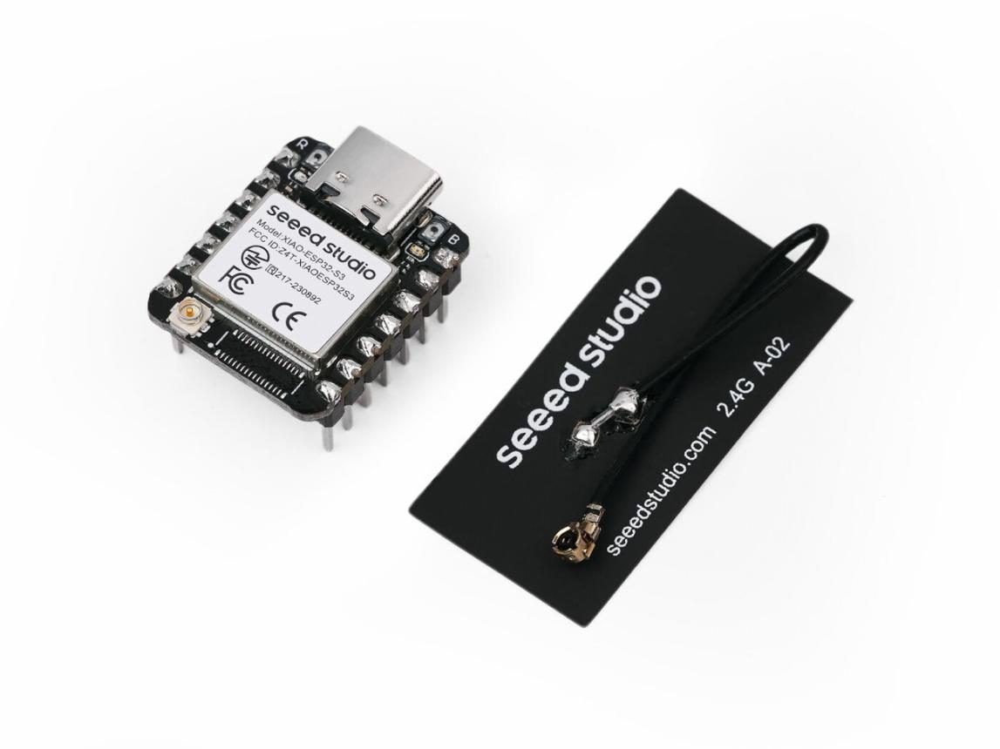
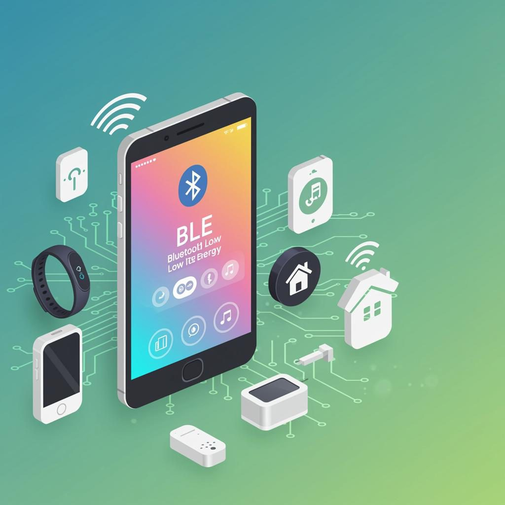
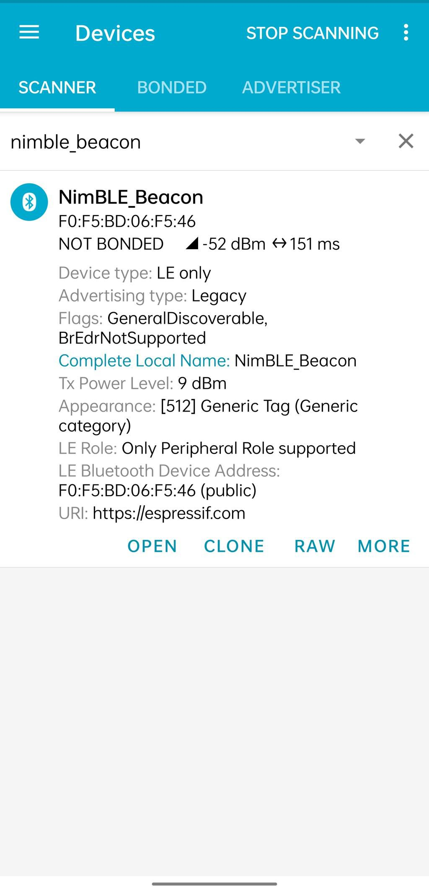

# 第七课：XIAO ESP32S3 的 Wi-Fi、BLE 与网络通信原理

前面六课，我们已经从芯片底层逐步学习到了 FreeRTOS 多任务系统。

现在进入一个重要阶段：**让 XIAO ESP32S3 真正连接外部世界。**

本课将从无线硬件原理开始，逐步讲解 Wi-Fi、蓝牙 BLE、TCP/IP、HTTP、MQTT、网络事件和 OTA 固件升级。

最终目标是让你能够开发一个完整的联网设备：

- XIAO ESP32S3 连接家庭或办公 Wi-Fi。
- 手机通过 BLE 配置设备。
- 设备通过 MQTT 向服务器发送数据。
- 手机或电脑远程控制设备。
- 设备能够在线升级固件。

---

## 一、ESP32-S3 的无线通信硬件

首先了解 XIAO ESP32S3 的无线能力。



*[Seeed Studio XIAO ESP32S3 (Pre-Soldered) | Kiwi Electronics](https://www.kiwi-electronics.com/image/cache/catalog/product/km3jH8sd/5-102010634-seeed-studio-xiao-esp32s3-_pre-soldered_-all-1280x960.jpg) · 搜索词：Seeed Studio XIAO ESP32S3 development board antenna WiFi Bluetooth PCB antenna*

ESP32-S3 内部集成了：

| 功能 | 规格 |
| --- | --- |
| Wi-Fi | 2.4GHz Wi-Fi 4（802.11 b/g/n） |
| 蓝牙 | Bluetooth LE 5，支持 LE 功能 |
| 经典蓝牙 | 不支持 Bluetooth Classic |
| TCP/IP | 支持 IPv4 网络协议栈 |
| 无线频段 | 2.4GHz |

特别注意：ESP32-S3 不支持传统蓝牙 Classic，因此不能直接按照经典蓝牙 SPP 串口模块的方式开发。

它主要使用 BLE，也就是低功耗蓝牙。

### 1. Wi-Fi 和 BLE 的区别

> 图示：WiFi wireless router signal icon technology

- **Wi-Fi**
  - 连接路由器
  - 接入局域网
  - 访问互联网
  - 传输大量数据



*[Bluetooth Low Energy (BLE) for IIoT | Technical Guide - Acal BFi](https://cdn.acalbfi.com/media/jpg/ble-apps-2560x2560.jpg) · 搜索词：Bluetooth low energy BLE smartphone IoT connection illustration*

- **BLE**
  - 手机连接设备
  - 近距离配置
  - 发送控制命令
  - 低功耗通信

一个典型的智能设备可以同时使用两种技术：

- BLE 负责手机与设备之间的近距离配置。
- Wi-Fi 负责设备与服务器之间的数据通信。

### 2. Wi-Fi 和 BLE 为什么可以同时工作？

ESP32-S3 的 Wi-Fi 和 BLE 共享 2.4GHz 无线资源。

芯片使用共存协调机制，安排不同无线协议的射频使用时间。

这意味着它们可以协同工作，但不是两个独立射频同时无限制地工作。

实际运行中可能受到：

- 无线信号强度；
- Wi-Fi 数据传输量；
- BLE 广播间隔；
- BLE 连接间隔；
- 天线设计；
- 无线干扰；

等因素影响。

因此，正式产品需要进行 Wi-Fi 与 BLE 共存测试。

---

## 二、Wi-Fi 的工作原理

### 1. Wi-Fi 有哪些工作模式？

ESP32-S3 常用三种模式：

| 模式 | 英文 | 作用 |
| --- | --- | --- |
| STA | Station | 连接已有路由器 |
| AP | Access Point | 自己创建 Wi-Fi 热点 |
| AP+STA | Station + AP | 同时连接路由器并提供热点 |

### STA 模式

这是最常用的方式。

**互联网 / 云服务器**

↑↓

**Wi-Fi 路由器**

↑↓

**XIAO ESP32S3（STA）**

适合：

- 上传传感器数据；
- 连接 MQTT 服务器；
- 访问 HTTP API；
- 接收远程控制命令。

### AP 模式

ESP32-S3 自己创建热点。

**XIAO ESP32S3（AP）**创建设备配置热点

↑↓

- **手机**
- **电脑**

适合：

- 初次设备配置；
- 手机直接连接设备；
- 本地网页控制；
- 无路由器环境下的设备通信。

AP 模式本身不意味着可以访问互联网，它只是创建了一个无线局域网。

---

## 三、ESP-IDF Wi-Fi 软件架构

ESP-IDF 的 Wi-Fi 系统不是简单的一个连接函数，而是由多个模块协同工作的。

**应用程序** 你的业务逻辑

↓

**ESP-IDF Wi-Fi API** 连接、断开、配置、扫描

↓

**Wi-Fi Driver** 管理无线连接和数据收发

↓

**LwIP TCP/IP 协议栈** IP、TCP、UDP、DHCP、DNS

↓

**ESP32-S3 无线硬件** 射频、基带、天线

这里要记住：

Wi-Fi 负责无线链路，而 TCP/IP 负责网络通信。

连接 Wi-Fi 成功，不代表一定能够访问互联网。

例如：

- Wi-Fi 连接成功；
- 路由器分配了 IP；
- DNS 解析失败；
- 服务器连接失败。

这些是不同层次的问题，需要分别排查。

---

## 四、实战：使用 ESP-IDF 连接 Wi-Fi

现在开始编写第一个联网程序。

目标：

1. 初始化 NVS。
2. 初始化网络接口。
3. 创建默认事件循环。
4. 初始化 Wi-Fi。
5. 配置 SSID 和密码。
6. 连接路由器。
7. 获取 IP 地址。

### 1. Wi-Fi 初始化代码

```c
#include <stdio.h>
#include <string.h>

#include "freertos/FreeRTOS.h"
#include "freertos/event_groups.h"

#include "esp_event.h"
#include "esp_log.h"
#include "esp_netif.h"
#include "esp_wifi.h"
#include "nvs_flash.h"

#define WIFI_SSID     "YOUR_WIFI_NAME"
#define WIFI_PASSWORD "YOUR_WIFI_PASSWORD"

#define WIFI_CONNECTED_BIT BIT0
#define WIFI_FAIL_BIT      BIT1

static const char *TAG = "XIAO_WIFI";

static EventGroupHandle_t wifi_event_group;

static int retry_count = 0;
#define MAX_RETRY 5

static void wifi_event_handler(
    void *arg,
    esp_event_base_t event_base,
    int32_t event_id,
    void *event_data)
{
    if (event_base == WIFI_EVENT &&
        event_id == WIFI_EVENT_STA_START) {

        esp_wifi_connect();

    } else if (event_base == WIFI_EVENT &&
               event_id == WIFI_EVENT_STA_DISCONNECTED) {

        if (retry_count < MAX_RETRY) {
            retry_count++;
            ESP_LOGW(TAG, "Retry WiFi: %d", retry_count);
            esp_wifi_connect();
        } else {
            xEventGroupSetBits(
                wifi_event_group,
                WIFI_FAIL_BIT
            );
        }

    } else if (event_base == IP_EVENT &&
               event_id == IP_EVENT_STA_GOT_IP) {

        ip_event_got_ip_t *event =
            (ip_event_got_ip_t *)event_data;

        ESP_LOGI(
            TAG,
            "Got IP: " IPSTR,
            IP2STR(&event->ip_info.ip)
        );

        retry_count = 0;

        xEventGroupSetBits(
            wifi_event_group,
            WIFI_CONNECTED_BIT
        );
    }
}

void wifi_init(void)
{
    wifi_event_group = xEventGroupCreate();

    ESP_ERROR_CHECK(nvs_flash_init());

    ESP_ERROR_CHECK(esp_netif_init());

    ESP_ERROR_CHECK(
        esp_event_loop_create_default()
    );

    esp_netif_create_default_wifi_sta();

    wifi_init_config_t cfg = WIFI_INIT_CONFIG_DEFAULT();

    ESP_ERROR_CHECK(
        esp_wifi_init(&cfg)
    );

    ESP_ERROR_CHECK(
        esp_event_handler_register(
            WIFI_EVENT,
            ESP_EVENT_ANY_ID,
            &wifi_event_handler,
            NULL
        )
    );

    ESP_ERROR_CHECK(
        esp_event_handler_register(
            IP_EVENT,
            IP_EVENT_STA_GOT_IP,
            &wifi_event_handler,
            NULL
        )
    );

    wifi_config_t wifi_config = {0};

    strlcpy(
        (char *)wifi_config.sta.ssid,
        WIFI_SSID,
        sizeof(wifi_config.sta.ssid)
    );

    strlcpy(
        (char *)wifi_config.sta.password,
        WIFI_PASSWORD,
        sizeof(wifi_config.sta.password)
    );

    wifi_config.sta.threshold.authmode =
        WIFI_AUTH_WPA2_PSK;

    ESP_ERROR_CHECK(
        esp_wifi_set_mode(WIFI_MODE_STA)
    );

    ESP_ERROR_CHECK(
        esp_wifi_set_config(
            WIFI_IF_STA,
            &wifi_config
        )
    );

    ESP_ERROR_CHECK(esp_wifi_start());
}

void app_main(void)
{
    wifi_init();

    EventBits_t bits = xEventGroupWaitBits(
        wifi_event_group,
        WIFI_CONNECTED_BIT | WIFI_FAIL_BIT,
        pdFALSE,
        pdFALSE,
        pdMS_TO_TICKS(30000)
    );

    if (bits & WIFI_CONNECTED_BIT) {
        ESP_LOGI(TAG, "WiFi connected!");
    } else if (bits & WIFI_FAIL_BIT) {
        ESP_LOGE(TAG, "WiFi connection failed!");
    } else {
        ESP_LOGE(TAG, "WiFi timeout!");
    }
}
```

注意：

- 将 SSID 和密码替换为自己的网络配置。
- 不要把真实 Wi-Fi 密码提交到 GitHub。
- 生产项目应使用 NVS 或安全配置机制保存凭据。
- `WIFI_AUTH_WPA2_PSK` 是这里的教学配置，实际应根据路由器安全模式调整。
- 正式工程还需要处理重复初始化、事件处理器注销和重新连接策略。

### 2. 连接成功后会发生什么？

典型流程：

```text
esp_wifi_start()
      ↓
WIFI_EVENT_STA_START
      ↓
esp_wifi_connect()
      ↓
连接路由器
      ↓
WIFI_EVENT_STA_CONNECTED
      ↓
DHCP 获取 IP
      ↓
IP_EVENT_STA_GOT_IP
      ↓
开始网络通信
```

这里有个非常重要的区别：

`WIFI_EVENT_STA_CONNECTED` 表示无线链路已连接。

`IP_EVENT_STA_GOT_IP` 表示设备已经获得 IP 地址。

开发中应该在获得 IP 后再启动依赖 IP 网络的业务。

---

## 五、TCP 和 UDP：网络数据如何传输？

Wi-Fi 连接成功后，下一步是理解网络协议。

ESP32-S3 使用 TCP/IP 协议栈进行网络通信。

### 1. TCP 是什么？

TCP 是 Transmission Control Protocol，即传输控制协议。

它的特点是：

- 面向连接；
- 可靠传输；
- 数据按序交付；
- 具备丢包重传机制；
- 有流量控制和拥塞控制。

例如：

XIAO ESP32S3 向服务器发送一条设备状态数据。

如果网络发生丢包，TCP 会根据协议机制处理重传。

**XIAO ESP32S3**

↑↓

**TCP 连接** 连接建立、确认、重传、数据排序

↑↓

**服务器**

适合：

- HTTP；
- MQTT；
- 文件传输；
- 设备控制；
- 可靠数据上传。

### 2. UDP 是什么？

UDP 是 User Datagram Protocol。

特点：

- 无连接；
- 协议开销较小；
- 不保证数据到达；
- 不保证数据顺序；
- 由应用自行处理必要的可靠性。

适合：

- 实时状态广播；
- 局域网设备发现；
- 对延迟敏感的数据传输；
- 自己实现可靠性机制的应用。

### 3. TCP 和 UDP 对比

| 项目 | TCP | UDP |
| --- | --- | --- |
| 连接 | 有 | 无 |
| 可靠性 | 协议提供可靠传输 | 不保证 |
| 顺序 | 保证字节流顺序 | 不保证 |
| 延迟 | 受确认、重传等影响 | 通常较低 |
| 数据边界 | 字节流，没有消息边界 | 数据报有边界 |
| 典型应用 | HTTP、MQTT | DNS、实时数据、发现协议 |

注意：TCP 可靠传输不等于业务数据一定成功处理。设备还需要设计应用层确认、超时和重试机制。

---

## 六、HTTP：让 XIAO ESP32S3 访问网页和服务器

HTTP 是应用层协议。

你可以把它理解为：

XIAO ESP32S3 使用一种统一的请求和响应格式，与 Web 服务器交换信息。

### 1. HTTP 通信过程

例如设备想读取服务器上的温度配置：

```text
XIAO ESP32S3
      |
      | HTTP GET
      ↓
服务器
      |
      | HTTP 200 OK
      ↓
返回 JSON 数据
```

一个简单的 HTTP 请求：

```http
GET /api/device/config HTTP/1.1
Host: example.com
Connection: close
```

服务器可能返回：

```json
{
  "device_id": "xiao001",
  "temperature_limit": 35,
  "enabled": true
}
```

### 2. HTTP 常见方法

| 方法 | 功能 |
| --- | --- |
| GET | 获取数据 |
| POST | 提交数据 |
| PUT | 更新资源 |
| PATCH | 部分更新 |
| DELETE | 删除资源 |

### 3. ESP-IDF HTTP 客户端示例

ESP-IDF 提供 `esp_http_client`。

```c
#include "esp_http_client.h"
#include "esp_log.h"

static const char *TAG = "HTTP";

static esp_err_t http_event_handler(
    esp_http_client_event_t *evt)
{
    switch (evt->event_id) {

    case HTTP_EVENT_ON_DATA:
        ESP_LOGI(
            TAG,
            "Received: %.*s",
            (int)evt->data_len,
            (char *)evt->data
        );
        break;

    case HTTP_EVENT_ERROR:
        ESP_LOGE(TAG, "HTTP error");
        break;

    default:
        break;
    }

    return ESP_OK;
}

void http_get_example(void)
{
    esp_http_client_config_t config = {
        .url = "https://httpbin.org/get",
        .event_handler = http_event_handler,
        .timeout_ms = 10000
    };

    esp_http_client_handle_t client =
        esp_http_client_init(&config);

    esp_err_t err = esp_http_client_perform(client);

    if (err == ESP_OK) {
        ESP_LOGI(
            TAG,
            "HTTP status: %d",
            esp_http_client_get_status_code(client)
        );
    } else {
        ESP_LOGE(TAG, "Request failed: %s",
                 esp_err_to_name(err));
    }

    esp_http_client_cleanup(client);
}
```

需要注意：

- 先连接 Wi-Fi 并获得 IP。
- HTTPS 必须正确验证服务器证书。
- 不要在正式产品中关闭 TLS 证书验证。
- 大型响应应该分段处理，不能无条件把所有数据放入栈或小缓冲区。

### 4. HTTP 可以做什么？

例如：

- 上传设备数据；
- 获取服务器配置；
- 下载图片；
- 请求云端 AI 接口；
- 检查固件版本；
- 下载 OTA 固件。

---

## 七、MQTT：物联网设备最常用的通信方式之一

如果你想开发一个真正的智能硬件产品，我建议重点学习 MQTT。

MQTT 是一种轻量级消息发布/订阅协议。

它特别适合：

- 传感器设备；
- 智能家居；
- 远程控制；
- 设备状态上报；
- 多设备管理。

### 1. MQTT 的工作原理

MQTT 使用 Broker，也就是消息代理服务器。

它主要有三个角色：

- Publisher：发布消息；
- Subscriber：订阅消息；
- Broker：消息代理。

- **设备 A** 发布温度
- **手机** 订阅设备状态

↑↓

**MQTT Broker** 接收消息并转发给订阅者

↑↓

**设备 B** 接收控制指令

### 2. MQTT Topic 是什么？

Topic 就是消息主题。

例如：

```text
xiao/device001/temperature
xiao/device001/humidity
xiao/device001/status
xiao/device001/command
```

设备发布温度：

```json
{
  "temperature": 26.5,
  "unit": "C"
}
```

手机订阅：

```text
xiao/device001/temperature
```

服务器收到消息后，就可以把温度数据转发给手机。

### 3. MQTT QoS 级别

| QoS | 说明 |
| --- | --- |
| 0 | 最多一次，不确认 |
| 1 | 至少一次，可能重复 |
| 2 | 恰好一次，协议交互开销更高 |

对于普通传感器数据，QoS 0 或 QoS 1 通常就够用。

如果使用 QoS 1，业务程序还应考虑重复消息，例如通过消息 ID 或序列号进行去重。

### 4. ESP-IDF MQTT 客户端示例

ESP-IDF 提供 `esp-mqtt` 组件，工程需要声明相应依赖。

```c
#include "mqtt_client.h"
#include "esp_log.h"

static const char *TAG = "MQTT";

static void mqtt_event_handler(
    void *handler_args,
    esp_event_base_t base,
    int32_t event_id,
    void *event_data)
{
    esp_mqtt_event_handle_t event =
        event_data;

    switch ((esp_mqtt_event_id_t)event_id) {

    case MQTT_EVENT_CONNECTED:

        ESP_LOGI(TAG, "MQTT connected");

        esp_mqtt_client_subscribe(
            event->client,
            "xiao/device001/command",
            1
        );

        break;

    case MQTT_EVENT_DATA:

        ESP_LOGI(
            TAG,
            "Topic: %.*s",
            event->topic_len,
            event->topic
        );

        ESP_LOGI(
            TAG,
            "Data: %.*s",
            event->data_len,
            event->data
        );

        break;

    case MQTT_EVENT_DISCONNECTED:

        ESP_LOGW(TAG, "MQTT disconnected");
        break;

    default:
        break;
    }
}

void mqtt_start(void)
{
    esp_mqtt_client_config_t config = {
        .broker.address.uri =
            "mqtt://test.mosquitto.org"
    };

    esp_mqtt_client_handle_t client =
        esp_mqtt_client_init(&config);

    ESP_ERROR_CHECK(
        esp_mqtt_client_register_event(
            client,
            ESP_EVENT_ANY_ID,
            mqtt_event_handler,
            NULL
        )
    );

    ESP_ERROR_CHECK(
        esp_mqtt_client_start(client)
    );
}
```

这里的公共测试 Broker 只用于学习，不适合存放真实设备数据或生产控制指令。

生产设备应该使用经过身份认证的 MQTT 服务，优先采用 TLS 加密连接，并配置每台设备独立身份和访问权限。

---

## 八、BLE：让手机直接连接 XIAO ESP32S3

接下来学习 BLE。

BLE 与 Wi-Fi 的应用方式不同。

BLE 更适合短距离、低功耗、少量数据交换。

例如：

- 手机设置 Wi-Fi 密码；
- 手机读取设备状态；
- 手机控制 LED；
- 手机修改设备参数；
- 手机读取设备传感器数据。

### 1. BLE 的基本架构

BLE 采用 GATT 架构进行数据组织。

GATT 全称 Generic Attribute Profile。

主要包含：

| 概念 | 含义 |
| --- | --- |
| Peripheral | 外围设备 |
| Central | 中心设备 |
| Service | 服务 |
| Characteristic | 特征 |
| Descriptor | 描述符 |

例如，XIAO ESP32S3 作为 Peripheral，手机作为 Central。

**手机 BLE Central** 扫描、连接、读写数据

↑↓

**XIAO ESP32S3 BLE Peripheral**

**Device Service** UUID：自定义服务标识

**Temperature Characteristic** 读取温度

**Command Characteristic** 接收控制命令

### 2. Service 和 Characteristic 的关系

可以这样理解：

Service 是一个功能集合。

Characteristic 是集合中的具体数据。

例如，一个智能设备：

```text
Device Service
│
├── Device Name
│
├── Battery Level
│
├── Temperature
│
├── Humidity
│
└── Command
```

手机可以：

- Read：读取数据；
- Write：写入数据；
- Notify：接收设备主动推送；
- Indicate：接收带确认的推送。

### 3. ESP32-S3 应该使用什么 BLE 协议栈？

ESP-IDF 支持 NimBLE。

NimBLE 是一个轻量级 BLE 协议栈，适合资源受限的嵌入式设备。

推荐学习：

[ESP-IDF NimBLE 官方文档](https://docs.espressif.com/projects/esp-idf/en/stable/esp32s3/api-reference/bluetooth/nimble/index.html)

需要注意，ESP32-S3 不支持 Bluetooth Classic，开发时应使用 BLE，而不是传统蓝牙 SPP。

---

## 九、BLE 实战：建立手机与 XIAO ESP32S3 的通信

这里选择 NimBLE 作为 BLE 开发方案。

首先在 ESP-IDF 工程中配置：

```bash
idf.py menuconfig
```

在组件配置中启用 Bluetooth 和 NimBLE，并确认工程包含对应 NimBLE 组件。

### 1. BLE 初始化流程

- 初始化 NVS 和 NimBLE Host。
- 初始化 BLE GAP 和 GATT。
- 注册 Service 和 Characteristic。
- 设置设备名称。
- 开始 BLE 广播。
- 等待手机扫描和连接。

### 2. 一个简单的 BLE 设备设计

建议先定义自己的设备服务 UUID。

例如：

```c
#define DEVICE_SERVICE_UUID \
    "12345678-1234-5678-1234-56789abcdef0"

#define DEVICE_COMMAND_UUID \
    "12345678-1234-5678-1234-56789abcdef1"

#define DEVICE_STATUS_UUID \
    "12345678-1234-5678-1234-56789abcdef2"
```

设计成：

| Characteristic | 属性 | 功能 |
| --- | --- | --- |
| Command | Write | 手机发送控制命令 |
| Status | Read / Notify | 手机读取或订阅设备状态 |

实际开发时，UUID 应保持唯一且长期稳定。

### 3. BLE 命令设计

例如手机向设备写入：

```json
{
  "command": "led",
  "value": 1
}
```

设备收到命令后：

```text
BLE Write
   ↓
解析命令
   ↓
发送 FreeRTOS Queue
   ↓
控制任务
   ↓
GPIO 输出
   ↓
LED 点亮
```

这里非常推荐使用 Queue 把 BLE 回调和业务处理分离。

不要在 BLE 协议栈回调中执行耗时的业务操作。

### 4. 手机端如何调试？

推荐使用：



*[Device Discovery - ESP32-S3 - — ESP-IDF Programming Guide v5.5.2 documentation](https://docs.espressif.com/projects/esp-idf/en/stable/esp32s3/_images/ble-scan-list-nimble-beacon.jpg) · 搜索词：nRF Connect for Mobile BLE scanner application screenshot*

**nRF Connect for Mobile** 扫描 BLE 设备、连接、查看 Service、读写 Characteristic、测试 Notify。[官方应用介绍](https://www.nordicsemi.com/Products/Development-tools/nRF-Connect-for-mobile)

通过它可以检查：

- 设备是否正常广播；
- 手机是否成功连接；
- Service 是否存在；
- Characteristic 是否可读写；
- Notify 是否能够接收数据。

---

## 十、网络事件：为什么 ESP-IDF 要使用事件驱动架构？

前面 Wi-Fi 代码中出现了：

```c
WIFI_EVENT_STA_START
WIFI_EVENT_STA_DISCONNECTED
IP_EVENT_STA_GOT_IP
```

这就是 ESP-IDF 的事件系统。

事件驱动是嵌入式网络程序非常重要的架构。

### 1. 为什么不建议不断轮询网络状态？

不推荐：

```c
while (1) {
    if (wifi_connected()) {
        // 处理网络
    }

    vTaskDelay(pdMS_TO_TICKS(100));
}
```

这种方式会让程序反复检查状态。

更好的方式是：

```text
Wi-Fi 驱动产生事件
       ↓
ESP Event Loop
       ↓
应用事件处理器
       ↓
更新网络状态
       ↓
通知对应任务
```

### 2. 推荐的网络状态机

实际产品可以设计以下状态：

**WIFI_IDLE**

↓

**WIFI_CONNECTING**

↓

**WIFI_CONNECTED**

↓

**IP_READY**

↓

**APPLICATION_ONLINE** MQTT / HTTP 可以启动

发生断网时：

```text
APPLICATION_ONLINE
       ↓
WIFI_DISCONNECTED
       ↓
停止或暂停网络业务
       ↓
尝试重新连接
       ↓
重新获取 IP
       ↓
恢复网络业务
```

这样即使路由器断电，设备也能尝试恢复工作。

---

## 十一、OTA：远程升级 XIAO ESP32S3 固件

OTA 是 Over-The-Air，即无线固件升级。

这项技术非常重要。

如果设备已经安装在外壳内部，甚至部署在远离你的地方，就不希望每次修改程序都要拆开设备，连接 USB 烧录。

OTA 可以让设备通过 Wi-Fi 下载新固件。

### 1. OTA 的基本工作原理

**云端固件服务器** 保存新版 firmware.bin

↓

**XIAO ESP32S3** 检查版本、下载固件、校验数据

↓

- **OTA_0** **当前固件**
- **OTA_1** **新固件写入目标**

↓

**更新启动分区并重启**

### 2. OTA 的升级过程

1. 设备向服务器检查新版本。
2. 下载新版固件。
3. 将固件写入非当前运行的 OTA 分区。
4. 校验固件完整性。
5. 设置下次启动分区。
6. 重启设备。
7. 新固件运行并执行自检。
8. 自检成功后确认新固件有效。

如果新固件启动失败，可以利用 OTA 回滚机制恢复旧版本，但前提是分区和回滚配置正确。

### 3. ESP-IDF OTA 核心 API

ESP-IDF 提供：

```c
esp_ota_begin()
esp_ota_write()
esp_ota_end()
esp_ota_set_boot_partition()
esp_restart()
```

实际项目中建议使用官方 HTTP OTA 接口，或在应用层通过 HTTP 客户端配合 OTA API 完成升级。

官方资料：

[ESP-IDF OTA 官方文档](https://docs.espressif.com/projects/esp-idf/en/stable/esp32s3/api-reference/system/ota.html)

### 4. OTA 必须考虑的安全问题

正式产品至少应该做到：

- HTTPS 下载；
- 验证服务器证书；
- 验证固件完整性；
- 验证固件来源和签名；
- 防止未经授权的固件写入；
- 失败后回滚；
- 防止断电导致设备无法启动。

对于量产设备，还应研究 Secure Boot 和 Flash Encryption。

OTA 不只是下载一个 BIN 文件，还涉及整个设备启动链的安全设计。

---

## 十二、将 Wi-Fi、BLE、MQTT 和 FreeRTOS 组合成完整系统

现在进入真正的产品架构设计。

假设我们开发一台 XIAO ESP32S3 智能控制设备。

它需要：

- 手机 BLE 配置；
- Wi-Fi 联网；
- MQTT 数据上传；
- 远程控制；
- OLED 状态显示；
- OTA 远程升级。

推荐使用下面的架构：

**XIAO ESP32S3 智能设备软件架构**

**Application Layer** 设备业务、状态机、命令处理

- **BLE Manager** 手机配置、近距离控制
- **Wi-Fi Manager** 网络连接、断线恢复
- **MQTT Manager** 数据上传、远程命令
- **OTA Manager** 固件更新、版本管理

**FreeRTOS** Task / Queue / Mutex / Event Group

**XIAO ESP32S3 BSP** GPIO / I2C / SPI / UART / ADC / PWM

**ESP32-S3 Hardware** CPU / Flash / PSRAM / Wi-Fi / BLE

### 推荐的工程目录

```text
XIAO-ESP32S3-Projects/
│
├── components/
│   ├── xiao_bsp/
│   │
│   ├── network_manager/
│   │   ├── wifi_manager.c
│   │   ├── wifi_manager.h
│   │   ├── ble_manager.c
│   │   └── ble_manager.h
│   │
│   ├── mqtt_manager/
│   │   ├── mqtt_client.c
│   │   └── mqtt_client.h
│   │
│   ├── ota_manager/
│   │   ├── ota_manager.c
│   │   └── ota_manager.h
│   │
│   ├── device_manager/
│   │   ├── device_state.c
│   │   └── command_handler.c
│   │
│   └── system_manager/
│       ├── event_manager.c
│       ├── task_manager.c
│       └── power_manager.c
│
├── main/
│   └── app_main.c
│
├── partitions.csv
│
├── sdkconfig.defaults
│
└── docs/
    ├── network_architecture.md
    ├── ble_protocol.md
    ├── mqtt_protocol.md
    ├── ota_design.md
    └── security_design.md
```

这里需要区分：目录是推荐的软件架构，不代表所有组件必须独立创建任务。BLE、Wi-Fi 和 MQTT 底层已经有自己的系统任务，应避免重复创建不必要的网络任务。

---

## 十三、本课实践：从理论到真实开发板

建议按照以下顺序完成实验。

**无线通信实验清单**/

## 十四、给 Codex 的网络开发任务

以后在 `XIAO-ESP32S3-Projects` 中，可以让 Codex 以统一规范开发网络组件。

**Codex 网络组件开发指令**

**复制指令**

为普通版 XIAO ESP32S3 建立完整 ESP-IDF 网络通信组件。

要求：

- Wi-Fi STA/AP 与断线恢复。
- BLE NimBLE GATT。
- HTTP 和 MQTT 客户端。
- OTA 双分区与回滚。
- FreeRTOS 任务间通信。
- 内存、任务栈和无线共存测试。
- 安全凭据管理和 HTTPS 证书验证。
- 先编译验证，不自动烧录。

---

## 十五、下一课：摄像头、I2S 音频与 DMA 数据处理

下一阶段开始进入 ESP32-S3 比较有特色的能力：图像和音频处理。

**第八课：XIAO ESP32S3 多媒体系统原理**

课程内容：

1. 摄像头 CMOS 图像传感器工作原理。
2. DVP 摄像头接口和图像采集。
3. OV2640 图像数据格式。
4. PSRAM 帧缓冲区。
5. DMA 图像数据传输。
6. I2S 数字音频采集和输出。
7. PCM、采样率、位深和声道。
8. 音频缓冲区与实时处理。
9. JPEG 图像压缩和网络传输。
10. XIAO ESP32S3 Sense 的摄像头与音频项目。

**特别说明：** 你当前的开发范围是普通版 XIAO ESP32S3，所以接下来仍以普通版为基础讲解；涉及摄像头时，会单独区分 Sense 版本的板载摄像头硬件，避免把 Sense 专属配置错误地套用到普通版。

官方学习资料：

- [ESP-IDF Wi-Fi](https://docs.espressif.com/projects/esp-idf/en/stable/esp32s3/api-reference/network/esp_wifi.html)
- [HTTP 客户端](https://docs.espressif.com/projects/esp-idf/en/stable/esp32s3/api-reference/protocols/esp_http_client.html)
- [MQTT 客户端](https://docs.espressif.com/projects/esp-idf/en/stable/esp32s3/api-reference/protocols/mqtt.html)
- [蓝牙开发](https://docs.espressif.com/projects/esp-idf/en/stable/esp32s3/api-reference/bluetooth/index.html)
- [OTA 固件升级](https://docs.espressif.com/projects/esp-idf/en/stable/esp32s3/api-reference/system/ota.html)

下一课我们将从数字摄像头和音频硬件开始，逐步理解 XIAO ESP32S3 如何处理图像、声音以及大型实时数据。
