# 第八课：XIAO ESP32S3 多媒体系统原理——摄像头、I2S 音频、DMA 与图像处理

前面七课，我们已经从 CPU、寄存器、内存、驱动、FreeRTOS，一直学习到 Wi-Fi、BLE 和网络通信。

现在进入 ESP32-S3 非常重要的一组应用技术：

**图像采集、数字音频、DMA 数据传输和实时多媒体处理。**

这部分知识对以后开发智能摄像头、语音交互设备、音频播放器、网络监控终端非常重要。

本课仍然以普通版 XIAO ESP32S3 为主，涉及 Sense 摄像头时会单独说明硬件区别。

## 一、先认识 XIAO ESP32S3 的多媒体处理能力

ESP32-S3 不仅是一颗微控制器，还集成了多媒体处理相关硬件。

| 硬件模块 | 作用 |
| --- | --- |
| 双核 Xtensa LX7 | 执行图像和音频处理程序 |
| PSRAM | 保存较大的图像和音频缓存 |
| LCD_CAM | 支持并行摄像头数据采集及 LCD 数据输出 |
| I2S | 数字音频采集和播放 |
| DMA / EDMA | 满足条件时直接搬运数据 |
| Wi-Fi | 将图像和音频发送到网络 |
| GPIO Matrix | 将外设信号映射到可用引脚 |

特别注意：ESP32-S3 的硬件图像采集能力，不意味着普通版 XIAO 已经安装摄像头。

> 图示：Seeed Studio XIAO ESP32S3 standard board front back

- **XIAO ESP32S3 普通版** 主控开发板，可通过外部硬件扩展音频、摄像头等功能。

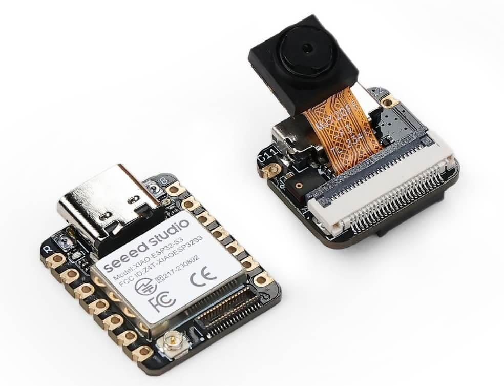

*[Mạch Seeed Studio XIAO ESP32S3 Sense Wi-Fi, BLE 5.0, OV2640 camera, microphone](https://bizweb.dktcdn.net/thumb/1024x1024/100/522/662/products/6-113991115-xiao-esp32s3-sense-feature-2.jpg?v=1731597572090) · 搜索词：Seeed Studio XIAO ESP32S3 Sense camera expansion board OV2640*

- **XIAO ESP32S3 Sense** 增加摄像头扩展硬件，适合图像采集实验。

两者的 ESP32-S3 核心架构相近，但扩展板、摄像头接口、引脚占用和实际存储配置需要分别核对。

---

## 二、摄像头的工作原理：如何把光变成数字图像？

首先理解摄像头内部发生了什么。

摄像头不是简单地把照片传给 ESP32-S3，而是经过一系列硬件处理。

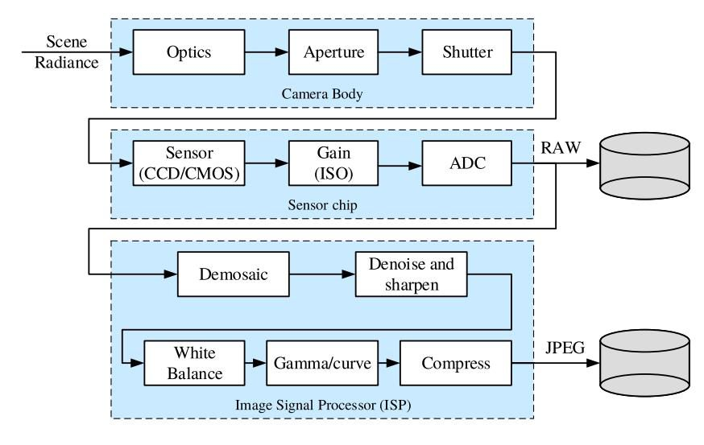

*[Note 2-4 Image Sensing Pipeline - Jiepeng's notes](https://note.jiepeng.tech/CS_Online/ML-4360/Lec2/images/image-38.png) · 搜索词：CMOS image sensor camera image acquisition pipeline lens pixel sensor ADC ISP digital image block diagram*

### 1. CMOS 图像传感器

摄像头镜头将光线聚焦到 CMOS 图像传感器上。

传感器上有大量感光像素。

例如：

- 160 × 120；
- 320 × 240；
- 640 × 480；
- 1600 × 1200。

像素数量越多，理论上可以提供更高的空间细节，但也意味着更大的数据量和处理开销。

### 2. 像素如何形成颜色？

常见彩色 CMOS 传感器使用 Bayer 彩色滤光阵列。

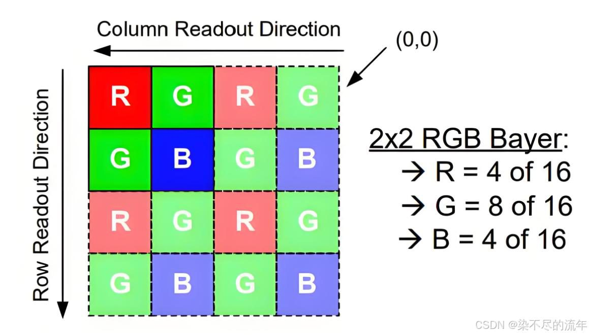

*[图像传感器 RGGB与 RYYB-CSDN博客](https://i-blog.csdnimg.cn/direct/1767358e834843249a6e5bdcc18b7d56.png) · 搜索词：Bayer filter RGGB 2x2 pixel pattern camera sensor diagram*

每个像素位置通常只采集红、绿、蓝中的一种颜色信息。

经过去马赛克等处理，才能形成完整 RGB 彩色图像。

### 3. 摄像头输出的数据格式

常见图像格式包括：

| 格式 | 每像素数据量 | 特点 |
| --- | --- | --- |
| RGB565 | 16 bit | 每像素 2 字节 |
| RGB888 | 24 bit | 每像素 3 字节 |
| YUV422 | 16 bit | 适合视频处理 |
| JPEG | 可变 | 压缩图像 |

对于 ESP32-S3，JPEG 通常是网络传输和摄像头缓存中非常实用的格式。

---

## 三、图像数据量计算：为什么需要 PSRAM？

假设摄像头输出 320 × 240 的 RGB565 图像。

每个像素占 2 字节。

$320\times240\times2=153600$

即约 150KB。

如果是 640 × 480：

$640\times480\times2=614400$

即约 600KB。

如果需要同时保留两帧 640 × 480 的图像：

$614400\times2=1228800$

约 1.17MiB。

**不同图像分辨率的内存需求**

| 分辨率 | 单帧内存 |
| --- | --- |
| 160×120 | 37.5 KB |
| 320×240 | 150 KB |
| 640×480 | 600 KB |
| 800×600 | 937.5 KB |

*按 RGB565、每像素 2 字节计算，未计入其他缓存和系统开销。*

这些是理论缓冲区大小，不代表摄像头实际能够以该分辨率、格式和帧率运行。

这就是为什么图像项目通常需要使用 PSRAM。

但是要记住：

**PSRAM 容量大，不代表所有摄像头数据都可以无条件放入 PSRAM。**

还需要检查摄像头驱动、DMA 能力、缓冲区对齐和缓存一致性要求。

---

## 四、ESP32-S3 如何接收摄像头数据？

ESP32-S3 有 LCD_CAM 外设，可以用于并行摄像头数据采集。

典型的 DVP 摄像头接口包含：

| 信号 | 作用 |
| --- | --- |
| D0～D7 | 图像数据 |
| PCLK | 像素时钟 |
| VSYNC | 帧同步 |
| HREF | 行有效信号 |
| XCLK | 摄像头参考时钟 |
| SCCB | 摄像头寄存器配置接口 |

SCCB 与 I2C 类似，但属于摄像头常用的控制总线协议。

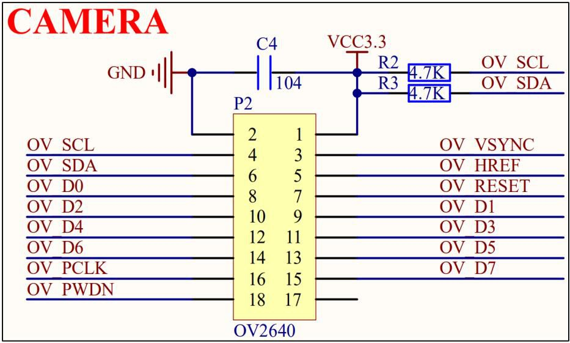

*[第三十五章 ESP32S3 摄像头实验_vo5640和 esp32-s3-cam接口对应-CSDN博客](https://i-blog.csdnimg.cn/direct/7ee9d10beee74b26944bac831519cf73.png) · 搜索词：OV2640 DVP camera module ESP32 parallel camera interface D0 D7 PCLK VSYNC HREF XCLK SCCB wiring diagram*

### 1. 摄像头启动过程

```text
摄像头供电
    ↓
生成 XCLK
    ↓
通过 SCCB 配置传感器
    ↓
配置分辨率和输出格式
    ↓
摄像头开始输出像素
    ↓
LCD_CAM 接收数据
    ↓
DMA / EDMA 搬运
    ↓
图像帧缓冲区
    ↓
应用程序处理
```

这里有一个关键知识：

CPU 不需要逐个读取每个像素。

满足硬件和驱动条件时，LCD_CAM 可以配合 DMA/EDMA 把图像数据搬运到内存，CPU 再处理完整帧或图像块。

### 2. 摄像头和普通 GPIO 读取有什么不同？

如果使用 GPIO 逐个读取高速像素信号：

- CPU 负担很大；
- 容易丢失数据；
- 难以稳定处理连续图像。

因此，实际开发应该使用摄像头专用采集外设和驱动，而不是自己用 GPIO 轮询模拟摄像头总线。

---

## 五、在 XIAO ESP32S3 上使用摄像头

这里要区分两种硬件情况。

**当前普通版开发范围** **普通版 XIAO ESP32S3**

可以使用外部摄像头，但必须先确认摄像头接口、供电、引脚和电气兼容性。不能直接把 Sense 摄像头扩展板的引脚配置套用过来。

---

**扩展知识** **XIAO ESP32S3 Sense**

可以使用配套摄像头扩展板及兼容摄像头模块，按照对应硬件资料配置驱动。

### 1. 推荐先了解的摄像头型号

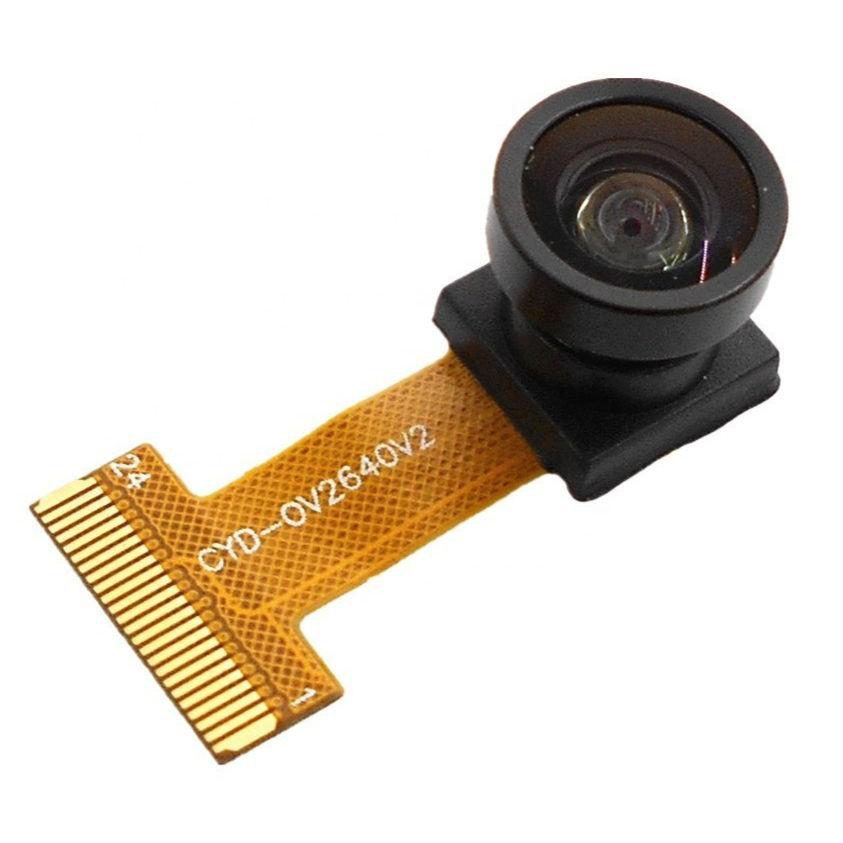

*[OV2640 Camera Module | Mysite](https://static.wixstatic.com/media/2d737a_8898ba87fb1942408daaf8e7e87c0f5a~mv2.jpg/v1/fill/w_843%2Ch_843%2Cal_c%2Cq_85%2Cenc_avif%2Cquality_auto/2d737a_8898ba87fb1942408daaf8e7e87c0f5a~mv2.jpg) · 搜索词：OV2640 camera module 2 megapixel DVP*

- **OV2640** 常见 200 万像素摄像头，支持 JPEG 输出，适合入门实验。

> 图示：OV3660 camera sensor module

- **OV3660** 更高分辨率的摄像头型号，需检查驱动和接口兼容性。

### 2. ESP-IDF 摄像头开发库

常见方案是 Espressif 的 `esp32-camera`。

官方项目：

[Espressif esp32-camera GitHub](https://github.com/espressif/esp32-camera)

它提供：

- 摄像头初始化；
- 传感器寄存器配置；
- 图像格式配置；
- 帧缓冲管理；
- JPEG 图像采集；
- 图像数据读取。

典型代码结构：

```c
camera_config_t config = {
    // 摄像头引脚配置
    // 时钟配置
    // 像素格式
    // 分辨率
    // 帧缓冲配置
};

esp_err_t err = esp_camera_init(&config);

if (err != ESP_OK) {
    printf("Camera init failed: %s\n",
           esp_err_to_name(err));
    return;
}

camera_fb_t *fb = esp_camera_fb_get();

if (fb != NULL) {
    printf("Image size: %u bytes\n",
           (unsigned)fb->len);

    esp_camera_fb_return(fb);
}
```

这是接口结构示意，不能直接作为普通版 XIAO 的可烧录程序：必须补全实际摄像头 GPIO、XCLK、格式、分辨率和内存配置。

---

## 六、I2S 数字音频：让 XIAO ESP32S3 采集和播放声音

图像处理解决的是视觉输入，I2S 则是 ESP32-S3 处理数字音频的重要接口。

如果要开发以下设备，就必须掌握 I2S：

- 语音助手；
- 网络音频播放器；
- 语音识别设备；
- 录音设备；
- 数字麦克风；
- 网络语音对讲机。

### 1. 什么是 I2S？

I2S 全称 Inter-IC Sound，是一种用于数字音频设备之间传输 PCM 音频数据的串行接口。

它通常包含三根主要信号线：

| 信号 | 名称 | 作用 |
| --- | --- | --- |
| BCLK | Bit Clock | 位时钟 |
| WS / LRCLK | Word Select | 左右声道选择 |
| DOUT | Data Out | 数据输出 |
| DIN | Data In | 数据输入 |

注意：I2S 的 DIN 和 DOUT 是相对于 ESP32-S3 来定义的。

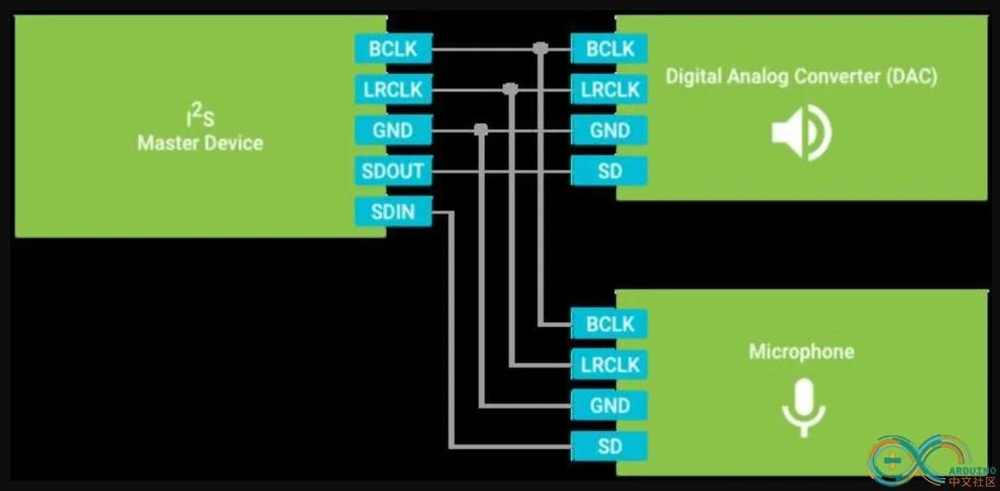

*[Arduino中文社区](https://arduino.me/storage/v1/object/public/image/a6e4dc978b5070be5ccc18bd4fd08c33.webp) · 搜索词：I2S digital audio interface BCLK LRCLK DIN DOUT microphone amplifier wiring diagram*

例如：

- 数字麦克风向 ESP32-S3 发送声音数据；
- ESP32-S3 通过 I2S 接收数据；
- ESP32-S3 对声音进行处理；
- 最后通过 I2S 将数据发送给数字功放。

### 2. I2S 与普通 GPIO 的区别

GPIO 只能简单地读取或输出电平。

如果要通过 GPIO 自己读取高速音频数据，需要自己处理：

- 位时钟；
- 数据同步；
- 左右声道；
- 数据位宽；
- 采样时间。

这非常复杂。

I2S 外设可以自动完成这些工作。

**I2S 音频数据流**

**数字麦克风**

↓

**I2S 接收外设** 时钟同步、串行数据接收

↓

**DMA / EDMA** 数据搬运到内存

↓

**PCM 音频缓冲区**

↓

**音频处理程序**

---

## 七、PCM：数字音频数据到底是什么？

要理解 I2S，必须先理解 PCM。

PCM 是 Pulse Code Modulation，即脉冲编码调制。

它是数字音频最常见的基础数据表示方式之一。

### 1. 采样率

采样率表示每秒钟采集多少次声音。

例如：

| 采样率 | 含义 |
| --- | --- |
| 8kHz | 每秒采样 8000 次 |
| 16kHz | 每秒采样 16000 次 |
| 22.05kHz | 每秒采样 22050 次 |
| 44.1kHz | 每秒采样 44100 次 |
| 48kHz | 每秒采样 48000 次 |

语音识别常见使用 16kHz 单声道 PCM。

音乐播放常见使用 44.1kHz 或 48kHz。

### 2. 位深

位深表示每个采样值使用多少位表示。

常见的有：

- 16 bit；
- 24 bit；
- 32 bit。

位深越高，理论量化精度越高，但数据量也会增加。

### 3. 声道

| 声道 | 含义 |
| --- | --- |
| Mono | 单声道 |
| Stereo | 立体声，左、右声道 |

### 4. 音频数据量计算

假设：

- 采样率：16000Hz；
- 位深：16bit；
- 声道：1。

每秒数据量：

$16000\times16\times1
=256000\text{ bit/s}$

换算成字节：

$256000\div8=32000\text{ Bytes/s}$

即每秒约 31.25KB。

如果连续录音 60 秒：

$32000\times60=1920000\text{ Bytes}$

约 1.83MiB。

| 时长 | PCM 数据量 |
| --- | --- |
| 1 秒 | 0.032 MB |
| 10 秒 | 0.32 MB |
| 30 秒 | 0.96 MB |
| 60 秒 | 1.92 MB |

*16kHz、16bit、单声道、未压缩 PCM。*

这说明：

即使只是录制一分钟语音，也会产生相当可观的数据量。

所以音频项目通常使用循环缓冲区，而不是无限地将录音数据保存在内存里。

---

## 八、I2S 麦克风：采集真实声音

常见数字麦克风：

> 图示：INMP441 I2S digital microphone breakout module

- **INMP441** 常见 I2S 数字麦克风，适合语音采集。

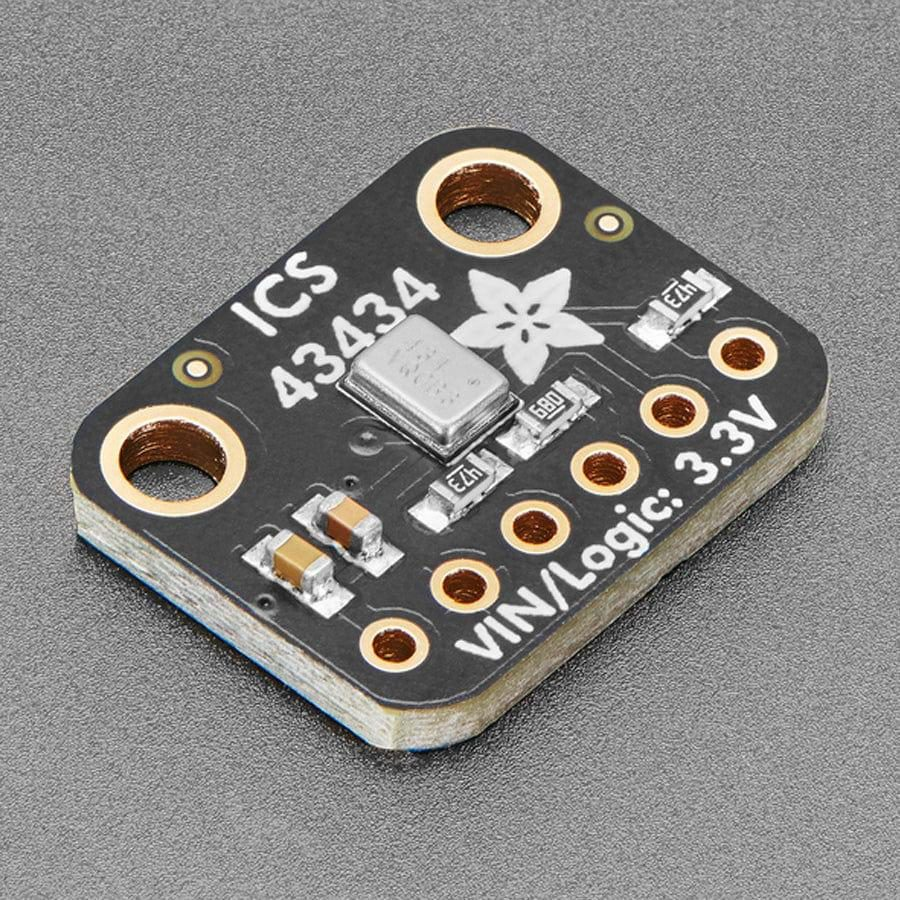

*[Adafruit I2S MEMS Microphone Breakout - ICS-43434 - The Pi Hut](https://thepihut.com/cdn/shop/files/adafruit-i2s-mems-microphone-breakout-ics-43434-adafruit-ada6049-71878643155329.jpg?v=1730863019&width=2048) · 搜索词：ICS 43434 I2S MEMS microphone module*

- **ICS-43434** I2S MEMS 麦克风，适合数字音频实验。

### 1. 麦克风的引脚

以 INMP441 为例：

| 麦克风引脚 | 功能 |
| --- | --- |
| VDD | 电源 |
| GND | 地 |
| SCK | I2S 位时钟 |
| WS | 左右声道时钟 |
| SD | 串行数据输出 |
| L/R | 左右声道选择 |

这里的 SCK 对应 I2S 的 BCLK。

### 2. 音频采集过程

```text
声音
 ↓
麦克风 MEMS 传感器
 ↓
模拟信号转换
 ↓
麦克风内部 ADC
 ↓
I2S 数字数据
 ↓
XIAO ESP32S3
 ↓
DMA
 ↓
PCM 缓冲区
 ↓
语音处理
```

数字麦克风已经完成了模拟到数字的转换，因此 ESP32-S3 不需要再通过 ADC 读取它的音频输出。

### 3. ESP-IDF 新版 I2S 驱动

ESP-IDF 5.x 及以后版本使用新的 I2S Channel API。

主要头文件：

```c
#include "driver/i2s_std.h"
```

首先创建接收通道：

```c
#include "driver/i2s_std.h"
#include "esp_err.h"

#define AUDIO_SAMPLE_RATE 16000

static i2s_chan_handle_t rx_handle;

void audio_i2s_init(void)
{
    i2s_chan_config_t chan_config =
        I2S_CHANNEL_DEFAULT_CONFIG(
            I2S_NUM_0,
            I2S_ROLE_MASTER
        );

    ESP_ERROR_CHECK(
        i2s_new_channel(
            &chan_config,
            NULL,
            &rx_handle
        )
    );

    i2s_std_config_t std_config = {
        .clk_cfg = I2S_STD_CLK_DEFAULT_CONFIG(
            AUDIO_SAMPLE_RATE
        ),

        .slot_cfg = I2S_STD_PHILIPS_SLOT_DEFAULT_CONFIG(
            I2S_DATA_BIT_WIDTH_32BIT,
            I2S_SLOT_MODE_MONO
        ),

        .gpio_cfg = {
            .mclk = I2S_GPIO_UNUSED,
            .bclk = GPIO_NUM_7,
            .ws = GPIO_NUM_8,
            .dout = I2S_GPIO_UNUSED,
            .din = GPIO_NUM_9,
            .invert_flags = {
                .mclk_inv = false,
                .bclk_inv = false,
                .ws_inv = false
            }
        }
    };

    ESP_ERROR_CHECK(
        i2s_channel_init_std_mode(
            rx_handle,
            &std_config
        )
    );

    ESP_ERROR_CHECK(
        i2s_channel_enable(rx_handle)
    );
}
```

这里有一个特别重要的硬件问题：

上面 GPIO7、GPIO8、GPIO9 只是软件演示引脚，不能直接照搬到所有 XIAO 项目。它们也是 XIAO 常用 SPI 引脚。

如果你的 SPI 屏幕已经使用这些引脚，就必须重新规划 I2S 引脚。

另外，INMP441 的数据通常以 24 位有效音频数据装载在 32 位 I2S 时隙中。采集格式必须结合麦克风数据手册和 I2S 驱动的位宽配置进行调整。

### 4. 读取音频数据

```c
int32_t audio_buffer[512];

size_t bytes_read = 0;

esp_err_t err = i2s_channel_read(
    rx_handle,
    audio_buffer,
    sizeof(audio_buffer),
    &bytes_read,
    1000
);

if (err == ESP_OK && bytes_read > 0) {
    printf(
        "Audio bytes: %u\n",
        (unsigned)bytes_read
    );
}
```

这里已经完成了最基础的数字音频采集。

但要注意：原始 32 位 I2S 数据不一定等于已经转换好的标准 16 位 PCM 数据。实际语音识别之前，通常还要进行位对齐、符号扩展、位宽转换、声道选择和增益处理。

---

## 九、I2S 音频播放：让 ESP32-S3 输出声音

采集声音之后，还需要学习播放声音。

常见的方案是：

- ESP32-S3；
- I2S 数字功放；
- 扬声器。

例如：

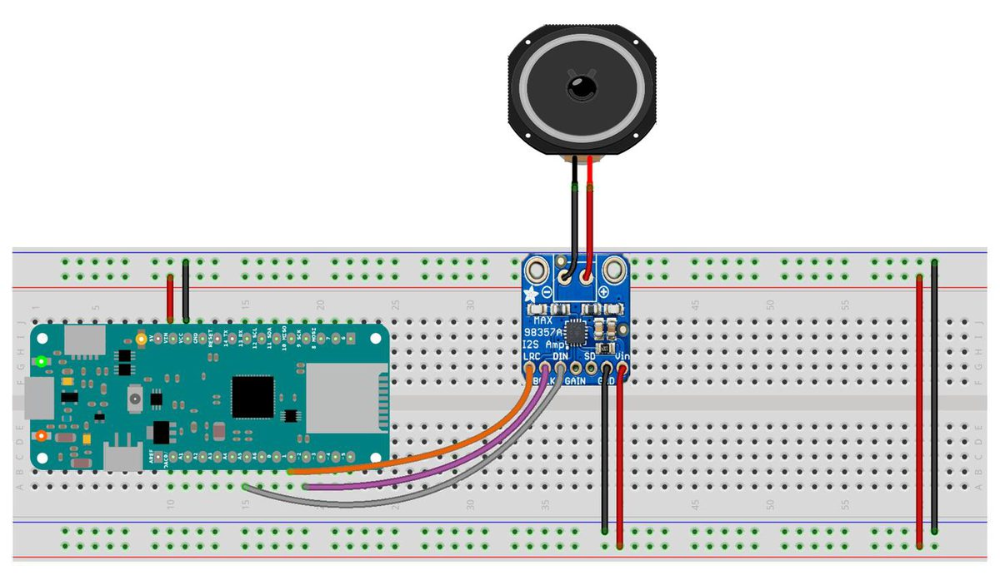

*[trigonometry - Arduino I2S sine wave - Stack Overflow](https://i.sstatic.net/LLZWh.png) · 搜索词：MAX98357A I2S class D amplifier module speaker wiring*

### 1. MAX98357A 的工作原理

MAX98357A 是一款常见的 I2S 数字输入音频功放。

它接收：

- BCLK；
- LRC / WS；
- DIN。

然后将数字音频转换为驱动扬声器的功率信号。

数据流：

```text
XIAO ESP32S3
      ↓
I2S 输出
      ↓
MAX98357A
      ↓
功率放大
      ↓
扬声器
```

注意：

扬声器不能直接接到 ESP32-S3 的 GPIO 上。

扬声器需要合适的功率放大器，且功放供电和扬声器阻抗、功率规格必须匹配。

### 2. ESP-IDF I2S 发送配置

与接收通道类似：

```c
static i2s_chan_handle_t tx_handle;
```

创建发送通道：

```c
i2s_chan_config_t chan_config =
    I2S_CHANNEL_DEFAULT_CONFIG(
        I2S_NUM_0,
        I2S_ROLE_MASTER
    );

ESP_ERROR_CHECK(
    i2s_new_channel(
        &chan_config,
        &tx_handle,
        NULL
    )
);
```

配置发送格式时，需要将 `dout` 指定到连接功放 DIN 的 GPIO，并将 `din` 设置为 `I2S_GPIO_UNUSED`。

启用通道：

```c
ESP_ERROR_CHECK(
    i2s_channel_init_std_mode(
        tx_handle,
        &tx_config
    )
);

ESP_ERROR_CHECK(
    i2s_channel_enable(tx_handle)
);
```

发送 PCM 数据：

```c
size_t bytes_written = 0;

esp_err_t err = i2s_channel_write(
    tx_handle,
    pcm_buffer,
    pcm_size,
    &bytes_written,
    1000
);
```

这里的 `tx_config`、`pcm_buffer` 和 `pcm_size` 需要根据实际的采样率、位宽、声道和引脚定义配置。

---

## 十、音频 DMA：为什么不能一直让 CPU 搬运数据？

假设：

- 16kHz；
- 16bit；
- 单声道。

每秒需要处理 32KB 音频数据。

如果 CPU 不断逐个读取数据、复制数据、再处理数据，会浪费大量时间。

因此需要 DMA。

**I2S DMA 工作流程**

**I2S 外设** 连续接收或发送音频

↓

**DMA 描述符和缓冲区** 按块进行数据传输

↓

**FreeRTOS 音频任务** 获取完成的数据块

↓

**DSP / 语音识别 / 网络发送**

### 1. 音频缓冲区应该多大？

例如：

- 采样率：16000Hz；
- 采样位宽：16bit；
- 单声道；
- 每次处理 20ms。

每个缓冲区的数据量：

$16000\times0.02\times2=640\text{ Bytes}$

这意味着每 20ms 就有一个 640 字节的音频数据块。

可以设计：

```text
DMA Buffer 0
     ↓
DMA Buffer 1
     ↓
DMA Buffer 2
     ↓
Audio Processing Task
```

实际驱动可能采用多 DMA 描述符和环形缓冲区，具体数量与驱动配置有关。

### 2. 音频任务设计

推荐：

| 任务 | 功能 |
| --- | --- |
| Audio Capture | 读取麦克风 |
| Audio Processing | 音频格式转换、降噪 |
| Audio Network | 上传音频数据 |
| Audio Playback | 输出声音 |

通过 Queue 或 Ring Buffer 在任务之间传递音频块。

不要在音频采集任务中直接执行 HTTP 请求或等待 MQTT 网络操作，否则网络阻塞可能导致音频缓冲区溢出。

---

## 十一、DSP：数字音频处理原理

采集到声音之后，并不是一定要直接上传。

很多情况下，需要先对声音进行处理。

这就涉及 DSP，即 Digital Signal Processing，数字信号处理。

### 1. 常见音频处理算法

| 算法 | 作用 | 应用 |
| --- | --- | --- |
| Gain | 调节音量 | 音频输入输出 |
| Low-pass Filter | 低通滤波 | 降低高频噪声 |
| High-pass Filter | 高通滤波 | 消除低频干扰 |
| Noise Reduction | 降噪 | 语音识别 |
| AGC | 自动增益控制 | 语音采集 |
| VAD | 语音活动检测 | 判断是否有人说话 |
| FFT | 频谱分析 | 音频分析 |
| AEC | 回声消除 | 双向语音通话 |

### 2. 什么是 VAD？

VAD 是 Voice Activity Detection。

它的作用是判断当前音频中是否包含有效语音。

例如：

```text
麦克风持续采集
       ↓
计算音频能量
       ↓
判断是否超过阈值
       ↓
有语音？
   /       \
 是         否
 ↓           ↓
保存语音    减少处理
```

这样就不必把所有静音数据都上传到服务器。

不过，单纯使用能量阈值并不等于真正可靠的语音检测。环境噪声、麦克风距离和背景音乐都可能影响判断。

### 3. FFT 是什么？

FFT 是 Fast Fourier Transform，快速傅里叶变换。

它可以将时域信号转换为频域信息。

例如：

- 低频部分；
- 中频部分；
- 高频部分。

这样可以分析声音的频率分布。

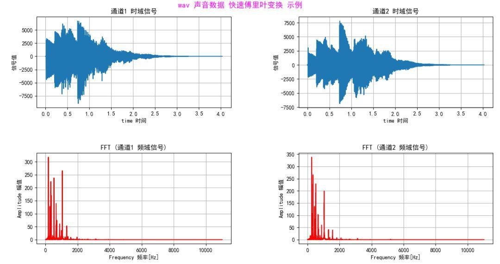

*[wav 声音文件快速傅里叶变换-腾讯云开发者社区-腾讯云](https://ask.qcloudimg.com/http-save/yehe-6021899/2yq0j522zs.jpeg) · 搜索词：audio signal time domain frequency domain FFT spectrum visualization*

在 ESP32-S3 上，可以使用轻量级 DSP 算法处理简单音频，也可以使用经过验证的第三方 DSP 库。

需要注意：复杂降噪、回声消除和语音识别会消耗较多 CPU 和内存资源，必须进行性能测试。

---

## 十二、JPEG：为什么摄像头通常不直接传输 RGB 图像？

我们回到图像处理。

假设一张 640 × 480 RGB565 图像：

$640\times480\times2=614400\text{ Bytes}$

也就是 600KB。

如果每秒传输 10 帧：

$614400\times10=6144000\text{ Bytes/s}$

即约 6.14MB/s。

这对于无线传输来说负担很大。

所以很多摄像头系统使用 JPEG 压缩。

### 1. JPEG 压缩原理

JPEG 是一种有损图像压缩技术。

大致过程：

```text
RGB 图像
   ↓
颜色空间转换
   ↓
图像分块
   ↓
离散余弦变换 DCT
   ↓
量化
   ↓
熵编码
   ↓
JPEG 文件
```

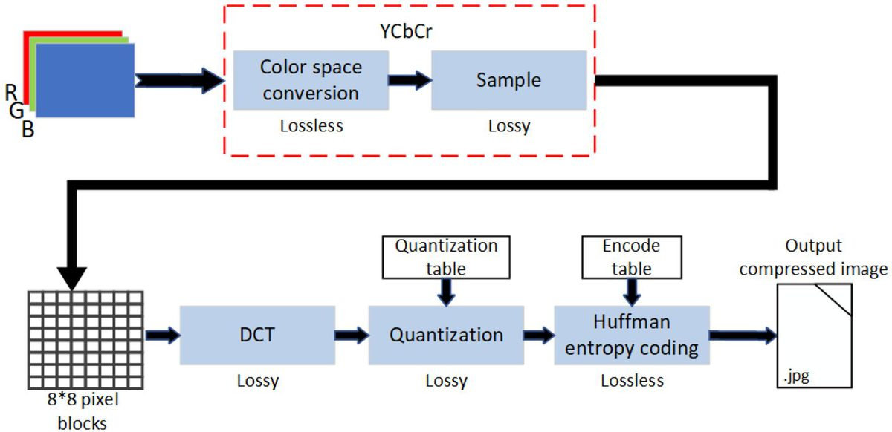

*[Optimization of User Service Rate with Image Compression in Edge Computing-Based Vehicular Networks | MDPI](https://www.mdpi.com/mathematics/mathematics-12-00558/article_deploy/html/images/mathematics-12-00558-g005.png) · 搜索词：JPEG compression pipeline RGB YCbCr DCT quantization entropy coding diagram*

JPEG 可以大幅降低图像数据量。

但压缩率取决于图像内容、分辨率和质量设置，不能保证每张图像都有固定压缩比例。

### 2. ESP32-S3 如何使用 JPEG？

常见方式有两种：

**方式 A：摄像头直接输出 JPEG**

摄像头传感器内部完成 JPEG 压缩，ESP32-S3 接收 JPEG 数据。

优点：

- 减少内存占用；
- 减少网络传输量；
- 减少后续压缩计算。

**方式 B：先采集 RGB，再软件压缩**

ESP32-S3 采集 RGB 图像，再进行 JPEG 编码。

优点：

- 可以进行图像处理；
- 可以先裁剪、调整颜色或尺寸。

缺点：

- CPU 开销增加；
- 需要更多内存；
- 处理速度受到软件编码器性能限制。

对于资源有限的项目，优先考虑摄像头直接输出 JPEG。

---

## 十三、摄像头图像如何通过 Wi-Fi 发送到电脑？

现在把摄像头、PSRAM、DMA 和 Wi-Fi 结合起来。

一个典型的图像传输架构：

**摄像头** 获取 JPEG 图像

↓

**LCD_CAM + DMA** 接收数据并搬运

↓

**PSRAM 帧缓冲区** 保存 JPEG 数据

↓

**Wi-Fi 网络任务** 通过 HTTP 或其他协议发送

↓

**电脑或服务器** 接收、保存、显示图像

### 1. 为什么要把采集任务和网络任务分开？

假设摄像头正在采集图像。

如果网络传输突然变慢，采集任务不能一直等待网络。

否则就可能发生：

- 帧缓冲区积压；
- 图像丢帧；
- 内存耗尽；
- 摄像头采集失败。

因此应该采用生产者—消费者模式：

```text
Camera Task
    ↓
Frame Queue
    ↓
Network Task
    ↓
HTTP Server
```

需要特别注意：帧缓冲区通常是有限资源。队列中保存的是帧缓冲区指针时，必须明确所有权，消费者使用完成后归还缓冲区，避免内存泄漏和重复释放。

### 2. 推荐传输方案

| 方案 | 适用场景 |
| --- | --- |
| HTTP POST | 上传单张图片 |
| HTTP MJPEG | 局域网连续图像预览 |
| WebSocket | 双向实时通信 |
| MQTT | 发送图像状态和元数据，不适合直接传输大量连续图像 |
| RTP/UDP | 对实时性要求较高的视频传输，需要自行处理可靠性 |

对于初学阶段，我建议先完成 HTTP 单张 JPEG 上传，再实现 MJPEG 实时预览。

---

## 十四、普通版 XIAO ESP32S3 的多媒体开发注意事项

这里回到你的实际开发板。

普通版 XIAO ESP32S3 并不是 Sense 版本。

在开发多媒体功能时，必须注意以下问题。

| 功能 | 普通版是否支持 | 额外要求 |
| --- | --- | --- |
| I2S 数字麦克风 | 支持 | 外接兼容麦克风 |
| I2S 数字功放 | 支持 | 外接功放和扬声器 |
| 摄像头采集 | 有条件支持 | 外接兼容摄像头和接口电路 |
| JPEG 网络传输 | 支持 | 有图像数据来源 |
| PCM 音频网络传输 | 支持 | 麦克风、音频缓冲区 |
| FFT 音频分析 | 支持 | DSP 算法和 CPU 资源 |
| Wi-Fi 音频传输 | 支持 | 网络缓冲及协议设计 |

### 1. 引脚冲突问题

这是 XIAO 项目中特别需要重视的地方。

前面我们学习过：

| XIAO 引脚 | ESP32-S3 GPIO | 常见功能 |
| --- | --- | --- |
| D0 | GPIO1 | GPIO / ADC |
| D1 | GPIO2 | GPIO / ADC |
| D2 | GPIO3 | GPIO / ADC |
| D3 | GPIO4 | GPIO / ADC |
| D4 | GPIO5 | I2C SDA |
| D5 | GPIO6 | I2C SCL |
| D6 | GPIO43 | UART TX |
| D7 | GPIO44 | UART RX |
| D8 | GPIO7 | SPI SCK |
| D9 | GPIO8 | SPI MISO |
| D10 | GPIO9 | SPI MOSI |

I2S 也可以通过 GPIO Matrix 分配到其他合适的引脚，但必须检查：

- 引脚是否已经使用；
- 是否有板载电路占用；
- 是否涉及启动绑带功能；
- 是否涉及 USB 或其他特殊功能；
- 是否满足外设时钟和电气要求。

不要把一套 I2S 示例的 GPIO 定义直接复制到所有工程。

### 2. 内存规划

对于普通版 XIAO ESP32S3：

- 音频小块缓冲优先考虑内部 RAM；
- 大型音频缓存可评估 PSRAM；
- 图像帧缓冲通常优先考虑 PSRAM；
- DMA 缓冲区必须符合对应驱动的内存要求；
- 任务栈和中断关键数据需要考虑内部 RAM。

尤其是同时运行 Wi-Fi、BLE、音频和摄像头时，不能只看 8MB PSRAM 的标称容量，还要监控内部 RAM 的可用量。

---

## 十五、建立多媒体系统的标准软件架构

建议以后在 XIAO-ESP32S3-Projects 中，为多媒体项目建立独立组件。

```text
components/
│
├── xiao_bsp/
│
├── camera_manager/
│   ├── camera_init.c
│   ├── camera_capture.c
│   ├── camera_buffer.c
│   └── camera_manager.h
│
├── audio_manager/
│   ├── audio_i2s.c
│   ├── audio_capture.c
│   ├── audio_playback.c
│   ├── audio_buffer.c
│   └── audio_manager.h
│
├── dsp_manager/
│   ├── audio_filter.c
│   ├── audio_vad.c
│   ├── audio_fft.c
│   └── dsp_manager.h
│
├── image_manager/
│   ├── jpeg_decoder.c
│   ├── image_process.c
│   └── image_manager.h
│
├── network_manager/
│   ├── image_upload.c
│   └── audio_stream.c
│
└── system_manager/
    ├── memory_monitor.c
    ├── task_monitor.c
    └── resource_manager.c
```

### 推荐任务划分

| FreeRTOS 任务 | 功能 | 设计重点 |
| --- | --- | --- |
| Camera Task | 摄像头采集 | 避免阻塞 |
| Audio Capture | 音频采集 | 保证连续性 |
| Audio Process | 音频处理 | 控制计算时间 |
| Network Task | 网络发送 | 允许超时和重试 |
| Display Task | 屏幕刷新 | 控制刷新频率 |
| System Monitor | 系统监控 | 内存与任务统计 |

实际工程中，任务优先级和 CPU 核心分配必须经过性能测试，不建议一开始就把所有任务固定在不同核心。

---

## 十六、给 Codex 的多媒体开发任务

可以将下面的要求交给 Codex，让它在现有 `XIAO-ESP32S3-Projects` 项目中建立多媒体基础组件。

**Codex 多媒体组件开发指令**

**复制指令**

请在项目中建立普通版 XIAO ESP32S3 多媒体基础组件。

要求：

- I2S 音频采集与播放。
- PCM 缓冲区管理。
- DMA 内存管理。
- JPEG 图像数据管理。
- HTTP 图像上传。
- FreeRTOS 多任务设计。
- 摄像头接口适配层。
- 内存和 CPU 性能监控。

特别要求：普通版摄像头硬件未确认之前，不允许编造引脚配置或声称摄像头程序可以直接烧录。

先静态分析和编译，不自动烧录。

---

## 十七、本课知识总结

这一课最重要的是理解四条数据处理链路。

**图像采集链路**

摄像头 → LCD_CAM → DMA → PSRAM → 图像处理

---

**音频采集链路**

数字麦克风 → I2S → DMA → PCM → DSP

---

**音频播放链路**

PCM → I2S → 数字功放 → 扬声器

---

**网络传输链路**

图像 / 音频 → 缓冲区 → Wi-Fi → HTTP / WebSocket → 服务器

你现在已经学习了 XIAO ESP32S3 的八个核心技术阶段：

| 课程 | 核心技术 |
| --- | --- |
| 第一课 | ESP32-S3 芯片架构 |
| 第二课 | CPU、寄存器、中断、时钟 |
| 第三课 | Flash、SRAM、PSRAM |
| 第四课 | 内存管理、DMA |
| 第五课 | GPIO、I2C、SPI、UART、ADC、PWM |
| 第六课 | FreeRTOS 多任务 |
| 第七课 | Wi-Fi、BLE、TCP/IP、MQTT、OTA |
| 第八课 | 摄像头、I2S、PCM、JPEG、DSP |

---

## 十八、下一课：ESP32-S3 底层安全、启动流程与固件结构

下一步建议进入更接近产品工程的内容。

**第九课：Bootloader、Flash 分区与固件启动机制**

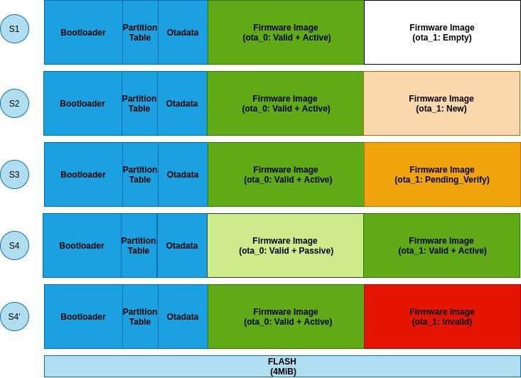

*[OTA Updates Framework. In this post we will discuss design and… | by Mahavir Jain | The ESP Journal | Medium](https://miro.medium.com/v2/resize%3Afit%3A1400/1%2AJq25sVCtXrv-WUQ0TIg2og.png) · 搜索词：ESP32 bootloader firmware startup partition table OTA flash memory architecture diagram*

学习内容：

1. ESP32-S3 上电后的启动过程。
2. Boot ROM 和 Second Stage Bootloader。
3. Flash 中的固件存储结构。
4. Partition Table 分区表。
5. NVS 配置存储。
6. Factory、OTA_0、OTA_1 分区。
7. 固件链接和 ELF 文件结构。
8. Secure Boot V2。
9. Flash Encryption。
10. OTA 回滚与固件恢复。
11. 如何制作可量产的 XIAO ESP32S3 固件。

这一课非常值得深入，因为它将解释一个关键问题：

**为什么 XIAO ESP32S3 上电后能够自动运行你的程序？固件究竟存放在 Flash 的什么位置？升级失败后又如何恢复？**

完成第九课后，我们就可以从单个驱动开发进一步进入完整固件工程、产品启动、安全和量产设计。
