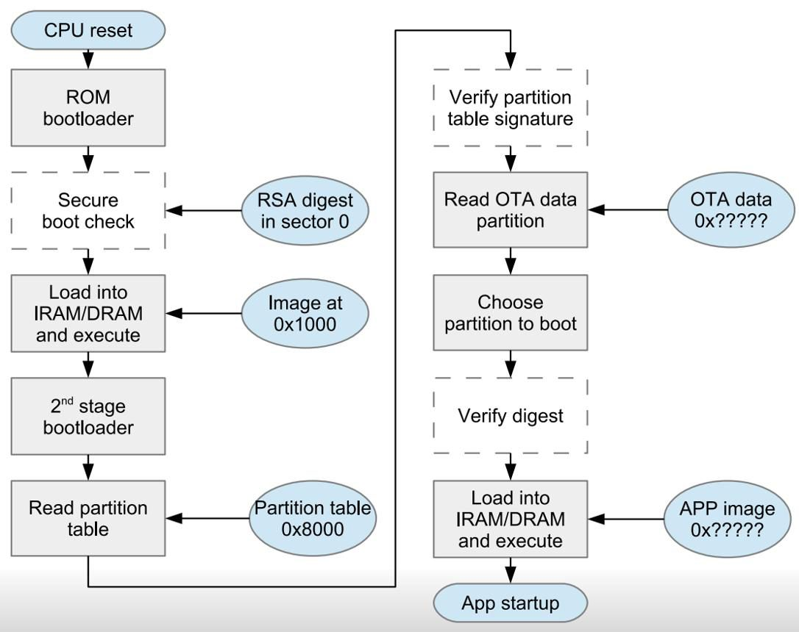
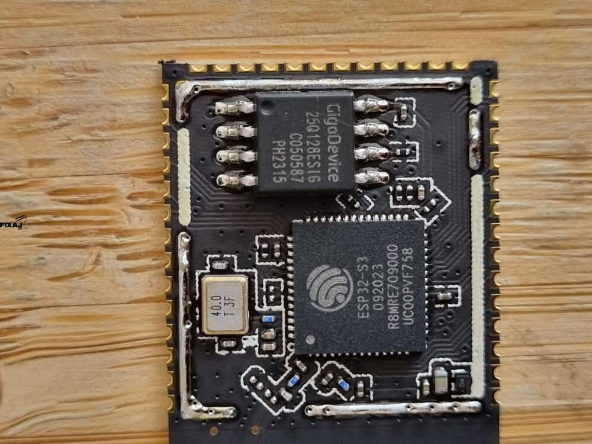
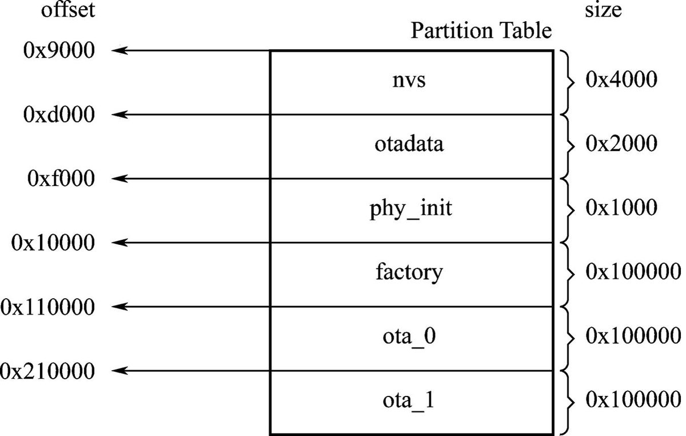
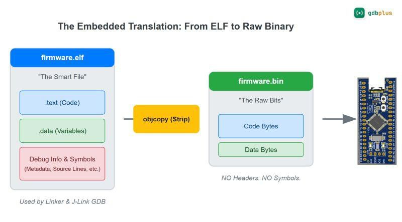

# 第九课：XIAO ESP32S3 启动原理、Bootloader、Flash 分区与固件安全

前面八课，我们已经学习了 XIAO ESP32S3 的主要开发技术：

- CPU、寄存器、中断和时钟；
- SRAM、Flash 和 PSRAM；
- GPIO、I2C、SPI、UART、ADC；
- FreeRTOS 多任务；
- Wi-Fi、BLE、MQTT 和 OTA；
- 摄像头、I2S 音频、DMA 和 JPEG。

现在进入嵌入式开发中非常重要的一部分：

**一块 ESP32-S3 开发板上电之后，究竟是如何找到并运行你的程序的？**

理解这部分之后，你就能理解：

1. 为什么需要 Bootloader？
2. 为什么固件要烧录到特定 Flash 地址？
3. 为什么 ESP32-S3 有分区表？
4. OTA 为什么需要两个固件分区？
5. 程序升级失败后如何恢复？
6. 如何防止别人随意读取和修改固件？

---

## 一、XIAO ESP32S3 上电后发生了什么？

先看整个启动过程。



*[Ideas for Developers :: ESP32 부팅 시퀀스(booting sequence), 부트로더(bootloader)](https://blog.kakaocdn.net/dna/1jSW6/btrbkW7bC3k/AAAAAAAAAAAAAAAAAAAAAAzlenBWuNGcI4AjTr9KBZjFaqErYzYqnZ6k6q6MgVY9/img.png?allow_ip=&allow_referer=&credential=yqXZFxpELC7KVnFOS48ylbz2pIh7yKj8&expires=1777561199&signature=747H6Kgr8aHN3mfX54V6PwXfSSo%3D) · 搜索词：ESP32 S3 boot process ROM bootloader second stage bootloader partition table application firmware startup flow diagram*

当你给 XIAO ESP32S3 接通 USB 或外部电源后，并不是直接运行 `app_main()`。

它需要经过多个阶段。

**① Power ON** 芯片上电、复位释放

↓

**② Boot ROM** 芯片内部固化的第一阶段启动代码

↓

**③ Second Stage Bootloader** 从外部 Flash 加载启动程序

↓

**④ Partition Table** 读取 Flash 分区布局

↓

**⑤ Application Firmware** 选择并加载应用固件

↓

**⑥ ESP-IDF System Initialization** 初始化系统、驱动、FreeRTOS

↓

**⑦ app_main()**执行你的应用程序

### 1. 第一阶段：Boot ROM

Boot ROM 是 ESP32-S3 芯片内部的只读启动代码。

它由芯片制造商固化，通常不能像普通应用程序一样修改。

主要负责：

- 读取启动配置；
- 判断启动模式；
- 初始化必要的硬件；
- 从 SPI Flash 加载第二阶段 Bootloader；
- 在下载模式下支持固件烧录。

例如你使用 USB 烧录程序时，芯片可以进入下载模式，由烧录工具通过 ROM 下载协议与芯片通信。

### 2. 第二阶段：Bootloader

Second Stage Bootloader 存放在外部 Flash 中。

它比 Boot ROM 更灵活，可以由 ESP-IDF 工程生成。

它主要负责：

- 读取分区表；
- 确定应用程序位置；
- 处理 OTA 启动分区；
- 验证固件（取决于安全配置）；
- 加载应用程序；
- 将控制权交给应用程序入口。

### 3. 第三阶段：Application

Bootloader 选择应用固件后，会完成必要的映射和启动准备，将执行流程交给应用程序。

随后 ESP-IDF 完成 C 运行环境和系统初始化，创建主任务，最终调用：

```c
void app_main(void)
{
    printf("XIAO ESP32S3 Started!\n");
}
```

这就是你平时编写的程序入口。

注意：`app_main()` 并不是芯片真正的第一条执行指令，它是在 ROM、Bootloader 和 ESP-IDF 初始化之后才执行的。

---

## 二、ESP32-S3 的 Flash 究竟是什么？

XIAO ESP32S3 使用外部 SPI Flash 保存固件和配置数据。

普通版 XIAO ESP32S3 常见规格为：

- 8MB Flash；
- 8MB PSRAM；
- ESP32-S3R8 核心模组。

具体项目仍然应该以板卡版本和实际芯片识别结果为准。



*[S3 ESP32 WROOM Çip N16R8 Diğer fixaj](https://shop.fixaj.com/s3-esp32-wroom-cip-n16r8-diger-fixaj-15305-48-B.jpg) · 搜索词：SPI NOR flash memory chip embedded ESP32 development board close up*

### 1. Flash 和 RAM 的区别

| 特性 | Flash | SRAM | PSRAM |
| --- | --- | --- | --- |
| 断电保存 | 是 | 否 | 否 |
| 主要用途 | 固件、配置、文件 | 实时运行数据 | 大型运行缓存 |
| 访问速度 | 相对较慢 | 快 | 通常低于内部 SRAM |
| 擅长频繁读写 | 不适合直接当普通 RAM | 适合 | 适合 |
| 擅长保存程序 | 是 | 否 | 通常不作为固件存储 |

这里特别注意：

Flash 不是 RAM。

程序虽然存储在 Flash 中，但运行时 ESP32-S3 可以通过 Flash 映射机制访问代码和只读数据。

PSRAM 则主要用于运行时数据缓存。

### 2. Flash 为什么不能像 RAM 一样随意修改？

SPI NOR Flash 的写入和擦除具有特殊限制：

- 读取可以按字节进行；
- 编程通常要求遵循页编程规则；
- 擦除以扇区或更大的块为单位；
- 不能简单地把任意一个 bit 从 0 改成 1。

通常需要先擦除对应区域，再写入新数据。

因此不能把 Flash 当成普通 C 数组：

```c
char *p = (char *)0x3F0000;

p[0] = 123; // 不能这样直接写 Flash
```

要使用 ESP-IDF 提供的 Flash API、NVS 或文件系统。

---

## 三、Partition Table：Flash 分区表是什么？

这是本课最核心的知识。

假设你的开发板拥有 8MB Flash。

如果将整个 Flash 都当成一个固件区域，那么就很难同时实现：

- 保存设备配置；
- 保存文件；
- 保存 OTA 固件；
- 保留旧版本固件；
- 存储设备校准数据。

因此需要把 Flash 划分成多个区域。

这就是 Partition Table。



*[What Is Partition Table Entry at Fred Mounce blog](https://espressif.github.io/esp32-c3-book-en/Pics/D11Z/11-2.png) · 搜索词：ESP32 flash partition table nvs otadata phy_init factory ota_0 ota_1 spiffs layout diagram*

### 1. 常见 Flash 分区

| 分区 | 类型 | 作用 |
| --- | --- | --- |
| NVS | data | 保存 Wi-Fi、设备配置等 |
| otadata | data | 保存 OTA 启动选择信息 |
| phy_init | data | 保存无线 PHY 初始化数据 |
| factory | app | 出厂固件 |
| ota_0 | app | OTA 固件槽位 0 |
| ota_1 | app | OTA 固件槽位 1 |
| spiffs | data | 文件存储 |
| littlefs | data | 文件存储 |

不是每个项目都需要这些分区。

例如普通联网设备可以只使用 NVS、otadata、两个 OTA 分区和 PHY 初始化分区。

### 2. 一个 8MB Flash 分区示意

**8MB Flash 概念布局**

**Bootloader** 约 32KB

**Partition Table** 4KB

**NVS / OTA Data / PHY** 配置区

**OTA_0** 固件槽位

**OTA_1** 固件槽位

**LittleFS / SPIFFS** 文件存储

*概念布局，不是可以直接烧录的实际地址表。各区域大小必须根据固件体积、Flash 实际容量和文件需求计算。*

### 3. 为什么 OTA 需要两个分区？

假设设备当前运行：

```text
OTA_0：固件 V1.0
OTA_1：空闲
```

现在你准备升级到 V1.1。

不能直接覆盖正在运行的 V1.0。

因为一旦下载失败或断电，设备可能无法正常启动。

正确方式：

```text
当前运行 OTA_0
       ↓
下载 V1.1
       ↓
写入 OTA_1
       ↓
校验固件
       ↓
设置 OTA_1 为下次启动
       ↓
重启设备
       ↓
运行 V1.1
```

如果新固件启动失败并且启用了回滚机制，就可以恢复到 V1.0。

这就是双分区 OTA 的基本原理。

---

## 四、实际创建自己的 Flash 分区表

现在我们不只理解概念，还要学习如何在 ESP-IDF 中配置分区。

ESP-IDF 使用 CSV 文件描述分区布局。

例如创建：

```text
partitions.csv
```

### 1. 一个适合 8MB Flash 的教学分区方案

下面是一个示例：

```csv
# Name,    Type, SubType, Offset,   Size,    Flags
nvs,       data, nvs,     0x9000,   0x6000,
otadata,   data, ota,     0xF000,   0x2000,
phy_init,  data, phy,     0x11000,  0x1000,
ota_0,     app,  ota_0,   0x20000,  0x280000,
ota_1,     app,  ota_1,   0x2A0000, 0x280000,
littlefs,  data, spiffs,  0x520000,0x2E0000,
```

这个例子总共使用 8MB Flash 的地址空间。

| 分区 | 起始地址 | 大小 |
| --- | --- | --- |
| NVS | 0x9000 | 24KB |
| OTA Data | 0xF000 | 8KB |
| PHY Init | 0x11000 | 4KB |
| OTA_0 | 0x20000 | 2.5MB |
| OTA_1 | 0x2A0000 | 2.5MB |
| 文件系统 | 0x520000 | 2.875MB |

注意：

- 这是教学用分区布局，不是所有项目的通用最佳方案。
- `spiffs` 是分区子类型名称，实际使用 LittleFS 时需要相应文件系统组件支持。
- OTA 固件必须能完整装入两个 OTA 分区。
- 还要为 Bootloader、分区表和其他系统数据保留空间。
- 实际构建时必须确认所有分区没有重叠，并且符合擦除扇区对齐要求。

### 2. 如何让 ESP-IDF 使用这个文件？

打开：

```bash
idf.py menuconfig
```

进入：

```text
Partition Table
    ↓
Partition Table
    ↓
Custom partition table CSV
    ↓
partitions.csv
```

然后保存配置。

也可以检查 `sdkconfig` 中的配置：

```text
CONFIG_PARTITION_TABLE_CUSTOM=y
CONFIG_PARTITION_TABLE_CUSTOM_FILENAME="partitions.csv"
```

### 3. 编译并查看分区表

在项目目录执行：

```bash
idf.py build
```

编译后检查：

```text
build/
├── bootloader/
├── partition_table/
│   └── partition-table.bin
├── app.bin
└── project.elf
```

还可以使用：

```bash
idf.py partition-table
```

查看最终分区表。

---

## 五、NVS：为什么设备断电后还能记住 Wi-Fi 密码？

NVS 是 Non-Volatile Storage，即非易失性存储。

它基于 Flash，用来保存设备配置。

例如：

- Wi-Fi SSID；
- Wi-Fi 密码；
- 设备名称；
- 工作模式；
- 用户设置；
- 设备校准参数。

### 1. NVS 工作原理

**应用程序**

↓

**NVS API** nvs_set_str / nvs_get_str / nvs_commit

↓

**NVS 分区** Flash 持久化存储

### 2. NVS 写入示例

```c
#include "nvs.h"
#include "nvs_flash.h"
#include "esp_err.h"

void save_device_name(void)
{
    ESP_ERROR_CHECK(nvs_flash_init());

    nvs_handle_t handle;

    ESP_ERROR_CHECK(
        nvs_open("device", NVS_READWRITE, &handle)
    );

    ESP_ERROR_CHECK(
        nvs_set_str(
            handle,
            "name",
            "XIAO_ESP32S3"
        )
    );

    ESP_ERROR_CHECK(nvs_commit(handle));

    nvs_close(handle);
}
```

### 3. NVS 读取示例

```c
void read_device_name(void)
{
    nvs_handle_t handle;

    ESP_ERROR_CHECK(
        nvs_open("device", NVS_READONLY, &handle)
    );

    size_t required_size = 0;

    esp_err_t err = nvs_get_str(
        handle,
        "name",
        NULL,
        &required_size
    );

    if (err == ESP_OK && required_size > 0) {

        char name[64];

        if (required_size <= sizeof(name)) {

            ESP_ERROR_CHECK(
                nvs_get_str(
                    handle,
                    "name",
                    name,
                    &required_size
                )
            );

            printf("Device name: %s\n", name);
        }
    }

    nvs_close(handle);
}
```

注意，真实工程还应该统一处理 `ESP_ERR_NVS_NOT_FOUND`、分区初始化失败和 NVS 分区需要升级或擦除的情况。

### 4. NVS 为什么不建议频繁写入？

Flash 有擦写寿命。

如果你每隔 10ms 就把传感器数据写入 NVS，会造成大量写入操作。

建议：

- 配置变化时写入；
- 重要状态变化时写入；
- 传感器实时数据放 RAM；
- 大量日志使用文件系统或专用存储方案；
- 需要高频记录时考虑外部存储器。

**NVS 更适合保存设备状态和配置，而不是作为实时数据记录器。**

---

## 六、OTA 回滚：升级失败后如何恢复？

这部分是产品开发非常重要的知识。

假设：

- OTA_0 当前运行 V1.0；
- OTA_1 准备升级 V1.1。

新固件下载成功，不代表升级已经真正成功。

因为新固件可能存在：

- 初始化失败；
- Wi-Fi 无法连接；
- 外设驱动错误；
- 内存不足；
- 看门狗复位；
- 业务程序异常。

因此需要固件自检。

### 1. OTA 回滚工作机制

**当前固件 V1.0** **正常运行**

↓

**下载 V1.1 到 OTA_1**

↓

**切换启动分区并重启**

↓

- **自检成功** 确认 V1.1 有效
- **自检失败** 回滚到 V1.0

### 2. ESP-IDF 回滚配置

在 `menuconfig` 中找到：

```text
Component config
    ↓
ESP System Settings
    ↓
Bootloader config
    ↓
Enable app rollback support
```

对应配置通常是：

```text
CONFIG_BOOTLOADER_APP_ROLLBACK_ENABLE=y
```

具体菜单位置会随 ESP-IDF 版本变化。

### 3. 新固件启动自检

在 `app_main()` 中，可以使用：

```c
#include "esp_ota_ops.h"
#include "esp_system.h"
#include "esp_log.h"

static const char *TAG = "OTA";

void app_main(void)
{
    const esp_partition_t *running =
        esp_ota_get_running_partition();

    esp_ota_img_states_t state;

    if (esp_ota_get_state_partition(
            running,
            &state
        ) == ESP_OK) {

        if (state == ESP_OTA_IMG_PENDING_VERIFY) {

            ESP_LOGI(TAG, "New firmware, self testing");

            bool test_ok = true;

            // 这里应执行真实硬件和系统自检
            // 例如 NVS、GPIO、关键外设、业务初始化

            if (test_ok) {
                ESP_ERROR_CHECK(
                    esp_ota_mark_app_valid_cancel_rollback()
                );
            } else {
                ESP_ERROR_CHECK(
                    esp_ota_mark_app_invalid_rollback_and_reboot()
                );
            }
        }
    }
}
```

这里的 `test_ok = true` 只是示例，不能直接用于生产设备。

实际产品应该根据硬件初始化、系统稳定性和关键业务功能判断升级是否成功。

---

## 七、Secure Boot：如何防止未经授权的固件运行？

现在进入嵌入式设备安全。

假设你的设备已经部署在用户手中。

有人可能尝试：

- 修改 Flash 固件；
- 刷入恶意固件；
- 替换 Bootloader；
- 读取程序内部的密钥；
- 修改设备控制逻辑。

Secure Boot 就是用于保护启动链的重要机制。

### 1. Secure Boot 工作原理

ESP32-S3 支持 Secure Boot V2。

它使用数字签名验证启动代码和应用固件。

**Boot ROM** 启动安全验证流程

↓

**验证 Bootloader 签名** 确认可信启动代码

↓

**验证应用固件** 检查数字签名和可信性

↓

**执行经过验证的固件**

如果固件签名不正确，安全启动机制会阻止其正常启动。

### 2. 数字签名是什么？

可以简单理解为：

开发者使用私钥给固件生成签名。

设备使用对应的可信公钥验证签名。

```text
开发电脑
   ↓
固件 firmware.bin
   ↓
私钥签名
   ↓
signed firmware
   ↓
烧录到 XIAO ESP32S3
   ↓
设备验证签名
   ↓
验证成功才允许执行
```

私钥必须保存在安全的位置，不能直接放进公开 GitHub 仓库。

### 3. Secure Boot 和普通 OTA 的区别

| 功能 | 普通 OTA | Secure Boot |
| --- | --- | --- |
| 下载新固件 | 支持 | 不负责下载 |
| 验证数据完整性 | 可配置 | 结合签名验证 |
| 验证固件来源 | 不一定 | 通过可信签名链 |
| 阻止未授权固件 | 不一定 | 是其主要目标 |
| 解决断电升级 | 需要 OTA 分区和回滚 | 不负责解决 |

生产设备建议把 OTA、Secure Boot 和固件签名结合起来。

---

## 八、Flash Encryption：防止别人直接读取固件

Secure Boot 主要解决固件是否可信。

Flash Encryption 主要解决 Flash 中的数据保护。

ESP32-S3 支持基于硬件加密机制的 Flash Encryption。

### 1. 工作原理

**Flash 写入数据** 固件、敏感数据

↓

**Flash Encryption** 使用硬件密钥加密机制

↓

**Flash 中保存密文** 直接读取无法得到明文固件

↓

**芯片读取时自动解密** 正常执行固件

### 2. 两种安全技术的区别

| 技术 | 解决的问题 |
| --- | --- |
| Secure Boot | 谁可以运行固件 |
| Flash Encryption | 如何保护 Flash 数据 |
| HTTPS | 网络传输如何加密 |
| MQTT Authentication | 谁可以连接消息服务器 |
| OTA Signature | 谁可以发布升级固件 |

这几项并不互相替代。

### 3. 一个重要提醒

Secure Boot 和 Flash Encryption 都涉及 eFuse 配置。

部分 eFuse 一旦烧写就无法恢复。

因此不要为了学习而直接在自己的开发板上执行永久性安全配置。

建议先使用 ESP-IDF 官方安全启动测试流程，熟悉签名、密钥、烧录和恢复机制，再考虑正式启用。

官方资料：

[ESP32-S3 Secure Boot V2](https://docs.espressif.com/projects/esp-idf/en/stable/esp32s3/security/secure-boot-v2.html)[ESP32-S3 Flash Encryption](https://docs.espressif.com/projects/esp-idf/en/stable/esp32s3/security/flash-encryption.html)

---

## 九、ESP-IDF 编译出来的文件分别是什么？

这是以后使用 Codex 开发和管理固件必须掌握的知识。

当你执行：

```bash
idf.py build
```

ESP-IDF 不只是生成一个 BIN 文件，而是生成多个不同用途的文件。

| 文件 | 用途 |
| --- | --- |
| `bootloader.bin` | 第二阶段 Bootloader |
| `partition-table.bin` | Flash 分区表 |
| `app.bin` | 应用固件 |
| `project.elf` | 包含调试信息的 ELF 文件 |
| `project.map` | 链接地址和内存占用信息 |
| `flasher_args.json` | 烧录地址和文件信息 |
| `sdkconfig` | 工程配置 |

### 1. BIN 和 ELF 有什么区别？

- **BIN 文件** 适合烧录到 Flash 的固件二进制数据。
- **ELF 文件** 包含程序段、符号和调试信息，适合 GDB 分析。

例如：

```bash
idf.py build
```

生成：

```text
build/
├── bootloader/
│   └── bootloader.bin
├── partition_table/
│   └── partition-table.bin
├── xiao_firmware.bin
├── xiao_firmware.elf
├── xiao_firmware.map
└── flasher_args.json
```

其中：

- BIN 用于烧录和 OTA；
- ELF 用于调试；
- MAP 用于分析代码和内存布局。

### 2. 如何查看固件大小？

ESP-IDF 提供：

```bash
idf.py size
```

查看整体占用。

```bash
idf.py size-components
```

查看不同组件占用。

```bash
idf.py size-files
```

查看不同目标文件占用。

例如，你发现 MQTT、TLS、图像处理库占用过多，就可以进一步分析对应组件。

### 3. 如何检查固件是否超过 OTA 分区？

假设 OTA 分区为 2.5MB。

编译出来的 `app.bin` 如果超过这个容量，就无法正常写入对应 OTA 分区。

因此每次正式构建都应检查：

```text
Application binary size
       ↓
OTA partition size
       ↓
是否能够容纳
       ↓
是否预留增长空间
```

不要等到产品升级时才发现新固件装不进去。

---

## 十、如何调试 ESP32-S3 的启动过程？

掌握启动原理之后，下一步就是学会分析启动日志。

### 1. 打开串口日志

可以使用：

```bash
idf.py monitor
```

或者：

```bash
idf.py -p /dev/cu.usbmodemXXXX monitor
```

Mac 上可以先检查串口：

```bash
ls /dev/cu.*
```

然后找到对应 XIAO ESP32S3 的串口设备。

### 2. 典型启动日志

例如：

```text
ESP-ROM:esp32s3-20210327

Build:Mar 27 2021

rst:0x1 (POWERON)

boot:0x8 (SPI_FAST_FLASH_BOOT)

I (30) boot: ESP-IDF v5.x

I (40) boot: Partition Table:

I (60) boot: nvs

I (70) boot: otadata

I (80) boot: ota_0

I (100) cpu_start: Starting scheduler

I (150) app_main: XIAO ESP32S3 Started!
```

不同芯片版本和 ESP-IDF 版本输出会不同，这里只是示意。

### 3. 常见启动故障

| 现象 | 可能原因 |
| --- | --- |
| 找不到启动固件 | Flash 内容或烧录地址错误 |
| Invalid partition table | 分区表损坏或布局错误 |
| Invalid image | 固件格式、完整性或签名错误 |
| OTA 启动失败 | 分区空间不足或镜像异常 |
| Boot loop | 程序异常、看门狗或启动配置问题 |
| Brownout | 电源电压不稳定 |

### 4. 如何分析崩溃地址？

ESP32-S3 出现异常时，串口可能打印：

```text
Guru Meditation Error

Core 0 panic'ed

Backtrace: 0x4037xxxx:0x3fcexxxx ...
```

可以使用：

```bash
idf.py monitor
```

配合当前工程的 ELF 文件解析回溯。

也可以使用：

```bash
xtensa-esp32s3-elf-addr2line \
    -e build/xiao_firmware.elf \
    -a -f -p 0x4037xxxx
```

这样可以将异常地址映射到具体函数和源码位置。

注意：地址必须替换成日志中真实的地址，而且必须使用产生该固件的同一版本 ELF 文件，否则解析结果可能不准确。

---

## 十一、把这些知识整合成一套 XIAO ESP32S3 产品固件架构

现在可以把前面九课的内容组合起来。

**XIAO ESP32S3 产品固件整体架构**

**Application Layer** 设备业务、用户逻辑、设备状态机

- **Network** Wi-Fi / BLE / MQTT / OTA
- **Multimedia** Camera / I2S / JPEG / DSP
- **System** FreeRTOS / NVS / Event
- **Drivers** GPIO / I2C / SPI / UART

**ESP-IDF Runtime** Bootloader / Scheduler / Drivers / Memory

**Flash + SRAM + PSRAM** 固件、配置、运行数据、缓存

**ESP32-S3 Hardware** CPU / Wi-Fi / BLE / GPIO / DMA / I2S

### 推荐的工程目录

```text
XIAO-ESP32S3-Projects/
│
├── boards/
│   └── xiao_esp32s3/
│       ├── board_config.h
│       ├── pins.h
│       └── partitions.csv
│
├── bootloader/
│
├── main/
│   └── app_main.c
│
├── components/
│   ├── xiao_bsp/
│   ├── system_manager/
│   ├── network_manager/
│   ├── audio_manager/
│   ├── camera_manager/
│   ├── storage_manager/
│   └── security_manager/
│
├── configs/
│   ├── sdkconfig.defaults
│   └── firmware_config.h
│
├── docs/
│   ├── boot_process.md
│   ├── flash_partition.md
│   ├── ota_design.md
│   ├── security_design.md
│   └── firmware_release.md
│
└── tools/
    ├── build.sh
    ├── flash.sh
    └── inspect_firmware.sh
```

这是一种推荐的组织方式。ESP-IDF 的 Bootloader 通常由构建系统生成，不需要把它当作普通应用组件手动维护。

---

## 十二、本课实战：自己检查 XIAO ESP32S3 的固件

建议使用现有的 ESP-IDF 工程进行实验。

### 实验一：检查芯片和 Flash 信息

```c
#include "esp_chip_info.h"
#include "esp_flash.h"
#include "esp_log.h"

void print_chip_info(void)
{
    esp_chip_info_t chip_info;

    esp_chip_info(&chip_info);

    uint32_t flash_size = 0;

    esp_flash_get_size(
        NULL,
        &flash_size
    );

    printf("CPU cores: %d\n", chip_info.cores);

    printf(
        "Flash size: %lu MB\n",
        (unsigned long)(flash_size / (1024 * 1024))
    );

    printf(
        "Revision: %d\n",
        chip_info.revision
    );
}
```

这可以帮助确认实际芯片信息和 Flash 容量。

### 实验二：读取当前运行分区

```c
#include "esp_ota_ops.h"
#include "esp_partition.h"

void print_running_partition(void)
{
    const esp_partition_t *partition =
        esp_ota_get_running_partition();

    if (partition != NULL) {

        printf("Partition: %s\n",
               partition->label);

        printf("Address: 0x%lx\n",
               (unsigned long)partition->address);

        printf("Size: %lu\n",
               (unsigned long)partition->size);
    }
}
```

### 实验三：检查 NVS

完成以下操作：

1. 写入设备名称。
2. 断电。
3. 重新上电。
4. 读取设备名称。
5. 确认数据仍然存在。

### 实验四：制作 OTA 测试固件

建议先使用两个简单版本：

- V1.0：串口输出 `Firmware V1.0`。
- V1.1：串口输出 `Firmware V1.1`。

完成：

1. 烧录 V1.0。
2. 使用 OTA 下载 V1.1。
3. 检查启动分区变化。
4. 验证 V1.1 是否正常运行。
5. 再测试回滚机制。

不要一开始就在真实设备上启用 Secure Boot 和永久性 eFuse 配置。

## 十三、本课学习验收

**第九课学习进度**/

- [ ] **理解 Boot ROM 和 Bootloader** 能够解释芯片从上电到 app_main 的启动过程。

- [ ] **查看 Flash 容量** 使用 ESP-IDF 获取真实 Flash 大小。

- [ ] **创建自定义分区表** 能够配置 NVS、OTA_0、OTA_1 和文件系统。

- [ ] **完成 NVS 读写** 断电后配置仍然保留。

- [ ] **查看 ELF 和 BIN 文件** 理解固件、调试文件和 MAP 文件的区别。

- [ ] **检查启动日志** 能够定位常见启动失败原因。

- [ ] **完成 OTA 升级实验** 实现 V1.0 到 V1.1 的升级。

- [ ] **理解安全启动和 Flash Encryption** 能够区分固件认证与 Flash 数据加密。

## 十四、下一课：ESP-IDF 工程构建、链接器与底层调试

**第十课：从 C 代码到 ESP32-S3 可执行固件**



*[STM32 Round-Robin Task Scheduler in Bare Metal C | Kshitij Vaze posted on the topic | LinkedIn](https://media.licdn.com/dms/image/v2/D5622AQHwg1bNx_OUMg/feedshare-shrink_800/B56ZtajLl5K8Ag-/0/1766750731641?e=2147483647&t=5KgAeuzVOF0qeFMweiTSQhd6OQ4KZQRbQXAHFVDVd6o&v=beta) · 搜索词：embedded firmware compilation pipeline C compiler linker ELF BIN ESP32 microcontroller diagram*

下一课将深入学习：

1. C 代码如何变成机器指令。
2. GCC 编译器和 Xtensa 指令集。
3. 预处理、编译、汇编和链接。
4. CMake 与 ESP-IDF 构建系统。
5. 静态库和动态库的区别。
6. ELF 文件结构。
7. Linker Script 链接脚本。
8. IRAM、DRAM、Flash 和 PSRAM 的内存布局。
9. GDB、OpenOCD 和 JTAG 调试。
10. 如何分析内存溢出、异常和性能瓶颈。

**第十课的目标：** 不仅知道怎么写 ESP32-S3 程序，还能理解编译器如何生成机器代码、程序如何分配到芯片内存，以及如何通过调试器定位底层问题。

这一步完成之后，你就开始具备独立分析 ESP-IDF 底层工程的能力，而不只是使用现成示例开发。

官方资料：

- [ESP-IDF 启动流程](https://docs.espressif.com/projects/esp-idf/en/stable/esp32s3/api-guides/startup.html)
- [Flash 分区表](https://docs.espressif.com/projects/esp-idf/en/stable/esp32s3/api-guides/partition-tables.html)
- [NVS 存储](https://docs.espressif.com/projects/esp-idf/en/stable/esp32s3/api-reference/storage/nvs_flash.html)
- [固件大小分析](https://docs.espressif.com/projects/esp-idf/en/stable/esp32s3/api-guides/tools/idf-size.html)

**学习建议：** 目前先不要急于做复杂产品。把启动、分区、NVS、OTA 和编译调试这些基础打牢，后面你在 `XIAO-ESP32S3-Projects` 中管理和改造 GitHub 开源项目时，就能更准确地判断一个项目是否真正适合 XIAO ESP32S3。
