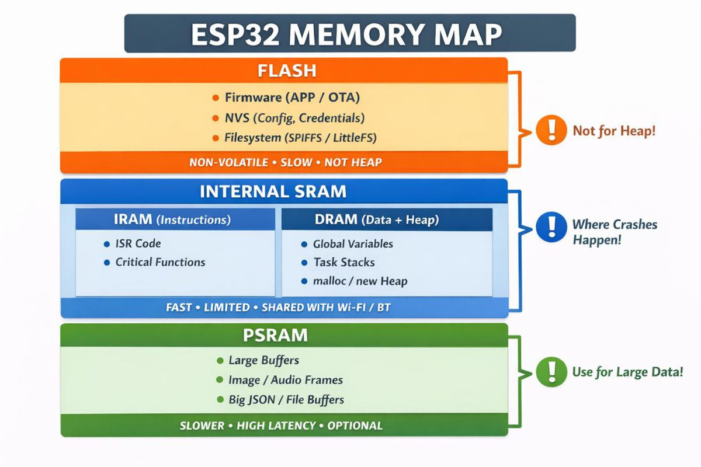
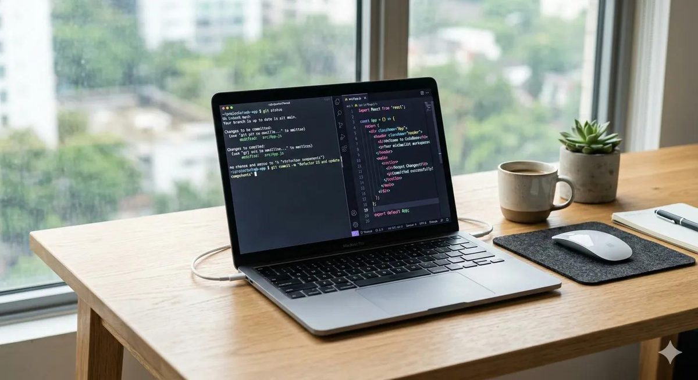
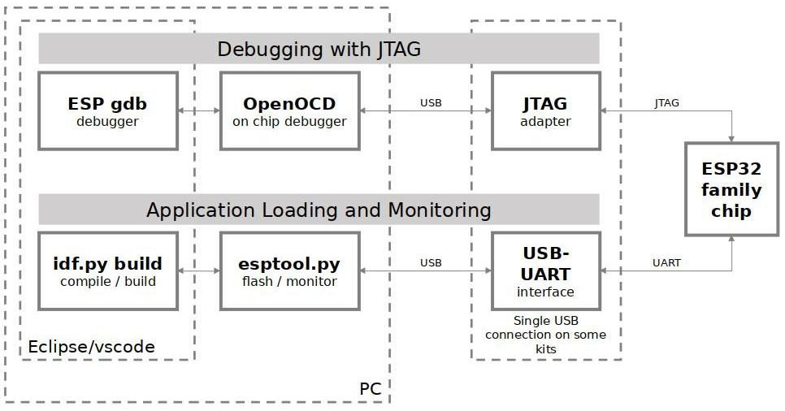

# 第十课：ESP-IDF 工程构建、编译器、链接器与底层调试

前面九课，我们已经从 ESP32-S3 芯片架构，一直学习到了 Bootloader、Flash 分区、OTA 和固件安全。

现在进入嵌入式软件开发最重要的底层知识之一：

**你编写的 C 代码，究竟是如何变成 ESP32-S3 能够执行的机器指令的？**

这节课将帮助你理解：

1. C 语言如何变成机器代码。
2. GCC 编译器如何工作。
3. Xtensa LX7 指令集是什么。
4. CMake 和 ESP-IDF 如何组织工程。
5. 链接器如何分配程序内存。
6. ELF、BIN 和 MAP 文件的关系。
7. IRAM、DRAM、Flash 和 PSRAM 如何分配。
8. 如何使用 GDB、OpenOCD 调试 XIAO ESP32S3。

---

## 一、从 C 代码到机器指令

先看一个最简单的程序：

```c
#include <stdio.h>

int main(void)
{
    int a = 10;
    int b = 20;

    int c = a + b;

    printf("Result: %d\n", c);

    return 0;
}
```

你写的是 C 语言，但 ESP32-S3 并不能直接理解 `int a = 10` 这样的语句。

它只能执行 CPU 指令。

因此必须经过编译流程。

**C 语言编译全过程**

**C 源代码** main.c

↓

**预处理 Preprocessor** 展开宏、头文件、条件编译

↓

**编译 Compiler** C 代码转换成汇编指令

↓

**汇编 Assembler** 汇编转换为目标文件 .o

↓

**链接 Linker** 组合目标文件和库，解决符号与地址

↓

**ELF 文件** 包含机器代码、符号和调试信息

↓

**BIN 文件** 生成适合烧录的二进制镜像

这里有一个重要区别：

- Compiler 负责把 C 语言转换为目标代码。
- Assembler 负责生成目标文件。
- Linker 负责把多个目标文件组合起来，解决函数和变量的地址。

---

## 二、预处理器：C 语言真正编译之前发生了什么？

我们经常写：

```c
#include "driver/gpio.h"

#define LED_GPIO 21

#ifdef CONFIG_FREERTOS_UNICORE
    #define SINGLE_CORE 1
#endif
```

这些内容并不是 CPU 指令。

它们属于 C 预处理器的工作范围。

### 1. 头文件展开

例如：

```c
#include <stdio.h>
```

预处理器会把对应头文件中的声明展开到源代码中。

### 2. 宏替换

```c
#define LED_GPIO 21

gpio_set_level(LED_GPIO, 1);
```

预处理之后相当于：

```c
gpio_set_level(21, 1);
```

### 3. 条件编译

```c
#ifdef CONFIG_IDF_TARGET_ESP32S3

printf("ESP32-S3\n");

#endif
```

只有条件成立时，这段代码才会进入后续编译过程。

这也是为什么 ESP-IDF 的 `sdkconfig` 非常重要。

它决定了很多功能是否真正进入最终固件。

### 4. 实际实验

在 ESP-IDF 工程目录执行：

```bash
idf.py preprocess
```

如果当前 ESP-IDF 版本或工程组件不支持这个快捷目标，可以使用实际编译命令中的 `-E` 参数对单个 C 文件执行预处理。

例如：

```bash
xtensa-esp32s3-elf-gcc \
    -E main/main.c \
    -I main \
    -o main.i
```

注意：真实 ESP-IDF 工程还有大量自动生成的头文件和编译宏，直接运行上面的简化命令可能找不到完整依赖。初学阶段更推荐从 `build/compile_commands.json` 中复制真实编译命令。

---

## 三、GCC：ESP32-S3 的编译器

ESP32-S3 使用 Xtensa LX7 处理器。

因此不能使用普通电脑上的 x86 GCC 来直接编译 ESP32-S3 固件。

需要使用对应的交叉编译工具链。

常见工具：

```text
xtensa-esp32s3-elf-gcc
xtensa-esp32s3-elf-g++
xtensa-esp32s3-elf-as
xtensa-esp32s3-elf-ld
xtensa-esp32s3-elf-objdump
xtensa-esp32s3-elf-objcopy
xtensa-esp32s3-elf-size
```

### 1. 什么叫交叉编译？

你的 Mac 使用 Apple Silicon 处理器。

但是 XIAO ESP32S3 使用 Xtensa LX7。

因此：

```text
Mac
  ↓
交叉编译工具链
  ↓
Xtensa 机器指令
  ↓
ESP32-S3
```

编译器运行在 Mac 上，生成的程序却运行在 ESP32-S3 上。

这就叫交叉编译。

### 2. 查看工具链版本

打开 Mac 终端：

```bash
xtensa-esp32s3-elf-gcc --version
```

如果没有找到命令，先加载 ESP-IDF 环境：

```bash
. $HOME/esp/esp-idf/export.sh
```

如果你的 ESP-IDF 安装在其他位置，应替换成真实路径。

然后执行：

```bash
which xtensa-esp32s3-elf-gcc
```

### 3. 编译器优化

GCC 常见优化级别：

| 参数 | 含义 | 使用场景 |
| --- | --- | --- |
| `-O0` | 不优化 | 调试 |
| `-O1` | 基础优化 | 普通开发 |
| `-O2` | 较高优化 | 性能开发 |
| `-Os` | 优先减小体积 | Flash 空间紧张 |
| `-Og` | 兼顾调试体验 | 开发调试 |

例如：

```bash
xtensa-esp32s3-elf-gcc -O0
```

与：

```bash
xtensa-esp32s3-elf-gcc -O2
```

生成的机器代码可能差异很大。

注意，优化后变量可能被消除、合并或放入寄存器，调试时看到的变量值和源码行不一定一一对应。

---

## 四、Xtensa LX7：CPU 究竟执行什么指令？

这是本课非常重要的知识。

C 语言只是人类编写程序的语言。

真正被 ESP32-S3 执行的是 Xtensa 指令集。

例如：

```c
int a = 10;
int b = 20;
int c = a + b;
```

编译器可能生成类似这样的汇编：

```asm
movi    a2, 10
movi    a3, 20
add     a4, a2, a3
```

这里：

- `movi`：将立即数加载到寄存器；
- `add`：执行加法；
- `a2`、`a3`、`a4`：寄存器。

这是概念示例，实际汇编会受到优化、ABI 和寄存器分配影响。

### 1. 查看真实汇编

假设已经编译了工程：

```bash
xtensa-esp32s3-elf-objdump \
    -d build/你的工程名.elf
```

可以查看整个程序的反汇编。

只看某个函数：

```bash
xtensa-esp32s3-elf-objdump \
    -d \
    --disassemble=app_main \
    build/你的工程名.elf
```

这样你就可以观察：

```text
C 语言
  ↓
编译器优化
  ↓
Xtensa 汇编
  ↓
机器指令
```

### 2. 为什么要学汇编？

你不需要一开始就精通 Xtensa 汇编。

但需要具备以下能力：

- 识别函数调用；
- 识别寄存器操作；
- 理解栈帧；
- 理解跳转指令；
- 分析异常回溯；
- 判断编译器是否优化掉了某段代码。

这对分析 ESP32-S3 崩溃问题特别有帮助。

---

## 五、CMake：ESP-IDF 为什么使用 CMake？

前面我们学习了编译器，现在看看工程如何组织。

假设你的项目有：

```text
main.c
gpio.c
wifi.c
mqtt.c
```

如果每次都手动编译所有文件，会非常麻烦。

CMake 的作用就是管理：

- 源代码；
- 头文件；
- 组件依赖；
- 编译参数；
- 链接库；
- 构建目标。

ESP-IDF 使用 CMake 构建系统。

### 1. ESP-IDF 项目结构

```text
my_xiao_project/
│
├── CMakeLists.txt
│
├── sdkconfig
│
├── sdkconfig.defaults
│
├── main/
│   ├── CMakeLists.txt
│   ├── main.c
│   ├── gpio.c
│   └── wifi.c
│
├── components/
│   ├── xiao_bsp/
│   └── mqtt_manager/
│
└── build/
```

### 2. 根目录 CMakeLists.txt

```cmake
cmake_minimum_required(VERSION 3.16)

include($ENV{IDF_PATH}/tools/cmake/project.cmake)

project(xiao_esp32s3_demo)
```

### 3. main/CMakeLists.txt

```cmake
idf_component_register(
    SRCS
        "main.c"
        "gpio.c"
        "wifi.c"

    INCLUDE_DIRS
        "."

    REQUIRES
        driver
        esp_wifi
        esp_event
        esp_netif
)
```

这里：

- `SRCS` 是源文件；
- `INCLUDE_DIRS` 是头文件目录；
- `REQUIRES` 是组件依赖。

注意，ESP-IDF 不同版本对组件依赖名称和驱动 API 可能有所调整，实际工程应按当前版本的组件注册规则核对。

### 4. CMake 如何实现组件管理？

例如：

```text
main
  ↓
依赖 xiao_bsp
  ↓
依赖 driver
  ↓
依赖 esp_wifi
  ↓
依赖 mqtt
```

CMake 根据依赖关系构建组件。

这意味着你不需要每个项目都复制一遍底层驱动代码。

这也是为什么建立统一 BSP 非常有价值。

---

## 六、Linker：链接器如何决定程序放在哪里？

这是理解 ESP32-S3 内存结构的关键。

假设你的程序有三个文件：

```text
main.c
gpio.c
wifi.c
```

编译后得到：

```text
main.o
gpio.o
wifi.o
```

每个 `.o` 文件都包含自己的机器代码和符号信息。

但是这些代码还没有确定最终的运行地址。

链接器负责把它们组织起来。

### 1. 链接器主要完成什么？

- 合并多个目标文件；
- 解析函数调用；
- 解析全局变量；
- 分配程序段地址；
- 处理静态库依赖；
- 生成最终 ELF 文件。

例如：

```c
// gpio.c

void led_on(void)
{
    // LED 控制
}
```

```c
// main.c

void led_on(void);

void app_main(void)
{
    led_on();
}
```

编译 `main.c` 时，编译器知道存在 `led_on()` 这个函数，但不知道它最终位于哪里。

链接器会找到 `gpio.o` 中的 `led_on()`，并处理函数调用地址。

这就是符号解析。

### 2. 什么是 Linker Script？

Linker Script 中文叫链接脚本。

它告诉链接器：

- 哪些代码放在 Flash；
- 哪些代码放在 IRAM；
- 哪些变量放在 DRAM；
- 哪些数据需要初始化；
- 哪些内存区域可以使用。

ESP-IDF 会根据目标芯片、配置和组件生成相应的链接布局。

你不需要一开始手写链接脚本，但必须理解它。

### 3. ESP32-S3 的主要内存区域



*[ESP32 Flash/PSRAM & Memory Leaks: Understanding the Memory Map and Preventing Crashes | SunFounder](https://cdn.shopify.com/s/files/1/0474/7729/3217/files/2_017409f0-00bc-4f03-ba41-567bf30d459e.png?v=1768545329) · 搜索词：ESP32 S3 memory map IRAM DRAM RTC RAM flash PSRAM memory architecture diagram*

| 内存 | 主要用途 |
| --- | --- |
| Flash 映射区 | 程序代码和只读数据 |
| IRAM | 可在指令 RAM 中执行的代码 |
| DRAM | 内部数据和变量 |
| RTC FAST Memory | 低功耗相关数据和代码 |
| RTC SLOW Memory | RTC 低功耗数据 |
| PSRAM | 大型数据缓存和图像缓冲 |

特别注意：

ESP32-S3 的内存系统比较复杂，内部 SRAM 可以根据芯片和系统配置在不同用途之间分配，并不是所有内存区域都能任意使用。

### 4. IRAM 与 DRAM 有什么区别？

IRAM 是 Instruction RAM，主要用于执行代码。

DRAM 是 Data RAM，主要用于保存数据。

例如：

```c
void normal_function(void)
{
    printf("Hello\n");
}
```

通常代码可能位于 Flash 映射区域。

如果需要在特定中断场景下执行 IRAM 安全代码，可以使用：

```c
void IRAM_ATTR my_isr_handler(void *arg)
{
    // 中断处理
}
```

`IRAM_ATTR` 的作用是把函数放入适合执行的 IRAM 段。

但是有一个重要问题：

**仅仅给中断函数加上 `IRAM_ATTR`，并不代表整个中断处理链都是安全的。**

还必须检查：

- 中断调用的其他函数；
- 访问的全局数据；
- 常量是否位于 Flash；
- 使用的 API 是否允许在该中断上下文执行。

这在 Flash Cache 暂时不可用的场景中尤其重要。

---

## 七、RAM、Flash、PSRAM 的实际分配

现在通过一个例子理解内存分配。

```c
#include <stdint.h>

int global_counter = 100;

const char message[] = "XIAO ESP32S3";

static int sensor_data[100];

void app_main(void)
{
    int local_value = 10;

    static int persistent_runtime = 0;

    uint8_t *buffer = malloc(1024);

    persistent_runtime++;

    if (buffer != NULL) {
        buffer[0] = 0xAA;
        free(buffer);
    }

    printf("%d\n", local_value);
}
```

这些变量并不是都放在同一个地方。

| 对象 | 通常存放位置 |
| --- | --- |
| `global_counter` | DRAM，已初始化数据段 |
| `message` | Flash 映射只读数据区域，具体取决于链接配置 |
| `sensor_data` | DRAM，BSS 段 |
| `local_value` | 通常在寄存器或任务栈 |
| `persistent_runtime` | DRAM，静态存储区 |
| `buffer` 指针 | 栈或寄存器 |
| `malloc` 分配的内存 | 堆，具体区域取决于内存分配器 |

这里有几个重要概念。

### 1. Data Segment

保存已经初始化的全局变量和静态变量。

例如：

```c
int value = 100;
```

### 2. BSS Segment

保存未初始化或初始化为零的全局变量和静态变量。

例如：

```c
static int buffer[1024];
```

程序启动时，BSS 会按照运行环境的要求初始化为零。

### 3. Stack

保存函数调用相关数据。

例如：

```c
void test(void)
{
    int a = 10;
    int b = 20;
}
```

局部变量可能位于任务栈，也可能被编译器放入寄存器。

### 4. Heap

动态申请内存。

例如：

```c
void *ptr = malloc(1024);

if (ptr != NULL) {
    free(ptr);
}
```

适合生命周期不确定的数据，但频繁申请和释放不同大小的内存可能导致内存碎片。

### 5. PSRAM 如何使用？

如果 XIAO ESP32S3 的 PSRAM 已经被正确识别和初始化，可以使用 ESP-IDF 的能力分配适合的内存：

```c
#include "esp_heap_caps.h"

void *image_buffer = heap_caps_malloc(
    1024 * 1024,
    MALLOC_CAP_SPIRAM | MALLOC_CAP_8BIT
);

if (image_buffer != NULL) {

    // 图像数据处理

    heap_caps_free(image_buffer);
}
```

这适合大型图像、音频和数据缓存。

但是 DMA 缓冲区不能简单地认为只要分配到 PSRAM 就一定可用。

某些 DMA 外设对内存区域、对齐和缓存一致性有要求，需要根据对应驱动的要求选择内部 DMA-capable 内存或受支持的外部内存方案。

---

## 八、MAP 文件：如何知道程序到底占用了多少内存？

这项技能对你以后使用 Codex 开发很重要。

假设某个 GitHub 项目使用了大量组件。

你想知道：

- 哪个组件占用 Flash 最大？
- 哪些函数占用 IRAM？
- 为什么固件突然变大？
- 哪些全局变量占用大量 DRAM？

可以使用 MAP 文件。

### 1. MAP 文件是什么？

MAP 文件是链接器生成的内存布局报告。

它记录：

- 目标文件；
- 函数地址；
- 数据段地址；
- 静态变量；
- 符号；
- 组件内存占用。

### 2. 查看 MAP 文件

在工程编译后：

```bash
find build -name "*.map"
```

然后使用文本编辑器打开。

也可以搜索：

```bash
grep -n "app_main" build/*.map
```

具体 MAP 文件名称和位置取决于工程配置。

### 3. 使用 ESP-IDF 内存分析工具

执行：

```bash
idf.py size
```

```bash
idf.py size-components
```

```bash
idf.py size-files
```

这三个命令非常值得掌握。

例如：

**假设某个固件的 Flash 占用**

| 组件 | Flash 占用 |
| --- | --- |
| Wi-Fi | 320 KB |
| TLS | 240 KB |
| MQTT | 80 KB |
| 应用程序 | 180 KB |
| 其他 | 100 KB |

*教学用模拟数据，不是实际 XIAO ESP32S3 测量结果。*

*模拟组件占用分布。实际大小取决于 ESP-IDF 版本、编译配置和链接优化。*

如果发现 TLS 占用较大，就可以进一步研究是否启用了不需要的密码套件或组件。

如果发现某个组件大量占用 IRAM，就可以分析其代码段和中断安全要求。

---

## 九、GDB：如何单步调试 ESP32-S3？

前面我们学习了编译和链接，现在开始真正调试。

GDB 是 GNU Debugger。

它可以帮助你：

- 设置断点；
- 单步执行；
- 查看变量；
- 查看寄存器；
- 查看调用栈；
- 分析程序崩溃。

### 1. 调试需要哪些东西？



*[The Ultimate Git Command Guide: From Merge vs Rebase to Conflict Resolution 🍎](https://agmazon.com/blog/articles/technology/202603/git-commands-apple-style-guide.webp) · 搜索词：Apple MacBook laptop development terminal*

- **Mac** 运行 ESP-IDF 和 GDB



*[JTAG Debugging - ESP32-S3 - — ESP-IDF Programming Guide v6.0.2 documentation](https://docs.espressif.com/projects/esp-idf/en/stable/esp32s3/_images/jtag-debugging-overview.jpg) · 搜索词：ESP32 S3 JTAG debugger development board USB JTAG*

- **XIAO ESP32S3** 待调试设备

**OpenOCD** 负责调试器与目标芯片之间的通信

**GDB** 控制程序执行、断点和寄存器检查

### 2. ESP32-S3 支持什么调试接口？

主要包括：

- JTAG；
- USB Serial/JTAG；
- 外部 JTAG 调试器。

XIAO ESP32S3 具有原生 USB 功能，但要注意 USB CDC 串口与 USB Serial/JTAG 调试功能不是完全相同的概念。

具体使用哪种方式，要根据板卡 USB 接线、芯片配置和当前运行固件确定。

### 3. 启动 OpenOCD

在 ESP-IDF 环境中可以使用：

```bash
openocd \
  -f board/esp32s3-builtin.cfg
```

这是内置 USB Serial/JTAG 调试接口的常见配置示例。

实际使用前需要确认当前 OpenOCD 版本支持该配置，并确认开发板 USB 连接和调试功能已启用。

### 4. 启动 GDB

另开一个终端：

```bash
xtensa-esp32s3-elf-gdb \
  build/你的工程名.elf
```

进入 GDB 后：

```gdb
target remote :3333
```

设置断点：

```gdb
break app_main
```

继续执行：

```gdb
continue
```

单步执行：

```gdb
step
```

查看变量：

```gdb
print variable_name
```

查看寄存器：

```gdb
info registers
```

查看调用栈：

```gdb
backtrace
```

这样就可以真正观察程序在 ESP32-S3 上的运行过程。

---

## 十、OpenOCD：GDB 如何与 ESP32-S3 通信？

GDB 负责调试命令，但它本身并不直接控制 ESP32-S3 的 JTAG 硬件。

中间需要 OpenOCD。

OpenOCD 是 Open On-Chip Debugger。

它的主要工作是：

1. 连接调试接口；
2. 识别目标芯片；
3. 控制 CPU；
4. 设置硬件断点；
5. 读取寄存器；
6. 与 GDB 进行通信。

工作关系：

```text
Mac
 │
 ├── GDB
 │     │
 │     │ 调试命令
 │     ↓
 ├── OpenOCD
 │     │
 │     │ JTAG / USB Serial-JTAG
 │     ↓
 └── ESP32-S3
       │
       ├── CPU Core 0
       └── CPU Core 1
```

### 1. ESP32-S3 调试时需要注意什么？

- USB Serial/JTAG 调试和普通串口打印不是一回事。
- 外部 JTAG 调试需要正确连接相关信号。
- 某些 GPIO 可能与其他功能冲突。
- 如果开启了特定安全配置，JTAG 调试能力可能受到限制。
- 调试时最好使用与当前固件完全匹配的 ELF 文件。

对于 XIAO ESP32S3，我建议先尝试板载 USB Serial/JTAG，再考虑购买外部调试器。

---

## 十一、实际案例：分析一个 ESP32-S3 内存溢出问题

现在把编译、链接和调试知识结合起来。

假设你开发一个音频设备：

```c
void audio_task(void *arg)
{
    while (1) {

        uint8_t audio_buffer[65536];

        // 音频采集和处理

        vTaskDelay(pdMS_TO_TICKS(20));
    }
}
```

这段代码看起来没有什么问题。

但它可能造成任务栈不足。

为什么？

因为：

```c
uint8_t audio_buffer[65536];
```

它是一个 64KB 的局部数组。

通常会占用当前任务栈空间，而不是自动分配到 PSRAM。

如果任务栈只有 4096 字节，就可能造成严重的栈溢出。

### 正确的设计

把大缓冲区放到动态内存：

```c
#include <stdlib.h>
#include "esp_heap_caps.h"

void audio_task(void *arg)
{
    uint8_t *audio_buffer =
        heap_caps_malloc(
            65536,
            MALLOC_CAP_SPIRAM |
            MALLOC_CAP_8BIT
        );

    if (audio_buffer == NULL) {
        printf("Audio buffer allocation failed\n");

        vTaskDelete(NULL);
        return;
    }

    while (1) {

        // 音频采集和处理

        vTaskDelay(pdMS_TO_TICKS(20));
    }

    heap_caps_free(audio_buffer);
}
```

这个例子展示了一个重要的设计原则：

**小数据放栈，大数据根据访问和 DMA 要求放入合适的堆内存。**

另外，真实音频程序还应该处理缓冲区的生命周期、DMA 可访问性和任务退出时的释放问题。

### 1. 如何检查栈空间？

```c
UBaseType_t remaining =
    uxTaskGetStackHighWaterMark(NULL);

printf(
    "Stack remaining: %u\n",
    (unsigned)remaining
);
```

### 2. 如何检查内部 RAM？

```c
#include "esp_heap_caps.h"

printf(
    "Internal free: %u\n",
    (unsigned)heap_caps_get_free_size(
        MALLOC_CAP_INTERNAL |
        MALLOC_CAP_8BIT
    )
);
```

### 3. 如何检查 PSRAM？

```c
printf(
    "PSRAM free: %u\n",
    (unsigned)heap_caps_get_free_size(
        MALLOC_CAP_SPIRAM |
        MALLOC_CAP_8BIT
    )
);
```

这样你就可以判断：

- 是任务栈不足；
- 是内部 RAM 不足；
- 还是 PSRAM 分配失败。

这比单纯看到设备崩溃后反复修改代码有效得多。

---

## 十二、Mac + Codex + ESP-IDF：推荐的实际开发流程

结合你之前配置的 Codex Desktop 和 FreeCAD 工作环境，我建议将 XIAO ESP32S3 固件开发也纳入统一工程管理。

Codex 负责代码分析、编写和修改；ESP-IDF 负责构建；OpenOCD/GDB 负责底层调试；开发板负责实际验证。

### 推荐工作流程

**Codex** 分析需求、编写 C 代码、检查工程结构

↓

**ESP-IDF + CMake** 编译、链接、生成 ELF / BIN

↓

**静态分析 + 固件分析** MAP、size、依赖、内存检查

↓

**烧录到 XIAO ESP32S3** 硬件运行验证

↓

**GDB / OpenOCD** 断点、寄存器、异常和性能分析

↓

**提交 Git** 保存经过验证的版本

### 建议在项目中增加工具目录

```text
XIAO-ESP32S3-Projects/
│
├── tools/
│   ├── build.sh
│   ├── flash.sh
│   ├── monitor.sh
│   ├── analyze_size.sh
│   ├── analyze_map.sh
│   └── check_memory.sh
│
├── scripts/
│   ├── check_gpio_conflicts.py
│   ├── check_partition.py
│   └── check_component_deps.py
│
├── docs/
│   ├── build_guide.md
│   ├── debug_guide.md
│   ├── memory_analysis.md
│   └── coding_standards.md
│
└── projects/
    ├── gpio_demo/
    ├── wifi_demo/
    ├── audio_demo/
    └── mqtt_demo/
```

### Codex 应该遵守的开发规范

1. 不得随意修改已经验证通过的 BSP 引脚。
2. 修改驱动之前先检查现有 ESP-IDF 版本。
3. 修改 CMakeLists.txt 时检查组件依赖。
4. 每次构建后检查 ELF、BIN 和 MAP。
5. 对大数组和 DMA 缓冲区进行内存规划。
6. 对任务栈进行检查。
7. 不自动修改分区表和 eFuse 安全配置。
8. 不自动烧录，除非明确授权。
9. 每个实验都应该保留独立测试工程。

---

## 十三、本课实战：亲自观察 XIAO ESP32S3 的编译过程

建议在 Mac 上使用现有 ESP-IDF 工程完成下面的实验。

### 实验一：检查编译工具链

```bash
. $HOME/esp/esp-idf/export.sh

xtensa-esp32s3-elf-gcc --version

idf.py --version
```

### 实验二：生成编译数据库

```bash
idf.py build
```

检查：

```bash
ls build/compile_commands.json
```

这个文件非常重要。

它记录了工程中各个 C 文件的实际编译命令。

Codex 可以利用它分析：

- 每个文件使用什么编译参数；
- 哪些宏被启用；
- 使用了哪些头文件；
- 代码是如何被编译的。

### 实验三：分析机器指令

```bash
xtensa-esp32s3-elf-objdump \
    -d build/你的工程名.elf \
    > build/disassembly.txt
```

然后搜索：

```bash
grep -n "app_main" build/disassembly.txt
```

### 实验四：分析固件大小

```bash
idf.py size

idf.py size-components

idf.py size-files
```

### 实验五：分析内存

编写程序分别输出：

- 内部 RAM 剩余空间；
- PSRAM 剩余空间；
- 当前任务栈剩余空间；
- 系统任务数量。

最后对比优化前后的数据。

---

## 十四、本课知识验收

**第十课学习进度**/

- [ ] **理解 C 语言编译全过程** 能解释预处理、编译、汇编和链接。

- [ ] **掌握 Xtensa 工具链** 能够查看编译器版本和反汇编结果。

- [ ] **理解 CMake** 能够建立一个 ESP-IDF 组件并配置依赖。

- [ ] **理解 Linker** 能够解释目标文件、符号解析和内存分配。

- [ ] **理解 IRAM、DRAM 和 PSRAM** 能够判断不同数据应该放在哪里。

- [ ] **分析 ELF、BIN 和 MAP** 能够定位程序和组件的内存占用。

- [ ] **使用 GDB** 能够设置断点、查看寄存器和调用栈。

- [ ] **完成内存分析** 能够检查任务栈、内部 RAM 和 PSRAM。

---

## 十五、接下来进入第十一课：ESP32-S3 外设底层原理与驱动开发

前十课，我们主要学习了芯片、软件和系统架构。

下一阶段建议进一步研究外设底层，真正理解芯片如何与外围电路交互。

**第十一课：ESP32-S3 外设控制器与底层驱动原理**

> 图示：ESP32 S3 microcontroller peripheral architecture GPIO UART SPI I2C ADC PWM RMT LEDC diagram

课程安排：

1. GPIO Matrix 与 IO MUX 引脚复用原理。
2. GPIO 输入输出寄存器。
3. UART 控制器和 FIFO。
4. I2C 控制器与时序。
5. SPI Master 和 Slave 工作原理。
6. LEDC PWM 定时器和通道。
7. RMT 脉冲信号控制。
8. ADC SAR 转换原理。
9. GPTimer 和硬件定时器。
10. DMA 描述符与数据搬运。
11. 如何从数据手册编写自己的 ESP-IDF 驱动。

### 为什么第十一课特别重要？

你以后在 XIAO ESP32S3 上可能会连接：

- OLED 显示屏；
- 摄像头；
- I2S 麦克风；
- 数字功放；
- 传感器；
- 按键和旋钮；
- SPI Flash；
- 外部存储器。

如果只会调用现成 API，遇到引脚冲突、通信异常、时序不正确时就很难定位问题。

而理解 GPIO Matrix、寄存器、FIFO、时序和 DMA 后，你就能够从硬件原理分析驱动问题。

**下一阶段的学习目标：从会调用 ESP-IDF 驱动，进阶到能够独立设计、分析和调试 XIAO ESP32S3 外设驱动。**

官方参考：

- [GPIO 外设](https://docs.espressif.com/projects/esp-idf/en/stable/esp32s3/api-reference/peripherals/gpio.html)
- [UART 外设](https://docs.espressif.com/projects/esp-idf/en/stable/esp32s3/api-reference/peripherals/uart.html)
- [I2C 外设](https://docs.espressif.com/projects/esp-idf/en/stable/esp32s3/api-reference/peripherals/i2c.html)
- [SPI 外设](https://docs.espressif.com/projects/esp-idf/en/stable/esp32s3/api-reference/peripherals/spi_master.html)
- [LEDC PWM](https://docs.espressif.com/projects/esp-idf/en/stable/esp32s3/api-reference/peripherals/ledc.html)
- [RMT 外设](https://docs.espressif.com/projects/esp-idf/en/stable/esp32s3/api-reference/peripherals/rmt.html)

**学习建议：** 继续坚持以普通版 XIAO ESP32S3 为唯一基础开发板，所有实验都尽量落实到实际引脚、接线、ESP-IDF 代码、编译和硬件验证。这样最终积累的不是零散知识，而是一套可以真正用于产品开发的技术体系。
