# 第十一课：ESP32-S3 外设控制器与底层驱动开发

这一课开始进入真正的硬件驱动开发。

前面我们学习了 CPU、寄存器、中断、DMA、FreeRTOS、内存、网络和固件构建。现在要把这些知识结合起来，理解 ESP32-S3 如何控制外部电路。

本课始终以 **Seeed XIAO ESP32S3 普通版** 为开发对象，不把 Sense 版的摄像头接口配置混入普通版。

本课重点：

1. GPIO Matrix 和 IO MUX。
2. GPIO 寄存器与输入输出。
3. UART 串口控制器。
4. I2C 通信控制器。
5. SPI 控制器。
6. LEDC PWM。
7. RMT 脉冲控制。
8. ADC 模数转换。
9. GPTimer 定时器。
10. DMA 与外设数据传输。
11. 如何独立开发 ESP-IDF 驱动。

---

## 一、ESP32-S3 外设系统的整体架构

首先要理解：ESP32-S3 并不是 CPU 直接控制所有外部设备。

芯片内部集成了大量专用外设控制器。

例如：

- GPIO 控制器负责输入输出电平；
- UART 控制器负责串行通信；
- I2C 控制器负责 I2C 总线；
- SPI 控制器负责高速串行通信；
- LEDC 控制器负责 PWM；
- ADC 控制器负责模拟信号转换；
- RMT 控制器负责精确脉冲序列；
- GPTimer 负责硬件定时。

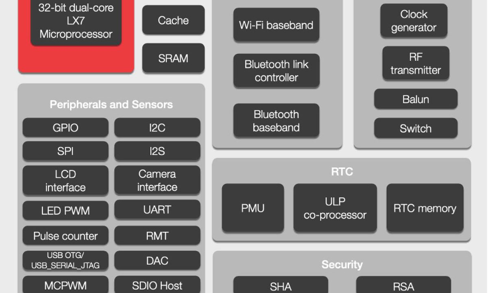

*[Espressif Providing Support for the AIoT Market with its Dual-Core ESP32-S3 - Embedded Computing Design](https://data.embeddedcomputing.com/uploads/resize/1256/756/external/data.embeddedcomputing.com/uploads/articles/primary_images/1614971006.png) · 搜索词：ESP32-S3 SoC internal peripheral architecture block diagram GPIO UART SPI I2C ADC LEDC RMT DMA CPU*

### 1. CPU 与外设之间如何协作？

例如，你想让 XIAO ESP32S3 点亮一个 LED。

整个过程大致是：

```text
C 语言程序
    ↓
ESP-IDF GPIO API
    ↓
GPIO 驱动
    ↓
GPIO 寄存器
    ↓
GPIO 输出控制电路
    ↓
GPIO 引脚输出高电平
    ↓
LED 电路
    ↓
LED 点亮
```

CPU 并不需要自己产生每一个电压变化，而是配置外设寄存器，由 GPIO 硬件完成输出。

### 2. 什么是寄存器？

寄存器是芯片内部用于配置和控制硬件的特殊存储单元。

例如 GPIO 输出寄存器可以控制引脚输出状态。

一个外设通常具有：

| 寄存器类型 | 作用 |
| --- | --- |
| Configuration | 配置工作模式 |
| Control | 控制外设运行 |
| Status | 读取工作状态 |
| Data | 读取或写入数据 |
| Interrupt | 配置和清除中断 |

你之前学习过 CPU 寄存器，这里需要区分：

- CPU 通用寄存器：CPU 执行指令时使用。
- 外设寄存器：控制芯片内部硬件模块。

---

## 二、GPIO Matrix：ESP32-S3 为什么可以灵活分配引脚？

这是 ESP32-S3 很有特色的硬件设计。

普通微控制器有时会将某个外设功能固定在特定引脚上。

ESP32-S3 具有 GPIO Matrix，可以将许多外设信号灵活路由到可用 GPIO。

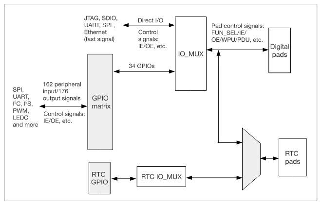

*[GPIO Matrix and Pin Mux - - — Arduino ESP32 latest documentation](https://docs.espressif.com/projects/arduino-esp32/en/latest/_images/tutorial_peripheral_diagram.png) · 搜索词：ESP32 GPIO matrix IO MUX signal routing peripheral GPIO diagram*

### 1. GPIO Matrix 的作用

假设你有一个 UART 外设：

```text
UART TX
UART RX
```

GPIO Matrix 可以将 UART 信号路由到合适的 GPIO 引脚。

例如：

```text
UART TX ───── GPIO43
UART RX ───── GPIO44
```

又可以在其他条件允许时配置成：

```text
UART TX ───── GPIO1
UART RX ───── GPIO2
```

这里是信号路由示意，不表示所有引脚组合都适合实际电路。

### 2. IO MUX 是什么？

IO MUX 是引脚功能复用控制器。

它负责选择引脚使用的功能，例如：

- GPIO；
- UART；
- SPI；
- I2C；
- 特定外设信号。

GPIO Matrix 和 IO MUX 配合，使 ESP32-S3 可以灵活安排外设信号。

### 3. XIAO ESP32S3 的引脚对应关系

普通版 XIAO ESP32S3 常用引脚：

| XIAO 引脚 | ESP32-S3 GPIO | 常见用途 |
| --- | --- | --- |
| D0 | GPIO1 | GPIO / ADC |
| D1 | GPIO2 | GPIO / ADC |
| D2 | GPIO3 | GPIO / ADC |
| D3 | GPIO4 | GPIO / ADC |
| D4 | GPIO5 | I2C SDA |
| D5 | GPIO6 | I2C SCL |
| D6 | GPIO43 | UART TX |
| D7 | GPIO44 | UART RX |
| D8 | GPIO7 | SPI SCK |
| D9 | GPIO8 | SPI MISO |
| D10 | GPIO9 | SPI MOSI |

实际使用前仍需检查板卡原理图、板载电路、USB 和启动相关功能，以及当前项目的引脚占用。

**重要原则：一个 GPIO 不应该同时被两个互相冲突的外设占用。**

---

## 三、GPIO 底层原理：让 XIAO ESP32S3 控制 LED

先从最简单的 GPIO 开始。

GPIO 有两种主要工作模式：

- Input：输入；
- Output：输出。

### 1. GPIO 输出原理

当 GPIO 配置为输出模式时：

```text
CPU
 ↓
GPIO 输出寄存器
 ↓
GPIO 驱动电路
 ↓
引脚输出高电平或低电平
```

例如：

- 输出高电平：接近芯片供电电压；
- 输出低电平：接近 GND。

ESP32-S3 GPIO 属于 3.3V 逻辑，不能把 5V 信号直接输入普通 GPIO。

### 2. 实际接线

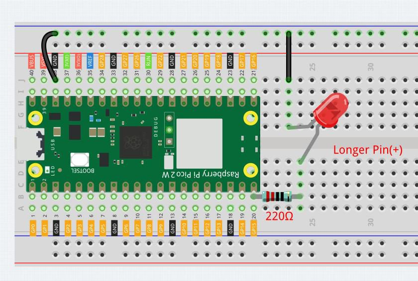

*[2.1 Hello, LED! — SunFounder Pico 2 W Starter Kit for Raspberry Pi Pico 2 W documentation](https://docs.sunfounder.com/projects/pico-2w-kit/en/latest/_images/wiring_led.png) · 搜索词：microcontroller GPIO LED series resistor breadboard wiring diagram*

使用：

- XIAO ESP32S3；
- LED；
- 330Ω 电阻；
- 杜邦线。

接线：

```text
XIAO GPIO1
     |
    330Ω
     |
    LED 正极
     |
    LED 负极
     |
    GND
```

电阻可以使用 220Ω～1kΩ 的合适值，但还需要考虑 LED 正向压降和 GPIO 输出电流限制。

### 3. ESP-IDF GPIO 示例

```c
#include "driver/gpio.h"
#include "freertos/FreeRTOS.h"
#include "freertos/task.h"

#define LED_GPIO GPIO_NUM_1

void app_main(void)
{
    gpio_config_t config = {
        .pin_bit_mask = 1ULL << LED_GPIO,
        .mode = GPIO_MODE_OUTPUT,
        .pull_up_en = GPIO_PULLUP_DISABLE,
        .pull_down_en = GPIO_PULLDOWN_DISABLE,
        .intr_type = GPIO_INTR_DISABLE
    };

    ESP_ERROR_CHECK(gpio_config(&config));

    while (1) {

        gpio_set_level(LED_GPIO, 1);

        vTaskDelay(pdMS_TO_TICKS(500));

        gpio_set_level(LED_GPIO, 0);

        vTaskDelay(pdMS_TO_TICKS(500));
    }
}
```

运行后 LED 每 500ms 切换一次状态。

### 4. GPIO 输入原理

例如连接一个按钮：

```text
3.3V
 |
上拉电阻
 |
GPIO 输入 ─── 按钮 ─── GND
```

按钮松开时，GPIO 读取高电平。

按钮按下时，GPIO 读取低电平。

代码：

```c
#include "driver/gpio.h"

#define BUTTON_GPIO GPIO_NUM_2

void button_init(void)
{
    gpio_config_t config = {
        .pin_bit_mask = 1ULL << BUTTON_GPIO,
        .mode = GPIO_MODE_INPUT,
        .pull_up_en = GPIO_PULLUP_ENABLE,
        .pull_down_en = GPIO_PULLDOWN_DISABLE,
        .intr_type = GPIO_INTR_DISABLE
    };

    ESP_ERROR_CHECK(gpio_config(&config));
}

int button_read(void)
{
    return gpio_get_level(BUTTON_GPIO);
}
```

注意：实际按钮还需要考虑硬件或软件消抖，避免一次按下产生多次触发。

---

## 四、GPIO 中断：如何不用不断读取按钮？

前面我们使用：

```c
gpio_get_level(BUTTON_GPIO);
```

不断检查按钮状态，这叫轮询。

但还有一种更高效的方法：GPIO 中断。

### 1. 中断工作机制

当按钮状态变化时，GPIO 硬件可以触发中断。

```text
按钮按下
   ↓
GPIO 电平发生变化
   ↓
GPIO 中断控制器
   ↓
CPU 接收中断
   ↓
执行中断服务函数
   ↓
通知业务任务
```

### 2. ESP-IDF GPIO 中断示例

```c
#include "driver/gpio.h"
#include "freertos/FreeRTOS.h"
#include "freertos/queue.h"

#define BUTTON_GPIO GPIO_NUM_2

static QueueHandle_t button_queue;

static void IRAM_ATTR button_isr_handler(void *arg)
{
    uint32_t pin = (uint32_t)arg;

    BaseType_t higher_priority_task_woken = pdFALSE;

    xQueueSendFromISR(
        button_queue,
        &pin,
        &higher_priority_task_woken
    );

    if (higher_priority_task_woken) {
        portYIELD_FROM_ISR();
    }
}

static void button_task(void *arg)
{
    uint32_t pin;

    while (1) {

        if (xQueueReceive(
                button_queue,
                &pin,
                portMAX_DELAY
            ) == pdTRUE) {

            printf("Button GPIO: %lu\n",
                   (unsigned long)pin);
        }
    }
}

void app_main(void)
{
    button_queue = xQueueCreate(10, sizeof(uint32_t));

    gpio_config_t config = {
        .pin_bit_mask = 1ULL << BUTTON_GPIO,
        .mode = GPIO_MODE_INPUT,
        .pull_up_en = GPIO_PULLUP_ENABLE,
        .pull_down_en = GPIO_PULLDOWN_DISABLE,
        .intr_type = GPIO_INTR_NEGEDGE
    };

    ESP_ERROR_CHECK(gpio_config(&config));

    ESP_ERROR_CHECK(gpio_install_isr_service(ESP_INTR_FLAG_IRAM));

    ESP_ERROR_CHECK(
        gpio_isr_handler_add(
            BUTTON_GPIO,
            button_isr_handler,
            (void *)BUTTON_GPIO
        )
    );

    xTaskCreate(
        button_task,
        "button_task",
        2048,
        NULL,
        5,
        NULL
    );
}
```

这是用于学习中断和队列机制的示例。正式使用时需要考虑队列创建失败、重复中断、按键消抖和 ISR 所调用函数的 IRAM 安全性。

### 3. 为什么中断函数不能执行复杂操作？

中断服务函数应该尽可能短。

不要在中断中：

- 等待 Wi-Fi；
- 执行 HTTP 请求；
- 操作文件系统；
- 长时间延时；
- 执行复杂图像处理。

推荐方式：

**中断负责通知，FreeRTOS 任务负责处理。**

---

## 五、UART：串口通信控制器的工作原理

UART 是嵌入式开发中最常用的通信接口之一。

在 XIAO ESP32S3 开发中，它主要用于：

- 与电脑进行串口通信；
- 连接 GPS 模块；
- 连接串口传感器；
- 连接其他 MCU；
- 与外部通信模块交换数据；
- 输出系统调试日志。

### 1. UART 是什么？

UART 全称 Universal Asynchronous Receiver/Transmitter，即通用异步收发器。

它主要使用两根数据线：

| 信号 | 功能 |
| --- | --- |
| TX | 发送数据 |
| RX | 接收数据 |
| GND | 两个设备共地 |

典型连接：

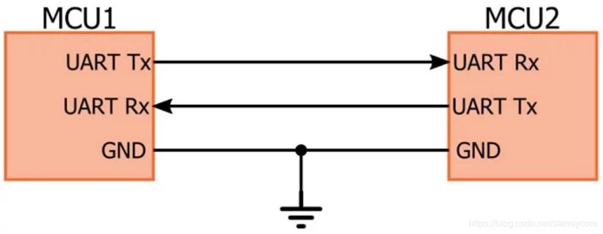

*[UART详解 | MCU加油站](https://mcu.eetrend.com/files/2020-03/wen_zhang_/100048421-93639-1.jpg) · 搜索词：UART serial communication TX RX GND microcontroller two devices wiring diagram*

连接规则：

```text
XIAO TX  ───── 外部设备 RX

XIAO RX  ───── 外部设备 TX

XIAO GND ───── 外部设备 GND
```

TX 必须交叉连接到对方 RX。

### 2. UART 为什么叫异步通信？

因为 UART 不需要像 SPI 那样额外传输时钟线。

发送方和接收方提前约定相同的通信参数：

- 波特率；
- 数据位；
- 校验位；
- 停止位。

例如：

```text
115200
8N1
```

含义：

| 参数 | 数值 |
| --- | --- |
| 波特率 | 115200 |
| 数据位 | 8 |
| 校验位 | 无 |
| 停止位 | 1 |

### 3. UART 一帧数据如何传输？

假设要发送字符 `A`。

ASCII 编码：

```text
A = 0x41 = 01000001
```

UART 通常使用：

```text
空闲状态：高电平

起始位：0

数据位：01000001（通常低位先发送）

停止位：1
```

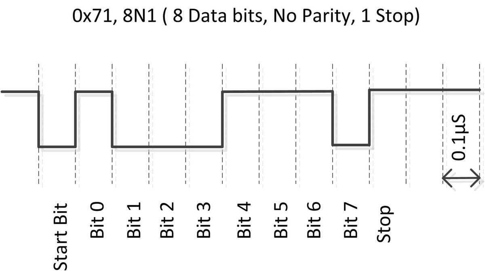

*[UART Basics – ECE353: Introduction to Microprocessor Systems – UW–Madison](https://ece353.engr.wisc.edu/wp-content/uploads/sites/607/2014/11/dataFrame-8N1.jpg) · 搜索词：UART serial frame start bit 8 data bits stop bit timing diagram 8N1*

UART 接收端通过起始位识别一帧数据，然后根据约定的波特率采样数据位。

### 4. 波特率如何影响通信？

波特率表示每秒传输的符号数。

对于普通 UART，每个符号通常对应一个比特时间。

例如：

115200 baud：

$T=\frac{1}{115200}$

约为 8.68 微秒。

如果使用 8N1，每个字节需要：

- 1 个起始位；
- 8 个数据位；
- 1 个停止位。

共 10 个比特时间。

因此理论传输速度：

$115200\div10=11520$

约 11520 字节/秒，不考虑其他协议开销。

### 5. UART 内部硬件架构

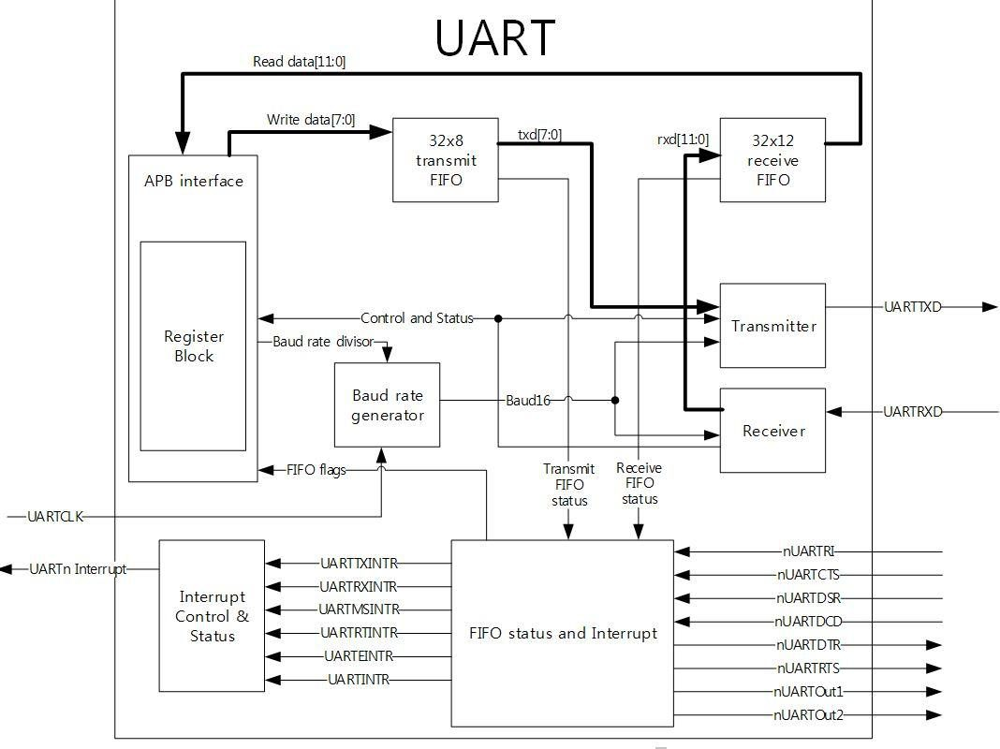

*[Universal Asynchronous Receive Transmit (UART) | WIZnet Document System](https://docs.wiznet.io/assets/images/uart_block_diagram-50abce4a05d13a3cc80cdb7b8d4eb63d.jpg) · 搜索词：UART peripheral internal block diagram baud rate generator transmit FIFO receive FIFO shift register*

UART 控制器通常包含：

- 波特率发生器；
- 发送 FIFO；
- 接收 FIFO；
- 移位寄存器；
- 状态寄存器；
- 中断控制逻辑。

CPU 不需要自己逐位产生 UART 波形。

只需要把数据写入发送 FIFO，UART 硬件就会自动完成串行发送。

### 6. ESP-IDF UART 初始化

下面以 UART1 为例。

```c
#include "driver/uart.h"
#include "driver/gpio.h"

#define UART_PORT UART_NUM_1
#define UART_TX GPIO_NUM_43
#define UART_RX GPIO_NUM_44

void uart_init(void)
{
    uart_config_t config = {
        .baud_rate = 115200,
        .data_bits = UART_DATA_8_BITS,
        .parity = UART_PARITY_DISABLE,
        .stop_bits = UART_STOP_BITS_1,
        .flow_ctrl = UART_HW_FLOWCTRL_DISABLE,
        .source_clk = UART_SCLK_DEFAULT
    };

    ESP_ERROR_CHECK(
        uart_driver_install(
            UART_PORT,
            2048,
            2048,
            0,
            NULL,
            0
        )
    );

    ESP_ERROR_CHECK(
        uart_param_config(
            UART_PORT,
            &config
        )
    );

    ESP_ERROR_CHECK(
        uart_set_pin(
            UART_PORT,
            UART_TX,
            UART_RX,
            UART_PIN_NO_CHANGE,
            UART_PIN_NO_CHANGE
        )
    );
}
```

这里 GPIO43、GPIO44 是 XIAO 常见的 UART TX/RX 引脚示例，使用前要确认没有被 USB 或其他功能占用。

### 7. UART 发送数据

```c
void uart_send_example(void)
{
    const char *message = "Hello XIAO ESP32S3!\r\n";

    uart_write_bytes(
        UART_PORT,
        message,
        strlen(message)
    );
}
```

### 8. UART 接收数据

```c
void uart_receive_example(void)
{
    uint8_t buffer[128];

    while (1) {

        int length = uart_read_bytes(
            UART_PORT,
            buffer,
            sizeof(buffer) - 1,
            pdMS_TO_TICKS(1000)
        );

        if (length > 0) {

            buffer[length] = '\0';

            printf("UART RX: %s\n", buffer);
        }
    }
}
```

这里使用字符串方式显示数据，只适合文本协议。对于二进制数据，应按实际长度处理，不要假设接收到的数据以 `\0` 结束。

### 9. UART 实际应用

假设连接一个 GPS 模块：

```text
GPS TX
  ↓
XIAO RX
  ↓
UART 接收
  ↓
解析 NMEA 数据
  ↓
获取经纬度
  ↓
业务程序
```

GPS 常见 NMEA 数据：

```text
$GPRMC,123519,A,4807.038,N,01131.000,E,...
```

ESP32-S3 接收后，可以解析经纬度、速度和时间。

---

## 六、I2C：多设备共用两根线的通信原理

I2C 是非常重要的传感器通信接口。

它特别适合：

- OLED 显示屏；
- 温湿度传感器；
- 气压传感器；
- RTC 时钟；
- IO 扩展芯片；
- EEPROM。

### 1. I2C 为什么只需要两根线？

I2C 使用：

| 信号 | 作用 |
| --- | --- |
| SDA | 数据线 |
| SCL | 时钟线 |

多个设备可以连接在同一条总线上。

> 图示：I2C bus multiple slave devices shared SDA SCL pull up resistors wiring diagram

例如：

```text
             XIAO ESP32S3
                  |
          ┌───────┴───────┐
          |               |
         SDA             SCL
          |               |
     ┌────┼────┐     ┌────┼────┐
     |    |    |     |    |    |
   OLED  RTC  温度传感器 共用总线
```

设备通过地址区分。

### 2. I2C 地址是什么？

每个 I2C 从设备通常有自己的地址。

例如：

| 设备 | 常见地址 |
| --- | --- |
| SSD1306 OLED | 0x3C |
| AHT20 | 0x38 |
| BMP280 | 0x76 或 0x77 |
| PCF8574 | 0x20～0x27，取决于配置 |

这些是常见地址示例，具体要以模块配置和数据手册为准。

### 3. I2C 工作时序

一次典型 I2C 写操作：

```text
START
  ↓
从设备地址 + 写方向
  ↓
ACK
  ↓
寄存器地址
  ↓
ACK
  ↓
数据
  ↓
ACK
  ↓
STOP
```

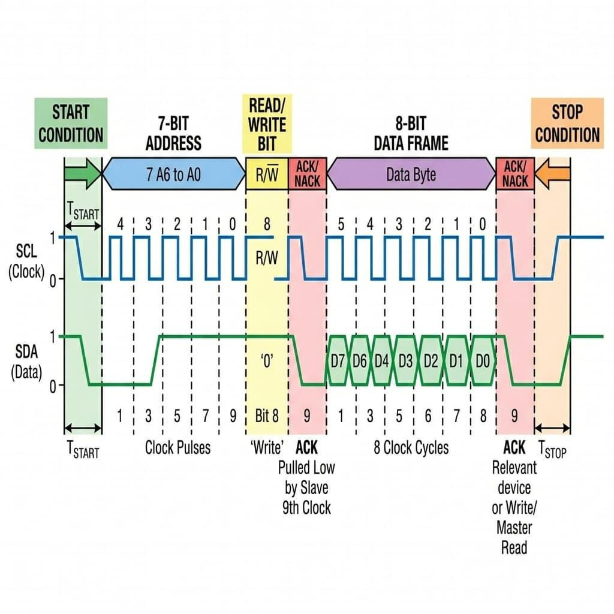

*[volt-X / How ESP32 BLE Works: Bluetooth Low Energy & GATT | Volt X](https://www.volt-x.dev/_next/image?q=75&url=https%3A%2F%2Fqoibkmtvaikabpjamxzs.supabase.co%2Fstorage%2Fv1%2Fobject%2Fpublic%2Fcontent-images%2Fhow-esp32-ble-works%2Fdiagram-advertising.png&w=3840) · 搜索词：I2C communication timing diagram start stop ACK NACK address data SDA SCL*

这里需要理解几个关键概念：

- START：开始通信；
- STOP：结束通信；
- ACK：接收方确认；
- NACK：接收方未确认；
- Address：从设备地址；
- Data：实际传输数据。

### 4. 为什么 I2C 需要上拉电阻？

I2C SDA 和 SCL 通常使用开漏或开集电极结构。

设备可以主动拉低总线，但不直接主动输出高电平。

总线通过上拉电阻恢复到高电平。

```text
3.3V
 |
上拉电阻
 |
SDA ───── 多个设备
```

因此没有合适的上拉电阻，I2C 可能无法正常通信。

很多开发模块已经集成上拉电阻，但多个模块同时连接时，上拉电阻可能并联得过小，需要检查总线实际电气情况。

### 5. XIAO ESP32S3 I2C 接线

普通版 XIAO 常用：

| XIAO | GPIO | I2C |
| --- | --- | --- |
| D4 | GPIO5 | SDA |
| D5 | GPIO6 | SCL |
| 3V3 | — | 电源 |
| GND | — | 地 |

> 图示：Seeed XIAO ESP32S3 SSD1306 OLED I2C wiring SDA SCL D4 D5

### 6. ESP-IDF I2C 主机初始化

ESP-IDF 5.x 推荐使用新的 I2C Master API。

```c
#include "driver/i2c_master.h"

#define I2C_SDA GPIO_NUM_5
#define I2C_SCL GPIO_NUM_6

static i2c_master_bus_handle_t bus_handle;

void i2c_init(void)
{
    i2c_master_bus_config_t bus_config = {
        .i2c_port = I2C_NUM_0,
        .sda_io_num = I2C_SDA,
        .scl_io_num = I2C_SCL,
        .clk_source = I2C_CLK_SRC_DEFAULT,
        .glitch_ignore_cnt = 7,
        .flags.enable_internal_pullup = true
    };

    ESP_ERROR_CHECK(
        i2c_new_master_bus(
            &bus_config,
            &bus_handle
        )
    );
}
```

注意：内部上拉只能作为辅助，实际硬件通常应根据总线电容和速率配置外部上拉电阻。

### 7. 添加一个 I2C 设备

```c
static i2c_master_dev_handle_t oled_handle;

void oled_device_add(void)
{
    i2c_device_config_t device_config = {
        .dev_addr_length = I2C_ADDR_BIT_LEN_7,
        .device_address = 0x3C,
        .scl_speed_hz = 400000
    };

    ESP_ERROR_CHECK(
        i2c_master_bus_add_device(
            bus_handle,
            &device_config,
            &oled_handle
        )
    );
}
```

### 8. 向 I2C 设备发送数据

```c
uint8_t data[] = {
    0x00,
    0xAE
};

ESP_ERROR_CHECK(
    i2c_master_transmit(
        oled_handle,
        data,
        sizeof(data),
        1000
    )
);
```

这个示例发送的是 OLED 常见的显示关闭命令，不是完整 OLED 初始化程序。

### 9. I2C 调试方法

如果 OLED 没有显示，按照以下顺序检查：

1. 检查 3.3V 供电。
2. 检查 GND 是否共地。
3. 检查 SDA 和 SCL 是否接反。
4. 检查 I2C 地址。
5. 检查上拉电阻。
6. 检查通信速率。
7. 使用逻辑分析仪查看 START、ACK 和 STOP。

**掌握逻辑分析仪，是从普通嵌入式开发走向底层驱动开发的重要一步。**

---

## 七、SPI：高速外设通信的工作原理

SPI 是 ESP32-S3 中非常重要的高速通信接口。

如果以后要连接：

- TFT 彩色显示屏；
- LCD；
- 外部 Flash；
- SD 卡；
- 高速 ADC；
- 其他 MCU；

通常都会接触 SPI。

### 1. SPI 的四根信号线

| 信号 | 全称 | 功能 |
| --- | --- | --- |
| SCLK | Serial Clock | 时钟 |
| MOSI | Master Out Slave In | 主机发送数据 |
| MISO | Master In Slave Out | 主机接收数据 |
| CS | Chip Select | 选择从设备 |

> 图示：SPI master slave communication wiring SCLK MOSI MISO CS diagram

### 2. SPI 工作过程

假设 XIAO ESP32S3 要向 TFT 屏幕发送数据：

```text
XIAO ESP32S3
     |
     | SCLK
     | MOSI
     | CS
     ↓
   TFT 屏幕
```

工作流程：

1. 主机拉低 CS。
2. 主机产生 SCLK 时钟。
3. 主机通过 MOSI 发送数据。
4. 从设备根据时钟采样数据。
5. 通信结束，CS 拉高。

SPI 是同步通信，时钟由主机提供。

### 3. SPI 的四种工作模式

SPI 有四种常见模式：

| 模式 | CPOL | CPHA |
| --- | --- | --- |
| Mode 0 | 0 | 0 |
| Mode 1 | 0 | 1 |
| Mode 2 | 1 | 0 |
| Mode 3 | 1 | 1 |

CPOL 决定时钟空闲电平。

CPHA 决定在哪个时钟边沿采样。

如果主机和从设备模式不一致，就可能出现数据错误。

### 4. XIAO ESP32S3 常用 SPI 引脚

| XIAO 引脚 | GPIO | 功能 |
| --- | --- | --- |
| D8 | GPIO7 | SCK |
| D9 | GPIO8 | MISO |
| D10 | GPIO9 | MOSI |

CS 通常选择另外一个可用 GPIO。

这些是常见 SPI 引脚映射，实际工程还应检查板级引脚定义和外设占用。

### 5. ESP-IDF SPI 初始化

```c
#include "driver/spi_master.h"

#define PIN_NUM_MOSI GPIO_NUM_9
#define PIN_NUM_MISO GPIO_NUM_8
#define PIN_NUM_CLK  GPIO_NUM_7
#define PIN_NUM_CS   GPIO_NUM_1

static spi_device_handle_t spi_handle;

void spi_init(void)
{
    spi_bus_config_t bus_config = {
        .mosi_io_num = PIN_NUM_MOSI,
        .miso_io_num = PIN_NUM_MISO,
        .sclk_io_num = PIN_NUM_CLK,
        .quadwp_io_num = -1,
        .quadhd_io_num = -1,
        .max_transfer_sz = 4096
    };

    ESP_ERROR_CHECK(
        spi_bus_initialize(
            SPI2_HOST,
            &bus_config,
            SPI_DMA_CH_AUTO
        )
    );

    spi_device_interface_config_t device_config = {
        .clock_speed_hz = 10 * 1000 * 1000,
        .mode = 0,
        .spics_io_num = PIN_NUM_CS,
        .queue_size = 4
    };

    ESP_ERROR_CHECK(
        spi_bus_add_device(
            SPI2_HOST,
            &device_config,
            &spi_handle
        )
    );
}
```

### 6. SPI 发送数据

```c
void spi_send_example(void)
{
    uint8_t data[] = {
        0xAA,
        0x55,
        0x12,
        0x34
    };

    spi_transaction_t transaction = {
        .length = sizeof(data) * 8,
        .tx_buffer = data
    };

    ESP_ERROR_CHECK(
        spi_device_transmit(
            spi_handle,
            &transaction
        )
    );
}
```

### 7. SPI 为什么比 I2C 快？

主要原因：

- SPI 使用专用时钟线；
- 不需要每个字节都进行 I2C 地址和 ACK 处理；
- 支持较高时钟频率；
- 可以使用 DMA 连续传输大量数据。

但是实际速度还受外设、线路长度、信号完整性、驱动和 DMA 缓冲区限制。

### 8. SPI 和 I2C 应该如何选择？

| 对比 | I2C | SPI |
| --- | --- | --- |
| 信号线 | 2 根 | 通常 3～4 根 |
| 设备识别 | 地址 | CS |
| 通信时钟 | SCL | SCLK |
| 典型速度 | 100/400kHz 等 | 通常数 MHz 到数十 MHz，视设备而定 |
| 适用设备 | 传感器、OLED | TFT、SD 卡、Flash |
| 硬件复杂度 | 较低 | 较高 |

对于 XIAO 项目：

- 小型传感器优先考虑 I2C；
- 彩色屏幕优先考虑 SPI；
- 大量数据传输优先考虑 SPI + DMA。

---

## 八、LEDC：PWM 脉冲宽度调制

LEDC 是 ESP32-S3 的 PWM 控制器。

它可以让 GPIO 输出一定频率和占空比的脉冲。

常见应用：

- LED 亮度控制；
- 电机调速；
- 蜂鸣器；
- 舵机控制；
- 风扇控制。

### 1. PWM 是什么？

PWM 全称 Pulse Width Modulation。

例如：

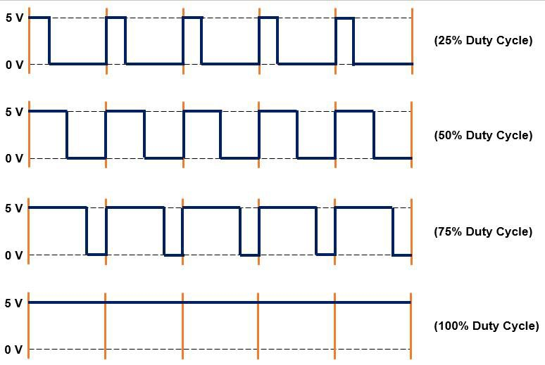

*[10. 아두이노 LED 실습 (3) with PWM 제어](https://blog.kakaocdn.net/dna/dHXfVy/btqFOLWfRzm/AAAAAAAAAAAAAAAAAAAAACjGNOINwfKawTisD4IBIiMp55c8JtE1dKPGK0AQJbZo/img.png?allow_ip=&allow_referer=&credential=yqXZFxpELC7KVnFOS48ylbz2pIh7yKj8&expires=1777561199&signature=PW8k8hvjnyaJWNls84JezZY1svs%3D) · 搜索词：PWM pulse width modulation 25 50 75 percent duty cycle waveform diagram*

占空比定义：

$D=\frac{T_{ON}}{T}\times100\%$

例如：

- 25%：高电平占周期的四分之一；
- 50%：高低电平时间相等；
- 75%：高电平占周期的四分之三。

### 2. LED 为什么可以通过 PWM 调节亮度？

当 LED 以足够高的频率快速开关，人眼感知的是平均亮度。

例如：

| 占空比 | 视觉效果 |
| --- | --- |
| 10% | 较暗 |
| 30% | 较低亮度 |
| 50% | 中等亮度 |
| 80% | 较亮 |
| 100% | 持续点亮 |

### 3. ESP-IDF LEDC 初始化

```c
#include "driver/ledc.h"

#define PWM_GPIO GPIO_NUM_1

void pwm_init(void)
{
    ledc_timer_config_t timer_config = {
        .speed_mode = LEDC_LOW_SPEED_MODE,
        .duty_resolution = LEDC_TIMER_10_BIT,
        .timer_num = LEDC_TIMER_0,
        .freq_hz = 5000,
        .clk_cfg = LEDC_AUTO_CLK
    };

    ESP_ERROR_CHECK(
        ledc_timer_config(&timer_config)
    );

    ledc_channel_config_t channel_config = {
        .gpio_num = PWM_GPIO,
        .speed_mode = LEDC_LOW_SPEED_MODE,
        .channel = LEDC_CHANNEL_0,
        .intr_type = LEDC_INTR_DISABLE,
        .timer_sel = LEDC_TIMER_0,
        .duty = 0,
        .hpoint = 0
    };

    ESP_ERROR_CHECK(
        ledc_channel_config(&channel_config)
    );
}
```

### 4. 调节 PWM 占空比

10 位分辨率意味着：

$2^{10}=1024$

占空比取值范围为 0～1023。

```c
void set_brightness(uint32_t duty)
{
    if (duty > 1023) {
        duty = 1023;
    }

    ESP_ERROR_CHECK(
        ledc_set_duty(
            LEDC_LOW_SPEED_MODE,
            LEDC_CHANNEL_0,
            duty
        )
    );

    ESP_ERROR_CHECK(
        ledc_update_duty(
            LEDC_LOW_SPEED_MODE,
            LEDC_CHANNEL_0
        )
    );
}
```

例如：

```c
set_brightness(512);
```

大约就是 50% 占空比。

---

## 九、RMT：精确控制脉冲和时序

RMT 是 ESP32-S3 一个非常实用的外设。

它适合生成和接收精确的数字脉冲序列。

典型应用：

- WS2812 RGB 灯带；
- 红外遥控；
- 红外接收；
- 单线通信；
- 特定时序协议。

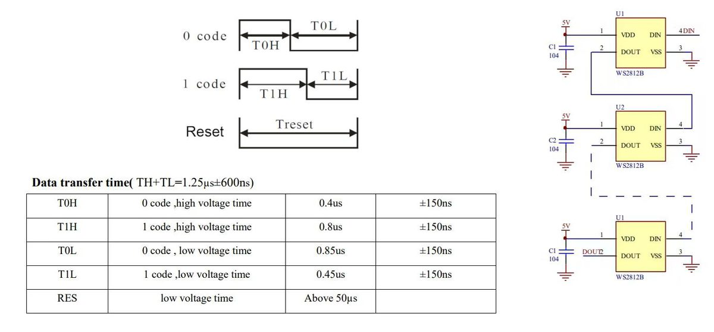

*[การใช้งานโมดูล WS2812 RGB LED (NeoPixel) - IoT Engineering Education](https://iot-kmutnb.github.io/blogs/displays/neopixel_rgb_leds/ws2812b_timing.png) · 搜索词：ESP32 RMT WS2812 LED strip digital timing signal waveform*

### 1. 为什么 RMT 很有用？

假设需要控制 WS2812 灯珠。

它要求非常精确的高低电平时间。

如果完全依赖 CPU：

```text
GPIO 拉高
等待一段时间
GPIO 拉低
等待一段时间
```

可能因为任务切换或中断导致时序不稳定。

RMT 可以将脉冲时序交给硬件完成。

CPU 只需要准备好脉冲数据。

### 2. RMT 的工作原理

```text
应用程序
    ↓
准备脉冲数据
    ↓
RMT 编码
    ↓
RMT 内部存储和 DMA（按配置）
    ↓
硬件自动输出脉冲
    ↓
外部设备
```

### 3. 为什么 WS2812 适合 RMT？

WS2812 使用单线数据传输。

每个数据位通过高电平和低电平的持续时间来表示 0 或 1。

例如：

```text
逻辑 0：

高电平较短
低电平较长

逻辑 1：

高电平较长
低电平较短
```

RMT 可以准确控制这些时间。

### 4. ESP-IDF RMT 开发

新版 ESP-IDF 使用：

```c
#include "driver/rmt_tx.h"
#include "driver/rmt_encoder.h"
```

主要步骤：

1. 创建 RMT TX Channel。
2. 配置 GPIO。
3. 配置时钟分辨率。
4. 创建编码器。
5. 准备发送数据。
6. 调用发送 API。
7. 等待发送完成。

官方资料：

[ESP-IDF RMT 官方文档](https://docs.espressif.com/projects/esp-idf/en/stable/esp32s3/api-reference/peripherals/rmt.html)

---

## 十、本课的知识关联：如何选择正确的外设？

现在我们已经学习了 GPIO、UART、I2C、SPI、PWM 和 RMT。

实际开发时，可以按照下面的原则选择：

| 需求 | 推荐外设 |
| --- | --- |
| 控制普通 LED | GPIO |
| 读取按钮 | GPIO / 中断 |
| 连接 GPS | UART |
| 连接温湿度传感器 | I2C |
| 连接 OLED | I2C 或 SPI |
| 连接 TFT 彩屏 | SPI |
| 控制 LED 亮度 | LEDC |
| 控制 WS2812 | RMT |
| 控制舵机 | LEDC |
| 高速传输数据 | SPI + DMA |
| 数字音频 | I2S + DMA |

**一个实际智能设备的外设规划**

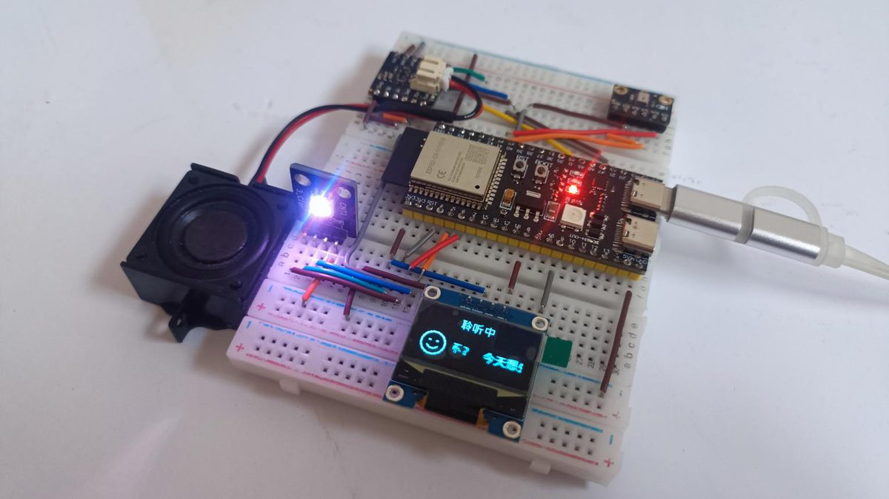

*[体验ROCO小智物联控制GPIO外接硬件*LED/舵机/继电器- Makelog(造物记)](https://makelogimg.dfrobot.com.cn/makelog/5a197745e455e06a216f8a4f/e843afab015bcf73ea2ff7fbcf929ec9.jpg) · 搜索词：ESP32 S3 development board connected OLED display microphone speaker sensors LED breadboard project*

假设开发一台桌面智能终端：

- OLED：显示设备状态；
- I2C：读取温湿度；
- I2S：录制语音；
- SPI：连接彩色屏幕；
- UART：连接外部通信模块；
- LEDC：控制指示灯亮度；
- RMT：控制 RGB 灯带；
- GPIO 中断：处理按键。

这里最重要的是先做好 GPIO 资源规划，不能只看软件 API 是否支持，还要考虑物理引脚是否足够。

---

## 十一、本课实践任务

建议按照顺序在普通版 XIAO ESP32S3 上完成。

**外设驱动实验清单**/

## 十二、下一课：ADC、GPTimer、DMA 与硬件实时控制

**第十二课：模拟信号采集与实时数据处理**

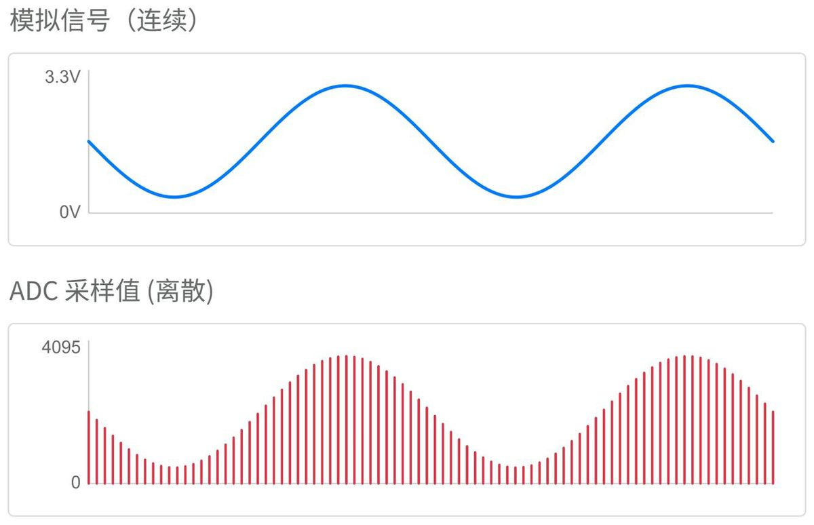

*[第4节 ADC 模拟输入 | 微雪文档平台](https://docs.waveshare.net/assets/images/04-ADC-75daf0aa10b419028e4d596708f3fbf0.webp) · 搜索词：ESP32 ADC analog sensor sampling oscilloscope waveform DMA timer microcontroller diagram*

下一课将深入学习：

1. ADC 的工作原理。
2. SAR ADC 逐次逼近转换过程。
3. ESP32-S3 ADC1 与 ADC2。
4. ADC 校准与非线性误差。
5. 电压、电流和传感器采集。
6. GPTimer 硬件定时器。
7. 定时器中断与任务通知。
8. ADC 连续采样。
9. DMA 数据搬运。
10. 环形缓冲区和实时数据处理。
11. 如何构建稳定的数据采集系统。

这一课将把前面学习的 ADC、寄存器、中断、FreeRTOS 和 DMA 真正组合起来。

**最终目标：让 XIAO ESP32S3 不只是能够控制外设，还能稳定、准确、连续地采集外部世界的数据。**
