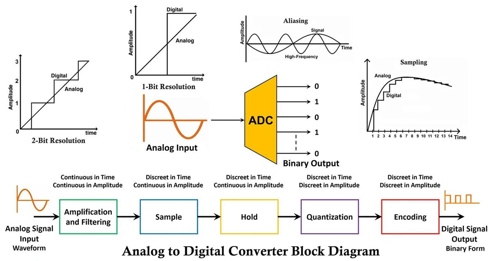
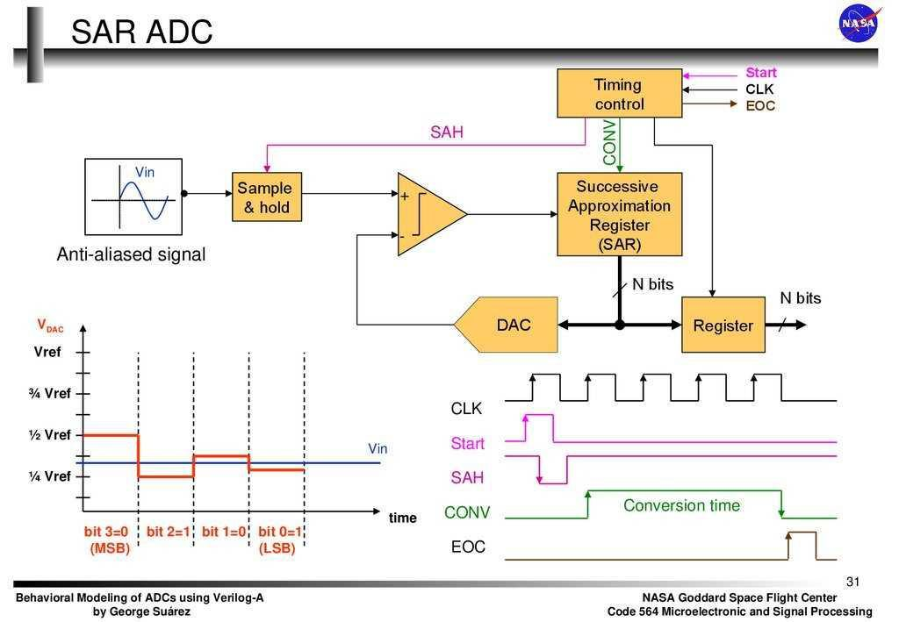
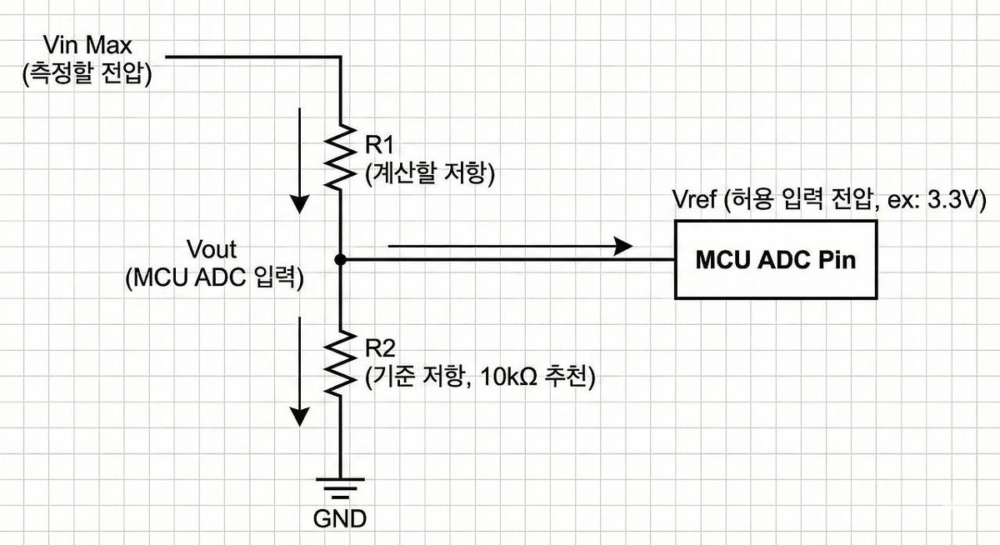
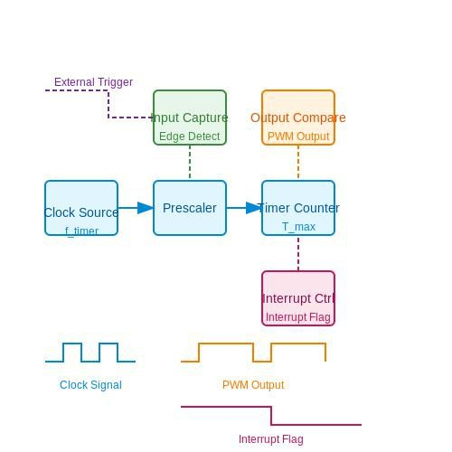
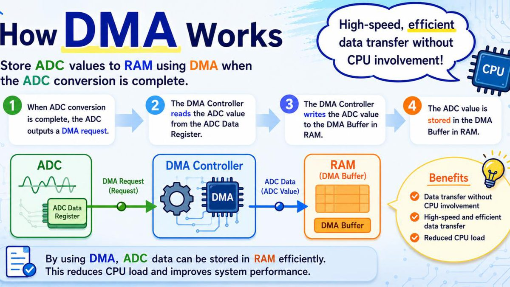
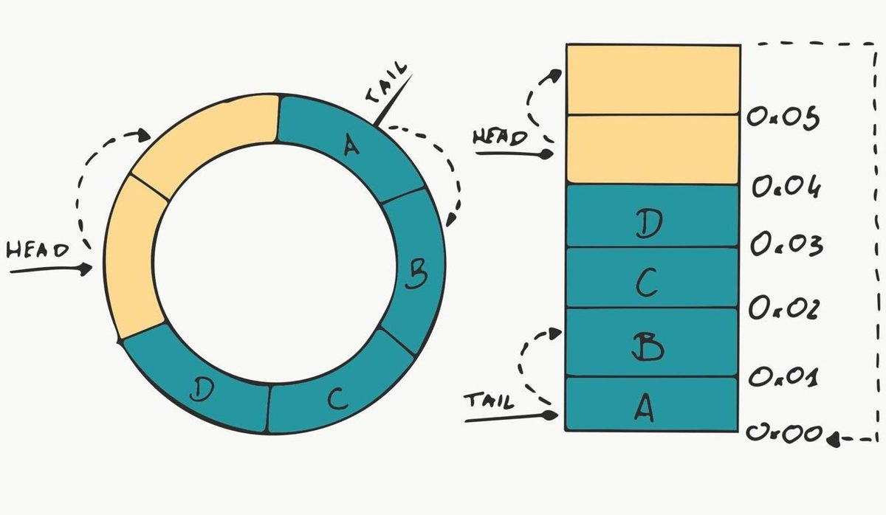
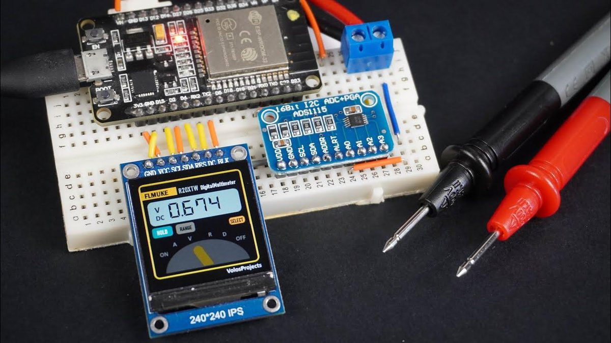

# 第十二课：XIAO ESP32S3 的 ADC、GPTimer、DMA 与实时数据采集

前面我们已经学习了 GPIO、UART、I2C、SPI、LEDC 和 RMT。

这一课进入嵌入式系统非常核心的能力：

**如何让 XIAO ESP32S3 按照精确的时间间隔，持续采集外部模拟信号，并将数据交给 CPU 处理？**

这项技术是很多智能硬件的基础，例如：

- 电池电压监测；
- 电流检测；
- 温度和光照采集；
- 麦克风信号采集；
- 电机运行监测；
- 电源质量监测；
- 高频传感器数据采集。

本课围绕六个核心模块展开：

1. ADC 模数转换。
2. SAR 逐次逼近转换。
3. ADC 校准和误差。
4. GPTimer 硬件定时器。
5. ADC 连续采样和 DMA。
6. 环形缓冲区与实时数据处理。

---

## 一、ADC：为什么 ESP32-S3 需要模数转换？

CPU 只能处理数字数据。

但是现实世界中的很多信号是模拟信号。

例如：

- 电池输出 3.7V；
- 温度传感器输出 1.2V；
- 光敏传感器输出 0.8V；
- 电位器输出 2.1V。

这些电压不能直接作为普通数字数据交给 CPU。

因此需要 ADC。

ADC 全称 Analog-to-Digital Converter，即模数转换器。



*[Analog to Digital Converter ADC - Block Diagram & Working](https://www.hackatronic.com/wp-content/uploads/2025/09/ADC-Analog-to-Digital-Converter.webp) · 搜索词：analog to digital converter ADC analog voltage input digital binary output waveform diagram*

### 1. ADC 的工作流程

```text
外部模拟信号
      ↓
输入电路
      ↓
ADC 采样
      ↓
量化
      ↓
编码
      ↓
数字数据
      ↓
CPU 处理
```

例如：

输入电压为 1.65V。

假设 ADC 参考范围是 0～3.3V，分辨率为 12 位。

那么 ADC 将电压转换为一个数字值。

$2^{12}=4096$

理论上可以表示 0～4095 共 4096 个量化等级。

理想情况下：

$ADC=\frac{V_{in}}{V_{ref}}\times4095$

代入：

$ADC=\frac{1.65}{3.3}\times4095$

得到约 2048。

所以：

```text
输入：1.65V

ADC：约 2048
```

注意，这是理想模型。实际 ESP32-S3 的 ADC 转换结果受到芯片非线性、衰减配置、校准、噪声和输入电路影响。

---

## 二、SAR ADC：ESP32-S3 如何把电压转换成数字？

ESP32-S3 的 ADC 使用 SAR，即 Successive Approximation Register，逐次逼近型模数转换原理。

这是理解 ADC 底层工作机制的重点。



*[Understanding and Implementing SAR ADC Schematic: A Comprehensive Guide](https://techschems.com/wp-content/img/8482_sar_adc_schematic.jpg) · 搜索词：SAR ADC successive approximation register comparator DAC block diagram conversion process*

### 1. SAR ADC 的内部结构

主要包含：

| 模块 | 作用 |
| --- | --- |
| 采样保持电路 | 暂时保存输入电压 |
| DAC | 产生内部比较电压 |
| 比较器 | 比较输入电压和 DAC 电压 |
| SAR 寄存器 | 逐位确定转换结果 |
| 控制逻辑 | 控制转换过程 |

### 2. 逐次逼近过程

假设 ADC 是 4 位，输入电压对应的数字结果为 1010。

SAR ADC 不会一次性直接得到结果，而是逐位判断。

```text
输入电压
   ↓
先测试最高位
   ↓
测试 1000
   ↓
再测试 1100
   ↓
再测试 1010
   ↓
最后测试 1011
   ↓
确定结果 1010
```

这是一个简化示意，实际 SAR 的比较和位判定过程由硬件自动完成。

### 3. ADC 分辨率意味着什么？

| 分辨率 | 量化等级 |
| --- | --- |
| 8 位 | 256 |
| 10 位 | 1024 |
| 12 位 | 4096 |
| 16 位 | 65536 |

分辨率越高，理论上可以区分越细微的电压变化。

但必须注意：

**ADC 位数不等于实际测量精度。**

例如一个 12 位 ADC，并不代表它就能够准确测量到 12 位有效精度。

实际精度还受：

- 参考电压；
- ADC 线性度；
- 电源噪声；
- 输入阻抗；
- PCB 布线；
- 温度；
- 校准算法；

等因素影响。

---

## 三、XIAO ESP32S3 的 ADC 引脚规划

普通版 XIAO ESP32S3 有多个可以用于 ADC 的 GPIO。

常见映射如下：

| XIAO 引脚 | ESP32-S3 GPIO | ADC 通道用途 |
| --- | --- | --- |
| D0 | GPIO1 | ADC1_CH0 |
| D1 | GPIO2 | ADC1_CH1 |
| D2 | GPIO3 | ADC1_CH2 |
| D3 | GPIO4 | ADC1_CH3 |

具体可用性还要结合板卡版本和当前引脚占用核对。

### 1. ADC 为什么优先考虑 ADC1？

ESP32 系列部分芯片的 ADC2 与无线功能存在资源竞争或使用限制。

ESP32-S3 的 ADC 使用规则应以其自身技术参考手册和当前 ESP-IDF 驱动为准。

对于普通传感器采集项目，建议优先规划 ADC1 通道，减少不必要的资源冲突。

### 2. 电压输入范围

不能认为所有 GPIO 都能安全输入 0～3.3V 以外的电压。

ESP32-S3 GPIO 不耐受 5V。

如果测量 5V 电源，应当通过电阻分压等输入调理电路，将电压限制在允许范围内。

例如：



*[2. 전압 분배 법칙(Voltage Divider) 2편 — 실무 회로 설계의 3가지 핵심 패턴](https://img1.daumcdn.net/thumb/R1280x0/?fname=https%3A%2F%2Fblog.kakaocdn.net%2Fdna%2Fyxzy9%2FdJMcaiIW8gf%2FAAAAAAAAAAAAAAAAAAAAAH0jbLXtr-KI2v6FaKE2S1WSks88K-ClVt6NvQNwPnp3M09yZCfMDOWWK2D93RgU1JH27JCVJcxIyhabrM1CmldnFupGlZihdMQmChlq74At%2Fimg.png%3Fcredential%3DyqXZFxpELC7KVnFOS48ylbz2pIh7yKj8%26expires%3D1772290799%26allow_ip%3D%26allow_referer%3D%26signature%3DODmS6hEV4nvx70KPRTIECLxyRM8%253D&scode=mtistory2) · 搜索词：resistor voltage divider circuit analog input microcontroller ADC schematic*

使用两个电阻：

```text
待测电压
   |
  R1
   |
   ├──── ADC 输入
   |
  R2
   |
  GND
```

分压公式：

$V_{ADC}=V_{IN}\frac{R_2}{R_1+R_2}$

假设：

- R1 = 10kΩ；
- R2 = 10kΩ；
- 输入电压 = 5V。

那么：

$V_=5\times\frac{10}{10+10}$

$V_=2.5V$

这只是电阻分压的理论计算，实际还需要考虑电阻误差、输入阻抗、瞬态过压和 ADC 采样条件。

---

## 四、ESP-IDF ADC 驱动实战

ESP-IDF 新版推荐使用 `esp_adc` 驱动接口。

先创建 ADC 单次采样句柄。

### 1. ADC 初始化

```c
#include "esp_adc/adc_oneshot.h"

static adc_oneshot_unit_handle_t adc_handle;

void adc_init(void)
{
    adc_oneshot_unit_init_cfg_t unit_config = {
        .unit_id = ADC_UNIT_1,
        .ulp_mode = ADC_ULP_MODE_DISABLE
    };

    ESP_ERROR_CHECK(
        adc_oneshot_new_unit(
            &unit_config,
            &adc_handle
        )
    );

    adc_oneshot_chan_cfg_t channel_config = {
        .atten = ADC_ATTEN_DB_12,
        .bitwidth = ADC_BITWIDTH_DEFAULT
    };

    ESP_ERROR_CHECK(
        adc_oneshot_config_channel(
            adc_handle,
            ADC_CHANNEL_0,
            &channel_config
        )
    );
}
```

这里示例使用 ADC1_CH0，对应 GPIO1。

### 2. 读取 ADC 数据

```c
int read_adc(void)
{
    int raw_value = 0;

    ESP_ERROR_CHECK(
        adc_oneshot_read(
            adc_handle,
            ADC_CHANNEL_0,
            &raw_value
        )
    );

    return raw_value;
}
```

### 3. 连续读取

```c
void app_main(void)
{
    adc_init();

    while (1) {

        int value = read_adc();

        printf("ADC RAW: %d\n", value);

        vTaskDelay(pdMS_TO_TICKS(500));
    }
}
```

这样就完成了基本的 ADC 采集。

---

## 五、ADC 校准：为什么读数不一定准确？

假设输入电压是 2.0V。

理论上你希望得到对应的 ADC 数值。

但是实际可能读到：

```text
理论值：2481

实际值：2395
```

为什么？

因为真实 ADC 存在误差。

### 1. 主要误差来源

| 误差类型 | 原因 |
| --- | --- |
| Offset Error | 零点偏移 |
| Gain Error | 增益误差 |
| INL | 积分非线性 |
| DNL | 微分非线性 |
| Noise | 电气噪声 |
| Reference Error | 参考电压误差 |

### 2. 使用 ESP-IDF 校准驱动

ESP-IDF 提供 ADC Calibration API。

示例：

```c
#include "esp_adc/adc_cali.h"
#include "esp_adc/adc_cali_scheme.h"

static adc_cali_handle_t cali_handle;

void adc_calibration_init(void)
{
    adc_cali_curve_fitting_config_t config = {
        .unit_id = ADC_UNIT_1,
        .chan = ADC_CHANNEL_0,
        .atten = ADC_ATTEN_DB_12,
        .bitwidth = ADC_BITWIDTH_DEFAULT
    };

    ESP_ERROR_CHECK(
        adc_cali_create_scheme_curve_fitting(
            &config,
            &cali_handle
        )
    );
}
```

转换成毫伏：

```c
int adc_to_mv(int raw_value)
{
    int voltage_mv = 0;

    ESP_ERROR_CHECK(
        adc_cali_raw_to_voltage(
            cali_handle,
            raw_value,
            &voltage_mv
        )
    );

    return voltage_mv;
}
```

实际工程中，需要检查芯片是否支持对应校准方案，并正确处理校准句柄创建失败及资源释放。

### 3. 为什么校准如此重要？

例如你想制作一个电池电压监控系统。

如果电池实际电压是 4.0V，但 ADC 误差导致显示 3.8V，那么电池状态判断就会受到影响。

所以：

**对于测量类项目，不能只看 ADC RAW 值，应该考虑校准、分压电路和实测修正。**

---

## 六、GPTimer：如何实现精确的硬件定时？

前面使用：

```c
vTaskDelay(pdMS_TO_TICKS(100));
```

可以让任务等待一段时间。

但是它并不适合所有高精度采样场景。

如果你需要：

- 每 1ms 采样一次；
- 每 100μs 触发一次事件；
- 生成精确的控制周期；
- 定时触发数据处理；

就应该研究硬件定时器。

ESP32-S3 提供 GPTimer。



*[Interrupts and Timers in Microcontrollers | Tutorials on Electronics | Next Electronics](https://www.next.gr/uploads/elec-tut-images/844_3_1.png) · 搜索词：microcontroller general purpose hardware timer counter prescaler alarm interrupt diagram*

### 1. GPTimer 的内部机制

主要包含：

- 时钟源；
- 计数器；
- 计数方向；
- 报警比较值；
- 中断机制。

例如：

```text
硬件时钟
   ↓
定时器计数器
   ↓
计数到设定值
   ↓
触发 Alarm
   ↓
产生中断
   ↓
通知 FreeRTOS 任务
```

### 2. 定时器的时间计算

假设定时器分辨率为 1MHz。

那么：

$1MHz=1,000,000\text{ 次/秒}$

每次计数对应：

$1\mu s$

如果希望每 1ms 触发一次：

$1000\mu s=1000\text{ 次计数}$

因此报警值可以设置为 1000 个计数单位。

### 3. ESP-IDF GPTimer 初始化

```c
#include "driver/gptimer.h"

static gptimer_handle_t timer_handle;

void timer_init(void)
{
    gptimer_config_t config = {
        .clk_src = GPTIMER_CLK_SRC_DEFAULT,
        .direction = GPTIMER_COUNT_UP,
        .resolution_hz = 1000000
    };

    ESP_ERROR_CHECK(
        gptimer_new_timer(
            &config,
            &timer_handle
        )
    );

    ESP_ERROR_CHECK(
        gptimer_enable(timer_handle)
    );
}
```

### 4. 设置定时器报警

```c
void timer_alarm_init(void)
{
    gptimer_alarm_config_t alarm_config = {
        .alarm_count = 1000,
        .reload_count = 0,
        .flags.auto_reload_on_alarm = true
    };

    ESP_ERROR_CHECK(
        gptimer_set_alarm_action(
            timer_handle,
            &alarm_config
        )
    );
}
```

还需要注册 Alarm 回调，并启动定时器，才能真正产生周期性事件。

---

## 七、DMA：为什么不让 CPU 一直搬运数据？

现在进入本课最重要的技术之一。

假设 ADC 每秒采集 20,000 个数据。

如果每个数据都让 CPU 单独读取、保存和处理，那么 CPU 就会承担大量数据搬运工作。

DMA 可以帮助外设和内存之间传输数据，减少 CPU 的参与。

DMA 全称 Direct Memory Access，即直接内存访问。



*[1-8. DMA](https://media.licdn.com/dms/image/v2/D5612AQEuiCV4uZ_fbQ/article-cover_image-shrink_720_1280/B56Z5ipOo8KkAU-/0/1779771440473?e=2147483647&t=l_5zBUI0AuCHyBnwogdTXILVFp9XhuIFDAypy_C5AIw&v=beta) · 搜索词：microcontroller ADC DMA direct memory access data transfer CPU RAM block diagram*

### 1. 普通数据采集方式

```text
ADC
 ↓
CPU 读取
 ↓
CPU 保存
 ↓
RAM
```

### 2. DMA 数据采集方式

```text
ADC
 ↓
DMA
 ↓
RAM 缓冲区
 ↓
CPU 批量处理
```

CPU 可以在 DMA 传输数据的同时执行其他任务。

### 3. DMA 的优势

- 降低 CPU 搬运负担；
- 提高数据采集效率；
- 支持连续数据流；
- 适合音频和图像；
- 可以与中断配合；
- 适合实时采集系统。

不过 DMA 并不意味着 CPU 完全不参与。CPU 仍然需要配置 DMA、管理缓冲区、处理完成事件和解决数据同步问题。

---

## 八、ADC Continuous：连续采样模式

前面使用的 `adc_oneshot_read()` 是单次采样模式。

每次调用，程序读取一个 ADC 转换结果。

但在音频、振动检测和电压波形分析中，我们通常需要连续采样。

例如：

```text
第 1 次：采样
第 2 次：采样
第 3 次：采样
第 4 次：采样
……
```

ESP-IDF 提供 ADC Continuous 驱动，可以配合 DMA 完成连续采样。

### 1. 单次采样与连续采样的区别

**单次采样模式**

**CPU 主动读取** 适合低频传感器

CPU 调用 ADC API

↓

ADC 转换一次

↓

返回一个采样值

---

**连续采样模式**

**硬件连续采集** 适合数据流

ADC 按设定频率采样

↓

DMA 搬运转换结果

↓

连续数据缓冲区

↓

CPU 批量读取和处理

### 2. 连续采样适合什么场景？

| 应用 | 建议采样频率示例 |
| --- | --- |
| 电池电压监控 | 1～10Hz |
| 温度传感器 | 1～10Hz |
| 光照变化 | 10～100Hz |
| 电机振动分析 | 1～10kHz，视分析需求 |
| 音频波形采集 | 常见 16kHz、44.1kHz 等 |

这些是应用场景示例，不代表 ESP32-S3 在所有配置下都能稳定达到对应采样质量。实际能力取决于 ADC 驱动、通道数量、采样率、缓冲区和系统负载。

### 3. ESP-IDF 连续 ADC 的工作机制

```text
ADC 配置
   ↓
设置采样频率
   ↓
设置采样通道
   ↓
启动 ADC Continuous
   ↓
ADC 硬件连续转换
   ↓
DMA 写入内部缓冲区
   ↓
产生数据就绪事件
   ↓
FreeRTOS 任务读取数据
   ↓
数据处理
```

这里有一个重要区别：

**ADC Continuous 驱动已经管理了底层连续采样和 DMA，不需要你自己再创建一套 DMA 控制器。**

### 4. ESP-IDF 连续 ADC 初始化示例

下面以 GPIO1，也就是 ADC1_CH0 为例。

```c
#include "esp_adc/adc_continuous.h"

#define ADC_SAMPLE_RATE 10000

static adc_continuous_handle_t adc_handle;

void adc_continuous_init(void)
{
    adc_continuous_handle_cfg_t handle_config = {
        .max_store_buf_size = 4096,
        .conv_frame_size = 256
    };

    ESP_ERROR_CHECK(
        adc_continuous_new_handle(
            &handle_config,
            &adc_handle
        )
    );

    adc_digi_pattern_config_t pattern = {
        .atten = ADC_ATTEN_DB_12,
        .channel = ADC_CHANNEL_0,
        .unit = ADC_UNIT_1,
        .bit_width = ADC_BITWIDTH_12
    };

    adc_continuous_config_t config = {
        .sample_freq_hz = ADC_SAMPLE_RATE,
        .conv_mode = ADC_CONV_SINGLE_UNIT_1,
        .format = ADC_DIGI_OUTPUT_FORMAT_TYPE2,
        .pattern_num = 1,
        .adc_pattern = &pattern
    };

    ESP_ERROR_CHECK(
        adc_continuous_config(
            adc_handle,
            &config
        )
    );
}
```

说明：

- `sample_freq_hz`：转换频率配置；
- `conv_frame_size`：每次读取的数据帧大小；
- `max_store_buf_size`：驱动内部缓冲区容量；
- `pattern_num`：采样通道配置数量；
- `adc_pattern`：采样通道及衰减配置。

这里使用的是 ESP32-S3 的单 ADC1 连续采样配置示例。具体的衰减枚举和输出格式要与你安装的 ESP-IDF 版本一致。

### 5. 启动和读取连续数据

```c
void adc_continuous_start(void)
{
    ESP_ERROR_CHECK(
        adc_continuous_start(adc_handle)
    );
}

void adc_read_task(void *arg)
{
    uint8_t buffer[512];

    while (1) {

        uint32_t bytes_read = 0;

        esp_err_t ret = adc_continuous_read(
            adc_handle,
            buffer,
            sizeof(buffer),
            &bytes_read,
            1000
        );

        if (ret == ESP_OK) {

            printf(
                "ADC received: %lu bytes\n",
                (unsigned long)bytes_read
            );

            // 后续解析采样数据
        }

        vTaskDelay(1);
    }
}
```

这里先只观察读取的数据量。不要直接把每个字节当成一个 ADC 数值，因为连续 ADC 输出通常包含通道和数据格式信息。

### 6. 如何解析 ADC 数据？

ESP-IDF 提供数据解析辅助宏，例如：

```c
#include "esp_adc/adc_continuous.h"

adc_digi_output_data_t *sample =
    (adc_digi_output_data_t *)&buffer[0];

int raw_value = sample->type2.data;
int channel = sample->type2.channel;
```

这种解析方式要与前面配置的 `ADC_DIGI_OUTPUT_FORMAT_TYPE2` 匹配，并且应检查缓冲区长度、结构体对齐和每条记录的有效性。

连续采样的数据不能仅凭 `uint8_t` 数组直接推断数值。

---

## 九、环形缓冲区：如何防止采样数据丢失？

现在我们已经有了 ADC 和 DMA。

但是还有一个问题：

如果 ADC 采集速度很快，而 CPU 处理速度比较慢，会发生什么？

例如：

```text
ADC：每秒采集 10000 个数据

CPU：每秒只能处理 5000 个数据
```

那么数据就会不断积压。

最后可能出现：

- 缓冲区满；
- 新数据覆盖旧数据；
- 数据丢失；
- 采样任务阻塞；
- 系统内存耗尽。

解决这个问题，需要学习环形缓冲区。

### 1. 什么是环形缓冲区？

Ring Buffer，也叫 Circular Buffer。

它是一块首尾相连的逻辑缓冲区。



*[eSDE-notes](https://mateuszmyalski.github.io/images/memory_scratch_pad_protocole/circular_buffer.jpg) · 搜索词：circular ring buffer producer consumer head tail pointers embedded systems diagram*

假设缓冲区容量为 8：

```text
[0][1][2][3][4][5][6][7]
```

数据写到最后一个位置后，会重新回到开头。

```text
写入顺序：

0 → 1 → 2 → 3 → 4 → 5 → 6 → 7 → 0 → 1
```

### 2. 环形缓冲区中的两个指针

| 指针 | 作用 |
| --- | --- |
| Head | 写入位置 |
| Tail | 读取位置 |

生产者负责写数据。

消费者负责读数据。

```text
ADC + DMA
    ↓
生产者
    ↓
Ring Buffer
    ↓
消费者
    ↓
滤波、计算、上传
```

### 3. C 语言实现一个简单环形缓冲区

```c
#include <stdint.h>
#include <stdbool.h>

#define BUFFER_SIZE 1024

typedef struct {
    uint16_t data[BUFFER_SIZE];

    volatile uint32_t head;
    volatile uint32_t tail;

} ring_buffer_t;

static ring_buffer_t adc_buffer;

bool ring_write(uint16_t value)
{
    uint32_t next =
        (adc_buffer.head + 1) % BUFFER_SIZE;

    if (next == adc_buffer.tail) {
        return false;
    }

    adc_buffer.data[adc_buffer.head] = value;

    adc_buffer.head = next;

    return true;
}

bool ring_read(uint16_t *value)
{
    if (adc_buffer.head == adc_buffer.tail) {
        return false;
    }

    *value = adc_buffer.data[adc_buffer.tail];

    adc_buffer.tail =
        (adc_buffer.tail + 1) % BUFFER_SIZE;

    return true;
}
```

这个示例适合解释环形缓冲区的基本逻辑。

但要注意：`volatile` 并不能保证多核并发安全，也不能替代互斥锁、临界区或原子操作。

在真实 FreeRTOS 工程中，应根据生产者和消费者的执行环境选择适当的同步机制。

### 4. 如何知道缓冲区是否满了？

当：

```c
next == tail
```

就表示当前缓冲区没有剩余空间。

可以选择：

- 丢弃新数据；
- 覆盖最旧数据；
- 暂停生产者；
- 提高消费者处理速度；
- 增大缓冲区。

对于实时采集系统，不能只考虑缓冲区大小，还必须保证长期平均消费速度不低于生产速度。

---

## 十、数字滤波：如何让 ADC 数据更加稳定？

真实的 ADC 采样数据经常会出现波动。

例如实际输入电压基本不变，但读数可能是：

```text
2040
2043
2038
2045
2041
2039
2044
```

这是因为存在噪声和测量误差。

可以使用数字滤波。

### 1. 算术平均滤波

连续读取 8 次：

$Y=\frac{X_1+X_2+\cdots+X_8}{8}$

例如：

```text
2040
2043
2038
2045
2041
2039
2044
2042
```

平均值为：

$Y=2041.5$

这样可以减少部分随机噪声。

代码：

```c
uint32_t adc_average(uint16_t *data, uint32_t count)
{
    uint64_t sum = 0;

    for (uint32_t i = 0; i < count; i++) {
        sum += data[i];
    }

    return (uint32_t)(sum / count);
}
```

### 2. 中值滤波

如果采样数据中偶尔出现特别大的异常值，可以使用中值滤波。

例如：

```text
2040
2042
2041
3000
2039
```

排序：

```text
2039
2040
2041
2042
3000
```

中值：

```text
2041
```

中值滤波对孤立异常值通常比简单平均更有效。

### 3. 一阶低通滤波

还有一种非常常用的滤波方法：

$Y_n=\alpha X_n+(1-\alpha)Y_{n-1}$

其中：

- $X_n$：当前采样；
- $Y_n$：当前滤波结果；
- $Y_{n-1}$：上一次滤波结果；
- $\alpha$：滤波系数。

代码：

```c
float low_pass_filter(
    float input,
    float previous,
    float alpha
)
{
    return alpha * input
         + (1.0f - alpha) * previous;
}
```

例如：

```c
filtered = low_pass_filter(
    current,
    filtered,
    0.2f
);
```

`alpha` 越小，滤波结果越平滑，但响应越慢。

---

## 十一、ADC + GPTimer + DMA：完整实时采集架构

现在把本课知识结合起来。

假设你要设计一个电压监控系统：

- GPIO1 连接电压分压电路；
- ADC 连续采样；
- DMA 搬运数据；
- FreeRTOS 任务批量读取；
- 滤波处理；
- 换算实际电压；
- Wi-Fi 上传服务器。

推荐架构：

**XIAO ESP32S3 实时采集系统**

**外部模拟信号** 电压 / 温度 / 光照

↓

**ADC 控制器** 连续转换

↓

**DMA** 自动搬运采样数据

↓

**采样缓冲区** 保存连续数据帧

↓

**FreeRTOS 数据处理任务** 平均滤波 / 中值滤波 / 低通滤波

↓

**电压换算和数据分析**

↓

**Wi-Fi / MQTT / 本地显示**

### 1. GPTimer 在系统中负责什么？

这里需要特别区分：

- GPTimer：通用硬件定时器，适合定时事件和时间测量。
- ADC Continuous：负责连续 ADC 转换和底层采样数据搬运。
- DMA：负责数据传输。
- FreeRTOS：负责任务调度和数据处理。

不是所有 ADC 采样都必须由 GPTimer 触发。

如果使用 ADC Continuous 驱动，应由驱动配置的采样机制管理转换频率。不要同时再用 GPTimer 去重复触发同一组 ADC 转换。

### 2. 数据处理任务设计

建议划分为：

| 任务 | 主要工作 |
| --- | --- |
| ADC 采集 | 接收连续采样数据 |
| Signal Process | 滤波和电压换算 |
| Network | 数据上传 |
| Monitor | 监控内存和采样丢失情况 |

网络传输不能阻塞 ADC 数据消费任务。

### 3. 实时性如何评估？

需要记录：

- 实际采样率；
- 每帧采样数量；
- DMA 或驱动缓冲区溢出次数；
- 数据处理耗时；
- 缓冲区峰值占用；
- 任务栈余量；
- 内部 RAM 余量。

这些指标比单纯看程序能否运行更加重要。

---

## 十二、实际项目：制作 XIAO ESP32S3 电压监测仪

这是本课最推荐完成的第一个综合实验。



*[BRUNO FUGA ADV](https://i.ytimg.com/vi/u-1TRpLGH04/maxresdefault.jpg) · 搜索词：ESP32 microcontroller analog voltage monitoring OLED display voltage divider potentiometer breadboard project*

### 1. 实验硬件

| 元件 | 数量 | 作用 |
| --- | --- | --- |
| XIAO ESP32S3 普通版 | 1 | 主控 |
| 10kΩ 电阻 | 2 | 电压分压 |
| 电位器 | 1 | 模拟电压输入 |
| OLED SSD1306 | 1 | 显示电压 |
| 杜邦线 | 若干 | 连接 |

### 2. 接线

先完成 ADC 实验：

```text
电位器一端 ─── 3V3

电位器另一端 ─ GND

电位器中间端 ─ D0 / GPIO1
```

之后连接 OLED：

```text
OLED VCC ─── 3V3
OLED GND ─── GND
OLED SDA ─── D4 / GPIO5
OLED SCL ─── D5 / GPIO6
```

注意：电位器输出必须保持在 GPIO 允许的电压范围内。不要将外部 5V 直接接到 GPIO1。

### 3. 软件功能

```text
启动设备
   ↓
初始化 ADC
   ↓
初始化 I2C
   ↓
初始化 OLED
   ↓
读取 ADC
   ↓
校准电压
   ↓
数字滤波
   ↓
显示电压
   ↓
循环运行
```

OLED 显示示例：

**XIAO VOLTAGE MONITOR** **RUNNING**

INPUT VOLTAGE

**2.50 V**

ADC RAW: 3100 FILTER: ON

*显示界面示意，不代表实际测量结果。*

### 4. 实验验收标准

- ADC 可以持续读取。
- 调节电位器时电压显示跟随变化。
- 数字滤波后显示相对稳定。
- OLED 不会因为 ADC 采样而明显卡顿。
- 串口能够输出原始值和校准值。
- 运行 30 分钟没有明显内存泄漏或异常重启。

---

## 十三、给 Codex 的本课开发任务

可以让 Codex 在现有 `XIAO-ESP32S3-Projects` 项目中创建独立实验工程。

**Codex：ADC 实时采集实验**

**复制任务**

**要求：**

1. 建立独立 ADC 实验。
2. 实现单次和连续采样。
3. 加入 ADC 校准。
4. 实现三种数字滤波。
5. 加入 FreeRTOS 数据处理任务。
6. 使用 OLED 显示采样结果。
7. 记录采样率和缓冲区溢出。
8. 提供完整接线说明。

不允许修改已经验证的 BSP，不自动烧录。

---

## 十四、本课知识验收

**第十二课学习进度**/

---

## 十五、下一课：I2S 数字音频与音频 DSP 深入开发

**第十三课：XIAO ESP32S3 数字音频系统**

> 图示：ESP32 I2S digital microphone MAX98357A amplifier speaker audio development wiring diagram

下一课重点：

1. I2S 总线工作原理。
2. BCLK、WS、DIN、DOUT 信号。
3. I2S 主从模式。
4. I2S DMA 音频采集。
5. PCM 数据格式。
6. 16bit、24bit、32bit 音频数据。
7. 采样率与音质的关系。
8. 数字音频增益。
9. FFT 频谱分析。
10. VAD 语音活动检测。
11. 麦克风和功放驱动。
12. Wi-Fi 实时音频传输。
13. 音频缓冲和丢帧处理。

这一课会把之前学习的 GPIO、DMA、FreeRTOS、环形缓冲区和数字信号处理全部串联起来。

**最终目标：使用普通版 XIAO ESP32S3，外接 I2S 数字麦克风和数字功放，完成一套可以采集、处理、播放和传输声音的基础音频系统。**

官方资料：

- [ADC 单次采样](https://docs.espressif.com/projects/esp-idf/en/stable/esp32s3/api-reference/peripherals/adc_oneshot.html)
- [ADC 连续采样](https://docs.espressif.com/projects/esp-idf/en/stable/esp32s3/api-reference/peripherals/adc_continuous.html)
- [GPTimer 定时器](https://docs.espressif.com/projects/esp-idf/en/stable/esp32s3/api-reference/peripherals/gptimer.html)
- [I2S 数字音频](https://docs.espressif.com/projects/esp-idf/en/stable/esp32s3/api-reference/peripherals/i2s.html)

**学习路线建议：** 现在不要只停留在看懂代码。每一课都尽量完成一个独立工程，并保留接线图、源码、编译日志和实测结果。最终你的 `XIAO-ESP32S3-Projects` 就会成为一套可以持续扩展的硬件驱动与产品开发实验平台。
