# 第十三课：XIAO ESP32S3 数字音频系统——I2S、PCM、DMA 与 DSP

前面我们学习了 ADC、GPTimer、DMA、环形缓冲区和数字滤波。

现在进入 XIAO ESP32S3 非常重要的一个应用领域：**数字音频开发**。

这节课我们将从数字音频的硬件原理开始，一直讲到实际录音、音频播放、数字信号处理和 Wi-Fi 音频传输。

本课全部以普通版 Seeed XIAO ESP32S3 为基础，外接音频模块，不依赖 Sense 版本的板载摄像头或麦克风。

## 一、先建立完整的音频系统概念

一套完整的数字音频设备通常有两条数据链路。

**音频采集链路**

**声音** 空气中的声波

↓

**数字麦克风** 将声音转换为数字数据

↓

**I2S RX + DMA** 接收音频数据

↓

**PCM 缓冲区** 保存原始音频采样

↓

**DSP 音频处理** 增益、滤波、VAD、FFT

---

**音频播放链路**

**PCM 音频数据**

↓

**I2S TX + DMA** 输出数字音频数据

↓

**数字音频功放** DAC 转换和功率放大（依模块而定）

↓

**扬声器** 输出声音

先记住一个概念：

- I2S：负责数字音频数据传输。
- PCM：负责表示数字音频采样数据。
- DMA：负责数据搬运。
- DSP：负责数字音频处理。
- 功放：负责驱动扬声器。

这几个模块组合起来，才能构成完整的音频系统。

---

## 二、声音是如何变成数字数据的？

首先理解声音本身。

声音是一种机械波。

麦克风接收到声波后，将其转换成电信号。

数字麦克风内部通常已经集成了模数转换功能。

模拟麦克风则输出模拟电压，需要外部 ADC 或音频编解码器进行转换。

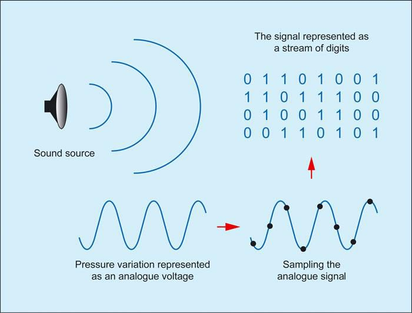

*[What is digital audio? - mp4gain.com](https://dt7v1i9vyp3mf.cloudfront.net/styles/news_large/s3/imagelibrary/D/DigMyth1-wpILIpnPnsuSK1dcyD8V_Ps3F_98.qjE.jpg) · 搜索词：sound wave microphone acoustic pressure analog electrical signal digital PCM sampling diagram*

### 1. 什么是采样？

假设麦克风输出连续变化的信号：

$x(t)$

数字系统不能无限连续地保存它，所以需要按照固定时间间隔读取信号。

例如每秒采样 16000 次：

$f_s=16000Hz$

采样间隔：

$T_s=\frac{1}{16000}$

约为 62.5 微秒。

也就是说，每隔 62.5 微秒记录一次声音幅度。

### 2. 什么是采样率？

| 采样率 | 每秒采样次数 | 常见用途 |
| --- | --- | --- |
| 8kHz | 8000 | 窄带语音 |
| 16kHz | 16000 | 语音识别 |
| 22.05kHz | 22050 | 音频处理 |
| 44.1kHz | 44100 | 常见音乐音频 |
| 48kHz | 48000 | 数字音频、视频 |

采样率越高，意味着每秒需要处理的数据越多。

但采样率并不是越高越好，需要结合目标信号的频率范围和系统处理能力选择。

### 3. 奈奎斯特采样定理

这是数字音频必须理解的理论。

如果需要正确表示最高频率为 $f_{max}$ 的带限信号，理想情况下采样率至少应满足：

$f_s>2f_{max}$

例如希望处理最高频率为 8kHz 的信号：

$f_s>16kHz$

实际系统还需要抗混叠滤波，不能仅仅把采样率设置成两倍就认为可以得到高质量音频。

### 4. 什么是量化位数？

采样得到的是一个幅度值，还需要将幅度转换成数字。

例如：

| 位数 | 可表示等级 |
| --- | --- |
| 8bit | 256 |
| 16bit | 65536 |
| 24bit | 16777216 |
| 32bit | 4294967296 |

这里要注意：

32bit PCM 不一定代表 32 位有效音频精度。有些 I2S 设备使用 32 位数据槽，但实际有效数据只有 18、24 或其他位数。

---

## 三、PCM：数字音频的数据格式

PCM 全称 Pulse Code Modulation，即脉冲编码调制。

它是最基础的数字音频表示形式之一。

例如一段音频：

```text
[100]
[250]
[400]
[350]
[120]
[-100]
[-300]
[-200]
```

这些数字就是不同时间点的音频采样值。

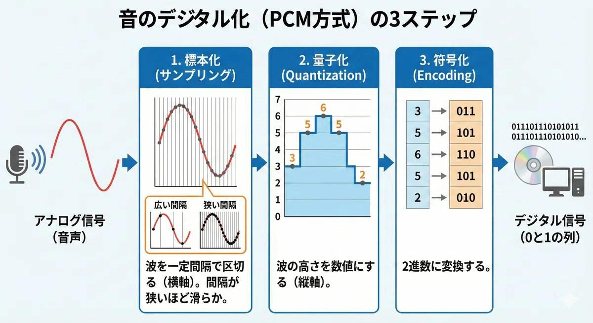

*[【ITパスポート攻略/テクノロジ系①】 0と1の世界。基礎理論とアルゴリズム｜Smart Life Lab](https://assets.st-note.com/img/1770613383-9hMb7yWeua4NRt5Qc3GSlBrx.png?width=1200) · 搜索词：PCM digital audio waveform sampled discrete amplitude signal diagram*

### 1. PCM 数据的三个关键参数

| 参数 | 说明 |
| --- | --- |
| Sample Rate | 采样率 |
| Bit Depth | 采样数据位数 |
| Channels | 声道数量 |

例如：

```text
16000Hz
16bit
Mono
```

代表：

- 每秒 16000 个采样；
- 每个采样 16 位；
- 单声道。

### 2. 如何计算 PCM 数据量？

公式：

$DataRate=
SampleRate\times BitDepth\times Channels$

例如：

16kHz、16bit、单声道：

$16000\times16\times1
=256000bit/s$

转换成字节：

$256000\div8=32000Byte/s$

即：

**32KB/s**

如果是 16kHz、16bit、双声道：

$16000\times16\times2\div8
=64000Byte/s$

即 64KB/s。

### 3. 不同音频配置的数据量

| 音频格式 | 每秒数据量 |
| --- | --- |
| 8kHz / 16bit / Mono | 16KB |
| 16kHz / 16bit / Mono | 32KB |
| 16kHz / 16bit / Stereo | 64KB |
| 44.1kHz / 16bit / Stereo | 176.4KB |
| 48kHz / 32bit / Stereo | 384KB |

这对 XIAO ESP32S3 的内存规划非常重要。

例如采集 10 秒 16kHz、16bit、单声道音频：

$32000\times10=320000Byte$

大约需要 312.5KiB。

所以不能把长时间录音的数据全部放在普通任务栈里。

---

## 四、I2S：ESP32-S3 如何与数字麦克风通信？

I2S 全称 Inter-IC Sound。

它是专门为数字音频数据传输设计的串行接口。

与 UART、I2C 不同，I2S 主要用于连续音频数据流。

### 1. I2S 的主要信号

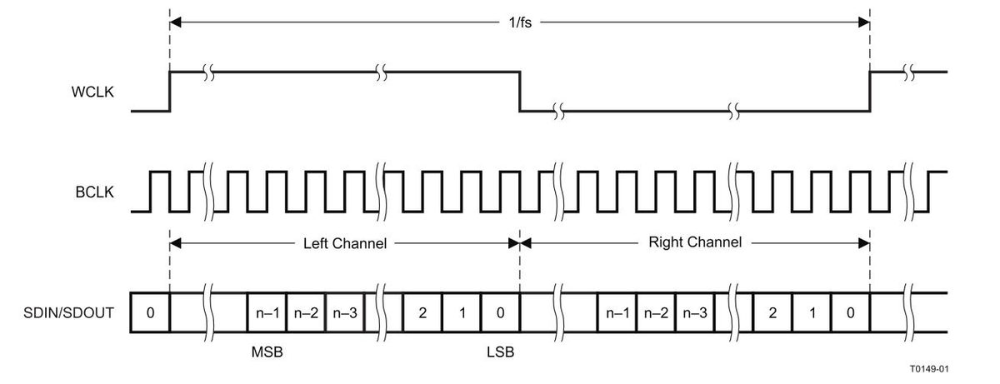

*[I2S 协议 - 可达达鸭 - 博客园](https://img2023.cnblogs.com/blog/3201119/202307/3201119-20230724162951792-210572944.png) · 搜索词：I2S bus BCLK LRCLK WS DIN DOUT digital audio connection timing diagram*

| 信号 | 作用 |
| --- | --- |
| BCLK | 位时钟 |
| WS / LRCLK | 左右声道选择时钟 |
| DIN | 数据输入 |
| DOUT | 数据输出 |
| MCLK | 主时钟，部分设备需要 |

其中：

- BCLK 控制每一位数据的传输节奏。
- WS 表示当前传输的是左声道还是右声道。
- DIN/DOUT 负责实际音频数据。

### 2. I2S 主机和从机

在常见的 ESP32-S3 音频系统中：

ESP32-S3 可以作为 I2S 主机。

由它产生：

- BCLK；
- WS。

数字麦克风接收时钟，然后把数据发送给 ESP32-S3。

```text
XIAO ESP32S3
     |
     ├── BCLK ───→ 数字麦克风
     |
     ├── WS ─────→ 数字麦克风
     |
     └── DIN ←──── 数字麦克风数据
```

播放时则可以把方向反过来：

```text
XIAO ESP32S3
     |
     ├── BCLK ───→ 数字功放
     |
     ├── WS ─────→ 数字功放
     |
     └── DOUT ───→ 数字功放
```

### 3. I2S 为什么需要 DMA？

假设：

```text
16kHz
16bit
单声道
```

每秒就有 32000 字节音频数据。

如果 CPU 每个采样都单独处理，就会产生大量数据搬运工作。

I2S + DMA 可以实现：

```text
数字麦克风
    ↓
I2S 接收
    ↓
DMA 缓冲区
    ↓
FreeRTOS 音频任务
    ↓
PCM 数据处理
```

CPU 可以按块读取数据，而不是逐个采样搬运。

---

## 五、I2S 实际硬件：选择数字麦克风和数字功放

现在把理论落实到普通版 XIAO ESP32S3。

建议第一套音频实验使用两个模块：

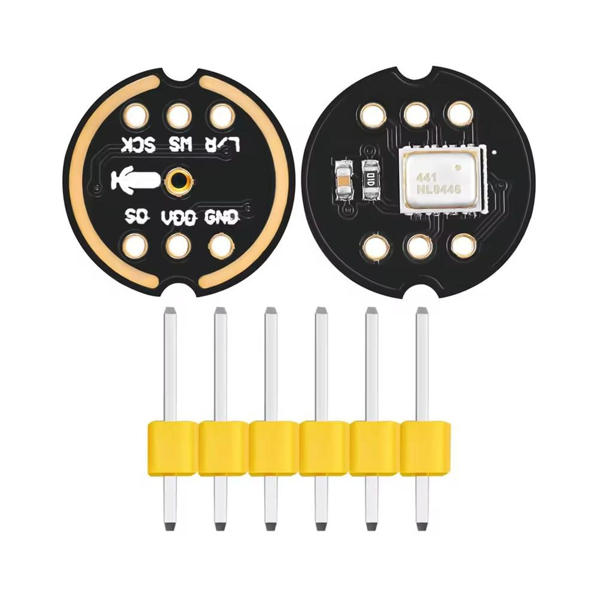

*[INMP441 I2S MEMS Omnidirectional Microphone – Zaitronics](https://zaitronics.com.au/cdn/shop/files/S04fd4196b48846639220a2baf5e5ff8bW_jpg_960x960q75_jpg.png?v=1764992284&width=1000) · 搜索词：INMP441 I2S MEMS digital microphone breakout module*

- **INMP441 数字麦克风** 负责声音采集，输出 I2S 数字数据。

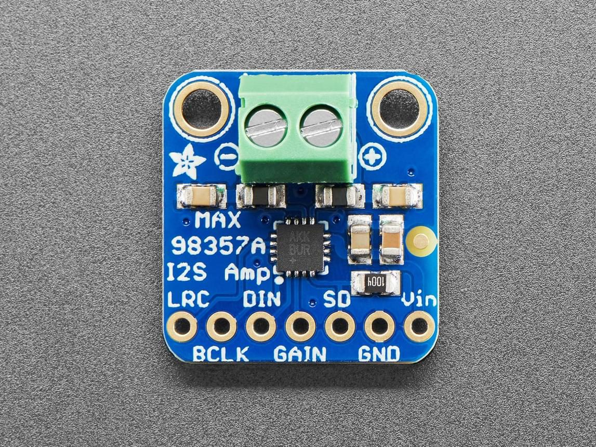

*[Adafruit MAX98357A I2S 3W Class D Audio Amplifier Breakout - Thingbits India](https://www.thingbits.in/rails/active_storage/blobs/proxy/eyJfcmFpbHMiOnsibWVzc2FnZSI6IkJBaHBBczRoIiwiZXhwIjpudWxsLCJwdXIiOiJibG9iX2lkIn19--bb72f6fb26e766c28450acdba6d6df0e4e340466/3006-08.jpg) · 搜索词：MAX98357A I2S class D digital audio amplifier breakout board*

- **MAX98357A 数字功放** 接收 I2S 数据，驱动扬声器。

这两个模块可以构成一套基础的录音和播放系统。

### 1. INMP441 麦克风接线

INMP441 常见引脚：

| 麦克风引脚 | XIAO ESP32S3 示例连接 |
| --- | --- |
| VDD | 3V3 |
| GND | GND |
| SCK | D0 / GPIO1 |
| WS | D1 / GPIO2 |
| SD | D2 / GPIO3 |
| L/R | GND（选择左声道，具体依模块说明） |

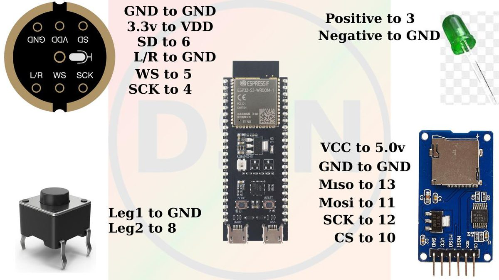

*[How to Make an Audio Recorder With Esp32, INMP441 I2S Microphone - Instructables](https://content.instructables.com/FZ8/1ROT/MIZ18QSP/FZ81ROTMIZ18QSP.png) · 搜索词：INMP441 microphone XIAO ESP32 ESP32 S3 wiring BCLK WS SD diagram*

说明：

- SCK 对应 I2S BCLK。
- WS 对应 I2S WS。
- SD 对应 ESP32-S3 的 DIN。
- L/R 用于选择麦克风输出的声道位置。

INMP441 通常在 32 位 I2S 数据槽中提供有效音频数据。不能简单认为每个槽里的 32 位都是 32 位有效音频。

### 2. MAX98357A 功放接线

| MAX98357A | XIAO ESP32S3 示例连接 |
| --- | --- |
| VIN | 按模块规格接电源 |
| GND | GND |
| BCLK | D0 / GPIO1 |
| LRC | D1 / GPIO2 |
| DIN | D3 / GPIO4 |
| SD / MODE | 按模块要求配置 |

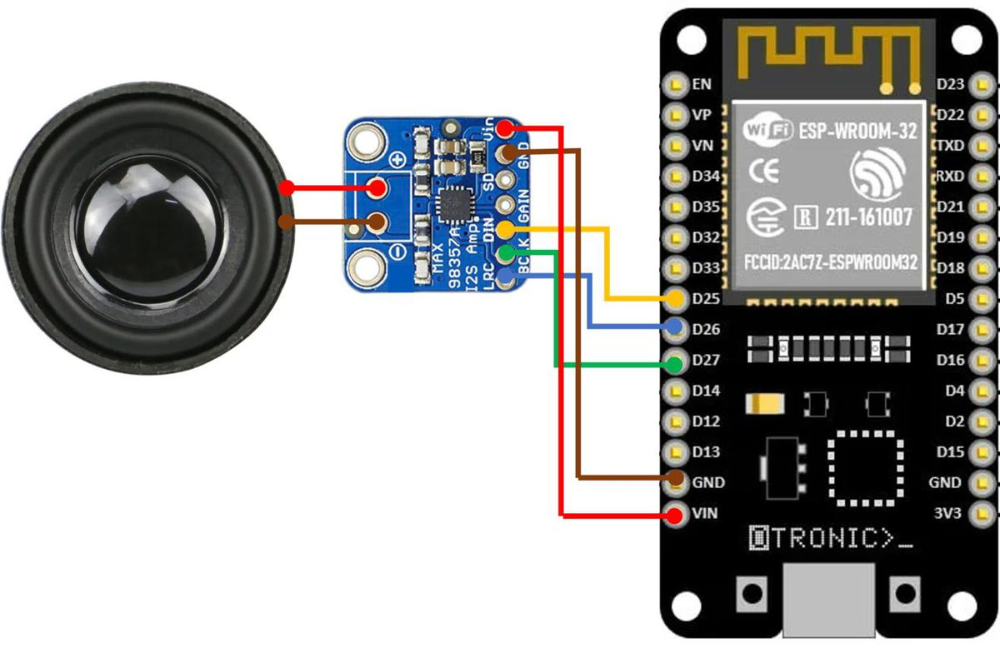

*[Schéma de connexion pour la radio wifi MAX98357A et code d'exemple pour ESP32 - OTRONIC](https://cdn.webshopapp.com/shops/346407/files/434889213/max98357a.png) · 搜索词：MAX98357A ESP32 I2S amplifier speaker wiring BCLK LRC DIN diagram*

注意：

- MAX98357A 的扬声器输出是桥接功放输出，不能将扬声器负端直接接 GND。
- 扬声器应该连接功放的 OUT+ 和 OUT−。
- 功放供电电压按照具体模块规格确定。
- 麦克风和功放需要共地。
- 如果同时连接采集和播放，两个设备可以共享 BCLK、WS 时钟，但需要合理设计 I2S 全双工通道及声道配置。

以上 GPIO 是实验规划示例。真正接线前必须确认没有与现有板载电路、USB、其他外设冲突。不要把普通版和 Sense 版的引脚定义混用。

---

## 六、ESP-IDF I2S 驱动：建立数字麦克风采集程序

现在进入实际代码。

ESP-IDF 5.x 使用新版 I2S Channel API。

主要头文件：

```c
#include "driver/i2s_std.h"
#include "driver/i2s_common.h"
```

### 1. 初始化 I2S 接收通道

下面以：

- 16kHz 采样率；
- 32 位数据槽；
- 单声道；
- Philips I2S 标准格式；

作为实验配置。

```c
#include "driver/i2s_std.h"
#include "esp_err.h"

#define I2S_PORT I2S_NUM_0

#define I2S_BCLK GPIO_NUM_1
#define I2S_WS   GPIO_NUM_2
#define I2S_DIN  GPIO_NUM_3

static i2s_chan_handle_t rx_handle;

void audio_input_init(void)
{
    i2s_chan_config_t chan_config =
        I2S_CHANNEL_DEFAULT_CONFIG(
            I2S_PORT,
            I2S_ROLE_MASTER
        );

    ESP_ERROR_CHECK(
        i2s_new_channel(
            &chan_config,
            NULL,
            &rx_handle
        )
    );

    i2s_std_config_t std_config = {

        .clk_cfg =
            I2S_STD_CLK_DEFAULT_CONFIG(16000),

        .slot_cfg =
            I2S_STD_PHILIPS_SLOT_DEFAULT_CONFIG(
                I2S_DATA_BIT_WIDTH_32BIT,
                I2S_SLOT_MODE_MONO
            ),

        .gpio_cfg = {
            .mclk = I2S_GPIO_UNUSED,
            .bclk = I2S_BCLK,
            .ws = I2S_WS,
            .dout = I2S_GPIO_UNUSED,
            .din = I2S_DIN,

            .invert_flags = {
                .mclk_inv = false,
                .bclk_inv = false,
                .ws_inv = false
            }
        }
    };

    ESP_ERROR_CHECK(
        i2s_channel_init_std_mode(
            rx_handle,
            &std_config
        )
    );

    ESP_ERROR_CHECK(
        i2s_channel_enable(rx_handle)
    );
}
```

这里有几个重要概念：

| 配置 | 含义 |
| --- | --- |
| `I2S_ROLE_MASTER` | ESP32-S3 产生时钟 |
| `16000` | 采样率 |
| `32BIT` | 每个数据槽的位宽 |
| `MONO` | 单声道配置 |
| `din` | 接收数字音频数据的 GPIO |

注意：单声道 I2S 的左右声道槽位选择，必须与麦克风的 L/R 配置匹配。部分麦克风虽然只输出一个声道的数据，但总线上仍存在左右声道时隙。若读到全零或数据异常，应优先检查声道槽位，而不是直接认定麦克风损坏。

### 2. 读取 PCM 数据

```c
#include <stdint.h>
#include <stdio.h>

#define AUDIO_BUFFER_SIZE 1024

static int32_t audio_buffer[AUDIO_BUFFER_SIZE];

void audio_capture_task(void *arg)
{
    size_t bytes_read = 0;

    while (1) {

        esp_err_t ret = i2s_channel_read(
            rx_handle,
            audio_buffer,
            sizeof(audio_buffer),
            &bytes_read,
            1000
        );

        if (ret == ESP_OK && bytes_read > 0) {

            printf(
                "Audio bytes: %u\n",
                (unsigned)bytes_read
            );

            // 后续进行 PCM 数据处理
        }
    }
}
```

这段代码先实现连续读取。

下一步需要将 I2S 数据槽转换为真正的 PCM 样本。

### 3. 为什么不能直接把 32 位数据当成 16 位 PCM？

因为麦克风的数据格式可能是：

- 24 位有效数据；
- 左对齐或其他对齐方式；
- 32 位 I2S 数据槽。

例如，实际有效数据可能位于 32 位槽的高 24 位。

因此需要根据 INMP441 数据手册和实际采集结果确定移位和符号扩展方式。

概念示例：

```c
int32_t sample_24bit =
    audio_buffer[i] >> 8;

int16_t sample_16bit =
    (int16_t)(sample_24bit >> 8);
```

这里仅演示位移处理思路，不能在未确认数据对齐和有效位位置时直接用于最终产品。

**调试音频的第一原则：先确认 I2S 时序和原始数据格式，再做 PCM 转换。**

---

## 七、I2S 音频播放：让 XIAO ESP32S3 发出声音

采集数据只是第一步。

现在我们学习如何播放音频。

播放过程：

```text
PCM 数据
   ↓
I2S TX
   ↓
DMA
   ↓
数字功放
   ↓
扬声器
```

### 1. 创建 I2S TX 通道

播放时可以使用 I2S_NUM_0 的 TX 通道，并与 RX 共享时钟资源，具体取决于驱动支持的全双工配置。

例如：

```c
#define I2S_DOUT GPIO_NUM_4

static i2s_chan_handle_t tx_handle;
```

创建全双工通道时，建议在创建阶段同时申请 TX 和 RX：

```c
i2s_chan_handle_t tx_handle;
i2s_chan_handle_t rx_handle;

i2s_chan_config_t chan_config =
    I2S_CHANNEL_DEFAULT_CONFIG(
        I2S_NUM_0,
        I2S_ROLE_MASTER
    );

ESP_ERROR_CHECK(
    i2s_new_channel(
        &chan_config,
        &tx_handle,
        &rx_handle
    )
);
```

之后分别配置 TX 和 RX 的标准模式，并确认两者时钟配置兼容。

### 2. 播放 PCM 数据

假设我们已经有一段 16 位 PCM 音频：

```c
int16_t pcm_data[1024];
```

播放：

```c
size_t bytes_written = 0;

ESP_ERROR_CHECK(
    i2s_channel_write(
        tx_handle,
        pcm_data,
        sizeof(pcm_data),
        &bytes_written,
        1000
    )
);
```

实际使用时，必须保证 TX 的数据槽宽度、声道模式和功放要求相匹配。

例如，功放使用 32 位 I2S 槽，而 PCM 是 16 位，就需要将 16 位样本转换为适当的 32 位槽格式，不能直接假定数据会自动以预期方式对齐。

### 3. 为什么扬声器不能直接接 GPIO？

因为 GPIO 只能输出数字逻辑信号，不能提供足够的音频功率。

扬声器需要驱动电流。

因此需要：

- DAC 或数字音频功放；
- 功率放大电路；
- 合适的扬声器负载。

MAX98357A 将数字 I2S 音频转换并放大，适合这种场景。

---

## 八、DSP：让声音变得更清晰

现在我们已经可以采集 PCM，也可以播放 PCM。

但原始声音通常需要处理。

DSP 是 Digital Signal Processing，即数字信号处理。

### 1. 音频增益 Gain

例如麦克风采集的声音太小，可以通过乘法调节增益：

$y[n]=G\cdot x[n]$

其中：

- $x[n]$：原始采样；
- $G$：增益系数；
- $y[n]$：处理后采样。

代码：

```c
int16_t apply_gain(
    int16_t input,
    float gain
)
{
    float output = input * gain;

    if (output > 32767) {
        output = 32767;
    }

    if (output < -32768) {
        output = -32768;
    }

    return (int16_t)output;
}
```

注意这里进行了限幅，防止整数溢出。

### 2. 什么是削波 Clipping？

如果输入信号已经达到最大值，再继续放大，就会出现削波。

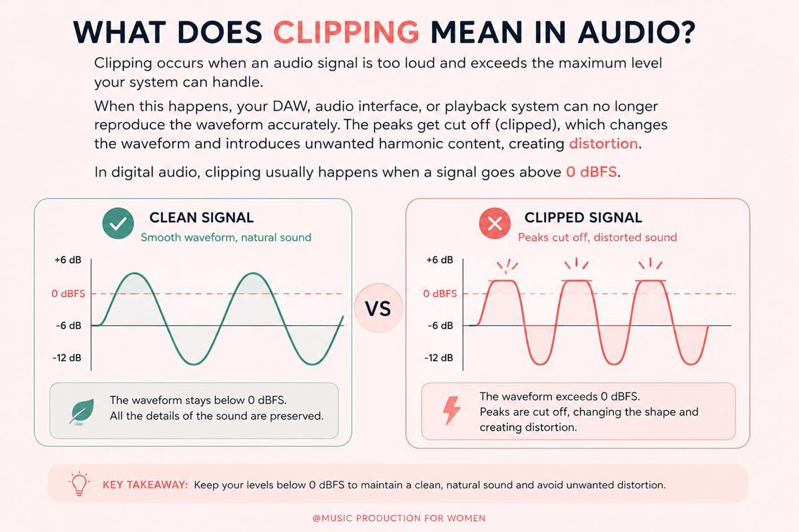

*[Audio Clipping Explained: What It Means, What It Sounds Like & How to Fix It](https://assets.cdn.filesafe.space/5fsvmS0WZTPnvqa5FEuG/media/6a20b2bdac6660124efd9202.png) · 搜索词：audio waveform clipping distortion comparison clean waveform clipped waveform*

削波会产生明显失真。

所以不能简单地认为增益越高声音越清晰。

### 3. RMS：计算声音能量

RMS 是 Root Mean Square，均方根。

常用于计算音频信号的有效幅度。

$RMS=\sqrt{\frac{1}\sum_{n=0}^{N-1}x[n]^2}$

代码：

```c
#include <math.h>
#include <stdint.h>

float audio_rms(
    const int16_t *samples,
    int count
)
{
    double sum = 0;

    for (int i = 0; i < count; i++) {

        double value = samples[i];

        sum += value * value;
    }

    return sqrt(sum / count);
}
```

RMS 可以用于：

- 音量表；
- 声音强度监测；
- VAD 初步判断；
- 音频信号分析。

### 4. VAD：判断是否有人说话

VAD 是 Voice Activity Detection。

基本思路：

```text
麦克风采集
    ↓
计算 RMS
    ↓
与阈值比较
    ↓
是否存在有效声音？
   /        \
 是          否
 ↓            ↓
标记语音     标记静音
```

简单能量阈值只能判断声音强弱，并不能可靠识别语音。

真实 VAD 还可能需要：

- 背景噪声估计；
- 频段能量；
- 自适应阈值；
- 语音特征；
- 神经网络模型。

### 5. FFT：分析声音频率

FFT 是 Fast Fourier Transform。

它把时域信号转换成频域信息。

例如：

- 低频：声音中的低频成分；
- 中频：语音主体频率成分；
- 高频：较高频率的声音成分。

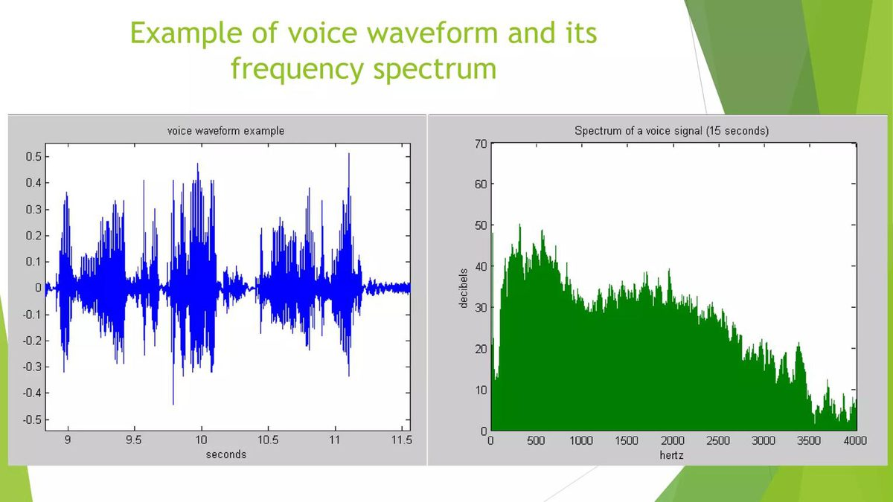

*[Frequency spectrum | PPTX](https://image.slidesharecdn.com/frequencyspectrum-160102130155/75/Frequency-spectrum-3-2048.jpg) · 搜索词：audio FFT frequency spectrum waveform microphone voice frequency analysis graph*

ESP32-S3 可以通过轻量级 FFT 算法进行实时频谱分析。

常见选择：

- ESP-DSP；
- KissFFT；
- 自己实现的定点 FFT。

官方资料：

[Espressif ESP-DSP 数字信号处理库](https://docs.espressif.com/projects/esp-dsp/en/latest/esp-dsp-library.html)

---

## 九、音频缓冲区：为什么录音容易出现爆音和丢帧？

这是实际开发中很容易遇到的问题。

假设：

- I2S 每秒采集 32000 字节；
- 音频任务负责读取；
- 网络任务负责上传。

如果网络突然变慢，可能出现：

- 音频缓冲区堆积；
- DMA 缓冲区溢出；
- 音频丢失；
- 播放出现爆音；
- 延迟不断增加。

### 1. 推荐的音频缓冲架构

**I2S + DMA** 连续音频采集

↓

**Buffer A / Buffer B** 双缓冲交替使用

↓

**PCM Ring Buffer** 暂存音频数据

↓

- **DSP Task** 音频处理
- **Network Task** 网络发送

### 2. 为什么推荐双缓冲？

假设有两个缓冲区：

```text
Buffer A：DMA 正在写入

Buffer B：CPU 正在处理
```

当 A 写满后：

```text
Buffer A：CPU 开始处理

Buffer B：DMA 开始写入
```

两个缓冲区交替使用。

这样可以减少采集和处理之间的相互等待。

但必须明确缓冲区所有权，不能让 CPU 读取 DMA 正在修改的数据。

### 3. 音频缓冲区大小如何计算？

假设：

- 16kHz；
- 16bit；
- 单声道；
- 每次处理 20ms。

采样数量：

$16000\times0.02=320$

数据大小：

$320\times2=640Bytes$

因此每个 20ms 音频块需要 640 字节。

这也是语音识别和实时语音通信中常见的数据分块思路。

---

## 十、FreeRTOS：音频系统如何划分任务？

对于普通版 XIAO ESP32S3，建议把音频系统划分为独立任务。

| 任务 | 主要职责 | 设计重点 |
| --- | --- | --- |
| Audio Capture | I2S 采集 | 及时读取 |
| Audio Process | DSP 处理 | 控制处理延迟 |
| Audio Playback | I2S 播放 | 防止欠载 |
| Network | Wi-Fi 传输 | 允许超时 |
| Monitor | 监控 | 检查缓冲区和内存 |

### 1. 任务间的数据流

```text
Audio Capture
      ↓
PCM Ring Buffer
      ↓
Audio Process
      ↓
Processed PCM
      ↓
 ┌────┴────┐
 ↓         ↓
Playback   Network
```

### 2. 为什么不能在采集任务中直接执行 HTTP？

因为网络传输可能发生阻塞。

例如：

```c
while (1) {

    i2s_channel_read(...);

    http_post_audio(...);
}
```

如果 HTTP 请求等待 200ms，那么连续采集任务就可能错过大量音频数据。

正确设计：

```text
采集任务：负责采集

处理任务：负责处理

网络任务：负责上传
```

每个任务各司其职。

### 3. 监控音频系统

建议监控：

```c
printf("Free heap: %u\n",
       (unsigned)esp_get_free_heap_size());

printf("Minimum free heap: %u\n",
       (unsigned)esp_get_minimum_free_heap_size());
```

同时监控：

- I2S 读取错误；
- DMA 缓冲区异常；
- PCM 队列积压；
- 音频丢帧次数；
- 任务栈余量；
- 网络传输延迟。

---

## 十一、Wi-Fi 音频传输：让电脑实时听到 XIAO 采集的声音

现在把音频和网络结合起来。

假设你希望在 Mac 上实时听到 XIAO ESP32S3 麦克风采集的声音。

推荐先从局域网 UDP 或 WebSocket 音频传输开始。

### 1. 系统架构

**INMP441** 数字麦克风

↓

**XIAO ESP32S3** I2S + DMA + PCM

↓

**Wi-Fi** UDP / WebSocket

↓

**Mac 音频接收程序** 接收 PCM 数据

↓

**电脑扬声器** 播放声音

### 2. 为什么不建议直接发送每个采样值？

假设使用：

- 16kHz；
- 16bit；
- 单声道。

每秒需要传输 32KB。

如果每次只发送一个采样值，就会产生大量网络数据包和协议开销。

因此建议将数据分块。

例如每 20ms 发送一包：

```text
每包 640 Bytes PCM
```

数据包可以增加：

```text
设备 ID
序列号
采样时间戳
采样率
声道数
PCM 数据
```

这样电脑可以识别数据格式，并检测是否丢包。

### 3. UDP 和 WebSocket 如何选择？

| 对比 | UDP | WebSocket |
| --- | --- | --- |
| 传输延迟 | 通常较低 | 有 TCP 可靠传输开销 |
| 是否保证到达 | 否 | TCP 提供可靠字节流 |
| 是否保证顺序 | 否 | 是 |
| 协议复杂度 | 需要自行设计 | 较容易使用 |
| 适合 | 实时音频实验 | 语音数据和控制通信 |

初学阶段建议：

先使用 WebSocket 完成稳定的数据传输，再研究 UDP 的实时性优化。

---

## 十二、AEC、NS 和 AGC：智能语音设备的三大关键技术

如果你以后想制作智能语音终端，这三个技术一定要了解。

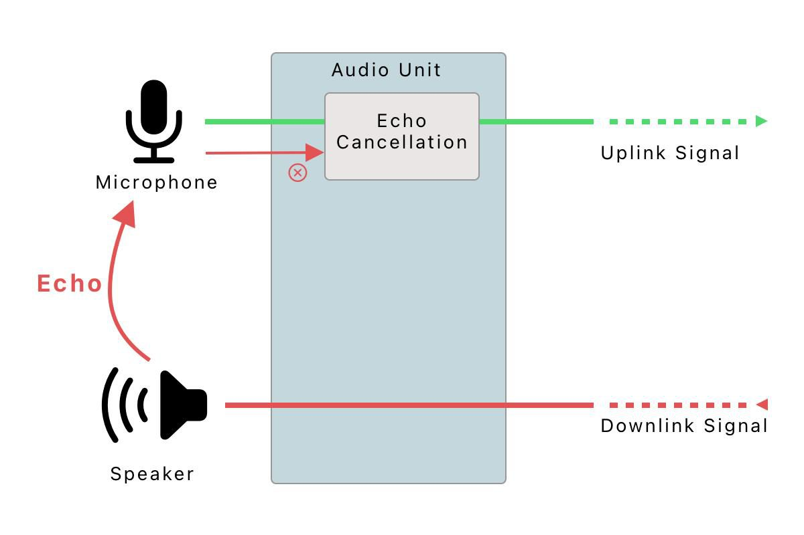

*[react native - How can we disable iOS ducking feature completely during our video call app? - Stack Overflow](https://i.sstatic.net/65Ot35ZB.png) · 搜索词：acoustic echo cancellation microphone speaker audio signal diagram*

**1. AEC：回声消除**

Acoustic Echo Cancellation。

当扬声器播放声音时，麦克风可能重新采集到扬声器的声音。

AEC 通过参考播放信号和麦克风信号，估计并消除回声。

---

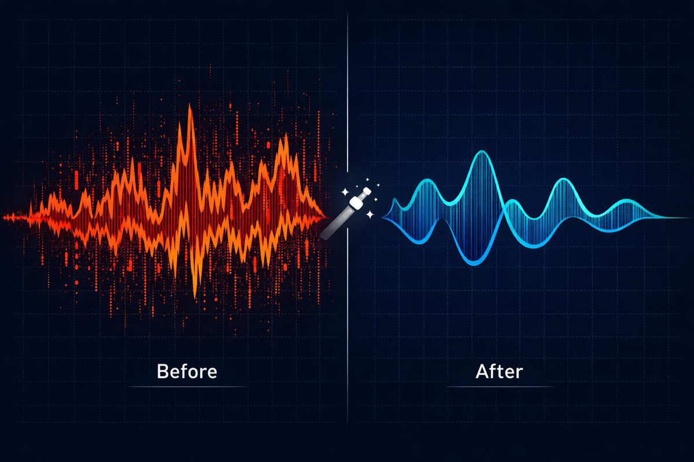

*[Como Reduzir Ruído em Áudio Online: Guia Completo 2026](https://www.audio-editor.online/blog/reducao-ruido-audio-online/hero-antes-depois-reducao-ruido.webp) · 搜索词：digital audio noise reduction background noise waveform illustration*

**2. NS：噪声抑制**

Noise Suppression。

减少风扇、空调、环境噪声等对语音的影响。

可以使用频域滤波或专门的语音降噪算法。

---

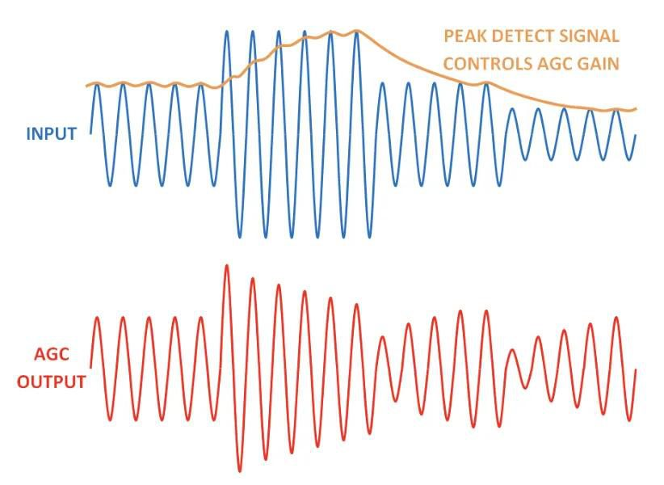

*[Auto Gain Control in Electronic Systems](https://resource.auditoryworks.co/server/nearity/images/d03159f5-0133-4c72-b763-37ccdac842b3.png?x-oss-process=image%2Fresize%2Cw_1100%2Fformat%2Cwebp) · 搜索词：automatic gain control AGC audio input output waveform diagram*

**3. AGC：自动增益控制**

Automatic Gain Control。

自动调节输入音频增益，让远近不同的声音保持相对合适的音量。

这些技术在智能音箱、语音助手和远场语音终端中非常重要。

ESP32-S3 可以运行部分轻量级音频算法，但复杂 AEC、NS、AGC 是否能够实时运行，需要结合算法复杂度、采样率、CPU 负载和内存实测。

---

## 十三、实战项目：制作一台 XIAO ESP32S3 网络语音终端

这是建议你完成的第一个综合音频项目。

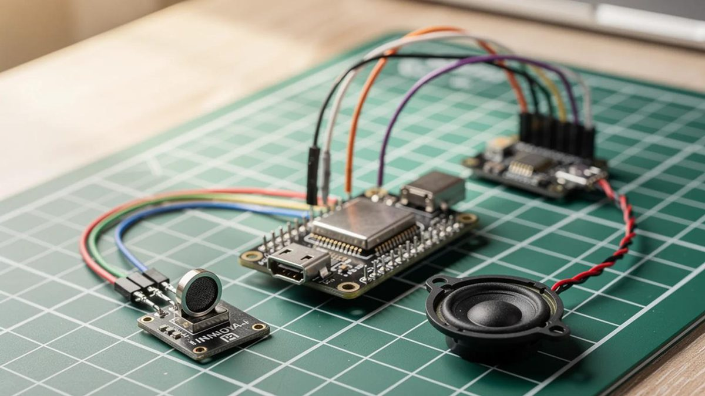

*[How to Build a Local Voice Satellite for Hermes or OpenClaw, a ESP32 project | Schematik](https://tfvg9prl3arlawj9.public.blob.vercel-storage.com/published/fae46e10-d3ca-410a-a2a3-75781a7d26e7/99fa8d64/photo.webp) · 搜索词：ESP32 S3 smart voice assistant prototype I2S microphone speaker amplifier development board enclosure*

### 第一阶段：本地录音

硬件：

- XIAO ESP32S3；
- INMP441；
- USB 连接 Mac。

目标：

1. 初始化 I2S。
2. 采集 PCM。
3. 输出原始数据。
4. 计算 RMS。
5. 保存 PCM 文件。
6. 在电脑上播放录音。

### 第二阶段：本地播放

增加：

- MAX98357A；
- 4Ω 或 8Ω 扬声器，按功放模块规格选择。

目标：

1. 生成 PCM 测试数据。
2. I2S TX 输出。
3. 数字功放播放。
4. 调节音量。
5. 测试连续播放稳定性。

### 第三阶段：Wi-Fi 音频传输

目标：

1. 连接 Wi-Fi。
2. 分块发送 PCM。
3. Mac 接收 PCM。
4. 检测丢包。
5. 实时播放。
6. 统计延迟。

### 第四阶段：智能语音处理

目标：

1. VAD 检测语音。
2. 静音时停止上传音频。
3. 语音数据发送到服务器。
4. 服务器进行语音识别。
5. 接收文字或语音回复。
6. XIAO 通过扬声器播放。

---

## 十四、推荐的音频工程目录

在现有 `XIAO-ESP32S3-Projects` 中，建议单独建立：

```text
projects/
└── audio_terminal/
    │
    ├── main/
    │   └── app_main.c
    │
    ├── components/
    │   ├── audio_bsp/
    │   │   ├── audio_pin_config.h
    │   │   └── audio_bsp.c
    │   │
    │   ├── audio_capture/
    │   │   ├── i2s_rx.c
    │   │   └── pcm_buffer.c
    │   │
    │   ├── audio_playback/
    │   │   ├── i2s_tx.c
    │   │   └── speaker.c
    │   │
    │   ├── audio_dsp/
    │   │   ├── audio_gain.c
    │   │   ├── audio_filter.c
    │   │   ├── audio_vad.c
    │   │   └── audio_fft.c
    │   │
    │   ├── audio_network/
    │   │   ├── audio_udp.c
    │   │   └── audio_websocket.c
    │   │
    │   └── audio_monitor/
    │       ├── audio_stats.c
    │       └── memory_monitor.c
    │
    ├── docs/
    │   ├── wiring.md
    │   ├── i2s_architecture.md
    │   ├── pcm_format.md
    │   └── audio_debug.md
    │
    └── README.md
```

这里建议先实现本地录音、播放，再添加网络功能。不要一开始就同时调试麦克风、功放、Wi-Fi 和语音识别，否则很难判断问题发生在哪一层。

---

## 十五、给 Codex 的本课开发任务

**Codex：XIAO ESP32S3 音频基础系统**

**复制指令**

开发要求：

- 普通版 XIAO ESP32S3。
- INMP441 数字麦克风。
- MAX98357A 数字功放。
- ESP-IDF 新版 I2S API。
- PCM 数据转换。
- RMS、增益和滤波。
- FreeRTOS 音频任务。
- 双缓冲。
- Wi-Fi 音频传输。

必须分阶段构建，不得一次性生成未经验证的完整系统。

---

## 十六、本课学习验收

**第十三课学习进度**/

---

## 十七、下一课：ESP32-S3 摄像头、图像处理与视觉系统

**第十四课：摄像头驱动、图像采集与计算机视觉**

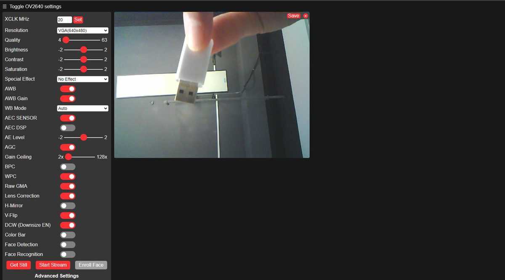

*[Chapter 17 Camera Web Server — Basic-Starter-Kit-for-ESP32-S3-WROOM documentation](https://basic-starter-kit-for-esp32-s3-wroom.readthedocs.io/en/latest/_images/25.1-2.png) · 搜索词：ESP32 S3 camera OV2640 JPEG image capture development electronics project*

下一课将讲解：

1. 摄像头 CMOS 图像传感器原理。
2. OV2640、OV3660 摄像头。
3. SCCB 摄像头配置总线。
4. DVP 并行数据接口。
5. XCLK、PCLK、VSYNC、HREF。
6. ESP32-S3 LCD_CAM 控制器。
7. 摄像头 DMA 采集。
8. RGB565、YUV422、JPEG 格式。
9. PSRAM 图像帧缓冲。
10. JPEG 压缩与解码。
11. HTTP 图片上传和 MJPEG 视频流。
12. 图像裁剪、缩放和灰度处理。
13. 摄像头与 Wi-Fi 的资源调度。

这里有一个硬件区别需要提前明确：

**普通版 XIAO ESP32S3 并不自带 Sense 版的摄像头接口配置。** 下一课会以普通版为主，研究外接摄像头所需的硬件接口、电路和引脚规划，不能直接照搬 XIAO ESP32S3 Sense 的接线方案。

官方参考：

- [ESP-IDF I2S 驱动](https://docs.espressif.com/projects/esp-idf/en/stable/esp32s3/api-reference/peripherals/i2s.html)
- [ESP-DSP 源码](https://github.com/espressif/esp-dsp)
- [ESP-ADF 音频开发框架](https://github.com/espressif/esp-adf)
- [ESP32 Camera 驱动源码](https://github.com/espressif/esp32-camera)

**本阶段最值得完成的目标：** 先用普通版 XIAO ESP32S3 + INMP441 + MAX98357A 做出真正能够录音和播放的设备。完成后，再加入 Wi-Fi、VAD 和语音识别。这样你就真正掌握了一条完整的嵌入式数字音频开发链路。
