# 第十四课：XIAO ESP32S3 摄像头、图像采集与计算机视觉

前面我们已经学习了数字音频系统，包括 I2S、PCM、DMA、DSP 和 Wi-Fi 音频传输。

现在进入另一个重要领域：**嵌入式视觉开发（Embedded Vision）**。

这节课仍然以普通版 Seeed XIAO ESP32S3 为唯一主控，不直接套用 Sense 版的摄像头接线。

我们将研究如何给普通版 XIAO ESP32S3 外接摄像头，让它能够：

- 拍摄照片；
- 获取 JPEG 图像；
- 保存图像；
- 通过 Wi-Fi 传输图像；
- 实时输出视频流；
- 进行简单图像处理；
- 进一步运行轻量级视觉算法。

## 一、先理解摄像头系统的整体结构

摄像头并不是简单地把一根数据线连接到 ESP32-S3 就能工作。

它包含图像传感器、时钟、数据接口、控制总线和数据缓冲区。

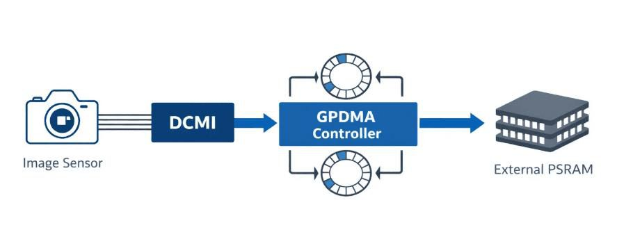

*[Real-Time Image Pipeline: DMA + DCMI Optimization](https://tech.hoomanely.com/content/images/2026/01/image-5.png) · 搜索词：embedded camera ESP32 camera sensor image processing pipeline sensor DVP DMA PSRAM JPEG architecture diagram*

一套典型的嵌入式摄像头系统：

```text
外部光线
   ↓
摄像头镜头
   ↓
CMOS 图像传感器
   ↓
图像像素转换
   ↓
DVP 并行数据接口
   ↓
ESP32-S3 LCD_CAM
   ↓
DMA
   ↓
PSRAM / RAM
   ↓
图像处理
   ↓
JPEG / Wi-Fi / 显示
```

这里有几个重要概念：

| 模块 | 作用 |
| --- | --- |
| CMOS Sensor | 感知光线并生成像素数据 |
| SCCB | 配置摄像头寄存器 |
| DVP | 传输图像数据 |
| LCD_CAM | ESP32-S3 图像接口控制器 |
| DMA | 搬运图像数据 |
| PSRAM | 保存较大的图像帧 |
| JPEG | 压缩图像 |
| Wi-Fi | 传输图像 |

---

## 二、CMOS 图像传感器：摄像头如何感知世界？

普通摄像头内部通常有一个 CMOS 图像传感器。

它由大量感光像素组成。

例如：

- 320 × 240；
- 640 × 480；
- 1600 × 1200；
- 1920 × 1080。

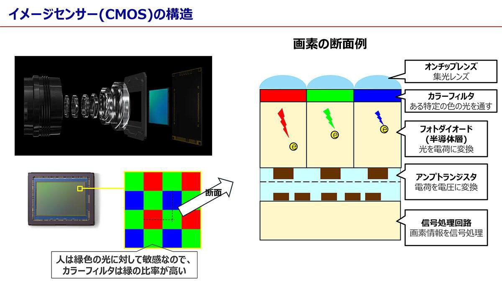

*[スマホカメラの画像センサの仕組みと「進化の先」を、ソニー開発者に聞く - CMOSセンサーのしくみ・技術のふしぎ(2) | TECH+（テックプラス）](https://news.mynavi.jp/techplus/article/Fundamentals-of-CMOS-Sensors-2/images/002.jpg) · 搜索词：CMOS image sensor pixel photodiode array microscopic structure diagram*

### 1. 像素是什么？

假设一个摄像头分辨率为：

$640\times480$

那么像素数量：

$640\times480=307200$

也就是约 30.7 万个像素。

每个像素负责感知一定区域的光线。

### 2. RGB 图像如何形成？

现实世界中的颜色可以通过红、绿、蓝三个颜色分量进行表示。

例如：

```text
R = 255
G = 0
B = 0
```

代表红色。

```text
R = 0
G = 255
B = 0
```

代表绿色。

```text
R = 0
G = 0
B = 255
```

代表蓝色。

但是 CMOS 传感器通常不会让每个像素直接同时测量完整的 RGB 三个分量。

常见做法是使用 Bayer 彩色滤光阵列，再通过 ISP 或传感器内部处理生成彩色图像。

### 3. 什么是图像传感器曝光？

曝光决定传感器接收多少光线。

曝光时间过短：

- 图像偏暗；
- 快速运动比较清晰。

曝光时间过长：

- 图像偏亮；
- 快速运动可能产生拖影。

因此摄像头通常具有：

- 曝光控制；
- 增益控制；
- 白平衡；
- 自动曝光；
- 自动增益。

这些通常可以通过摄像头控制寄存器配置。

---

## 三、OV2640：适合入门的摄像头模块

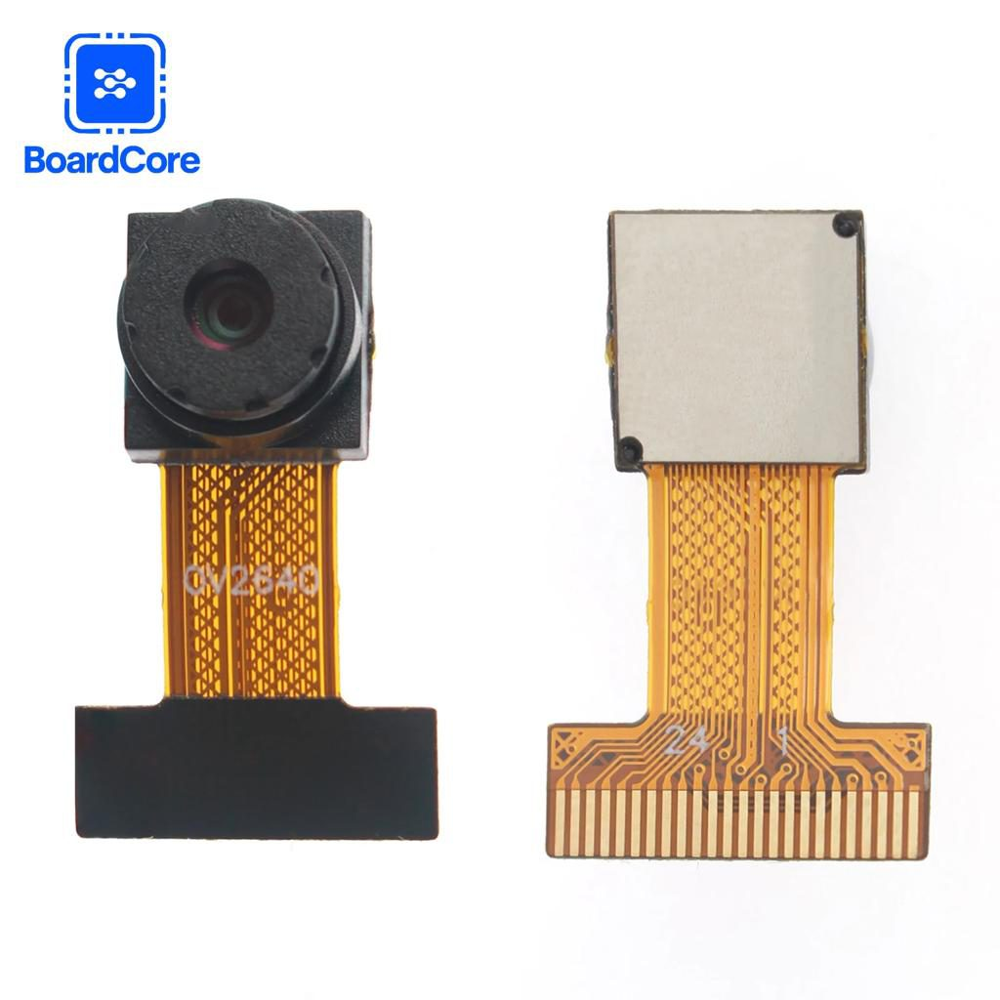

*[OV2640 2MP Camera Module JPEG/RGB/YUV Output for Arduino IoT Embedded DIY | eBay](https://ae01.alicdn.com/kf/S31bc80f31a074600a548ab6b7ced452bS.jpg) · 搜索词：OV2640 camera module 2 megapixel DVP camera*

- **OV2640** 常见 200 万像素摄像头，支持 JPEG 输出。

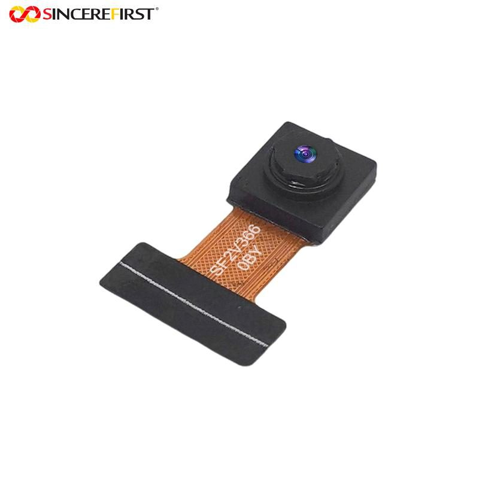

*[Cheap Price Dvp Interface Ov3660 Camera Module for Machine Vision - Mini Camera Module and Cheap Price Camera Module](https://image.made-in-china.com/2f0j00BsOMSNAyUgok/Cheap-Price-Dvp-Interface-Ov3660-Camera-Module-for-Machine-Vision.webp) · 搜索词：OV3660 camera module DVP sensor*

- **OV3660** 另一种常见的高分辨率摄像头传感器。

OV2640 是 ESP32 摄像头项目中非常常见的选择。

它的主要特点：

- 最高约 200 万像素；
- 支持 JPEG；
- 支持多种图像格式；
- 可以通过 SCCB 配置；
- 常见模块使用 DVP 并行接口。

注意：摄像头模块的具体供电、引脚排列和输出能力取决于模块设计，购买时需要确认是否为完整的 DVP 模块，而不是仅有传感器芯片的裸模块。

---

## 四、SCCB：ESP32-S3 如何配置摄像头？

摄像头不仅需要传输图像，还需要设置内部参数。

例如：

- 分辨率；
- 曝光；
- 白平衡；
- 图像格式；
- 亮度；
- 对比度；
- 特殊效果。

这些配置通常通过 SCCB 完成。

SCCB 是摄像头常见的控制接口，与 I2C 在电气和通信形式上有相似之处，但不能把所有 SCCB 行为都简单等同于标准 I2C。

### 1. SCCB 的两根主要信号线

| 信号 | 作用 |
| --- | --- |
| SIOC | 控制时钟 |
| SIOD | 控制数据 |

```text
XIAO ESP32S3
    │
    ├── SIOC ─── Camera
    │
    └── SIOD ─── Camera
```

摄像头初始化时，ESP32-S3 通过这两根线向传感器写入寄存器。

### 2. 配置流程

```text
ESP32-S3 启动
    ↓
初始化 SCCB
    ↓
读取传感器 ID
    ↓
确认摄像头型号
    ↓
写入初始化寄存器
    ↓
设置分辨率
    ↓
设置输出格式
    ↓
启动图像采集
```

### 3. 为什么摄像头需要读取 ID？

因为不同传感器具有不同的寄存器结构。

例如：

```text
OV2640
OV3660
OV5640
```

它们不能直接使用同一套未经适配的初始化寄存器。

所以驱动通常先读取芯片 ID，再选择对应配置表。

---

## 五、DVP：摄像头如何高速传输图像？

DVP 是 Digital Video Port。

这是很多传统嵌入式摄像头使用的并行图像数据接口。

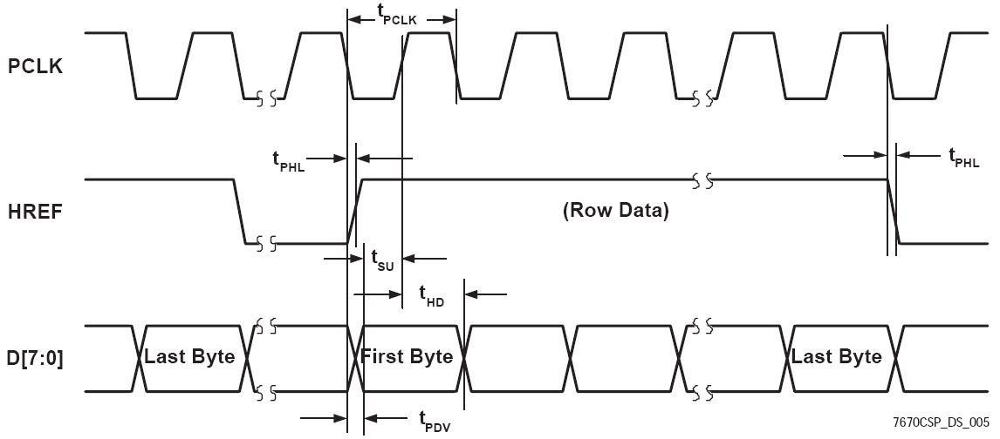

*[VGA Camera extension OV7670](https://wiki.epfl.ch/prsoc/documents/OV7670_H_timing.JPG) · 搜索词：DVP camera parallel interface D0 D7 PCLK HREF VSYNC XCLK wiring timing diagram*

### 1. DVP 主要信号

| 信号 | 作用 |
| --- | --- |
| D0～D7 | 图像数据 |
| PCLK | 像素时钟 |
| VSYNC | 帧同步 |
| HREF | 行有效信号 |
| XCLK | 摄像头输入时钟 |
| SIOD | SCCB 数据 |
| SIOC | SCCB 时钟 |

这些信号共同完成图像传输。

### 2. 数据如何传输？

可以把一帧图像理解为：

```text
Frame
 ├── Line 1
 │    ├── Pixel 1
 │    ├── Pixel 2
 │    └── Pixel ...
 │
 ├── Line 2
 │
 ├── Line 3
 │
 └── Line ...
```

摄像头通过 PCLK 提供数据节奏。

ESP32-S3 根据 HREF 判断一行数据是否有效。

VSYNC 用于识别帧边界。

### 3. 为什么 DVP 需要这么多 GPIO？

因为 DVP 是并行接口。

例如 8 位数据接口，就需要 8 根数据线，再加上同步和时钟信号。

这对普通版 XIAO ESP32S3 是一个重要的硬件限制。

它的物理引脚数量有限，必须提前做好引脚规划。

---

## 六、ESP32-S3 的 LCD_CAM 控制器

现在进入芯片内部。

ESP32-S3 并不需要 CPU 自己逐个读取摄像头像素。

它集成了 LCD_CAM 控制器。

这个控制器可以用于摄像头数据接收和 LCD 数据输出等相关工作。

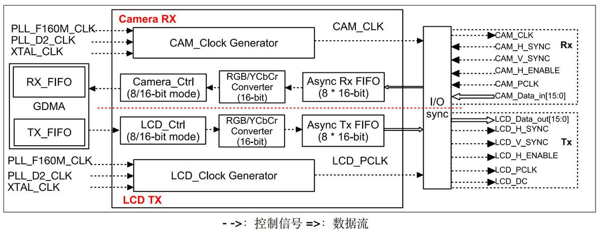

*[《ESP32-S3使用指南—IDF版 V1.6》第三十三章 RGB显示屏实验 - 正点原子 - 博客园](https://img2024.cnblogs.com/blog/3467708/202508/3467708-20250808153602832-1121458586.png) · 搜索词：ESP32-S3 LCD_CAM camera DVP DMA controller architecture block diagram*

工作流程：

```text
摄像头输出数据
      ↓
LCD_CAM 接收
      ↓
DMA 搬运
      ↓
内存缓冲区
      ↓
CPU 处理
```

它与前面学习的 UART、SPI、I2S DMA 有相同的设计思想：

**让专用硬件负责高速数据传输，CPU 负责配置和处理。**

### 1. 为什么不让 CPU 自己采集每个像素？

假设：

640 × 480 图像。

RGB565 每个像素占 2 字节。

整帧数据：

$640\times480\times2$

$=614400Byte$

约 600KiB。

如果 CPU 需要逐像素处理每次数据传输，系统开销会很大。

使用 DMA 可以更有效地处理图像数据流。

---

## 七、PSRAM：为什么摄像头系统特别需要外部 RAM？

这是普通版 XIAO ESP32S3 摄像头开发必须理解的问题。

假设你使用：

640 × 480 分辨率、RGB565 格式。

一帧需要：

$640\times480\times2=614400Byte$

如果你希望保存两帧：

$614400\times2=1228800Byte$

约 1.17MiB。

这还没有计算 Wi-Fi、FreeRTOS、音频和其他任务所需要的内存。

因此摄像头系统经常使用 PSRAM。

### 1. 图像帧缓冲区

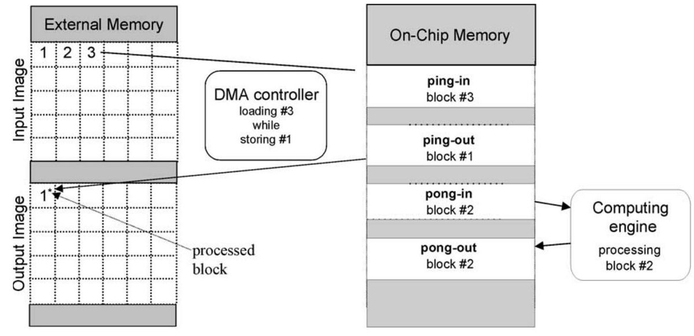

*[Figure 1 - from Template-based automatic data flow code](https://figures.academia-assets.com/88113402/figure_001.jpg) · 搜索词：camera double frame buffer ping pong buffering PSRAM DMA embedded vision architecture diagram*

常见结构：

```text
Camera
   ↓
DMA
   ↓
Frame Buffer A
   ↓
CPU 处理

Camera
   ↓
DMA
   ↓
Frame Buffer B
   ↓
网络发送
```

这就是双帧缓冲的思路。

### 2. XIAO ESP32S3 的 PSRAM

XIAO ESP32S3 系列存在不同硬件版本和存储配置。

不要只根据产品系列名称推断当前板子的 PSRAM 容量。

应当：

1. 查看板卡具体型号。
2. 检查板卡官方规格。
3. 查看 ESP-IDF 启动日志。
4. 使用 ESP-IDF 查询实际 PSRAM。
5. 确认摄像头驱动能够使用对应内存。

例如：

```c
#include "esp_psram.h"
#include "esp_heap_caps.h"

void print_memory_info(void)
{
    printf(
        "PSRAM size: %u\n",
        (unsigned)esp_psram_get_size()
    );

    printf(
        "PSRAM free: %u\n",
        (unsigned)heap_caps_get_free_size(
            MALLOC_CAP_SPIRAM
        )
    );
}
```

这里还需要区分：

- PSRAM 总容量；
- 已初始化容量；
- 当前空闲容量；
- DMA 是否可以访问该内存。

不能简单地认为所有 PSRAM 内存都可以直接作为任意 DMA 缓冲区。

---

## 八、图像格式：RGB565、RGB888、YUV422 和 JPEG

摄像头采集到的数据不一定都是 JPEG。

不同格式会直接影响内存、传输速度和 CPU 负载。

### 1. RGB565

RGB565 使用 16 位表示一个像素。

分配方式：

| 颜色 | 位数 |
| --- | --- |
| R | 5 |
| G | 6 |
| B | 5 |
| 总计 | 16 |

例如：

```c
uint16_t pixel = 0xF800;
```

代表红色。

特点：

- 数据结构简单；
- 适合 LCD 显示；
- 内存占用较大；
- 需要处理颜色排列和字节序。

### 2. RGB888

每个像素使用 24 位：

```text
R = 8bit
G = 8bit
B = 8bit
```

优点是颜色表示更丰富，但内存占用更大。

### 3. YUV422

YUV 将亮度和色度分开表示。

其中：

- Y：亮度；
- U：蓝色色度分量；
- V：红色色度分量。

YUV422 通常每两个像素共享一组色度数据，平均每像素 16 位。

它在视频采集和图像处理领域非常常见。

### 4. JPEG

JPEG 是一种有损图像压缩格式。

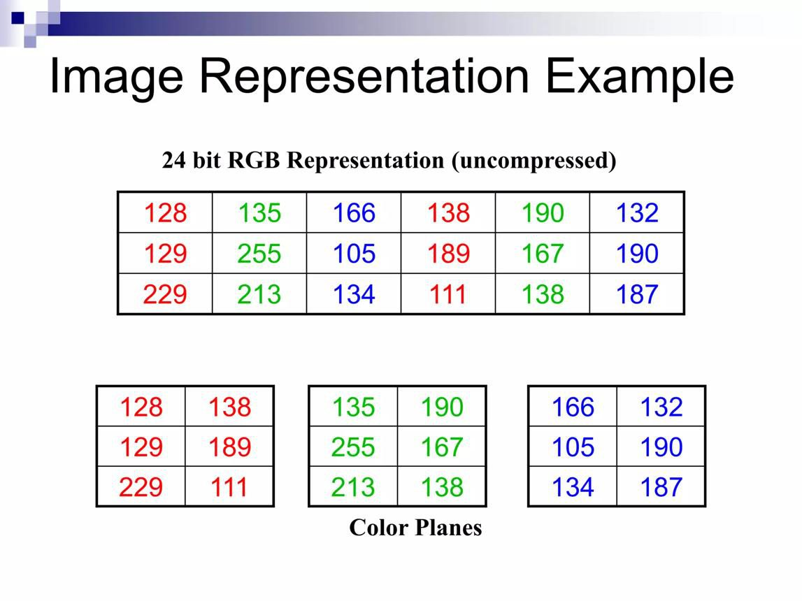

*[Digital Image Representation.ppt](https://image.slidesharecdn.com/digitalimagerepresentation-220723084559-771ffcdb/75/Digital-Image-Representation-ppt-10-2048.jpg) · 搜索词：uncompressed RGB bitmap digital photograph pixel image*

- **RGB 原始图像** 像素数据直接存储，文件通常较大。

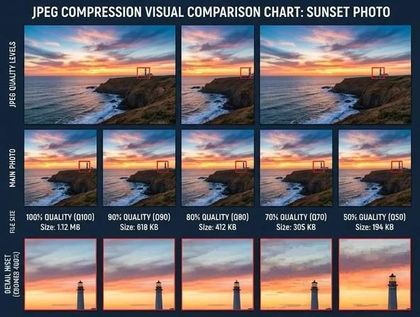

*[How to Compress an Image: Best Free Tools in 2026 (Without Visible Quality Loss)](https://data.catioapps.com/photoaistudio/in/a6ba6d78-cd5a-4cf5-91f4-6e1c42b2f18d.webp) · 搜索词：JPEG compressed photograph image visual example*

- **JPEG 压缩图像** 经过压缩，适合存储和网络传输。

例如，同一张照片：

- RGB565：约 600KiB；
- JPEG：可能只有几十 KiB。

具体压缩大小取决于图像内容、分辨率和 JPEG 质量参数。

### 5. 不同格式如何选择？

| 使用场景 | 推荐格式 |
| --- | --- |
| 网络拍照上传 | JPEG |
| LCD 显示 | RGB565 |
| 图像分析 | RGB888 / 灰度 |
| 视频处理 | YUV422 |
| 低带宽传输 | JPEG |

**对于 XIAO ESP32S3，建议首先使用 JPEG，而不是直接使用大尺寸 RGB 图像。**

原因是 JPEG 可以显著降低内存和网络带宽压力。

---

## 九、ESP32-Camera：使用现成驱动控制摄像头

前面我们学习了摄像头底层硬件，现在看看如何使用成熟驱动。

Espressif 提供了开源项目：

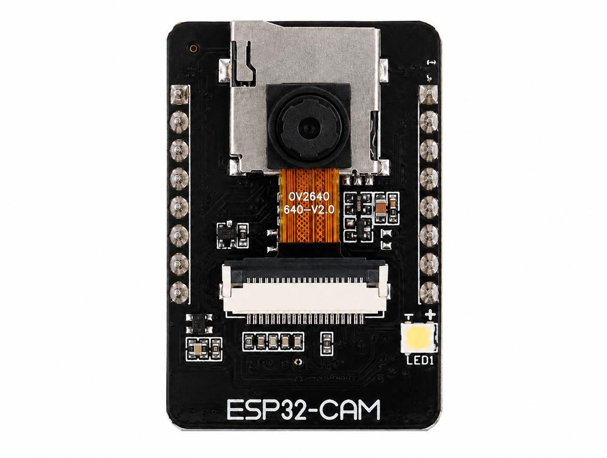

*[How to Use ESP32-CAM: Pinouts, Specs, and Examples | Cirkit Designer](https://abacasstorageaccnt.blob.core.windows.net/cirkit/b6fea144-67e6-416a-af83-9b6222ea9c4c.png) · 搜索词：Espressif esp32 camera OV2640 module logo project*

**esp32-camera** 支持多种 ESP32 摄像头传感器及图像采集功能。[GitHub 源码仓库](https://github.com/espressif/esp32-camera)

这个项目可以帮助我们省去大量底层工作。

它负责：

- SCCB 配置；
- 摄像头初始化；
- LCD_CAM 数据采集；
- DMA 管理；
- 图像帧缓冲；
- JPEG 数据获取；
- 图像参数配置。

### 1. 摄像头配置结构

核心结构体：

```c
camera_config_t config;
```

常见配置项：

| 配置 | 作用 |
| --- | --- |
| `pin_pwdn` | 电源控制 |
| `pin_reset` | 复位 |
| `pin_xclk` | 摄像头时钟 |
| `pin_sccb_sda` | SCCB 数据 |
| `pin_sccb_scl` | SCCB 时钟 |
| `pin_d0`～`pin_d7` | 并行数据 |
| `pin_vsync` | 帧同步 |
| `pin_href` | 行有效 |
| `pin_pclk` | 像素时钟 |
| `xclk_freq_hz` | 摄像头时钟频率 |
| `pixel_format` | 图像格式 |
| `frame_size` | 图像尺寸 |
| `fb_count` | 帧缓冲数量 |
| `fb_location` | 帧缓冲位置 |

注意：不同版本的 `esp32-camera` 结构体字段可能有变化，例如 SCCB 字段名称的调整。应以实际安装版本的 `sensor.h`、`esp_camera.h` 为准。

### 2. 摄像头初始化示例

下面先展示软件结构，不直接给出一套未经核对的 GPIO 接线表。

```c
#include "esp_camera.h"
#include "esp_log.h"

static const char *TAG = "CAMERA";

void camera_init(void)
{
    camera_config_t config = {
        // GPIO 引脚配置
        // 必须填写实际硬件接线对应的 GPIO

        .xclk_freq_hz = 20000000,

        .pixel_format = PIXFORMAT_JPEG,

        .frame_size = FRAMESIZE_QVGA,

        .jpeg_quality = 12,

        .fb_count = 1,

        .fb_location = CAMERA_FB_IN_PSRAM,

        .grab_mode = CAMERA_GRAB_WHEN_EMPTY
    };

    esp_err_t err = esp_camera_init(&config);

    if (err != ESP_OK) {

        ESP_LOGE(
            TAG,
            "Camera init failed: 0x%x",
            err
        );

        return;
    }

    ESP_LOGI(TAG, "Camera initialized");
}
```

这是初始化框架，实际使用前必须补全全部引脚，并确认当前驱动版本支持这些配置。

### 3. 获取一帧图像

```c
camera_fb_t *fb = esp_camera_fb_get();

if (fb != NULL) {

    printf("Width: %u\n", fb->width);

    printf("Height: %u\n", fb->height);

    printf("Length: %u\n", (unsigned)fb->len);

    printf("Format: %d\n", fb->format);

    esp_camera_fb_return(fb);
}
```

其中：

- `width`：图像宽度；
- `height`：图像高度；
- `len`：图像数据长度；
- `format`：图像格式；
- `buf`：图像数据指针。

这里有一个特别重要的规则：

**获取帧缓冲区之后，不要在数据尚未处理完成时就调用 `esp_camera_fb_return()`。**

否则驱动可能重新使用这块缓冲区，导致你读取到被覆盖的数据。

如果需要长期保存图像，应该先复制到自己管理的缓冲区，或者直接保存、发送完毕后再归还帧缓冲区。

---

## 十、图像分辨率：如何控制内存占用？

摄像头开发最容易出现的问题之一，就是内存不够。

我们计算几种常见分辨率的 RGB565 原始图像大小。

| 分辨率 | 像素数量 | RGB565 单帧 |
| --- | --- | --- |
| QQVGA 160×120 | 19,200 | 37.5KiB |
| QVGA 320×240 | 76,800 | 150KiB |
| VGA 640×480 | 307,200 | 600KiB |
| SVGA 800×600 | 480,000 | 937.5KiB |
| XGA 1024×768 | 786,432 | 1.5MiB |

这些是未压缩 RGB565 图像的理论数据量。

如果是 JPEG，大小会根据场景和压缩质量变化。

### 1. 为什么初学者应该从 QVGA 开始？

建议开发顺序：

```text
QQVGA
  ↓
QVGA
  ↓
VGA
  ↓
更高分辨率
```

每一步都验证：

- 摄像头初始化；
- 图像帧获取；
- 帧数据完整性；
- PSRAM 占用；
- JPEG 解码；
- Wi-Fi 传输。

不要一开始就使用最高分辨率。

### 2. 帧率如何计算？

假设每秒采集 10 帧：

$FPS=10$

如果每帧 JPEG 平均 40KB：

$40KB\times10=400KB/s$

这还没有计算 HTTP、TCP、Wi-Fi 等协议开销。

因此要根据图像大小和无线网络能力控制帧率。

---

## 十一、图像处理：让 ESP32-S3 能够分析图像

现在进入计算机视觉的基础。

摄像头得到图像之后，不只是显示照片，还可以对图像进行分析。

### 1. 灰度处理

彩色图像可以转换为灰度图像。

常用计算方式：

$Gray=0.299R+0.587G+0.114B$

例如：

```c
uint8_t rgb_to_gray(
    uint8_t r,
    uint8_t g,
    uint8_t b
)
{
    return (
        299 * r +
        587 * g +
        114 * b
    ) / 1000;
}
```

灰度处理能够减少后续图像分析的数据量。

### 2. 二值化

设置一个阈值：

$Gray>T$

则像素设置为白色，否则设置为黑色。

```c
uint8_t threshold(
    uint8_t gray,
    uint8_t value
)
{
    return gray > value ? 255 : 0;
}
```

可以用于：

- 简单目标区域提取；
- 黑白标记识别；
- 线条检测；
- 简单图像分割。

### 3. 边缘检测

图像中的边缘通常表现为亮度变化明显的区域。

常见算法：

- Sobel；
- Prewitt；
- Canny。

例如 Sobel 算法通过计算水平和垂直方向的梯度：

$G=\sqrt{G_x^2+G_y^2}$

边缘强度越大，说明图像在该位置变化越明显。

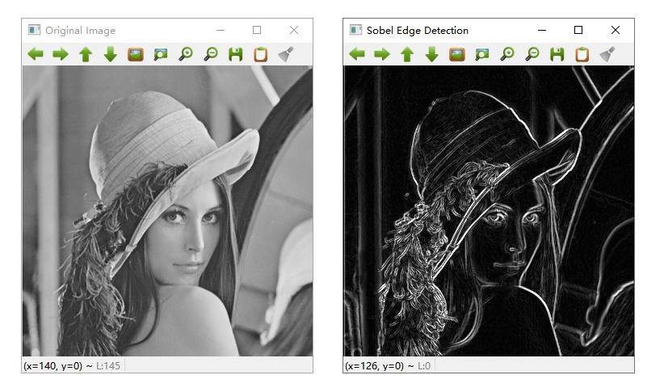

*[OpenCV入门（18）：图像处理之边缘检测 - fengMisaka - 博客园](https://s2.loli.net/2025/08/12/kLszGD8t97fnYbS.png) · 搜索词：Sobel edge detection original image grayscale edge detection result comparison*

ESP32-S3 可以运行简单的图像处理算法，但分辨率、帧率和算法复杂度需要合理控制。

### 4. 图像缩放

假设原始图像：

```text
640 × 480
```

缩小到：

```text
160 × 120
```

像素数量减少为原来的：

$\frac{160\times120}{640\times480}
=\frac{1}{16}$

可以显著降低后续处理开销。

---

## 十二、Wi-Fi 图像传输：让 Mac 实时看到 XIAO 的画面

现在将摄像头与前面学习的 Wi-Fi 网络知识结合起来。

建议首先实现 HTTP 单张照片上传，再实现 MJPEG 视频流。

**摄像头网络传输架构**

**OV2640** 拍摄图像

↓

**ESP32-S3 LCD_CAM + DMA** 获取图像帧

↓

**PSRAM 帧缓冲区** 保存 JPEG

↓

**HTTP / MJPEG** 网络传输

↓

**Mac 浏览器** 查看照片和视频流

### 1. HTTP 单张照片

工作流程：

```text
Mac 请求 /capture
       ↓
ESP32-S3 获取一帧
       ↓
返回 image/jpeg
       ↓
Mac 浏览器显示
```

这是最适合入门的方式。

### 2. MJPEG 视频流

MJPEG 是将多张 JPEG 图片连续发送形成的视频流。

典型 HTTP 响应使用：

```text
multipart/x-mixed-replace
```

每一帧都是独立的 JPEG 图片。

浏览器可以连续显示。

### 3. 为什么先做 JPEG？

因为 JPEG：

- 数据量较小；
- 便于浏览器显示；
- 不需要在 ESP32-S3 上实时进行复杂的视频编码；
- 适合无线网络传输。

### 4. 网络传输时要注意什么？

不能让摄像头采集任务一直等待网络发送。

建议：

```text
Camera Task
     ↓
Frame Queue
     ↓
HTTP Task
     ↓
Wi-Fi
```

并控制帧缓冲区数量，防止网络发送速度跟不上摄像头采集速度。

---

## 十三、视觉开发的下一步：轻量级 AI

当你掌握图像采集、JPEG 和基础图像处理后，可以进一步学习边缘 AI。

ESP32-S3 可以运行一些适合 MCU 的轻量级机器学习模型。

例如：

- 简单图像分类；
- 特定物体检测；
- 人体存在检测；
- 手势识别；
- 条码识别；
- 简单视觉触发。

但需要认识到：

**ESP32-S3 并不是桌面 GPU。**

它适合小模型、低分辨率和低复杂度任务。

更复杂的目标检测和视觉语言模型，通常需要将图像发送到更强的本地服务器或云端处理。

---

## 十四、普通版 XIAO ESP32S3 摄像头开发的硬件限制

这里需要专门强调一下。

普通版和 Sense 版的区别不只是是否有摄像头。

Sense 版本有相应的摄像头连接扩展硬件，而普通版需要自己完成摄像头模块接线和资源规划。

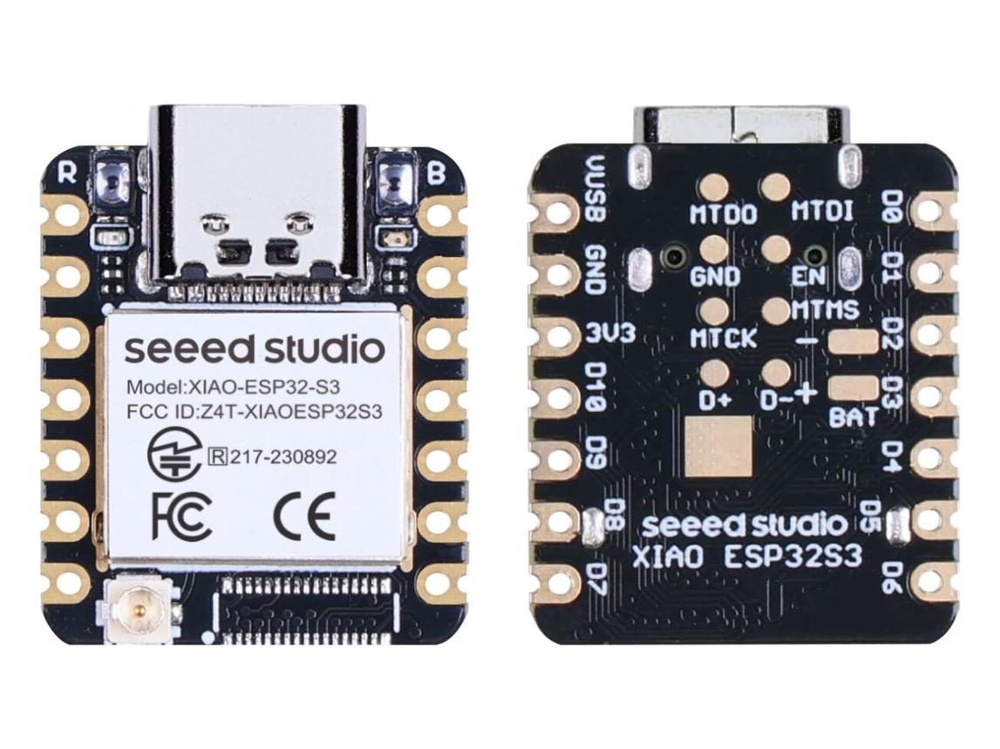

*[Overview of IoT WiFi Microcontroller Development Boards](https://datacapturecontrol.com/articles/static/images/data-communication/wireless/wifi/dev-boards/esp32-s3-seeed-studio-xiao-dev-board.png) · 搜索词：Seeed Studio XIAO ESP32S3 standard development board front back*

- **普通版 XIAO ESP32S3** 本课程唯一基础主控，需要外接摄像头并规划 DVP 引脚。

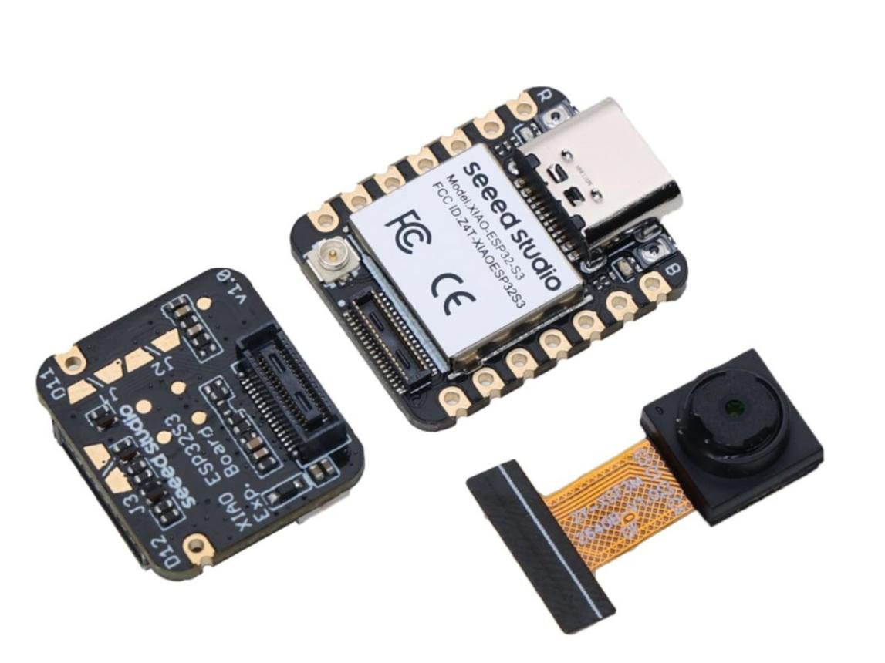

*[Seeed Studio XIAO ESP32S3 Sense - 2.4GHz WiFi, BLE 5.0, OV2640 camera sensor, digital microphone, 8MB PSRAM, 8MB FLASH, battery charge, IoT, embedded ML | Kiwi Electronics](https://www.kiwi-electronics.com/image/cache/catalog/product/map1/113991115c-1400x1050h.jpg) · 搜索词：Seeed Studio XIAO ESP32S3 Sense expansion board OV2640 camera module*

- **XIAO ESP32S3 Sense** 带摄像头扩展硬件，不直接作为本课程接线依据。

### 开发前必须核实的四件事

1. 你使用的普通版具体硬件版本。
2. 板子实际可用 GPIO。
3. 外接摄像头模块的完整引脚定义。
4. 摄像头 DVP 数据线、时钟和控制线能否全部映射到可用 GPIO。

还需要注意：XIAO 的 USB、启动相关引脚和板载功能可能占用部分资源，不能仅凭 GPIO Matrix 支持灵活映射就认为任意引脚都能使用。

**建议先不要购买摄像头，也不要照搬 Sense 的接线图。先核对普通版板卡原理图，再决定是否适合直接连接 OV2640。**

---

## 十五、实战：建立普通版 XIAO ESP32S3 摄像头实验工程

建议将摄像头开发拆成五个阶段。

| 阶段 | 实验目标 | 验收结果 |
| --- | --- | --- |
| 1 | 摄像头硬件连接 | 能够识别传感器 |
| 2 | 单张照片采集 | 获得完整 JPEG |
| 3 | PSRAM 帧缓冲 | 稳定获取图像 |
| 4 | HTTP 图片服务 | Mac 浏览器查看照片 |
| 5 | MJPEG 视频流 | 连续查看画面 |

### 1. 工程目录

```text
projects/
└── camera_vision/
    │
    ├── main/
    │   └── app_main.c
    │
    ├── components/
    │   ├── camera_bsp/
    │   │   ├── camera_pins.h
    │   │   └── camera_bsp.c
    │   │
    │   ├── camera_driver/
    │   │   ├── camera_init.c
    │   │   └── camera_capture.c
    │   │
    │   ├── image_processing/
    │   │   ├── grayscale.c
    │   │   ├── threshold.c
    │   │   └── resize.c
    │   │
    │   ├── camera_network/
    │   │   ├── http_capture.c
    │   │   └── mjpeg_server.c
    │   │
    │   └── camera_monitor/
    │       └── memory_monitor.c
    │
    ├── docs/
    │   ├── camera_hardware.md
    │   ├── gpio_mapping.md
    │   ├── memory_planning.md
    │   └── debug_guide.md
    │
    └── README.md
```

### 2. 第一阶段：确认摄像头 GPIO

先创建：

```c
// camera_pins.h

#pragma once

// 必须根据实际硬件接线填写。
// 以下只声明配置项，不预设 GPIO 数值。

#define CAMERA_PIN_PWDN   (-1)
#define CAMERA_PIN_RESET  (-1)

#define CAMERA_PIN_XCLK   (-1)

#define CAMERA_PIN_SIOD   (-1)
#define CAMERA_PIN_SIOC   (-1)

#define CAMERA_PIN_D0     (-1)
#define CAMERA_PIN_D1     (-1)
#define CAMERA_PIN_D2     (-1)
#define CAMERA_PIN_D3     (-1)
#define CAMERA_PIN_D4     (-1)
#define CAMERA_PIN_D5     (-1)
#define CAMERA_PIN_D6     (-1)
#define CAMERA_PIN_D7     (-1)

#define CAMERA_PIN_VSYNC  (-1)
#define CAMERA_PIN_HREF   (-1)
#define CAMERA_PIN_PCLK   (-1)
```

这里故意没有填写一套虚构的接线。

普通版 XIAO ESP32S3 必须先完成引脚资源核对，特别是 DVP 的 8 根数据线和同步时钟信号。

### 3. 第二阶段：摄像头初始化

完成 GPIO 配置后：

```c
esp_err_t camera_start(void)
{
    camera_config_t config = {
        // 使用 camera_pins.h 中的实际引脚

        .xclk_freq_hz = 20000000,

        .pixel_format = PIXFORMAT_JPEG,

        .frame_size = FRAMESIZE_QVGA,

        .jpeg_quality = 12,

        .fb_count = 1,

        .fb_location = CAMERA_FB_IN_PSRAM,

        .grab_mode = CAMERA_GRAB_WHEN_EMPTY
    };

    return esp_camera_init(&config);
}
```

### 4. 第三阶段：拍摄并保存图像

```c
#include "esp_camera.h"
#include "esp_log.h"

void capture_image(void)
{
    camera_fb_t *fb = esp_camera_fb_get();

    if (fb == NULL) {

        ESP_LOGE(
            "CAMERA",
            "Capture failed"
        );

        return;
    }

    ESP_LOGI(
        "CAMERA",
        "Image: %ux%u, %u bytes",
        fb->width,
        fb->height,
        (unsigned)fb->len
    );

    // 在这里将 fb->buf / fb->len
    // 写入文件或发送网络。

    esp_camera_fb_return(fb);
}
```

注意：文件系统写入需要单独初始化 SD 卡或其他存储介质；不能认为 `fb->buf` 自动就是一个文件。

### 5. 第四阶段：Mac 查看图像

推荐先实现：

```text
http://设备IP/capture
```

浏览器访问后，ESP32-S3 返回 JPEG 图片。

再增加：

```text
http://设备IP/stream
```

实现 MJPEG 视频流。

---

## 十六、给 Codex 的本课开发任务

建议不要让 Codex 直接按照 Sense 版的摄像头配置复制工程。

先让它完成普通版硬件可行性分析。

**Codex：普通版 XIAO ESP32S3 摄像头可行性分析**

**复制任务**

**执行顺序：**

1. 检查普通版原理图。
2. 建立 GPIO 资源矩阵。
3. 分析 DVP 接线可行性。
4. 检查 PSRAM 和 DMA。
5. 验证摄像头驱动。
6. 输出最终接线图。
7. 创建独立摄像头工程。

**先分析硬件，再写代码**

---

## 十七、本课知识验收

**第十四课学习进度**/

---

## 十八、下一课：ESP32-S3 边缘 AI 与本地模型运行

前面已经学习了 GPIO、通信外设、ADC、DMA、音频和摄像头。

下一阶段开始进入智能硬件开发的核心：

**如何让 XIAO ESP32S3 不仅采集数据，还能够在设备本地进行智能分析？**

**第十五课：TinyML、神经网络与 ESP32-S3 边缘 AI**

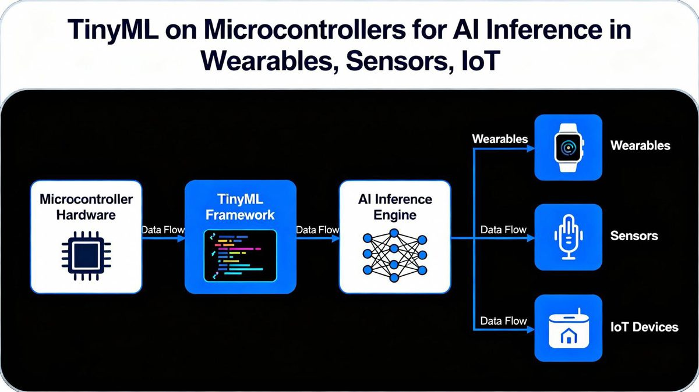

*[TinyML & On-Device AI: How to Run Machine Learning Models Without Cloud (Complete 2026 Setup Guide)](https://www.humai.blog/content/images/size/w2400/2026/01/image-447.png) · 搜索词：edge AI embedded microcontroller neural network inference TinyML architecture illustration*

课程安排：

1. 人工智能与机器学习的基本原理。
2. 神经网络的工作机制。
3. CNN 卷积神经网络。
4. 模型训练与推理的区别。
5. INT8 量化原理。
6. Flash、RAM、PSRAM 与模型内存规划。
7. TensorFlow Lite Micro。
8. Espressif ESP-DL。
9. 音频关键词识别。
10. 人体和简单图像分类。
11. 模型部署与推理性能分析。
12. 本地 AI 与云端 AI 协同。

### 这一课最终要实现什么？

建议完成三个独立实验：

| 实验 | 功能 |
| --- | --- |
| AI 音频识别 | 识别简单语音关键词 |
| AI 传感器识别 | 判断设备运行状态 |
| AI 图像识别 | 对低分辨率图像进行分类 |

重点学习两个开源生态：

- [ESP-DL：乐鑫边缘 AI 推理框架](https://github.com/espressif/esp-dl)
- [TensorFlow Lite Micro：微控制器模型推理框架](https://github.com/tensorflow/tflite-micro)

**后续学习方向：**

```text
XIAO ESP32S3
      │
      ├── 硬件驱动
      │
      ├── 音频采集
      │
      ├── 图像采集
      │
      ├── 数据处理
      │
      ├── 本地 AI 推理
      │
      └── Wi-Fi 云端通信
              │
              ↓
         智能终端产品
```

我的建议是：先完成本地音频关键词识别，再研究图像识别。这样即使普通版 XIAO ESP32S3 的外接摄像头引脚规划还没有完成，也不会影响 AI 学习。

最终，我们要建立的不是单纯的 ESP32 示例代码集合，而是一套覆盖硬件、驱动、操作系统、通信、音频、视觉和边缘 AI 的完整 XIAO ESP32S3 开发知识体系。
