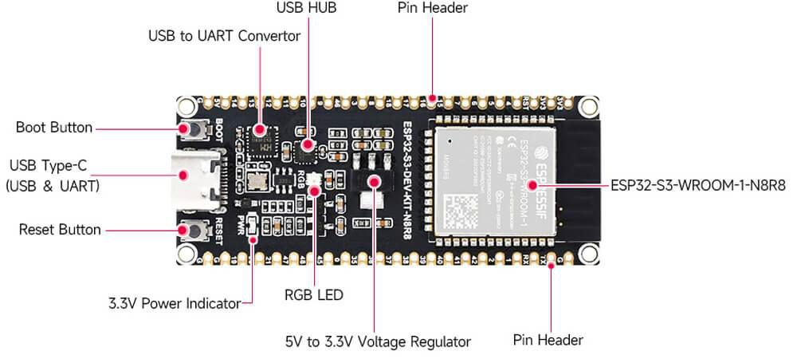
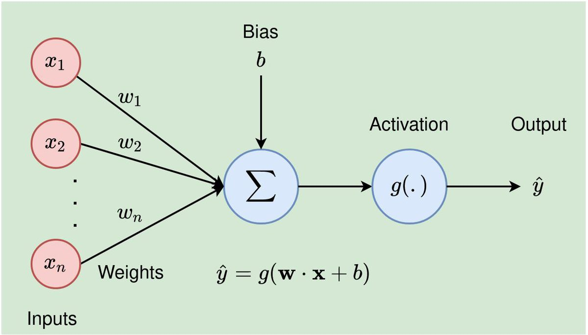
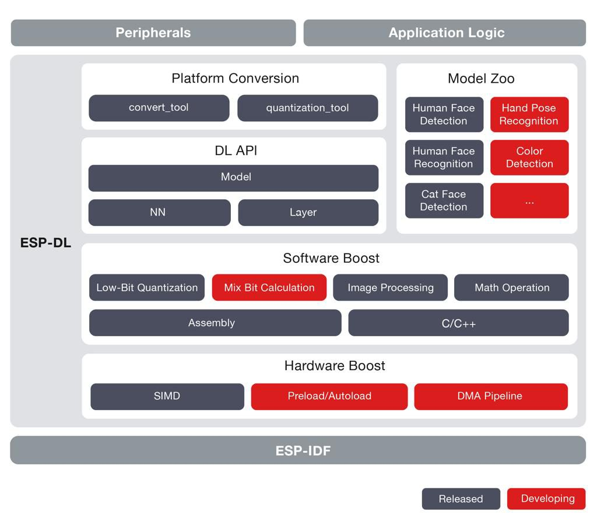
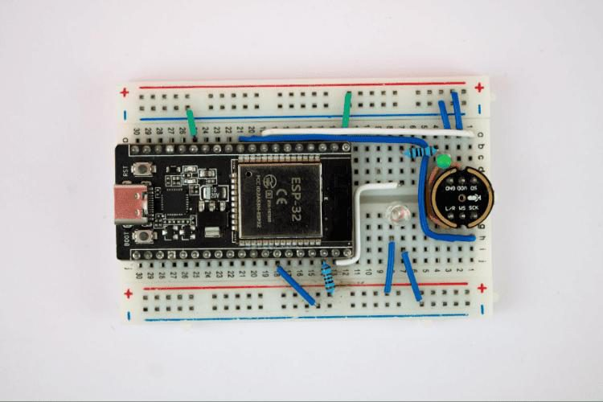
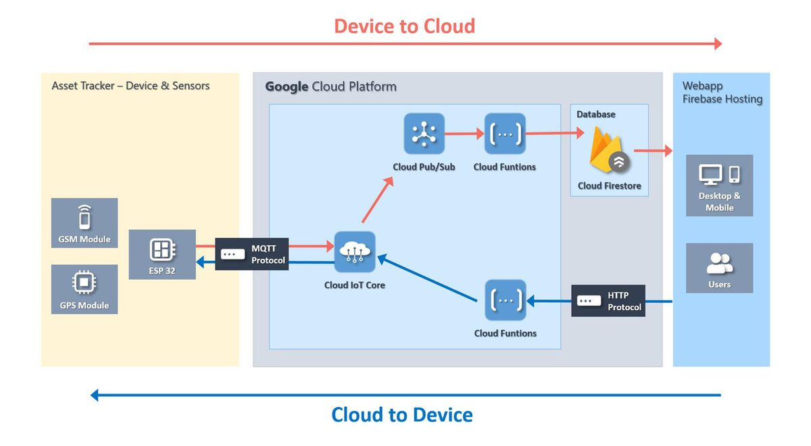

# 第十五课：XIAO ESP32S3 边缘 AI 开发原理——TinyML、神经网络与本地推理

前面十四课，我们已经系统学习了 XIAO ESP32S3 的硬件结构、CPU、寄存器、中断、FreeRTOS、GPIO、通信接口、DMA、数字音频和图像采集。

现在进入一个非常重要的阶段：**让 XIAO ESP32S3 从传统微控制器变成具有本地智能分析能力的设备。**

本课继续以普通版 Seeed XIAO ESP32S3 为开发对象，使用 ESP-IDF，逐步建立可以交给 Codex 实现的 AI 工程。

## 一、什么是边缘 AI？

传统嵌入式设备通常按照预先编写的规则工作。

例如：

```c
if (temperature > 30) {
    fan_on();
}
```

CPU 只需要比较温度和阈值。

但是，如果需要判断：

- 当前声音是不是人在说话？
- 设备是否出现异常振动？
- 用户是否说出了唤醒词？
- 传感器数据是否代表设备故障？

简单的 `if` 判断往往不够。

这时就需要机器学习模型。

**传统程序与边缘 AI 的区别**

- **传统嵌入式程序** 传感器输入 ↓ 人工编写规则 ↓ 执行动作
- **边缘 AI 程序** 传感器输入 ↓ 神经网络推理 ↓ 分类或预测

边缘 AI（Edge AI）就是在设备本地执行 AI 模型，而不是每次都将原始数据发送到服务器。

它的优势包括：

- 减少网络依赖；
- 降低部分场景下的响应延迟；
- 减少原始数据上传；
- 可以离线运行；
- 降低持续通信的带宽消耗。

但它也有局限：微控制器的内存、算力和功耗都比较有限。

---

## 二、XIAO ESP32S3 为什么能够运行 AI？

ESP32-S3 相比一些传统微控制器，具备更适合轻量级神经网络计算的硬件能力。



*[Waveshare ESP32-S3 Development Board (with Headers) - The Pi Hut](https://cdn.shopify.com/s/files/1/0176/3274/files/ESP32-S3_Microcontroller_features_1_12b0e7c8-3bbb-4f8f-a344-8e0c74f33a1e.jpg?v=1690544112) · 搜索词：Espressif ESP32-S3 microcontroller chip dual core Xtensa LX7 development board*

### 1. ESP32-S3 的关键硬件

| 硬件 | 作用 |
| --- | --- |
| 双核 Xtensa LX7 | 执行应用和 AI 推理 |
| 最高 240MHz CPU 时钟 | 提供通用计算能力 |
| 向量指令扩展 | 加速部分神经网络运算 |
| SRAM | 保存高速工作数据 |
| Flash | 保存程序和模型 |
| PSRAM（视板卡配置） | 保存较大的中间数据 |
| DMA | 搬运音频和其他外设数据 |
| Wi-Fi | 与服务器协同处理 |

这里有一个重要区别：

**ESP32-S3 没有像桌面 GPU 那样的独立大型 AI 加速器。**

它主要依靠 CPU、向量指令以及经过优化的数学运算库完成轻量级神经网络推理。

### 2. 向量指令为什么重要？

假设神经网络需要执行大量乘加运算：

$y=\sum_{i=0}^{N-1}w_ix_i+b$

传统计算需要反复执行乘法和加法。

ESP32-S3 的向量指令能够加速部分适合的数据运算。

例如：

- INT8 矩阵计算；
- 卷积计算；
- 向量乘加；
- 部分 DSP 操作。

但实际加速效果取决于运算类型、数据排列、编译器和推理框架实现，并非所有模型都能获得相同收益。

---

## 三、神经网络的底层工作原理

先从一个最简单的神经元开始。



*[Exploring the Power of Neural Networks | by Vibhuraj | Medium](https://miro.medium.com/v2/resize%3Afit%3A1400/1%2AUtVreXHT8Th-8NhzlASmTw.png) · 搜索词：artificial neuron neural network inputs weights bias activation function educational diagram*

一个人工神经元接收多个输入：

$x_1,x_2,x_3$

每个输入对应一个权重：

$w_1,w_2,w_3$

然后计算：

$z=w_1x_1+w_2x_2+w_3x_3+b$

最后通过激活函数：

$y=f(z)$

其中：

- $x$：输入数据；
- $w$：模型权重；
- $b$：偏置；
- $f$：激活函数；
- $y$：输出。

### 1. 用 C 语言实现一个神经元

```c
#include <math.h>

float neuron(
    const float *input,
    const float *weight,
    int count,
    float bias
)
{
    float sum = bias;

    for (int i = 0; i < count; i++) {
        sum += input[i] * weight[i];
    }

    // ReLU 激活函数
    return fmaxf(0.0f, sum);
}
```

这个函数就是一个简单神经元的前向计算。

### 2. 多个神经元组成神经网络

```text
输入层
  │
  ├── x1 ──┐
  ├── x2 ──┼──→ 隐藏层
  └── x3 ──┘       │
                   ↓
                输出层
                   │
                   ↓
                预测结果
```

例如我们要判断设备振动状态：

输入：

```text
振动幅度
振动频率
温度
电流
```

输出：

```text
正常
异常
```

神经网络会根据训练得到的权重进行判断。

---

## 四、模型训练和模型推理有什么区别？

这是 TinyML 开发中最重要的概念之一。

- **模型训练 Training**

  训练数据 ↓ 神经网络 ↓ 计算损失 ↓ 更新权重 ↓ 导出模型

  通常在 Mac、PC 或服务器上完成。

- **模型推理 Inference**

  实时输入 ↓ 已训练模型 ↓ 前向计算 ↓ 输出结果

  在 XIAO ESP32S3 上运行。

### 1. 为什么不直接在 XIAO 上训练？

训练通常需要：

- 大量数据；
- 多次迭代；
- 反向传播；
- 梯度计算；
- 较大的内存。

这些任务通常更适合电脑或服务器。

因此推荐：

```text
Mac
  ↓
收集数据
  ↓
训练模型
  ↓
量化模型
  ↓
导出模型文件
  ↓
Codex 集成到 ESP-IDF
  ↓
XIAO ESP32S3 推理
```

---

## 五、模型量化：INT8 为什么重要？

神经网络通常使用浮点数表示权重。

例如：

```text
0.1234
-0.7521
0.3812
```

如果每个权重使用 32 位浮点数：

```text
100万个权重 ≈ 4MB
```

对于微控制器来说，这可能占用大量存储空间。

如果转换为 INT8：

```text
100万个权重 ≈ 1MB
```

模型权重理论存储量可减少约 75%，但实际模型文件还包含结构、量化参数及其他数据。

### 1. INT8 量化公式

常见仿射量化表示：

$x_=scale\times(x_-zero\_point)$

例如：

```text
scale = 0.01

zero_point = 0

INT8 = 50
```

对应：

$x_=0.01\times50=0.5$

### 2. 量化有什么代价？

INT8 的优点：

- 模型更小；
- 通常减少内存带宽需求；
- 适合整数运算优化；
- 在合适框架下可以提高推理速度。

缺点：

- 可能损失部分精度；
- 不同层对量化的敏感度不同；
- 某些模型或算子不支持完整 INT8；
- 需要代表性数据集进行校准。

### 3. INT8 和 FP32 的直观对比

**假设模型有 100 万个权重，仅计算权重数据**

**FP32** 4 MB

**INT8** 1 MB

*十进制 MB，示意权重数据量，不包含运行时激活缓冲区。*

---

## 六、ESP32-S3 的 AI 内存管理

在真实开发中，模型文件大小并不是唯一需要考虑的内存。

一个神经网络推理过程通常需要：

```text
模型权重
   +
输入张量
   +
中间激活张量
   +
输出张量
   +
运行时工作缓冲区
```

### 1. Flash 和 RAM 分别负责什么？

| 存储区域 | 主要用途 |
| --- | --- |
| Flash | 程序、常量模型权重 |
| 内部 SRAM | 高速运行数据 |
| PSRAM | 大型张量或数据缓冲 |
| DMA 可访问内存 | 音频等外设数据传输 |

部分推理框架可能要求模型或特定算子的缓冲区满足对齐和内存能力限制。

不能简单地把所有张量放入 PSRAM 就认为一定能运行。

### 2. 如何查询剩余内存？

```c
#include "esp_heap_caps.h"
#include "esp_log.h"

void ai_memory_info(void)
{
    ESP_LOGI(
        "AI",
        "Internal RAM free: %u",
        (unsigned)heap_caps_get_free_size(
            MALLOC_CAP_INTERNAL |
            MALLOC_CAP_8BIT
        )
    );

    ESP_LOGI(
        "AI",
        "PSRAM free: %u",
        (unsigned)heap_caps_get_free_size(
            MALLOC_CAP_SPIRAM
        )
    );
}
```

### 3. 为什么 AI 模型可能初始化失败？

常见原因：

- 模型文件不兼容；
- 不支持某个算子；
- Tensor Arena 太小；
- 内存碎片化；
- PSRAM 未初始化；
- 数据对齐不正确；
- 模型格式和运行时版本不匹配。

所以 AI 开发必须记录内存使用情况。

---

## 七、XIAO ESP32S3 可以使用哪些 AI 框架？

目前学习阶段建议重点研究两个开源生态。


*[See Online Workshop: Build an ML app for Android with TFLite at Google Developer Groups GDG Chapel Hill](https://res.cloudinary.com/startup-grind/image/upload/c_fill%2Cdpr_2.0%2Cf_auto%2Cg_center%2Ch_1080%2Cq_100%2Cw_1080/v1/gcs/platform-data-goog/events/tensorflow-lite-logo-social_x3eyv8i.png) · 搜索词：TensorFlow Lite Micro logo embedded machine learning*

**TensorFlow Lite Micro**

面向微控制器的轻量级机器学习推理框架。

支持将兼容模型部署到资源有限的设备中。

[查看 GitHub 源码](https://github.com/tensorflow/tflite-micro)

---



*[Check out ESP-DL! | Espressif Systems](https://www.espressif.com/sites/default/files/wecom-temp-5d2ef2071558b783f292750b3f61623b.png) · 搜索词：Espressif ESP-DL neural network inference framework ESP32*

**ESP-DL**

Espressif 的深度学习推理框架，针对支持的 Espressif 芯片和模型格式提供优化。

[查看 GitHub 源码](https://github.com/espressif/esp-dl)

### 1. 应该先学哪个？

建议按照目标选择：

| 开发目标 | 优先研究 |
| --- | --- |
| 理解 TinyML 基础 | TensorFlow Lite Micro |
| 研究 ESP32-S3 优化推理 | ESP-DL |
| 数字信号处理 | ESP-DSP |
| 语音唤醒与语音前端 | ESP-SR |
| 自定义轻量级分类模型 | TFLM 或 ESP-DL，视模型兼容性 |

另外，ESP-SR 是 Espressif 的语音识别相关组件生态。

[ESP-SR 官方开源仓库](https://github.com/espressif/esp-sr)

需要注意：模型格式、工具链、算子支持和 ESP-IDF 版本会随框架版本变化，不能将 TFLM 模型文件直接视为 ESP-DL 模型。

---

## 八、第一个 AI 实验：不用麦克风，先让 XIAO 运行神经网络

这一实验的目的不是识别复杂声音，而是先验证：

**ESP32-S3 能否正确加载模型、执行推理并输出结果？**

我们先做一个简单的分类模型。

输入：

```text
温度
振动
电流
```

输出：

```text
0 = 正常

1 = 异常
```

### 1. AI 推理过程

```text
输入传感器数据
       ↓
数据归一化
       ↓
模型输入张量
       ↓
神经网络推理
       ↓
输出分类分数
       ↓
判断正常 / 异常
```

### 2. 为什么要归一化？

假设：

```text
温度：30
振动：0.02
电流：1.5
```

这些输入量纲和数值范围不同。

可以使用训练时确定的归一化方式：

$x'=\frac{x-\mu}{\sigma}$

其中：

- $\mu$：训练数据均值；
- $\sigma$：训练数据标准差。

例如温度均值为 25，标准差为 5：

$x'=\frac{30-25}{5}=1$

必须使用训练阶段保存的均值和标准差，不能在设备端随意重新计算一套参数。

### 3. 推理结果是什么？

假设模型输出：

```text
正常：0.92
异常：0.08
```

可以选择正常类别。

但模型输出分数不一定等于真实世界中准确校准的概率。

需要通过验证集和真实数据评估模型质量。

---

## 九、第二个 AI 实验：本地声音关键词识别

现在把第十三课的数字音频知识与 AI 结合。

硬件：

- 普通版 XIAO ESP32S3；
- INMP441 数字麦克风；
- USB 连接 Mac。



*[ESP32 Offline Voice Recognition Using Edge Impulse and INMP441 Module](https://circuitdigest.com/sites/default/files/inlineimages/u5/ESP32-Voice-Control-Using-Edge-Impulse-Project.png) · 搜索词：ESP32-S3 INMP441 microphone tinyml voice keyword spotting embedded development setup*

### 1. 关键词识别的整体流程

**INMP441 麦克风**

↓

**I2S + DMA** 16kHz PCM 采集

↓

**音频预处理** 分帧、窗函数、特征提取

↓

**MFCC / Log-Mel 特征**

↓

**TinyML 神经网络**

↓

**关键词识别结果** 唤醒 / 停止 / 未识别

### 2. 为什么不能直接把 PCM 全部输入模型？

理论上可以设计端到端的波形模型，但对于资源有限的微控制器，直接处理大量原始 PCM 可能需要较高计算量。

因此传统 TinyML 关键词识别通常先提取音频特征。

常见特征：

- MFCC；
- Mel Spectrogram；
- Log-Mel Filterbank。

这些特征可以减少数据维度，并突出语音频谱结构。

### 3. MFCC 是什么？

MFCC 全称 Mel-Frequency Cepstral Coefficients。

它是经典语音特征之一。

大致流程：

```text
PCM
 ↓
分帧
 ↓
加窗
 ↓
FFT
 ↓
功率谱
 ↓
Mel 滤波器组
 ↓
对数运算
 ↓
DCT
 ↓
MFCC
```

不同模型可能使用不同特征流程，不是所有语音模型都必须使用 DCT。

### 4. 为什么要分帧？

声音随时间变化。

假设：

- 采样率：16kHz；
- 每帧：25ms；
- 帧移：10ms。

每帧采样数：

$16000\times0.025=400$

帧移采样数：

$16000\times0.01=160$

这样可以将连续声音分成互相重叠的小片段。

### 5. 关键词识别与语音识别有什么区别？

| 功能 | 关键词识别 KWS | 自动语音识别 ASR |
| --- | --- | --- |
| 目标 | 少量固定词语 | 连续语音转文字 |
| 模型规模 | 通常较小 | 通常较大 |
| MCU 本地运行 | 相对容易 | 受模型和资源限制 |
| 应用 | 唤醒词、控制词 | 语音输入、对话 |

对于 XIAO ESP32S3，建议先实现 KWS，再研究服务器端 ASR。

---

## 十、第三个 AI 实验：设备异常检测

这个实验非常适合没有摄像头、没有麦克风的情况。

假设 XIAO ESP32S3 连接一个加速度传感器。

采集：

```text
X 轴加速度
Y 轴加速度
Z 轴加速度
```

然后通过模型判断：

```text
正常运行
异常振动
设备停止
```

### 1. 为什么不直接使用阈值？

简单场景当然可以使用阈值。

例如：

```c
if (vibration > 2.0f) {
    alarm_on();
}
```

但如果不同工作状态下正常振动范围不同，单一阈值可能不够可靠。

机器学习可以利用多个特征综合判断。

### 2. 输入特征设计

例如每 1 秒采集一次数据窗口。

提取：

| 特征 | 含义 |
| --- | --- |
| Mean | 平均值 |
| RMS | 有效值 |
| Variance | 方差 |
| Peak | 峰值 |
| Zero Crossing | 过零率 |
| Frequency Energy | 频域能量 |

这些特征组成一个输入向量。

```text
[mean, rms, variance, peak, zcr, energy]
```

模型输出：

```text
Normal
Abnormal
```

### 3. 训练数据比模型结构更重要

如果训练数据只包含实验桌面上的一种状态，模型可能无法适应真实环境。

应该采集不同：

- 工作负载；
- 安装位置；
- 环境温度；
- 传感器个体；
- 运行时间。

同时保留独立测试集，避免只在训练数据上评估准确率。

---

## 十一、如何评估 AI 推理性能？

嵌入式 AI 不只是看分类是否正确。

还要看运行是否足够快、是否占用太多内存。

### 1. 主要性能指标

| 指标 | 含义 |
| --- | --- |
| Inference Latency | 单次推理时间 |
| Model Size | 模型文件大小 |
| Peak RAM | 峰值 RAM 占用 |
| CPU Load | CPU 使用情况 |
| Accuracy | 模型准确率 |
| Precision / Recall | 分类性能 |
| Power | 功耗 |

### 2. 如何测量推理时间？

ESP-IDF 可以使用高精度计时 API：

```c
#include "esp_timer.h"
#include "esp_log.h"

void run_inference(void)
{
    int64_t start = esp_timer_get_time();

    // 在这里执行实际模型推理

    int64_t end = esp_timer_get_time();

    ESP_LOGI(
        "AI",
        "Inference time: %lld us",
        (long long)(end - start)
    );
}
```

例如实际测得：

```text
Inference time: 15000 us
```

代表本次推理耗时 15ms。

这只是举例，不代表某个模型在 XIAO ESP32S3 上的真实性能。

### 3. 如何判断能否实时运行？

假设模型每 100ms 需要推理一次。

如果单次推理需要 20ms，理论上还有时间执行其他任务。

但如果单次推理需要 150ms，就无法满足每 100ms 完成一次推理的要求。

因此需要考虑：

$T_{preprocess}+T_{inference}+T_{postprocess}
\leq T_{budget}$

还要为音频采集、Wi-Fi、FreeRTOS 调度和其他任务预留时间。

---

## 十二、AI + FreeRTOS：如何防止推理阻塞其他功能？

推荐架构：

```text
Sensor / I2S Task
        ↓
Input Ring Buffer
        ↓
Feature Task
        ↓
AI Inference Task
        ↓
Result Queue
        ↓
Application Task
        ↓
GPIO / Wi-Fi / Display
```

### 1. 为什么分任务？

因为音频采集是连续过程，而 AI 推理可能需要几十毫秒甚至更长。

如果在采集任务中直接执行耗时推理，就可能导致数据积压。

### 2. 推荐任务划分

| 任务 | 职责 |
| --- | --- |
| Capture Task | 采集原始数据 |
| Feature Task | 特征提取 |
| Inference Task | 模型推理 |
| Control Task | 根据结果执行动作 |
| Monitor Task | 记录系统性能 |

### 3. 如何防止模型推理太慢？

可以采用：

- 降低输入分辨率；
- 缩小模型；
- INT8 量化；
- 使用优化算子；
- 减少推理频率；
- 降低特征维度；
- 使用更合适的内存布局。

---

## 十三、本地 AI 和云端 AI 如何协同？

对于 XIAO ESP32S3，一个非常实用的架构是：

**本地负责快速判断，云端负责复杂分析。**

**XIAO ESP32S3** 采集音频 / 传感器数据

↓

**本地 TinyML** 唤醒词 / 状态判断 / 异常检测

↓

**触发事件** 满足条件才上传必要数据

↓

**Wi-Fi 服务器** 复杂识别 / 大模型推理

↓

**执行结果** 播放语音 / 显示 / 控制外设

例如智能语音终端：

1. XIAO 持续采集音频。
2. 本地模型检测唤醒词。
3. 唤醒后开始上传语音。
4. 服务器完成语音识别。
5. 大模型生成回复。
6. 服务器返回音频。
7. XIAO 通过 I2S 功放播放。

这样可以减少无意义的持续上传，也能将复杂模型计算放在更合适的设备上。

---

## 十四、为 XIAO-ESP32S3-Projects 建立 AI 实验目录

建议将 AI 项目独立管理：

```text
XIAO-ESP32S3-Projects/
└── projects/
    └── edge_ai/
        ├── 01_neural_network_basic/
        │   ├── main/
        │   └── README.md
        │
        ├── 02_tflite_micro/
        │   ├── main/
        │   ├── model/
        │   └── README.md
        │
        ├── 03_int8_inference/
        │   ├── main/
        │   ├── model/
        │   └── README.md
        │
        ├── 04_keyword_spotting/
        │   ├── main/
        │   ├── audio/
        │   ├── model/
        │   └── README.md
        │
        ├── 05_anomaly_detection/
        │   ├── main/
        │   ├── sensors/
        │   ├── model/
        │   └── README.md
        │
        ├── 06_esp_dl/
        │   ├── main/
        │   ├── model/
        │   └── README.md
        │
        └── docs/
            ├── model_conversion.md
            ├── quantization.md
            ├── memory_optimization.md
            └── performance_testing.md
```

每个实验都应该独立构建，并明确记录：

- ESP-IDF 版本；
- AI 框架版本；
- 模型来源；
- 模型许可证；
- 输入输出格式；
- RAM 和 Flash 占用；
- 推理时间；
- 实测准确率。

---

## 十五、给 Codex 的开发任务

**Codex：建立 XIAO ESP32S3 TinyML 实验体系**

**复制任务**

重点要求：先验证一个最小神经网络，再引入 AI 框架，最后结合音频和传感器，不要一次性集成所有功能。

---

## 十六、本课学习验收

**第十五课学习进度**/

---

## 十七、下一课：Wi-Fi、TCP/IP、HTTP、MQTT 与 WebSocket 的底层原理

**第十六课：XIAO ESP32S3 网络通信系统**



*[Status Internet Co., Ltd.](https://www.status.com.tw/Uploads/media/images/status/smartIOT/devicecloud2.png) · 搜索词：ESP32 WiFi IoT device TCP IP MQTT WebSocket network architecture diagram*

下一课将深入讲解：

1. ESP32-S3 Wi-Fi 硬件结构。
2. 802.11 无线通信原理。
3. STA、AP、AP+STA 工作模式。
4. TCP/IP 协议栈。
5. DHCP、DNS 和 IP 地址。
6. TCP 与 UDP 的区别。
7. Socket 编程。
8. HTTP 客户端与服务器。
9. MQTT 发布订阅。
10. WebSocket 实时双向通信。
11. TLS 加密通信。
12. Wi-Fi 断线重连。
13. FreeRTOS 网络任务设计。
14. 网络通信性能和内存优化。
15. 音频、AI 与网络的协同设计。

下一课的目标是让普通版 XIAO ESP32S3 从一个独立运行的智能控制器，变成能够稳定接入局域网、互联网和 AI 服务器的网络终端。

届时我们会结合 ESP-IDF 的实际代码，逐步构建一个具有 Wi-Fi 自动重连、HTTP 服务、MQTT 消息通信和 WebSocket 实时数据传输能力的完整工程。
