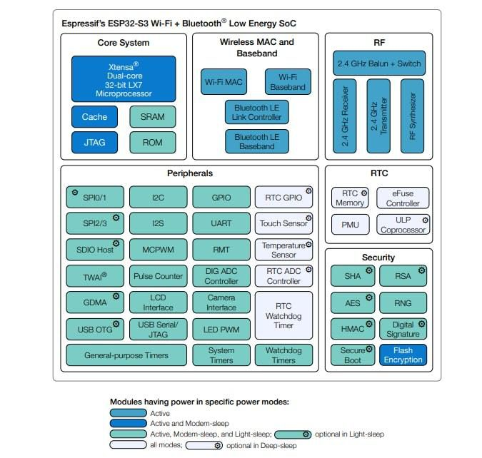
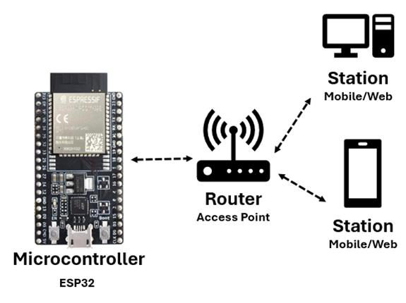
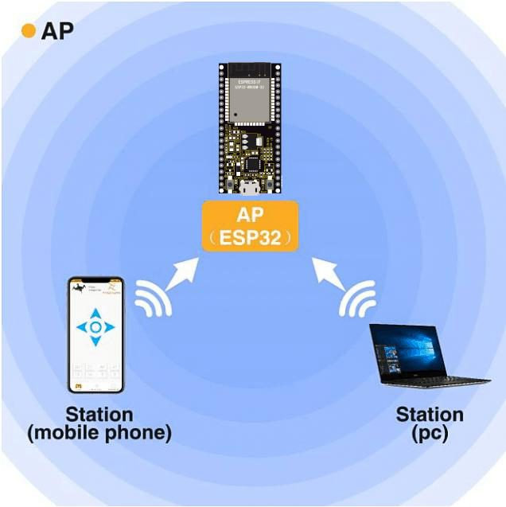
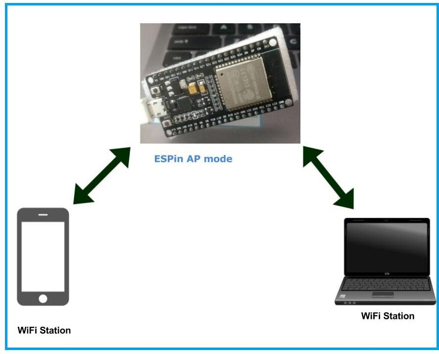

# 第十六课：XIAO ESP32S3 网络通信系统——Wi-Fi、TCP/IP、HTTP、MQTT 与 WebSocket

前面我们已经掌握了 ESP32-S3 的硬件、FreeRTOS、DMA、音频、图像和边缘 AI。现在要解决一个关键问题：

**如何让 XIAO ESP32S3 稳定地与 Mac、手机、局域网服务器以及云端 AI 服务通信？**

本课仍然以普通版 Seeed XIAO ESP32S3 为主控，采用 ESP-IDF 开发。

完成本课后，你应该能够独立设计一个具备 Wi-Fi 自动重连、HTTP 接口、MQTT 消息通信和 WebSocket 实时传输能力的嵌入式网络系统。

---

## 一、先理解完整的网络通信架构

**XIAO ESP32S3** 传感器 / 音频 / AI / FreeRTOS

↑↓

**ESP-IDF 网络系统** Wi-Fi Driver + esp_netif + lwIP

↑↓

**Wi-Fi 路由器** 2.4GHz 无线网络

↑↓

- **Mac** 调试 / HTTP
- **手机** 控制 / WebSocket
- **服务器** MQTT / AI

网络通信可以分成四层来理解：

| 层次 | 技术 | 作用 |
| --- | --- | --- |
| 无线连接 | Wi-Fi | 连接无线局域网 |
| 网络层 | IP | 设备寻址和数据包转发 |
| 传输层 | TCP / UDP | 端到端数据传输 |
| 应用层 | HTTP / MQTT / WebSocket | 实现业务功能 |

这四层的关系非常重要。

例如，HTTP 不是直接操作 Wi-Fi 天线，而是通常建立在 TCP/IP 之上。

---

## 二、ESP32-S3 的 Wi-Fi 硬件原理

ESP32-S3 支持 2.4GHz Wi-Fi，主要用于连接 IEEE 802.11 b/g/n 无线网络。

它不能直接连接仅支持 5GHz 或 6GHz 的无线网络。



*[ESP32-S3 2.4GHz Wi­-Fi & BLUETOOTH LE SoCs - Espressif Systems | Mouser](https://th.mouser.com/images/marketingid/2022/microsites/0/ESP32-S3_BlockDiagram.png) · 搜索词：Espressif ESP32-S3 WiFi RF antenna chip architecture diagram*

### 1. Wi-Fi 数据如何发送？

简化流程：

```text
应用程序
    ↓
TCP/IP 协议栈
    ↓
Wi-Fi 驱动
    ↓
MAC 层
    ↓
PHY 物理层
    ↓
射频电路
    ↓
天线
    ↓
无线路由器
```

其中：

**MAC 层** 负责无线帧的组织、地址和媒体访问控制。

**PHY 层** 负责调制、编码和无线信号收发。

**射频电路** 负责将数字信号转换为实际的无线电信号。

### 2. Wi-Fi 为什么会丢包？

无线环境存在很多干扰因素：

- 信号衰减；
- 其他 2.4GHz 设备干扰；
- 路由器拥塞；
- 墙体遮挡；
- 天线方向；
- 设备供电不稳定；
- Wi-Fi 省电机制带来的调度变化。

所以嵌入式网络程序必须考虑断线、重试和超时。

不能假设 Wi-Fi 永远在线。

---

## 三、STA、AP 和 AP+STA 模式

ESP32-S3 主要支持以下 Wi-Fi 工作方式。



*[Menghubungkan ESP32 ke Jaringan Wi-Fi | Internet of Things](https://www.pdk.sk.stikom-bali.ac.id/content/resources/20251112145112078YTO/mceclip51.png) · 搜索词：ESP32 WiFi station mode connecting to home router diagram*

**STA：Station 模式**

XIAO 作为客户端连接现有路由器。适合连接家庭网络、Mac、MQTT 服务器和互联网。

---



*[HOW to Enable WIFI AP Mode with ESP32](https://docs.keyestudio.com/projects/KS5003-KS5004/en/latest/_images/35d90f1ce10814ea1897ba63f8bd7ad91.png) · 搜索词：ESP32 access point AP mode phone connects directly ESP32 diagram*

**AP：Access Point 模式**

XIAO 自己建立 Wi-Fi 热点，手机或电脑可以直接连接。适合设备首次配网和本地控制。

---



*[ESP-IDF : ESP32 as SoftAP - iCircuit](https://icircuit.net/wp-content/uploads/2017/09/ESP32-soft-ap.jpg) · 搜索词：ESP32 AP STA simultaneous WiFi router smartphone network diagram*

**AP+STA：双模式**

一边连接现有路由器，一边提供自己的热点。适合需要配置入口的设备，但共享无线硬件资源，需要考虑信道和性能限制。

### 实际项目如何选择？

| 项目 | 建议模式 |
| --- | --- |
| 传感器数据上传 | STA |
| 智能语音终端 | STA |
| 手机首次配置设备 | AP 或配网机制 |
| 无路由器的本地控制 | AP |
| 设备配置和联网同时运行 | AP+STA |

对于我们的 XIAO ESP32S3 项目，建议先掌握 STA，再学习 AP 配网。

---

## 四、ESP-IDF Wi-Fi 软件架构

在 ESP-IDF 中，Wi-Fi 不是一个简单的 `connect()` 函数。

它涉及多个组件。

```text
app_main()
    │
    ├── NVS
    │
    ├── esp_netif
    │
    ├── Event Loop
    │
    ├── Wi-Fi Driver
    │
    └── Application Tasks
```

### 1. NVS

NVS 是非易失性存储系统。

Wi-Fi 驱动和应用程序可能需要保存配置数据。

### 2. esp_netif

`esp_netif` 是 ESP-IDF 的网络接口抽象层。

它负责将 Wi-Fi 网络接口与 TCP/IP 协议栈连接起来。

### 3. Event Loop

事件循环负责通知应用程序：

- Wi-Fi 已启动；
- Wi-Fi 已连接；
- Wi-Fi 已断开；
- IP 地址已获取。

### 4. lwIP

lwIP 是轻量级 TCP/IP 协议栈。

它实现了大量网络协议功能，例如：

- IPv4；
- IPv6；
- TCP；
- UDP；
- ICMP；
- DNS；
- DHCP 相关功能。

ESP-IDF 的 Socket API 就建立在相应网络协议栈能力之上。

---

## 五、实战一：使用 ESP-IDF 连接 Wi-Fi

我们先实现一个最基础的 STA 工程。

### 1. 工程目录

```text
wifi_basic/
├── CMakeLists.txt
├── main/
│   ├── CMakeLists.txt
│   └── app_main.c
└── sdkconfig
```

### 2. Wi-Fi 初始化代码

下面使用 ESP-IDF 5.x 风格的 API，演示连接流程和事件处理。

```c
#include <string.h>

#include "freertos/FreeRTOS.h"
#include "freertos/task.h"
#include "freertos/event_groups.h"

#include "esp_wifi.h"
#include "esp_event.h"
#include "esp_netif.h"
#include "esp_log.h"
#include "nvs_flash.h"

#define WIFI_SSID "YOUR_WIFI"
#define WIFI_PASS "YOUR_PASSWORD"

#define WIFI_CONNECTED_BIT BIT0

static const char *TAG = "WIFI";

static EventGroupHandle_t wifi_event_group;

static void wifi_event_handler(
    void *arg,
    esp_event_base_t event_base,
    int32_t event_id,
    void *event_data
)
{
    if (event_base == WIFI_EVENT) {

        if (event_id == WIFI_EVENT_STA_START) {
            esp_wifi_connect();
        }

        else if (event_id == WIFI_EVENT_STA_DISCONNECTED) {

            ESP_LOGW(TAG, "Wi-Fi disconnected");

            xEventGroupClearBits(
                wifi_event_group,
                WIFI_CONNECTED_BIT
            );

            esp_wifi_connect();
        }
    }

    else if (
        event_base == IP_EVENT &&
        event_id == IP_EVENT_STA_GOT_IP
    ) {
        ip_event_got_ip_t *event =
            (ip_event_got_ip_t *)event_data;

        ESP_LOGI(
            TAG,
            "IP: " IPSTR,
            IP2STR(&event->ip_info.ip)
        );

        xEventGroupSetBits(
            wifi_event_group,
            WIFI_CONNECTED_BIT
        );
    }
}

void wifi_init_sta(void)
{
    wifi_event_group = xEventGroupCreate();
    configASSERT(wifi_event_group != NULL);

    esp_err_t err = nvs_flash_init();

    if (err == ESP_ERR_NVS_NO_FREE_PAGES ||
        err == ESP_ERR_NVS_NEW_VERSION_FOUND) {

        ESP_ERROR_CHECK(nvs_flash_erase());
        err = nvs_flash_init();
    }

    ESP_ERROR_CHECK(err);

    ESP_ERROR_CHECK(esp_netif_init());

    ESP_ERROR_CHECK(
        esp_event_loop_create_default()
    );

    esp_netif_t *sta_netif =
        esp_netif_create_default_wifi_sta();

    configASSERT(sta_netif != NULL);

    wifi_init_config_t cfg =
        WIFI_INIT_CONFIG_DEFAULT();

    ESP_ERROR_CHECK(esp_wifi_init(&cfg));

    ESP_ERROR_CHECK(
        esp_event_handler_register(
            WIFI_EVENT,
            ESP_EVENT_ANY_ID,
            wifi_event_handler,
            NULL
        )
    );

    ESP_ERROR_CHECK(
        esp_event_handler_register(
            IP_EVENT,
            IP_EVENT_STA_GOT_IP,
            wifi_event_handler,
            NULL
        )
    );

    wifi_config_t wifi_config = {
        .sta = {
            .ssid = WIFI_SSID,
            .password = WIFI_PASS,
            .threshold.authmode =
                WIFI_AUTH_WPA2_PSK
        }
    };

    ESP_ERROR_CHECK(
        esp_wifi_set_mode(WIFI_MODE_STA)
    );

    ESP_ERROR_CHECK(
        esp_wifi_set_config(
            WIFI_IF_STA,
            &wifi_config
        )
    );

    ESP_ERROR_CHECK(esp_wifi_start());
}

void app_main(void)
{
    wifi_init_sta();

    xEventGroupWaitBits(
        wifi_event_group,
        WIFI_CONNECTED_BIT,
        pdFALSE,
        pdTRUE,
        portMAX_DELAY
    );

    ESP_LOGI(TAG, "Network ready");
}
```

这段代码演示了 Wi-Fi 初始化、事件回调、获取 IP 和等待连接。

它还不是完整的产品级网络管理器。特别是断线后立即无限重连，在密码错误或路由器长期不可用时并不理想。

另外，示例中直接填写 SSID 和密码只是为了教学。实际项目应使用配置机制、NVS 或安全配网流程，不要将真实密码提交到 GitHub。

### 3. 编译与烧录

在 Mac 的 ESP-IDF 环境中：

```bash
idf.py set-target esp32s3

idf.py build

idf.py -p /dev/cu.usbmodemXXXX flash monitor
```

实际串口名称需要根据 Mac 上识别到的设备确定。

### 4. 预期日志

```text
I WIFI: Wi-Fi started
I WIFI: Connected to AP
I WIFI: IP: 192.168.1.105
I WIFI: Network ready
```

IP 地址只是示例，实际由网络分配。

---

## 六、DHCP、DNS、IP 地址到底是什么？

这是很多嵌入式开发者容易混淆的知识点。

### 1. IP 地址

例如：

```text
192.168.1.105
```

这是设备在某个网络中的 IP 地址。

Mac 可能是：

```text
192.168.1.20
```

如果两者位于允许互相通信的网络中，就可以通过 IP 地址访问对方。

### 2. DHCP

DHCP 用于自动分配网络参数。

通常包括：

- IP 地址；
- 子网掩码；
- 默认网关；
- DNS 服务器。

### 3. DNS

DNS 负责将域名解析为 IP 地址。

例如：

```text
example.com
     ↓
DNS 查询
     ↓
服务器 IP
```

### 4. 网关

默认网关通常是路由器。

当 XIAO 需要访问其他网络中的服务器时，数据包一般需要通过网关转发。

---

## 七、TCP 和 UDP：两个最重要的传输协议

- **TCP** **可靠、有序的字节流** 适合 HTTP、MQTT、WebSocket 等应用。
- **UDP** **无连接的数据报** 适合低延迟音频、设备发现及允许应用自行处理丢包的场景。

### 1. TCP 为什么可靠？

TCP 通过：

- 序列号；
- 确认应答；
- 重传；
- 流量控制；
- 拥塞控制；

提供可靠、有序的字节流传输。

但 TCP 不保留应用消息边界。

例如发送两次：

```text
HELLO
WORLD
```

接收端可能一次读取：

```text
HELLOWORLD
```

也可能分多次读取。

因此使用 Socket 编程时，需要自己设计消息长度或分隔协议。

### 2. UDP 为什么适合部分实时音频？

因为 UDP 不要求传输层对丢失数据包进行可靠重传。

对于实时语音，过晚到达的旧音频可能已经没有播放价值。

但是 UDP 并不保证低延迟，也不保证到达、顺序或不重复。

实际系统通常还需要：

- 序列号；
- 时间戳；
- 抖动缓冲；
- 丢包统计；
- 必要的错误恢复。

### 3. 如何选择？

| 场景 | 推荐 |
| --- | --- |
| 配置设备 | TCP / HTTP |
| 传感器数据上传 | MQTT / TCP |
| 网页控制 | HTTP |
| 实时双向控制 | WebSocket |
| 实时音频实验 | UDP 或合适的实时传输方案 |
| 文件上传 | HTTP / TCP |

---

## 八、Socket 编程：网络通信的底层接口

Socket 可以理解为应用程序使用 TCP/IP 网络能力的接口。

一个典型 TCP 客户端流程：

```text
socket()
   ↓
connect()
   ↓
send()
   ↓
recv()
   ↓
close()
```

一个 TCP 服务器流程：

```text
socket()
   ↓
bind()
   ↓
listen()
   ↓
accept()
   ↓
recv() / send()
   ↓
close()
```

### TCP 客户端示例

```c
#include <string.h>
#include <unistd.h>
#include <sys/socket.h>
#include <arpa/inet.h>

#include "esp_log.h"

void tcp_client_example(void)
{
    int sock = socket(
        AF_INET,
        SOCK_STREAM,
        IPPROTO_IP
    );

    if (sock < 0) {
        ESP_LOGE("TCP", "Socket creation failed");
        return;
    }

    struct sockaddr_in dest = {
        .sin_family = AF_INET,
        .sin_port = htons(5000)
    };

    inet_pton(
        AF_INET,
        "192.168.1.20",
        &dest.sin_addr
    );

    if (connect(
        sock,
        (struct sockaddr *)&dest,
        sizeof(dest)
    ) < 0) {

        ESP_LOGE("TCP", "Connection failed");
        close(sock);
        return;
    }

    const char *message = "Hello from XIAO";

    ssize_t sent = send(
        sock,
        message,
        strlen(message),
        0
    );

    if (sent < 0) {
        ESP_LOGE("TCP", "Send failed");
    }

    close(sock);
}
```

这是最小演示。实际项目还需要处理部分发送、连接超时、断线恢复和 DNS 解析。

---

## 九、HTTP：让 Mac 浏览器直接访问 XIAO ESP32S3

HTTP 是非常适合嵌入式设备的应用协议。

例如：

```text
GET /status
```

ESP32-S3 返回：

```json
{
  "device": "XIAO ESP32S3",
  "status": "online",
  "temperature": 26.5
}
```

### 1. HTTP 服务器架构

```text
Mac 浏览器
    ↓
HTTP GET /status
    ↓
Wi-Fi
    ↓
ESP-IDF HTTP Server
    ↓
应用程序
    ↓
JSON 响应
```

### 2. ESP-IDF HTTP Server

主要头文件：

```c
#include "esp_http_server.h"
```

一个简单的状态接口：

```c
static esp_err_t status_handler(
    httpd_req_t *req
)
{
    const char *json =
        "{\"device\":\"XIAO ESP32S3\","
        "\"status\":\"online\"}";

    httpd_resp_set_type(
        req,
        "application/json"
    );

    return httpd_resp_sendstr(req, json);
}
```

注册接口：

```c
httpd_uri_t status_uri = {
    .uri = "/status",
    .method = HTTP_GET,
    .handler = status_handler,
    .user_ctx = NULL
};
```

启动服务器：

```c
httpd_handle_t server = NULL;

httpd_config_t config =
    HTTPD_DEFAULT_CONFIG();

ESP_ERROR_CHECK(
    httpd_start(&server, &config)
);

ESP_ERROR_CHECK(
    httpd_register_uri_handler(
        server,
        &status_uri
    )
);
```

这三个片段需要放在同一个完整工程中，确保服务器句柄和 URI 结构体的生命周期有效。

### 3. 在 Mac 上测试

假设 XIAO IP 为：

```text
192.168.1.105
```

打开浏览器：

```text
http://192.168.1.105/status
```

或者终端：

```bash
curl http://192.168.1.105/status
```

即可查看设备状态。

注意：HTTP 明文接口适合受控局域网实验。不要未经身份验证和安全防护就将设备管理接口直接暴露到公网。

---

## 十、MQTT：物联网设备最常用的通信协议之一

MQTT 使用发布订阅模式。

与 HTTP 不同，设备不一定需要直接知道其他设备的 IP 地址。

**MQTT Broker** 消息代理服务器

- ↑↓

  **XIAO ESP32S3** 发布传感器数据

- ↑↓

  **Mac / 服务器** 订阅数据与发送控制

### 1. Topic 是什么？

例如：

```text
xiao/device01/temperature
```

设备发布：

```text
26.5
```

Mac 订阅这个 Topic，就可以收到温度。

再例如：

```text
xiao/device01/command
```

Mac 发布：

```json
{"led":true}
```

XIAO 订阅后执行对应操作。

### 2. MQTT QoS

| QoS | 含义 |
| --- | --- |
| 0 | 最多一次 |
| 1 | 至少一次，可能重复 |
| 2 | 恰好一次，按协议交付语义 |

QoS 1 和 QoS 2 都不能代替应用层的命令去重、权限验证和状态确认。

### 3. MQTT 在 ESP-IDF 中如何使用？

ESP-MQTT 提供了客户端接口，例如：

```c
esp_mqtt_client_handle_t client =
    esp_mqtt_client_init(&mqtt_cfg);

esp_mqtt_client_start(client);
```

连接成功后：

```c
esp_mqtt_client_publish(
    client,
    "xiao/device01/status",
    "online",
    0,
    1,
    0
);
```

实际使用前需要配置 Broker URI、认证信息、事件回调，并检查当前 ESP-IDF 工程是否已经引入兼容版本的 `esp-mqtt` 组件。

---

## 十一、WebSocket：适合实时双向数据通信

WebSocket 与普通 HTTP 请求响应不同。

建立连接后，客户端和服务器可以持续双向发送消息。

例如：

```text
Mac
  ↕
WebSocket
  ↕
XIAO ESP32S3
```

非常适合：

- 实时设备状态；
- 音频数据；
- 控制命令；
- 传感器波形；
- 实时日志；
- 网页控制面板。

### HTTP 与 WebSocket 对比

| 项目 | HTTP | WebSocket |
| --- | --- | --- |
| 典型交互 | 请求响应 | 持续双向通信 |
| 实时推送 | 需要额外机制 | 原生支持 |
| 连接方式 | 可以复用连接 | 长连接 |
| 适合 | 配置、查询、文件 | 实时状态和数据流 |

### 1. WebSocket 音频数据传输

结合第十三课：

```text
INMP441
   ↓
I2S
   ↓
PCM Buffer
   ↓
WebSocket
   ↓
Mac
```

例如每 20ms 发送 640 字节 PCM。

但必须考虑 TCP 背压和发送队列长度，否则网络慢时音频延迟可能不断积累。

---

## 十二、TLS：为什么联网设备需要加密？

如果通过普通 HTTP 发送：

```text
Wi-Fi SSID
设备令牌
用户数据
```

数据可能在不可信网络路径上被读取或篡改。

TLS 可以提供：

- 通信加密；
- 完整性保护；
- 服务器身份验证。

### 1. 常见协议

| 未加密 | 加密版本 |
| --- | --- |
| HTTP | HTTPS |
| MQTT | MQTT over TLS |
| WebSocket | WSS |

### 2. ESP32-S3 如何验证服务器？

常见做法是使用可信 CA 证书链验证服务器证书。

必须检查：

- 证书是否可信；
- 证书是否过期；
- 服务器域名是否匹配；
- 设备时间是否正确。

不要为了让 HTTPS 连接成功而在产品中关闭证书验证。

---

## 十三、Wi-Fi 自动重连：产品稳定性的关键

我们在前面看到：

```c
esp_wifi_connect();
```

但实际产品不能无限快速重试。

推荐使用退避重连策略。

### 1. 重连时间示例

| 失败次数 | 下次重连等待 |
| --- | --- |
| 1 | 1 秒 |
| 2 | 2 秒 |
| 3 | 4 秒 |
| 4 | 8 秒 |
| 5 及以后 | 最长 30 秒 |

实际可加入少量随机抖动，避免大量设备同时重连。

### 2. 网络状态机

**INIT** 初始化 Wi-Fi

↓

**CONNECTING** 尝试连接路由器

↓

**CONNECTED** 获得 IP，业务可以运行

↓

**DISCONNECTED** 停止依赖网络的业务

↓

**BACKOFF** 等待后重试，返回 CONNECTING

注意：Wi-Fi 连接成功和获得 IP 是两个不同事件。获得 IP 也不代表互联网、DNS 或目标服务器一定可用。

因此网络管理器还需要处理服务器连接失败和服务级重连。

---

## 十四、FreeRTOS 网络任务如何设计？

推荐不要把所有网络操作放在 `app_main()` 中。

一个完整的 XIAO ESP32S3 网络系统可以这样划分：

```text
app_main
   │
   ├── WiFi Manager
   │
   ├── HTTP Server
   │
   ├── MQTT Client
   │
   ├── WebSocket Task
   │
   ├── Sensor Task
   │
   ├── Audio Task
   │
   └── Monitor Task
```

### 1. 任务之间如何通信？

建议通过：

- FreeRTOS Queue；
- Event Group；
- Ring Buffer；
- Mutex；
- Task Notification。

例如：

```text
Sensor Task
     ↓
FreeRTOS Queue
     ↓
MQTT Task
     ↓
Broker
```

这样即使 MQTT 连接短暂断开，也不会直接阻塞传感器采集任务。

但队列必须设置容量上限，并明确满队列时是丢弃旧数据、丢弃新数据，还是暂存到持久化存储。

---

## 十五、综合项目：XIAO ESP32S3 网络控制中心

这是本课推荐完成的实际工程。

### 功能目标

**XIAO ESP32S3** 网络设备控制中心 · 界面示意

**Online**

- Wi-Fi 信号 **-52 dBm**
- 运行时间 **02:35:18**
- 空闲内存 **186 KB**
- MQTT 状态 **Connected**

---

**计划提供的 HTTP 接口**

| GET | `/status` | 设备状态 |
| --- | --- | --- |
| GET | `/memory` | 内存信息 |
| GET | `/wifi` | 网络状态 |
| POST | `/control` | 设备控制 |

*以上数值为界面演示数据，不是当前设备的实测状态。*

### 工程目录

```text
projects/
└── network_control_center/
    ├── main/
    │   └── app_main.c
    │
    ├── components/
    │   ├── wifi_manager/
    │   ├── http_server/
    │   ├── mqtt_client/
    │   ├── websocket/
    │   ├── device_control/
    │   └── system_monitor/
    │
    ├── docs/
    │   ├── architecture.md
    │   ├── api.md
    │   ├── network_security.md
    │   └── testing.md
    │
    └── README.md
```

### 开发顺序

建议严格按照以下顺序：

1. Wi-Fi STA 连接并获得 IP。
2. 实现断线自动重连。
3. 实现 HTTP `/status`。
4. 实现 HTTP `/memory`。
5. 连接本地 MQTT Broker。
6. 实现 MQTT 发布与订阅。
7. 实现 WebSocket 实时状态推送。
8. 添加 TLS、认证和访问控制。
9. 运行长期稳定性测试。

---

## 十六、网络数据量与缓冲区计算器

在实际开发中，必须提前计算数据吞吐量和缓冲区需求。

例如 16kHz、16bit、单声道音频，每秒约 32KB。

下面可以调整参数，观察 PCM 原始数据量及缓冲区需求。

**PCM 网络传输计算器**

- 采样率
- 采样位数
- 声道数

缓冲时长

ms

---

- 原始数据速率 **— KB/s**
- 缓冲区需求 **— KiB**

*按紧密排列的 PCM 数据计算，不包含网络协议开销、数据包头、DMA 缓冲区或内存对齐。I2S 实际槽宽也可能大于有效采样位数。*

---

## 十七、给 Codex 的本课开发任务

**Codex：构建网络控制中心**

**复制任务**

本课的 Codex 任务重点不是一次性生成大量网络代码，而是建立能够长期运行、可测试、可扩展的网络通信基础组件。

---

## 十八、本课知识验收

**第十六课学习进度**/

---

## 十九、下一课：ESP32-S3 低功耗、RTC、Watchdog 与电源管理

**第十七课：XIAO ESP32S3 低功耗与可靠性设计**

> 图示：ESP32-S3 battery powered IoT development board lithium battery low power deep sleep electronics

下一课将学习：

1. ESP32-S3 电源域与时钟域。
2. Active、Modem Sleep、Light Sleep、Deep Sleep。
3. RTC 控制器和 RTC 内存。
4. GPIO 唤醒与定时器唤醒。
5. Wi-Fi 省电机制。
6. CPU 动态频率调整。
7. 电池供电与功耗计算。
8. Watchdog 看门狗。
9. Brownout 欠压检测。
10. 异常复位原因分析。
11. NVS 数据保存。
12. 低功耗设备状态机。
13. 电源故障和系统可靠性测试。

**第十六课的核心成果：** 建立一套可复用的 Wi-Fi、HTTP、MQTT、WebSocket 网络基础组件，为后续音频终端、AI 设备、远程控制和 OTA 升级提供稳定的通信能力。

官方参考资料：

- [ESP-IDF Wi-Fi 开发指南](https://docs.espressif.com/projects/esp-idf/en/stable/esp32s3/api-guides/wifi.html)
- [ESP-NETIF 网络接口](https://docs.espressif.com/projects/esp-idf/en/stable/esp32s3/api-reference/network/esp_netif.html)
- [ESP HTTP Server](https://docs.espressif.com/projects/esp-idf/en/stable/esp32s3/api-reference/protocols/esp_http_server.html)
- [ESP-MQTT 官方文档](https://docs.espressif.com/projects/esp-mqtt/en/latest/esp32s3/)

下一课将从电源、电池、休眠和故障恢复出发，解决一个真正产品化的问题：**如何让 XIAO ESP32S3 不仅能够运行，而且能够低功耗、长期、稳定地运行。**
