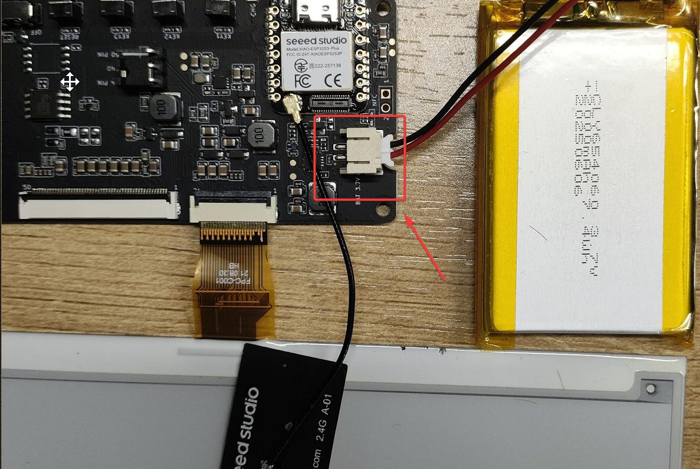
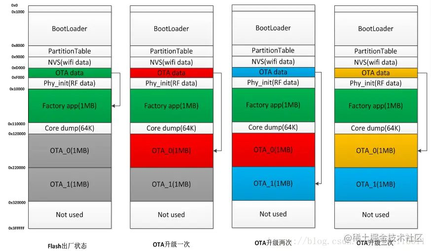

# 第十七课：XIAO ESP32S3 低功耗、电源管理与系统可靠性

前面我们已经学习了 Wi-Fi、MQTT、HTTP、WebSocket、音频、摄像头和边缘 AI。

这些功能能够让 XIAO ESP32S3 变成一台智能设备，但距离真正的产品还有一个关键问题：

**如何让设备在电池供电时尽可能省电，并且在断网、欠压、程序异常或意外重启后仍然能够可靠工作？**

本课继续以普通版 Seeed XIAO ESP32S3 为主控，使用 ESP-IDF 开发。

## 一、ESP32-S3 为什么需要电源管理？

ESP32-S3 的功耗不是固定的。

同一块开发板，在不同工作状态下，电流可能相差很大。

例如：

- CPU 高速运行；
- Wi-Fi 发射；
- Wi-Fi 待机；
- CPU 空闲；
- Light Sleep；
- Deep Sleep。

**典型工作状态的相对功耗**

*这是一张相对功耗示意图，不是 XIAO ESP32S3 的实测电流。实际功耗与板载电路、射频活动、供电方式和外设有关。*

### 1. 为什么不能只看 ESP32-S3 芯片的数据手册？

因为你使用的是完整开发板。

实际电池电流可能包括：

$I_{total}=I_{ESP32}+I_{regulator}+I_{LED}+I_{peripherals}$

其中：

- $I_{ESP32}$：芯片本身电流；
- $I_{regulator}$：稳压电路自身消耗；
- $I_{LED}$：板载指示灯电流；
- $I_{peripherals}$：麦克风、传感器、显示屏等外设电流。

因此，**芯片的 Deep Sleep 电流不等于整块 XIAO 开发板的 Deep Sleep 电流。**

---

## 二、ESP32-S3 的电源域与时钟域

ESP32-S3 内部不是所有模块都必须同时工作。

可以把它理解成一座工厂。

不同车间可以根据任务需要开启或关闭。

**ESP32-S3 电源与时钟管理**

### 1. 什么是时钟门控？

数字电路通常依靠时钟信号运行。

当某个模块不需要工作时，可以关闭它的时钟，减少动态功耗。

这称为 Clock Gating。

### 2. 什么是电源门控？

某些电源域可以在低功耗状态下断电。

相比仅停止时钟，断电通常能够进一步降低功耗，但也会丢失该电源域中未被保留的状态。

### 3. 为什么休眠后有些数据会丢失？

因为休眠期间，部分 RAM 和外设可能断电。

所以要区分：

- 普通 RAM；
- RTC 保留内存；
- Flash；
- NVS。

不同睡眠模式保留的数据不同。

---

## 三、四种重要的运行与休眠状态

| 模式 | CPU | Wi-Fi | 程序执行状态 |
| --- | --- | --- | --- |
| Active | 运行 | 可工作 | 正常运行 |
| Modem Sleep | 通常运行 | 无线模块间歇休眠 | 程序继续运行 |
| Light Sleep | 暂停 | 无法持续正常通信 | 唤醒后继续 |
| Deep Sleep | 主 CPU 停止 | 关闭 | 唤醒后重新启动 |

### 1. Active：正常工作

适合：

- 音频采集；
- AI 推理；
- 网络传输；
- 图像处理。

优点是响应快。

缺点是功耗较高。

### 2. Modem Sleep：无线模块省电

设备仍然保持 Wi-Fi 连接，但无线模块可以在部分时间进入省电状态。

ESP-IDF 提供：

```c
esp_wifi_set_ps(WIFI_PS_MIN_MODEM);
```

也可以根据应用选择其他支持的 Wi-Fi 省电配置。

但要注意：

Modem Sleep 可能增加网络响应延迟，特别是对于实时音频、低延迟 WebSocket 等应用。

### 3. Light Sleep：浅睡眠

CPU 暂停执行，部分状态得到保留。

唤醒后，程序可以从进入休眠的位置附近继续执行。

适合：

- 间歇性传感器采样；
- 短时间等待；
- 对唤醒延迟有要求的设备。

### 4. Deep Sleep：深度休眠

这是电池供电设备非常重要的模式。

进入 Deep Sleep 后：

- 主 CPU 停止；
- Wi-Fi 关闭；
- 大部分普通运行状态丢失；
- 只保留指定的低功耗域状态。

唤醒后通常重新经历启动流程，再执行 `app_main()`。

---

## 四、实战一：定时唤醒的 Deep Sleep

这是本课第一个推荐实际烧录的实验。

目标：

```text
XIAO 启动
    ↓
打印启动信息
    ↓
等待 3 秒
    ↓
进入 Deep Sleep
    ↓
10 秒后唤醒
    ↓
重新启动
    ↓
重复执行
```

### 1. ESP-IDF 完整示例

```c
#include <inttypes.h>

#include "freertos/FreeRTOS.h"
#include "freertos/task.h"

#include "esp_log.h"
#include "esp_sleep.h"
#include "esp_system.h"

static const char *TAG = "SLEEP";

void app_main(void)
{
    esp_sleep_wakeup_cause_t cause =
        esp_sleep_get_wakeup_cause();

    ESP_LOGI(
        TAG,
        "Wakeup cause: %d",
        cause
    );

    ESP_LOGI(TAG, "Running...");

    vTaskDelay(
        pdMS_TO_TICKS(3000)
    );

    ESP_LOGI(
        TAG,
        "Entering deep sleep"
    );

    ESP_ERROR_CHECK(
        esp_sleep_enable_timer_wakeup(
            10ULL * 1000000ULL
        )
    );

    esp_deep_sleep_start();
}
```

### 2. 为什么使用 `10ULL * 1000000ULL`？

因为 `esp_sleep_enable_timer_wakeup()` 使用微秒作为时间单位。

$10秒=10,000,000微秒$

`ULL` 用于确保表达式使用足够宽的无符号整数类型。

### 3. 预期现象

串口可能看到：

```text
I SLEEP: Wakeup cause: 0
I SLEEP: Running...
I SLEEP: Entering deep sleep
```

经过约 10 秒后，设备重新启动。

再次看到：

```text
I SLEEP: Wakeup cause: 4
I SLEEP: Running...
```

其中唤醒原因应以实际枚举值和日志为准。定时器唤醒对应 `ESP_SLEEP_WAKEUP_TIMER`。

---

## 五、RTC 内存：如何让 Deep Sleep 后保留变量？

普通变量：

```c
int boot_count = 0;
```

在 Deep Sleep 唤醒后通常不会保留上次运行时的值。

但 ESP-IDF 提供 RTC 保留内存相关机制。

例如：

```c
RTC_DATA_ATTR int boot_count = 0;
```

### 1. 完整示例

```c
#include <inttypes.h>

#include "esp_log.h"
#include "esp_sleep.h"

RTC_DATA_ATTR static uint32_t boot_count = 0;

void app_main(void)
{
    boot_count++;

    ESP_LOGI(
        "RTC",
        "Boot count: %" PRIu32,
        boot_count
    );

    ESP_ERROR_CHECK(
        esp_sleep_enable_timer_wakeup(
            5ULL * 1000000ULL
        )
    );

    esp_deep_sleep_start();
}
```

预期：

```text
Boot count: 1
Boot count: 2
Boot count: 3
```

但是需要注意：

RTC 保留变量并不等于永久存储。

断电、某些复位类型或 RTC 内存未保留的情况，仍然可能导致数据丢失。

### 2. RTC 内存和 NVS 的区别

| 特性 | RTC 保留内存 | NVS |
| --- | --- | --- |
| Deep Sleep 保留 | 视配置和供电情况 | 是 |
| 完全断电保留 | 否 | 是 |
| 写入速度 | RAM 访问 | Flash 写入 |
| 写入寿命限制 | 无 Flash 擦写问题 | 有 Flash 擦写寿命 |
| 适合 | 睡眠周期计数 | 设备配置和持久状态 |

---

## 六、GPIO 唤醒：按下按钮唤醒设备

除了定时器，ESP32-S3 还可以使用符合条件的 GPIO 唤醒。

对于 Deep Sleep，应该使用芯片支持的 RTC GPIO 和对应的唤醒机制。

不能认为所有普通 GPIO 都可以直接用于 Deep Sleep 唤醒。

### 1. 按钮连接示意

**3.3V 电源域**

↓

**上拉电阻**

↓

**RTC GPIO 输入** 按钮按下时拉低

↓

**按钮 → GND**

上图是逻辑连接关系，不代表电阻与按钮简单串联。实际电路应为 GPIO 节点经上拉电阻连接 3.3V，同时经按钮连接 GND。

### 2. 唤醒逻辑

```text
按钮未按下 → GPIO 高电平

按钮按下   → GPIO 低电平

低电平满足唤醒条件 → ESP32-S3 唤醒
```

ESP32-S3 支持的具体 RTC GPIO、EXT1 等唤醒方式和 API，应以所用 ESP-IDF 版本为准。

另外，选择 GPIO 时还要避免影响启动绑带引脚。

---

## 七、Wi-Fi 省电与网络延迟之间的权衡

对于智能语音终端，这是一个很重要的问题。

假设设备需要：

- 持续监听唤醒词；
- Wi-Fi 保持连接；
- 用户说话后立即上传音频。

如果 Wi-Fi 过度省电，可能增加唤醒和发送延迟。

### 不同业务的建议

| 应用 | 电源策略 |
| --- | --- |
| 电池温湿度计 | Deep Sleep |
| 定时数据上报 | Deep Sleep + Wi-Fi 短时连接 |
| 低频状态监控 | Modem Sleep |
| 持续 MQTT 在线 | 根据延迟要求使用 Wi-Fi 省电 |
| 实时音频 | 优先稳定低延迟 |
| 摄像头视频流 | 通常保持 Active |

这里没有适用于所有设备的统一省电配置。

需要通过真实电流和响应延迟测试选择。

---

## 八、动态频率调整：CPU 不必始终运行在 240MHz

ESP32-S3 的 CPU 频率可以根据系统配置和运行需求进行调整。

ESP-IDF 提供电源管理功能：

```c
#include "esp_pm.h"
```

典型配置形式：

```c
esp_pm_config_t pm_config = {
    .max_freq_mhz = 240,
    .min_freq_mhz = 80,
    .light_sleep_enable = false
};

ESP_ERROR_CHECK(
    esp_pm_configure(&pm_config)
);
```

实际使用需要启用相应 ESP-IDF 电源管理配置，并确认所选芯片和 SDK 支持对应设置。

### 为什么降低 CPU 频率可以省电？

动态功耗通常与频率和电压有关。

简化关系：

$P_\propto C V^2 f$

其中：

- $C$：等效开关电容；
- $V$：电压；
- $f$：时钟频率。

降低频率通常可以降低单位时间内的动态开关功耗。

但执行同一任务所需时间可能变长，所以必须比较完成任务所消耗的总能量。

---

## 九、电池续航计算：如何估算设备能运行多久？

假设使用一块标称容量为 1000mAh 的电池。

如果设备平均电流为 20mA：

$T=\frac{1000}{20}=50小时$

这是理想化计算。

实际还要考虑：

- 电池实际可用容量；
- 电池电压变化；
- 稳压转换效率；
- 峰值电流；
- 温度；
- 低压截止条件；
- 电池老化。

### 交互式电池续航计算器

**XIAO 电池续航估算**

- 电池容量（mAh）
- 工作电流（mA）
- 休眠电流（mA）
- 有效容量系数（%）

工作时间占比

%

---

- 平均电流 **— mA**
- 估算续航 **— 天**

*这是简化的电流占空比估算。有效容量系数用于粗略折减，不是严格的 DC-DC 效率模型；实际应测量电池端平均电流，并考虑电压及转换损耗。*

### 一个关键结论

如果设备每分钟只工作 1 秒，其余时间休眠，那么优化休眠电流可能比优化 CPU 计算速度更重要。

但如果设备持续运行音频和 Wi-Fi，则应重点优化运行状态功耗。

---

## 十、Watchdog：防止程序卡死

Watchdog（看门狗）是一种故障检测机制。

如果软件长时间不能正常执行，看门狗可以触发诊断或复位。

ESP-IDF 中需要重点理解两类：

- Interrupt Watchdog；
- Task Watchdog。

### 1. Interrupt Watchdog

主要用于检测中断长时间被阻塞等严重问题。

例如：

```c
portDISABLE_INTERRUPTS();

while (1) {
    // 错误：一直不恢复中断
}
```

这可能导致系统无法正常调度和响应中断。

### 2. Task Watchdog

用于监控指定任务是否长时间没有正常推进。

例如某个任务：

```c
while (1) {
    heavy_computation();
}
```

如果长期占用 CPU，其他任务无法获得运行机会，就可能触发看门狗。

### 3. 为什么不能简单关闭 Watchdog？

因为 Watchdog 是发现系统异常的重要工具。

如果因为程序触发 Watchdog 就直接禁用它，可能掩盖：

- 死循环；
- 任务饥饿；
- 锁死；
- 中断阻塞；
- 不合理的计算负载。

正确方法是分析触发原因，调整任务设计。

---

## 十一、Brownout：供电电压下降时会发生什么？

Brownout 是欠压状态。

当供电电压下降到不适合芯片可靠运行的范围时，系统可能触发欠压检测或复位。

### 1. 为什么 Wi-Fi 发送时容易出现供电问题？

Wi-Fi 发射时电流可能短时升高。

如果电源存在：

- 电池内阻过高；
- 连接线过细；
- 接触不良；
- 稳压器供电能力不足；
- 去耦电容配置不合理；

就可能导致电压瞬间下降。

### 2. 常见现象

```text
设备正常启动
    ↓
开始 Wi-Fi 连接
    ↓
供电电压下降
    ↓
系统复位
    ↓
再次启动
    ↓
循环重启
```

### 3. 如何排查？

建议依次检查：

1. 电源输入电压。
2. Wi-Fi 发射期间的瞬态电压。
3. 稳压器额定输出电流。
4. 电源线和连接器。
5. 去耦电容。
6. 启动日志中的复位原因。

不要通过简单关闭 Brownout 检测来掩盖真实供电问题。

---

## 十二、如何读取 ESP32-S3 的复位原因？

ESP-IDF 提供：

```c
esp_reset_reason()
```

示例：

```c
#include "esp_system.h"
#include "esp_log.h"

void print_reset_reason(void)
{
    esp_reset_reason_t reason =
        esp_reset_reason();

    ESP_LOGI(
        "SYSTEM",
        "Reset reason: %d",
        reason
    );
}
```

常见原因包括：

| 原因 | 含义 |
| --- | --- |
| `ESP_RST_POWERON` | 上电启动 |
| `ESP_RST_SW` | 软件复位 |
| `ESP_RST_PANIC` | 系统异常 |
| `ESP_RST_INT_WDT` | 中断看门狗 |
| `ESP_RST_TASK_WDT` | 任务看门狗 |
| `ESP_RST_BROWNOUT` | 欠压复位 |
| `ESP_RST_DEEPSLEEP` | Deep Sleep 唤醒 |

实际还存在其他复位原因，应以 ESP-IDF 枚举定义为准。

### 为什么要记录复位原因？

因为设备偶尔重启时，仅仅知道它“重启了”是不够的。

你需要判断：

- 是断电？
- 是软件主动重启？
- 是内存访问异常？
- 是任务卡死？
- 还是供电不稳定？

建议在启动时记录复位原因，并将统计信息保存在 NVS 或其他可靠存储中。

---

## 十三、低功耗设备应该使用状态机

对于实际产品，不建议到处调用休眠函数。

更好的方式是设计明确的设备状态机。

**BOOT** 启动和检查硬件

↓

**MEASURE** 采集传感器数据

↓

**CONNECT** 连接 Wi-Fi

↓

**UPLOAD** 上传数据

↓

**SAVE** 保存必要状态

↓

**SLEEP** 进入 Deep Sleep

### 典型低功耗温度采集器

```text
每 5 分钟唤醒
    ↓
采集温度
    ↓
连接 Wi-Fi
    ↓
上传数据
    ↓
断开 Wi-Fi
    ↓
进入 Deep Sleep
```

这种模式非常适合电池供电的环境监测设备。

---

## 十四、外设电源管理：真正省电不能只让 CPU 休眠

假设你连接：

- OLED；
- 麦克风；
- 功放；
- 温湿度传感器；
- LED 灯。

即使 ESP32-S3 进入 Deep Sleep，某些外设仍可能持续耗电。

因此需要考虑：

```text
电池
  ↓
电源管理
  ├── ESP32-S3
  ├── 传感器电源
  ├── 显示屏电源
  ├── 麦克风电源
  └── 功放电源
```

对于耗电较大的外设，可以使用：

- 具有低功耗关断功能的器件；
- Load Switch；
- MOSFET 电源控制电路；
- 专用电源管理芯片。

需要注意，不能随意通过 GPIO 直接为高电流外设供电。

还要防止外设断电后，通过 I2C、SPI 或其他信号线反向供电。

---

## 十五、XIAO ESP32S3 电池供电的安全注意事项

如果你计划使用锂电池，必须先确认板卡具体版本的电池接口和充电电路规格。



*[PlatformIO Cookbook | Seeed Studio Wiki](https://files.seeedstudio.com/wiki/Epaper/EE04/pio_battery_0.png) · 搜索词：Seeed Studio XIAO ESP32S3 lithium battery JST connector development board battery power*

### 需要特别注意

- 不要将单节锂电池直接连接到 3V3 引脚。
- 不要将电池正负极接反。
- 不要使用没有合适保护措施的电池组。
- 不要假设不同 XIAO 版本的电池焊盘和充电能力完全相同。
- 充电电流和电池容量应符合电池规格。
- 电池电压采样需要合适的分压与保护电路。

**如果你后续要为设备设计 3D 打印外壳，电池位置、散热、导线固定和充电接口空间必须提前规划。**

---

## 十六、综合实战：制作一台低功耗无线传感器

建议你使用普通版 XIAO ESP32S3，完成一个真正能够长期运行的电池供电项目。

### 项目目标

设备每 5 分钟：

1. 自动唤醒。
2. 读取传感器。
3. 连接 Wi-Fi。
4. 通过 MQTT 上传数据。
5. 记录运行状态。
6. 进入 Deep Sleep。

### 建议工程结构

```text
XIAO-ESP32S3-Projects/
└── projects/
    └── low_power_sensor/
        ├── main/
        │   └── app_main.c
        │
        ├── components/
        │   ├── power_manager/
        │   ├── sensor_manager/
        │   ├── wifi_manager/
        │   ├── mqtt_uploader/
        │   ├── rtc_state/
        │   └── system_monitor/
        │
        ├── docs/
        │   ├── power_architecture.md
        │   ├── current_measurement.md
        │   ├── battery_runtime.md
        │   └── reliability_test.md
        │
        └── README.md
```

### 验收标准

| 测试 | 预期结果 |
| --- | --- |
| 定时唤醒 | 能够按设定周期唤醒 |
| RTC 计数 | Deep Sleep 后保留计数 |
| Wi-Fi 恢复 | 唤醒后重新连接 |
| MQTT 上传 | 数据正常发布 |
| 断网处理 | 不无限等待，按策略休眠或重试 |
| 欠压处理 | 不出现持续异常重启 |
| 长期运行 | 连续运行并记录故障 |
| 电流测试 | 获得真实工作与休眠电流 |

---

## 十七、给 Codex 的本课开发任务

**Codex：低功耗与可靠性实验工程**

**复制任务**

推荐先完成定时休眠与 RTC 计数，再增加网络功能。不要一开始就同时调试电池、Wi-Fi、MQTT 和所有外设。

---

## 十八、本课学习验收

**第十七课学习进度**/

---

## 十九、下一课：ESP32-S3 OTA 升级、Flash 分区与安全启动

**第十八课：OTA、固件安全与远程维护**



*[OTA的学习_esp32 ota升级执行流程 回滚-CSDN博客](https://i-blog.csdnimg.cn/blog_migrate/c63f07cf90d15eed3fd698890afed360.png) · 搜索词：ESP32 IoT OTA firmware update secure boot flash partition architecture diagram*

下一课将深入学习：

1. ESP32-S3 Flash 分区表。
2. Factory、OTA_0、OTA_1 分区。
3. OTA Data 分区。
4. 双分区固件更新。
5. HTTP OTA 和 HTTPS OTA。
6. 固件完整性验证。
7. OTA 回滚机制。
8. Secure Boot V2。
9. Flash Encryption。
10. eFuse 安全配置。
11. 固件版本管理。
12. 远程升级失败恢复。
13. OTA 与 FreeRTOS、Wi-Fi 的协同。
14. 量产设备安全维护。

**第十七课最重要的结论：**

真正优秀的嵌入式设备，不只是功能丰富，而是能够在有限电量下长期稳定运行，并且在异常情况下具备明确的故障检测与恢复机制。

官方参考：

- [ESP32-S3 Sleep Modes](https://docs.espressif.com/projects/esp-idf/en/stable/esp32s3/api-reference/system/sleep_modes.html)
- [ESP-IDF Power Management](https://docs.espressif.com/projects/esp-idf/en/stable/esp32s3/api-reference/system/power_management.html)
- [ESP-IDF Watchdogs](https://docs.espressif.com/projects/esp-idf/en/stable/esp32s3/api-reference/system/wdts.html)

下一课将解决设备交付后的关键问题：**如何在不拆外壳、不连接 USB 的情况下安全更新固件，并在升级失败时恢复正常运行。**
