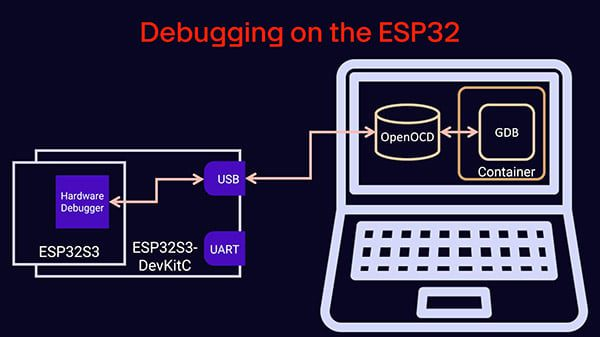

# 第十九课：XIAO ESP32S3 专业调试体系——JTAG、GDB、Core Dump、内存与性能分析

前面十八课，我们已经学习了 XIAO ESP32S3 的芯片架构、外设、FreeRTOS、网络、音频、AI、低功耗和 OTA。

现在进入专业嵌入式开发非常关键的一课：

**当程序能够编译，却运行不正常时，应该怎样准确找到问题？**

例如：

- 程序运行几分钟后突然重启。
- Wi-Fi 连接成功，但 MQTT 不断断线。
- I2S 麦克风偶尔丢失音频数据。
- FreeRTOS 任务卡死。
- PSRAM 分配成功，但 DMA 无法正常工作。
- 程序出现 `Guru Meditation Error`。
- Codex 修改代码后，固件可以编译，但功能不正确。

这些问题不能只依靠猜测和反复修改代码。

本课将建立一套适用于 **Mac + Codex Desktop + ESP-IDF + 普通版 XIAO ESP32S3** 的完整调试方法。

---

## 一、ESP32-S3 的调试系统由哪些部分组成？

**XIAO ESP32S3** 双核 Xtensa LX7 · FreeRTOS · 外设

- ↓

  **日志** ESP_LOG

- ↓

  **调试接口** USB JTAG

- ↓

  **故障记录** Core Dump

↓

**Mac 调试环境** ESP-IDF · OpenOCD · GDB · idf.py monitor

↓

**Codex 分析源码、日志和构建结果**

调试方法可以分为五个层级。

| 层级 | 工具 | 解决的问题 |
| --- | --- | --- |
| 1 | ESP_LOG | 程序运行到了哪里 |
| 2 | Monitor / Backtrace | 为什么发生异常 |
| 3 | GDB / JTAG | CPU 当前正在执行什么 |
| 4 | Heap / Stack / Core Dump | 内存和任务是否异常 |
| 5 | 性能分析 | 为什么程序慢、延迟高或丢数据 |

建议按照这个顺序学习。

---

## 二、ESP-IDF 日志系统：最常用的调试工具

ESP-IDF 提供统一的日志系统。

主要头文件：

```c
#include "esp_log.h"
```

### 1. 日志等级

| 等级 | 宏 | 用途 |
| --- | --- | --- |
| Error | `ESP_LOGE` | 严重错误 |
| Warning | `ESP_LOGW` | 潜在问题 |
| Info | `ESP_LOGI` | 重要运行状态 |
| Debug | `ESP_LOGD` | 调试细节 |
| Verbose | `ESP_LOGV` | 更详细的运行信息 |

示例：

```c
#include "esp_log.h"

static const char *TAG = "AUDIO";

void audio_start(void)
{
    ESP_LOGI(TAG, "Audio initializing");

    ESP_LOGD(TAG, "Sample rate: 16000");

    ESP_LOGW(TAG, "Buffer usage is high");

    ESP_LOGE(TAG, "I2S read failed");
}
```

### 2. 为什么需要 TAG？

假设你的智能语音终端有多个模块：

```text
WIFI
AUDIO
MQTT
AI
POWER
OTA
```

每个模块都使用不同 TAG。

日志就会变成：

```text
I WIFI: Connected
I AUDIO: Microphone initialized
I MQTT: Broker connected
W AUDIO: Buffer usage high
E MQTT: Publish failed
```

这样可以快速定位问题所属模块。

### 3. 动态调整日志等级

```c
esp_log_level_set(
    "AUDIO",
    ESP_LOG_DEBUG
);
```

这可以提高 `AUDIO` 模块的运行时日志等级，但前提是构建配置没有在编译时裁掉相应日志。

### 4. 日志设计原则

不要在高速 DMA 回调或高频中断中大量打印日志。

例如音频采样率为 16kHz，如果每个采样都打印一次，串口和 CPU 会承受极大负担。

更合理的做法是：

```text
每次采样 → 更新计数器

每秒一次 → 打印统计结果
```

另外，日志不能输出 Wi-Fi 密码、访问令牌或其他敏感数据。

---

## 三、Mac 上使用 idf.py monitor

这是最基本的调试方式。

### 1. 查看串口

在 Mac 终端中：

```bash
ls /dev/cu.*
```

找到 XIAO ESP32S3 对应的串口。

例如：

```text
/dev/cu.usbmodemXXXX
```

实际名称取决于板卡固件、USB 模式和 macOS 枚举结果。

### 2. 编译、烧录和监控

```bash
idf.py set-target esp32s3

idf.py build

idf.py -p /dev/cu.usbmodemXXXX flash monitor
```

如果已经烧录完成，可以直接：

```bash
idf.py -p /dev/cu.usbmodemXXXX monitor
```

### 3. Monitor 可以做什么？

除了查看日志，还可以辅助解析异常回溯地址。

例如：

```text
Guru Meditation Error
Backtrace: 0x4200xxxx ...
```

在构建信息和 ELF 文件匹配时，Monitor 可以将地址解析为源码位置。

### 4. 为什么必须保留 ELF 文件？

因为 `.bin` 主要用于设备烧录。

而 `.elf` 包含调试所需的符号信息。

```text
firmware.bin → 用于烧录

firmware.elf → 用于调试和地址解析

firmware.map → 用于分析内存布局
```

建议每次发布固件时，保存对应的 ELF、MAP、SDK 配置和构建版本。

---

## 四、Guru Meditation Error：ESP32-S3 为什么会崩溃？

这是 ESP32 开发中很常见的异常提示。

例如：

```text
Guru Meditation Error:
Core 0 panic'ed (LoadProhibited)
```

它通常表示 CPU 执行过程中发生了无法正常处理的异常。

### 常见异常

| 异常 | 可能原因 |
| --- | --- |
| LoadProhibited | 非法内存读取 |
| StoreProhibited | 非法内存写入 |
| InstrFetchProhibited | 从非法地址取指令 |
| IllegalInstruction | 执行非法指令 |
| LoadStoreAlignment | 不符合要求的内存对齐访问 |
| Stack Canary Watchpoint | 任务栈越界 |
| Interrupt WDT | 中断或调度长时间受阻 |
| Task WDT | 被监控任务长期未正常推进 |

### 1. 最简单的非法指针例子

```c
void crash_example(void)
{
    int *ptr = NULL;

    *ptr = 123;
}
```

这里尝试向空指针地址写入数据。

可能触发 `StoreProhibited` 等异常。

### 2. 如何看异常日志？

重点关注：

```text
PC
EXCCAUSE
EXCVADDR
Backtrace
```

其中：

- `PC`：发生异常时的程序计数器；
- `EXCCAUSE`：异常原因；
- `EXCVADDR`：部分异常相关的访问地址；
- `Backtrace`：函数调用回溯。

如果 `EXCVADDR` 接近零，可能存在空指针或接近空地址的非法访问，但不能仅凭这一点就确定根因。

---

## 五、Backtrace：如何找到发生错误的源码行？

假设日志显示：

```text
Backtrace:
0x42001234
0x42004567
0x42007890
```

这些地址本身不容易理解。

可以使用与固件匹配的 ELF 文件解析。

例如 ESP32-S3 的 Xtensa 工具链：

```bash
xtensa-esp32s3-elf-addr2line \
  -pfiaC \
  -e build/your_project.elf \
  0x42001234 0x42004567 0x42007890
```

如果符号和调试信息完整，可能得到：

```text
audio_process at main/audio.c:125
audio_task at main/audio.c:230
```

这里的地址和行号仅为示例。

### 关键规则

**必须使用崩溃固件对应的 ELF 文件。**

如果设备运行 v1.2，而你拿 v1.3 的 ELF 解析，结果可能错误。

这也是为什么 OTA 项目必须保存每个版本的构建产物。

---

## 六、JTAG：为什么比串口日志更强大？

串口日志只能告诉你程序打印了什么。

JTAG 可以让调试器直接检查 CPU 的执行状态。



*[Intro to Zephyr Part 7: Debugging with OpenOCD and GDB](https://sc-b.digikeyassets.com/-/media/MakerIO/Images/Tutorials/2025/Introduction%20to%20Zephyr%20Part%207%20Debugging%20with%20OpenOCD%20and%20GDB/part7-image4.jpg?la=en&ts=3fb8e310-4db9-4452-9a6b-373011d23858) · 搜索词：ESP32-S3 USB Serial JTAG OpenOCD GDB debugging development board laptop setup*

### 1. JTAG 能做什么？

- 暂停 CPU；
- 设置断点；
- 单步执行；
- 查看寄存器；
- 查看变量；
- 查看任务调用栈；
- 检查内存；
- 定位死循环。

### 2. 普通版 XIAO ESP32S3 有什么优势？

ESP32-S3 集成了 USB Serial/JTAG 控制器。

在板卡 USB 连接、芯片配置和调试接口均符合要求时，可以利用原生 USB 接口进行 JTAG 调试。

因此，**不一定需要额外购买外部 JTAG 调试器。**

但需要注意：

- 原生 USB Serial/JTAG 与 USB-OTG 功能的使用方式不同；
- 某些 USB 应用配置可能影响调试；
- 安全 eFuse 配置可能限制 JTAG；
- 程序异常、USB 引脚占用或 USB 配置错误可能影响连接。

---

## 七、Mac + ESP-IDF + OpenOCD + GDB 调试流程

### 1. 检查工具是否安装

在已经激活 ESP-IDF 环境的终端中：

```bash
which openocd
```

```bash
which xtensa-esp32s3-elf-gdb
```

```bash
idf.py --version
```

如果找不到工具，需要检查 ESP-IDF 安装和环境激活。

### 2. 启动 OpenOCD

对于 ESP32-S3 内置 USB JTAG，可以尝试：

```bash
openocd \
  -f board/esp32s3-builtin.cfg
```

具体配置文件名称及可用性应以安装的 OpenOCD 版本为准。

如果 USB 设备被串口监控程序占用，应先关闭冲突的连接。

### 3. 启动 GDB

另一个终端：

```bash
xtensa-esp32s3-elf-gdb \
  build/your_project.elf
```

然后在 GDB 中：

```gdb
target remote :3333
```

查看 CPU 状态：

```gdb
info registers
```

查看调用栈：

```gdb
bt
```

设置断点：

```gdb
break app_main
```

继续运行：

```gdb
continue
```

单步执行：

```gdb
next
```

进入函数：

```gdb
step
```

### 4. 为什么调试时要注意优化等级？

编译器优化可能：

- 内联函数；
- 合并变量；
- 删除无用代码；
- 调整指令顺序。

因此，源码执行顺序不一定与实际机器指令完全对应。

调试阶段可以使用 ESP-IDF 的 Debug 构建优化配置，以提高单步调试体验。

---

## 八、FreeRTOS 任务调试

在前面的课程中，我们已经设计了很多任务：

```text
WiFi Task
Audio Task
AI Task
MQTT Task
OTA Task
Monitor Task
```

如果某个任务出现问题，可能影响整个系统。

### 1. FreeRTOS 任务的主要状态

| 状态 | 含义 |
| --- | --- |
| Running | 正在 CPU 上执行 |
| Ready | 可以运行，等待调度 |
| Blocked | 等待事件或超时 |
| Suspended | 被挂起 |
| Deleted | 已删除或等待资源清理 |

### 2. 为什么高优先级任务可能导致系统卡死？

假设：

```c
void high_priority_task(void *arg)
{
    while (1) {
        heavy_work();
    }
}
```

如果任务没有合理等待、阻塞或让出 CPU，可能造成其他任务长期得不到执行机会。

在双核 ESP32-S3 上，还要考虑任务核心亲和性和中断分布。

### 3. 正确的任务设计

```c
void sensor_task(void *arg)
{
    while (1) {

        read_sensor();

        vTaskDelay(
            pdMS_TO_TICKS(100)
        );
    }
}
```

但是，并不是所有任务都应该使用固定延迟。

对于音频采集等实时任务，更适合使用队列、任务通知或 DMA 事件驱动。

---

## 九、Stack Overflow：任务栈溢出

每个 FreeRTOS 任务都需要栈空间。

栈中通常保存：

- 局部变量；
- 函数调用信息；
- 部分寄存器上下文；
- 临时数据。

### 1. 一个危险例子

```c
void audio_task(void *arg)
{
    uint8_t buffer[100000];

    while (1) {
        // ...
    }
}
```

如果任务栈远小于这个数组，就可能造成栈溢出。

### 2. 如何避免？

对于较大的缓冲区：

- 优先使用明确管理的堆内存；
- 根据 DMA 能力选择内存类型；
- 避免在任务栈中放置大型数组；
- 检查任务栈高水位。

### 3. 查询任务栈高水位

```c
#include "freertos/FreeRTOS.h"
#include "freertos/task.h"
#include "esp_log.h"

void print_stack_info(void)
{
    UBaseType_t free_stack =
        uxTaskGetStackHighWaterMark(NULL);

    ESP_LOGI(
        "STACK",
        "Minimum free stack: %u bytes",
        (unsigned)free_stack
    );
}
```

在 ESP-IDF 的 FreeRTOS 实现中，该 API 返回的单位通常为字节，而不是上游 FreeRTOS 常见的字长单位。实际使用时应核对当前 ESP-IDF 版本。

高水位代表任务运行以来观察到的最小剩余栈空间。

---

## 十、Heap 内存泄漏与内存碎片

ESP32-S3 的内存系统比简单 MCU 更复杂。

可能包含：

- 内部 SRAM；
- PSRAM；
- DMA 能力受限的内存；
- 不同能力标志的 Heap。

### 1. 什么是内存泄漏？

例如：

```c
void bad_function(void)
{
    uint8_t *buffer = malloc(4096);

    if (buffer == NULL) {
        return;
    }

    // 使用 buffer

    // 错误：忘记 free(buffer)
}
```

如果这个函数反复执行，空闲内存可能持续减少。

### 2. 如何查询 Heap？

```c
#include "esp_heap_caps.h"
#include "esp_log.h"

void print_heap_info(void)
{
    size_t free_heap =
        heap_caps_get_free_size(
            MALLOC_CAP_8BIT
        );

    size_t largest_block =
        heap_caps_get_largest_free_block(
            MALLOC_CAP_8BIT
        );

    ESP_LOGI(
        "HEAP",
        "Free: %u",
        (unsigned)free_heap
    );

    ESP_LOGI(
        "HEAP",
        "Largest block: %u",
        (unsigned)largest_block
    );
}
```

### 3. 为什么空闲内存很多，malloc 仍然失败？

因为内存可能发生碎片化。

例如：

```text
空闲 10KB
已用 5KB
空闲 10KB
已用 5KB
空闲 10KB
```

总空闲内存：

```text
30KB
```

但最大连续空闲块：

```text
10KB
```

如果申请 20KB 连续内存，就可能失败。

因此必须同时关注：

- 总空闲内存；
- 最大连续空闲块；
- 不同内存能力区域的剩余空间。

---

## 十一、PSRAM 与 DMA 故障分析

这是音频和摄像头项目中很重要的问题。

假设：

```c
uint8_t *buffer =
    heap_caps_malloc(
        4096,
        MALLOC_CAP_SPIRAM
    );
```

这说明申请了具有 PSRAM 能力的内存。

但并不意味着所有外设 DMA 都能够直接访问这块内存。

### 1. DMA 缓冲区申请

对于需要 DMA 能力的缓冲区：

```c
uint8_t *dma_buffer =
    heap_caps_malloc(
        4096,
        MALLOC_CAP_DMA |
        MALLOC_CAP_INTERNAL
    );
```

这种方式明确要求 DMA 能力和内部内存。

实际是否适合，还要结合具体外设驱动、对齐要求和 ESP-IDF 版本。

### 2. 常见 DMA 问题

| 现象 | 可能原因 |
| --- | --- |
| DMA 初始化失败 | 内存能力不满足 |
| 音频数据错乱 | 缓冲区生命周期错误 |
| 偶尔丢数据 | 处理速度跟不上采集速度 |
| 图像不完整 | 帧缓冲管理不正确 |
| 高负载时异常 | 内存带宽或任务调度问题 |

### 3. 推荐排查顺序

```text
确认缓冲区地址
      ↓
检查内存能力
      ↓
检查缓冲区大小
      ↓
检查对齐要求
      ↓
检查 DMA 生命周期
      ↓
检查任务处理速度
```

---

## 十二、Core Dump：设备崩溃后保存现场

这是非常适合长期运行设备的调试技术。

假设设备已经安装在外壳里，没有一直连接 Mac。

设备突然崩溃。

如果只有串口日志，可能无法保留现场。

Core Dump 可以保存崩溃时的部分运行状态。

**程序异常**

↓

**Panic Handler** 收集任务和寄存器等信息

↓

**Core Dump** 保存到 Flash 或输出到 UART

↓

**Mac + ELF** 解析崩溃现场

### 1. Core Dump 能记录什么？

根据配置，可能包括：

- CPU 寄存器；
- 任务状态；
- 任务栈；
- 异常原因；
- 调用栈。

### 2. 如何启用？

通过：

```bash
idf.py menuconfig
```

进入 ESP-IDF 的 Core Dump 相关配置。

可以选择支持的输出方式。

如果保存到 Flash，通常需要预留对应的 Core Dump 数据分区，并确认其大小。

### 3. 如何解析？

ESP-IDF 提供：

```bash
idf.py coredump-info
```

以及：

```bash
idf.py coredump-debug
```

具体命令选项与 Core Dump 存储方式取决于当前 ESP-IDF 版本。

### 4. Core Dump 有什么限制？

Core Dump 不一定能够捕获所有故障。

例如：

- 完全断电；
- 严重供电异常；
- Flash 不可写；
- 某些极端硬件故障。

此外，Core Dump 可能包含内存中的敏感数据，产品环境需要控制读取权限、存储和上传方式。

---

## 十三、性能分析：如何找出程序的瓶颈？

假设你实现了：

```text
I2S 音频采集
     ↓
DSP
     ↓
AI 推理
     ↓
WebSocket 上传
```

如果系统出现延迟，你需要知道时间花在哪里。

### 1. 使用 esp_timer 测量执行时间

```c
#include <inttypes.h>

#include "esp_timer.h"
#include "esp_log.h"

void process_audio(void)
{
    int64_t start = esp_timer_get_time();

    // 实际音频处理代码

    int64_t end = esp_timer_get_time();

    ESP_LOGI(
        "PERF",
        "Audio processing: %" PRId64 " us",
        end - start
    );
}
```

### 2. 为什么要分阶段测量？

例如：

| 阶段 | 示例耗时 |
| --- | --- |
| 音频预处理 | 3ms |
| AI 推理 | 18ms |
| 数据封装 | 2ms |
| 网络发送调用 | 5ms |

以上只是示意数据，不是 XIAO ESP32S3 实测结果。

通过分阶段测量，可以发现最值得优化的部分。

### 3. 关注最坏情况

实时系统不能只看平均耗时。

例如：

```text
平均处理时间：8ms

偶尔处理时间：60ms
```

如果音频缓冲区只能容纳 20ms 数据，就可能发生溢出。

因此建议统计：

- 最小耗时；
- 平均耗时；
- 最大耗时；
- P95 / P99 耗时；
- 缓冲区高水位；
- 丢包或溢出次数。

---

## 十四、建立统一的系统监控模块

对于你的 XIAO ESP32S3 项目，我建议每个复杂工程都包含一个独立的系统监控组件。

```text
system_monitor/
├── system_monitor.c
├── system_monitor.h
├── memory_monitor.c
├── task_monitor.c
├── performance_monitor.c
└── crash_monitor.c
```

建议监控：

| 指标 | 作用 |
| --- | --- |
| Uptime | 运行时间 |
| Reset Reason | 最近一次复位原因 |
| Free Heap | 空闲内存 |
| Largest Free Block | 最大连续内存块 |
| PSRAM Free | PSRAM 空闲空间 |
| Stack High Watermark | 任务栈安全余量 |
| Wi-Fi RSSI | 信号质量 |
| MQTT Reconnect Count | 网络稳定性 |
| Audio Overflow Count | 音频实时性 |
| OTA Version | 固件版本 |

这些数据可以：

- 输出到串口；
- 通过 HTTP 查询；
- 通过 MQTT 上传；
- 保存到日志文件。

这样就能够把前面学习的网络通信和本课的调试体系结合起来。

---

## 十五、Codex 如何参与 ESP-IDF 调试？

Codex 非常适合帮助分析：

- 编译错误；
- 链接错误；
- ESP-IDF API 使用错误；
- CMake 配置；
- Backtrace；
- Core Dump 文本；
- FreeRTOS 任务关系；
- 内存泄漏风险。

但它不能仅凭代码猜测硬件故障。

### 推荐工作流程

**复现问题** 固定固件、硬件、输入条件

↓

**收集证据** 日志、ELF、MAP、配置、复位原因

↓

**Codex 分析** 提出根因假设和验证方法

↓

**最小范围修改** 避免同时改动多个无关模块

↓

**重新测试** 确认故障消失且没有引入回归

### 为什么不能直接让 Codex 大规模重写？

因为复杂嵌入式问题可能来自：

- 硬件接线；
- 供电；
- 引脚冲突；
- DMA；
- 任务优先级；
- 时序；
- 驱动版本；
- 内存配置。

如果没有先找到原因，大规模修改可能引入更多问题。

---

## 十六、综合实战：建立 XIAO ESP32S3 调试实验室

建议创建：

```text
XIAO-ESP32S3-Projects/
└── projects/
    └── debugging_lab/
        ├── 01_logging/
        ├── 02_backtrace/
        ├── 03_jtag_gdb/
        ├── 04_freertos_debug/
        ├── 05_stack_monitor/
        ├── 06_heap_monitor/
        ├── 07_dma_debug/
        ├── 08_core_dump/
        ├── 09_performance/
        └── docs/
            ├── debugging_workflow.md
            ├── jtag_setup_mac.md
            ├── crash_analysis.md
            └── performance_guide.md
```

### 推荐实验顺序

| 实验 | 目标 |
| --- | --- |
| 日志实验 | 熟悉 ESP_LOG |
| Backtrace 实验 | 解析异常地址 |
| JTAG 实验 | 设置断点和单步 |
| FreeRTOS 实验 | 查看任务状态 |
| Stack 实验 | 监控栈空间 |
| Heap 实验 | 观察内存分配 |
| DMA 实验 | 检查缓冲区能力 |
| Core Dump 实验 | 保存和解析崩溃现场 |
| 性能实验 | 测量任务执行时间 |

涉及故意崩溃或看门狗测试时，应使用独立实验工程，避免影响正在运行的实际设备。

---

## 十七、给 Codex 的本课开发任务

**Codex：建立专业调试实验室**

**复制任务**

建议 Codex 首先检查现有 ESP-IDF 和 OpenOCD 版本，再生成适配 Mac 的具体调试配置，避免直接复制其他开发板的 JTAG 设置。

---

## 十八、本课学习验收

**第十九课学习进度**/

---

## 十九、下一课：XIAO ESP32S3 工程架构、组件化与产品级开发

**第二十课：从实验代码到可维护的嵌入式产品**

下一课将学习如何将前面所有知识整合成一套规范的 ESP-IDF 工程体系：

1. ESP-IDF 组件化开发。
2. CMake 与组件依赖管理。
3. BSP 板级支持包。
4. HAL 与驱动抽象。
5. FreeRTOS 任务架构。
6. 事件总线与消息队列。
7. 网络、音频、AI、OTA 模块解耦。
8. 配置管理与 NVS。
9. 错误码和故障恢复。
10. 单元测试与硬件在环测试。
11. CI 自动构建。
12. 固件版本与发布流程。
13. Codex 自动化开发规范。
14. GitHub 开源仓库组织。
15. 智能语音终端完整项目架构。

官方参考：

- [ESP32-S3 JTAG 调试指南](https://docs.espressif.com/projects/esp-idf/en/stable/esp32s3/api-guides/jtag-debugging/index.html)
- [ESP-IDF Core Dump](https://docs.espressif.com/projects/esp-idf/en/stable/esp32s3/api-guides/core_dump.html)
- [ESP-IDF Heap Memory Debugging](https://docs.espressif.com/projects/esp-idf/en/stable/esp32s3/api-reference/system/heap_debug.html)
- [ESP-IDF Watchdogs](https://docs.espressif.com/projects/esp-idf/en/stable/esp32s3/api-reference/system/wdts.html)

**第十九课最重要的结论：** 专业嵌入式开发不是靠反复猜测来修复问题，而是依靠日志、异常回溯、JTAG、内存统计、Core Dump 和性能数据建立证据链，再进行最小范围修改与验证。

下一课，我们将把这些能力整合到你正在使用的 `XIAO-ESP32S3-Projects` 开发体系中，建立一套适合长期维护、Codex 协作和 GitHub 开源的工程架构。
