# 第二十一课：XIAO ESP32S3 硬件接口与电路设计原理

从本课开始，我们正式从软件开发进入硬件设计。

前面二十课，我们学习了如何通过 ESP-IDF、FreeRTOS 和 Codex 开发 XIAO ESP32S3。

但如果要真正设计自己的电路板、修改外围电路、制作 PCB 和 3D 打印外壳，还必须理解芯片与外部电路之间是如何工作的。

本课以 **Seeed XIAO ESP32S3 普通版** 为唯一主控对象。

我们将重点学习：

1. 芯片 GPIO 内部结构。
2. GPIO 输入与输出原理。
3. 上拉电阻与下拉电阻。
4. GPIO 中断。
5. ADC 模数转换。
6. PWM 脉宽调制。
7. GPIO 电气保护。
8. 实际接线与 ESP-IDF 代码。
9. 示波器和万用表调试。
10. 在 XIAO ESP32S3 项目中的应用。

---

## 一、先理解 XIAO ESP32S3 的硬件结构

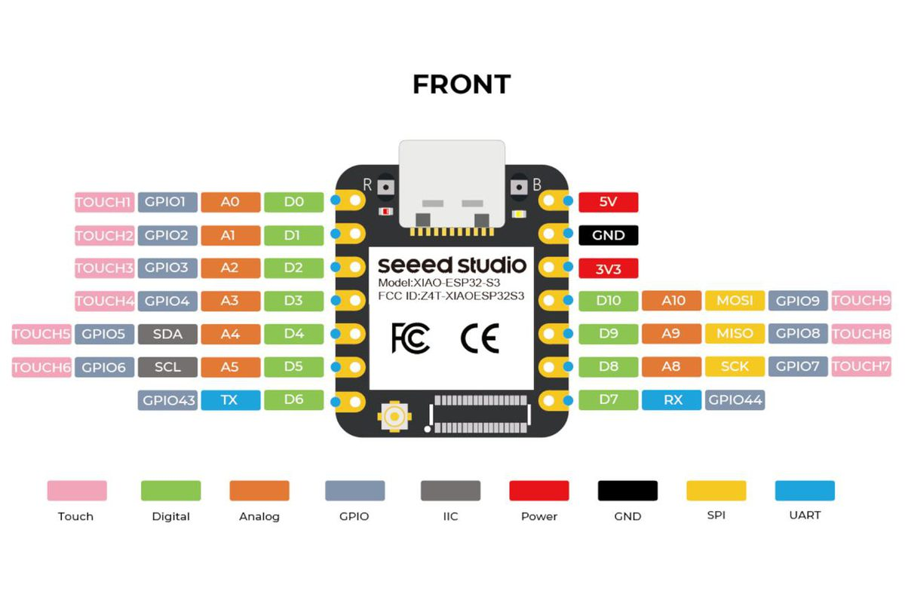

*[Seeed Studio XIAO ESP32S3 | Kiwi Electronics](https://www.kiwi-electronics.com/image/catalog/product/map1/113991114e.jpg) · 搜索词：Seeed Studio XIAO ESP32S3 standard development board front back labeled pinout*

XIAO ESP32S3 是一块非常小的 ESP32-S3 开发板。

它不仅包含 ESP32-S3 芯片，还集成了外围电路。

可以把它分成五个部分：

**ESP32-S3 主控芯片** 双核 Xtensa LX7 · 240MHz · Wi-Fi · BLE

- **存储系统** Flash、PSRAM（具体配置依板卡版本）
- **电源系统** 稳压、电源输入、电池相关电路
- **通信接口** USB、UART、I2C、SPI、I2S
- **用户接口** GPIO、按键、LED

这里需要先建立一个重要认识：

**ESP32-S3 芯片的引脚能力，不等于开发板所有引脚都可以自由使用。**

因为开发板上可能已经将部分 GPIO 用于 Flash、PSRAM、USB 或其他板载电路。

---

## 二、GPIO 是什么？为什么一个引脚能实现多种功能？

GPIO 的英文是 General Purpose Input/Output，即通用输入输出。

它是微控制器与外部世界连接的基本接口。

例如：

- 读取按钮状态；
- 控制 LED；
- 读取传感器数字信号；
- 控制继电器；
- 输出 PWM；
- 接收外部中断。

### 1. GPIO 内部结构

一个 GPIO 并不是简单的一根导线。

它内部包含多个电路模块。

**GPIO 内部功能示意**

**GPIO PAD** 芯片外部引脚

- **输入路径** 输入缓冲器 → 输入状态寄存器
- **输出路径** 输出数据寄存器 → 输出驱动器
- **上拉 / 下拉** 内部弱上拉、弱下拉
- **复用功能** UART、SPI、I2C、PWM 等

GPIO 的输入和输出功能由内部配置控制。

同一个 GPIO 可以在不同时间承担不同功能，但不能随意同时让多个外设驱动同一个引脚。

### 2. GPIO 的三种基本状态

| 状态 | 意义 | 应用 |
| --- | --- | --- |
| Input | 输入 | 读取按钮 |
| Output | 输出 | 控制 LED |
| Input/Output | 双向 | 某些数字通信场景 |

此外，还有高阻输入、上拉输入和下拉输入等配置。

### 3. 什么是高电平和低电平？

对于 XIAO ESP32S3 的 3.3V GPIO：

- 低电平：接近 GND；
- 高电平：接近 3.3V。

但实际数字输入的高低电平判定阈值由芯片电气规格决定，不是所有介于 0V 和 3.3V 之间的电压都能可靠识别。

**绝对不能把 5V 信号直接接到 ESP32-S3 普通 GPIO。**

需要通过电平转换或合适的保护电路处理。

---

## 三、GPIO 输出原理：为什么可以控制 LED？

我们先从最简单的 LED 电路理解 GPIO。

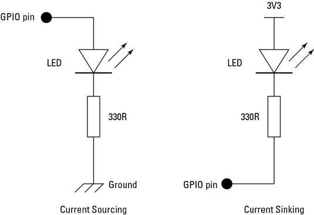

*[c - Built in LED is off when GPIOC13 is high, but on then GPIOC13 is low - Stack Overflow](https://i.sstatic.net/hYBh6.png) · 搜索词：microcontroller GPIO output LED series resistor schematic 3.3V circuit diagram*

典型连接：

```text
GPIO
  |
  |
限流电阻
  |
  |
 LED
  |
 GND
```

GPIO 输出高电平时，电流从 GPIO 流经电阻和 LED 到 GND，LED 发光。

GPIO 输出低电平时，LED 熄灭。

### 1. 为什么必须串联电阻？

LED 不能简单地直接连接 3.3V 电源。

因为 LED 的电流需要受到限制。

使用欧姆定律：

$R=\frac{V_{GPIO}-V_f}{I}$

假设：

- GPIO 电压：3.3V；
- LED 正向压降：2.0V；
- 目标电流：5mA。

那么：

$R=\frac{3.3-2.0}{0.005}=260\Omega$

可以选择标准阻值 270Ω。

### 2. 电阻功耗

$P=I^2R$

$P=0.005^2\times270
=0.00675W$

也就是约 6.75mW。

对于这个例子，常见的 1/8W 或 1/4W 电阻都足够。

实际还需要核对 LED 参数和 GPIO 输出能力。

### 3. ESP-IDF 控制 LED

```c
#include "driver/gpio.h"
#include "freertos/FreeRTOS.h"
#include "freertos/task.h"

#define LED_GPIO GPIO_NUM_4

void app_main(void)
{
    gpio_config_t config = {
        .pin_bit_mask = 1ULL << LED_GPIO,
        .mode = GPIO_MODE_OUTPUT,
        .pull_up_en = GPIO_PULLUP_DISABLE,
        .pull_down_en = GPIO_PULLDOWN_DISABLE,
        .intr_type = GPIO_INTR_DISABLE
    };

    ESP_ERROR_CHECK(gpio_config(&config));

    while (1) {
        gpio_set_level(LED_GPIO, 1);

        vTaskDelay(pdMS_TO_TICKS(500));

        gpio_set_level(LED_GPIO, 0);

        vTaskDelay(pdMS_TO_TICKS(500));
    }
}
```

注意：这里 GPIO4 只是示例，烧录前必须确认它在普通版 XIAO ESP32S3 上没有被其他硬件占用。

---

## 四、上拉电阻和下拉电阻：为什么按钮不能直接悬空？

这是硬件设计中非常重要的知识。

假设一个 GPIO 连接了按钮。

如果按钮没有按下，GPIO 没有连接明确的高电平或低电平，它可能处于悬空状态。

悬空输入容易受到环境噪声影响，读数可能随机变化。

### 1. 上拉电阻

**按钮上拉电路**

**3.3V** ↓

**10kΩ** 上拉电阻

↓

**GPIO 输入节点**

- ↓ **按钮** 按下时导通 ↓ **GND**
- **未按下：高电平** **按下：低电平**

工作状态：

| 按钮状态 | GPIO 读取 |
| --- | --- |
| 未按下 | HIGH |
| 按下 | LOW |

### 2. 下拉电阻

下拉电路则相反。

```text
3.3V
  |
 按钮
  |
 GPIO
  |
 10kΩ
  |
 GND
```

此时：

- 按钮未按下：LOW；
- 按钮按下：HIGH。

### 3. 内部上拉与外部上拉

ESP32-S3 提供内部上拉和下拉功能。

ESP-IDF 示例：

```c
gpio_config_t config = {
    .pin_bit_mask = 1ULL << BUTTON_GPIO,
    .mode = GPIO_MODE_INPUT,
    .pull_up_en = GPIO_PULLUP_ENABLE,
    .pull_down_en = GPIO_PULLDOWN_DISABLE,
    .intr_type = GPIO_INTR_DISABLE
};

ESP_ERROR_CHECK(gpio_config(&config));
```

内部上拉适合很多普通按钮场景。

外部上拉则适用于：

- 对抗干扰要求更高；
- 需要明确的上拉阻值；
- 外部电路要求更可靠的默认电平；
- 特定低功耗或电气设计场景。

---

## 五、GPIO 中断：如何让芯片主动感知外部变化？

前面我们使用循环读取按钮状态：

```c
while (1) {
    int level = gpio_get_level(BUTTON_GPIO);

    vTaskDelay(pdMS_TO_TICKS(10));
}
```

这种方式称为轮询（Polling）。

它的问题是：CPU 需要不断检查 GPIO 状态。

如果有很多按钮、传感器和外部信号，轮询会增加任务管理负担。

GPIO 中断可以解决这个问题。

### 1. 什么是中断？

假设按钮连接到 GPIO。

当按钮按下时，GPIO 电平发生变化。

芯片可以检测这个变化，并触发中断。

```text
正常执行程序
      |
      |
等待外部信号
      |
      ↓
按钮按下
      |
      ↓
GPIO 电平变化
      |
      ↓
触发中断
      |
      ↓
执行中断处理程序
      |
      ↓
恢复原来的任务
```

### 2. GPIO 中断类型

ESP32-S3 常见 GPIO 中断模式包括：

| 类型 | 触发条件 |
| --- | --- |
| `GPIO_INTR_POSEDGE` | 上升沿 |
| `GPIO_INTR_NEGEDGE` | 下降沿 |
| `GPIO_INTR_ANYEDGE` | 任意边沿 |
| `GPIO_INTR_LOW_LEVEL` | 低电平 |
| `GPIO_INTR_HIGH_LEVEL` | 高电平 |

例如，按钮采用上拉接法：

- 未按下：HIGH；
- 按下：LOW。

因此，按钮按下时产生下降沿。

可以使用：

```c
GPIO_INTR_NEGEDGE
```

### 3. ESP-IDF 中断示例

```c
#include "driver/gpio.h"
#include "esp_log.h"

#define BUTTON_GPIO GPIO_NUM_5

static const char *TAG = "BUTTON";

static void IRAM_ATTR button_isr(void *arg)
{
    BaseType_t higher_priority_task_woken = pdFALSE;

    TaskHandle_t task =
        (TaskHandle_t)arg;

    vTaskNotifyGiveFromISR(
        task,
        &higher_priority_task_woken
    );

    if (higher_priority_task_woken) {
        portYIELD_FROM_ISR();
    }
}
```

初始化中断：

```c
void button_init(TaskHandle_t task)
{
    gpio_config_t config = {
        .pin_bit_mask = 1ULL << BUTTON_GPIO,
        .mode = GPIO_MODE_INPUT,
        .pull_up_en = GPIO_PULLUP_ENABLE,
        .pull_down_en = GPIO_PULLDOWN_DISABLE,
        .intr_type = GPIO_INTR_NEGEDGE
    };

    ESP_ERROR_CHECK(gpio_config(&config));

    ESP_ERROR_CHECK(gpio_install_isr_service(0));

    ESP_ERROR_CHECK(
        gpio_isr_handler_add(
            BUTTON_GPIO,
            button_isr,
            (void *)task
        )
    );
}
```

任务中接收通知：

```c
void button_task(void *arg)
{
    while (1) {
        ulTaskNotifyTake(
            pdTRUE,
            portMAX_DELAY
        );

        ESP_LOGI("BUTTON", "Button event");
    }
}
```

这是一个基本的中断通知结构，完整工程还需要先创建 `button_task`，并处理重复安装 ISR 服务、按钮抖动和任务句柄生命周期等问题。

### 4. 为什么中断函数不能写太多代码？

因为中断处理程序运行在特殊的执行环境中。

不要在 GPIO ISR 中：

- 使用 `vTaskDelay()`；
- 调用普通阻塞队列；
- 执行长时间计算；
- 进行网络通信；
- 大量打印日志；
- 动态申请内存。

正确方式是：

**中断只负责通知任务，具体业务交给 FreeRTOS 任务完成。**

---

## 六、机械按钮为什么会抖动？如何消抖？

这是实际电路中经常遇到的问题。

按钮并不是理想开关。

按下或松开时，金属触点可能在短时间内多次接触和分离。

这称为机械抖动（Switch Bounce）。

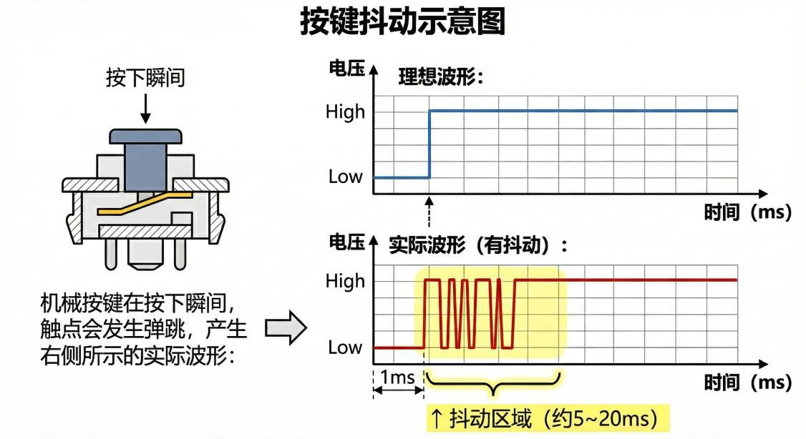

*[按键控制 | 立创开发板技术文档中心](https://wiki.lckfb.com/storage/images/zh-hans/fdb/micropython/gpio-basic/button-control/button-control_20260409_201336.png) · 搜索词：mechanical push button switch bounce oscilloscope waveform digital signal diagram*

假设你按下一次按钮，GPIO 可能检测到：

```text
HIGH
LOW
HIGH
LOW
HIGH
LOW
LOW
```

但你实际上只按了一次。

### 1. 软件消抖

最简单的方法是：

检测到中断后，延迟一段时间，再确认 GPIO 是否仍处于按下状态。

例如：

```c
void button_task(void *arg)
{
    while (1) {

        ulTaskNotifyTake(
            pdTRUE,
            portMAX_DELAY
        );

        vTaskDelay(pdMS_TO_TICKS(30));

        if (gpio_get_level(BUTTON_GPIO) == 0) {
            ESP_LOGI("BUTTON", "Valid press");
        }
    }
}
```

这只是入门示例。

真实项目还应处理消抖期间的重复通知、长按和释放事件。

### 2. 硬件消抖

可以使用 RC 电路。

**RC 消抖基本原理**

**按钮 + 上拉电阻**

↓

**电容滤波** 缓冲快速电平变化

↓

**GPIO 输入**

RC 电路的时间常数：

$\tau=R\times C$

例如：

- R = 10kΩ；
- C = 100nF。

则：

$\tau=10,000\times0.0000001
=1ms$

实际电平变化还取决于阈值、充放电路径和电路结构。

需要注意，简单 RC 滤波不一定适合所有输入电路，设计时还应考虑 GPIO 输入阈值和上升、下降时间。

---

## 七、ADC：ESP32-S3 如何读取模拟电压？

GPIO 主要用于识别数字信号。

但是很多传感器输出的是连续变化的电压。

例如：

- 光敏电阻；
- 电位器；
- 模拟温度传感器；
- 电池电压检测；
- 模拟压力传感器。

这时需要 ADC。

ADC 的完整名称是 Analog-to-Digital Converter，即模数转换器。

### 1. ADC 工作原理

假设传感器输出：

```text
0V ───────── 3.3V
```

ADC 将连续电压转换为数字数值。

ESP32-S3 的 ADC 支持 12 位转换结果。

理想化情况下：

$2^{12}=4096$

也就是 0～4095 共 4096 个数字等级。

**ADC 转换示意**

**模拟传感器** 输出 1.65V

↓

**ADC 转换器** 采样、量化、编码

↓

**数字结果**

**约 2048**

仅为理想化示意

### 2. ADC 的理论分辨率

如果参考电压假设为 3.3V：

$LSB=\frac{3.3}{4096}$

$LSB\approx0.806mV$

这表示理想情况下每一个数字等级对应约 0.806mV 的电压区间。

但必须注意：

**ESP32-S3 的 ADC 不能简单理解为固定 3.3V 满量程、完全线性的理想转换器。**

实际测量结果还受到以下因素影响：

- ADC 衰减配置；
- 芯片参考电压差异；
- ADC 非线性；
- 输入噪声；
- 采样时间；
- 电路阻抗；
- 校准情况。

ESP-IDF 提供 ADC Calibration Driver，可以改善电压换算精度。

### 3. ESP-IDF ADC 代码

使用 ESP-IDF 新版 ADC One-shot 驱动：

```c
#include "esp_adc/adc_oneshot.h"
#include "esp_adc/adc_cali.h"
#include "esp_adc/adc_cali_scheme.h"
#include "esp_log.h"

#define ADC_CHANNEL ADC_CHANNEL_2

static adc_oneshot_unit_handle_t adc_handle;

void adc_init(void)
{
    adc_oneshot_unit_init_cfg_t init_config = {
        .unit_id = ADC_UNIT_1,
    };

    ESP_ERROR_CHECK(
        adc_oneshot_new_unit(
            &init_config,
            &adc_handle
        )
    );

    adc_oneshot_chan_cfg_t channel_config = {
        .atten = ADC_ATTEN_DB_12,
        .bitwidth = ADC_BITWIDTH_DEFAULT
    };

    ESP_ERROR_CHECK(
        adc_oneshot_config_channel(
            adc_handle,
            ADC_CHANNEL,
            &channel_config
        )
    );
}
```

读取 ADC：

```c
void adc_read_value(void)
{
    int raw = 0;

    ESP_ERROR_CHECK(
        adc_oneshot_read(
            adc_handle,
            ADC_CHANNEL,
            &raw
        )
    );

    ESP_LOGI(
        "ADC",
        "Raw value: %d",
        raw
    );
}
```

这里 `ADC_CHANNEL_2` 是芯片 ADC 通道示例，不等于可以直接接到 XIAO 某个编号引脚。

实际开发必须先通过普通版 XIAO ESP32S3 引脚映射确认 GPIO 和 ADC 通道之间的关系。

### 4. ADC 校准

如果需要获得更准确的毫伏值，可以使用：

```c
adc_cali_raw_to_voltage(
    calibration_handle,
    raw,
    &voltage_mv
);
```

校准句柄需要先按照当前芯片和 ESP-IDF 版本支持的校准方案创建。

### 5. ADC 在 XIAO 项目中的应用

建议先做一个电位器实验。

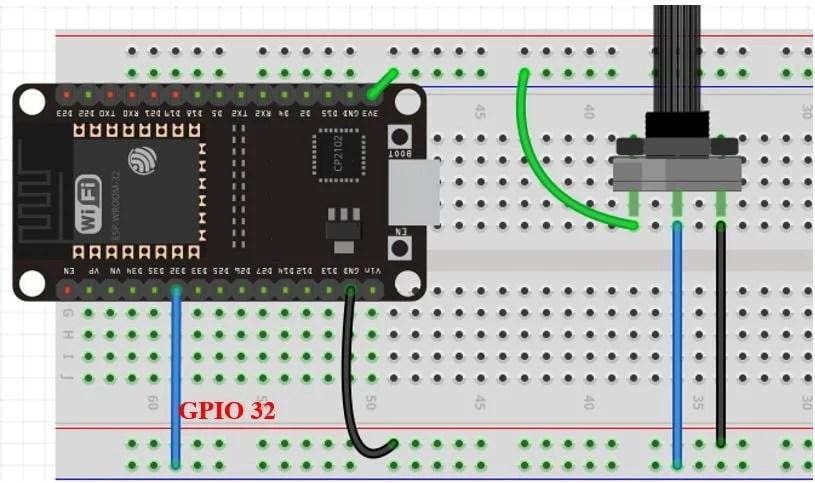

*[ESP32 ADC with ESP-IDF Measure Analog Inputs](https://i0.wp.com/esp32tutorials.com/wp-content/uploads/2022/07/ESP32-with-Potentiometer-ADC-Measurement-connection-diagram.jpg?resize=815%2C483&ssl=1) · 搜索词：10k potentiometer three pin analog input ESP32 ADC breadboard wiring*

连接逻辑：

| 电位器端子 | 连接 |
| --- | --- |
| 一端 | 3.3V |
| 另一端 | GND |
| 中间端 | 已确认支持 ADC 的 XIAO GPIO |

旋转电位器，就可以观察 ADC 数值变化。

不要将电位器接到 5V 后再把中间端接入 ESP32-S3 GPIO。

---

## 八、PWM：为什么 GPIO 可以控制 LED 亮度和电机速度？

PWM 的英文是 Pulse Width Modulation，即脉宽调制。

它通过快速切换数字输出的高低电平，改变高电平占整个周期的比例。

### 1. 什么是占空比？

假设一个 PWM 周期为 1ms。

其中：

- 高电平 0.25ms；
- 低电平 0.75ms。

那么：

$Duty=\frac{0.25}{1}\times100\%=25\%$

**PWM 波形对比**

### 2. PWM 的平均电压

在理想数字输出且负载适合平均化的情况下：

$V_{avg}=D\times V_{high}$

如果高电平为 3.3V：

| 占空比 | 理想平均电压 |
| --- | --- |
| 25% | 0.825V |
| 50% | 1.65V |
| 75% | 2.475V |
| 100% | 3.3V |

注意，PWM 并不是真正产生连续的模拟电压。

如果需要稳定的模拟电压，可以通过合适的低通滤波电路进行转换。

### 3. ESP32-S3 的 LEDC 外设

ESP32-S3 使用 LEDC 外设产生 PWM。

ESP-IDF 示例：

```c
#include "driver/ledc.h"
#include "esp_err.h"

#define PWM_GPIO GPIO_NUM_4

void pwm_init(void)
{
    ledc_timer_config_t timer = {
        .speed_mode = LEDC_LOW_SPEED_MODE,
        .duty_resolution = LEDC_TIMER_10_BIT,
        .timer_num = LEDC_TIMER_0,
        .freq_hz = 5000,
        .clk_cfg = LEDC_AUTO_CLK
    };

    ESP_ERROR_CHECK(
        ledc_timer_config(&timer)
    );

    ledc_channel_config_t channel = {
        .gpio_num = PWM_GPIO,
        .speed_mode = LEDC_LOW_SPEED_MODE,
        .channel = LEDC_CHANNEL_0,
        .intr_type = LEDC_INTR_DISABLE,
        .timer_sel = LEDC_TIMER_0,
        .duty = 0,
        .hpoint = 0
    };

    ESP_ERROR_CHECK(
        ledc_channel_config(&channel)
    );
}
```

设置 50% 占空比：

```c
void pwm_set_50_percent(void)
{
    ESP_ERROR_CHECK(
        ledc_set_duty(
            LEDC_LOW_SPEED_MODE,
            LEDC_CHANNEL_0,
            512
        )
    );

    ESP_ERROR_CHECK(
        ledc_update_duty(
            LEDC_LOW_SPEED_MODE,
            LEDC_CHANNEL_0
        )
    );
}
```

这里使用 10 位分辨率：

$2^{10}=1024$

因此 512 对应约 50% 占空比。

### 4. PWM 有哪些实际用途？

- LED 亮度调节；
- 蜂鸣器音调控制；
- 电机驱动信号；
- 舵机控制；
- 某些功率调节场景。

对于电机和大功率负载，GPIO 不能直接驱动，必须使用 MOSFET、驱动芯片和相应的保护电路。

---

## 九、I2C：为什么两个引脚就能连接很多传感器？

I2C 是一种常用的串行通信协议。

它只需要两根信号线：

- SDA：数据线；
- SCL：时钟线。

例如，一块 XIAO ESP32S3 可以通过 I2C 连接：

- OLED 显示屏；
- 温湿度传感器；
- 气压传感器；
- RTC 时钟；
- IO 扩展芯片。

### 1. I2C 电路原理

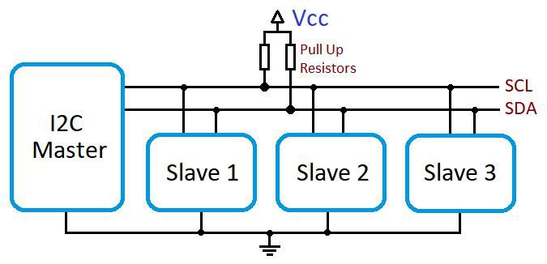

*[Understanding I2C Communication in Linux: A Beginner's Guide with Sample Code for Raspberry Pi](https://media.licdn.com/dms/image/v2/D4E12AQGE49_spEYXmA/article-inline_image-shrink_400_744/article-inline_image-shrink_400_744/0/1688208879970?e=2147483647&t=IWXXUlFJyIRojbVJn9RFjQz-bEsgxw_aKMkbQ99aBsA&v=beta) · 搜索词：I2C SDA SCL two pull up resistors multiple slave devices schematic diagram*

I2C 的一个重要特点：

**SDA 和 SCL 通常采用开漏输出，需要上拉电阻。**

为什么？

因为总线上的多个设备需要共同使用信号线。

设备可以主动将线路拉低，但不应该直接强行输出高电平与其他设备对抗。

典型连接：

```text
             3.3V
               |
         +-----+-----+
         |           |
        4.7K        4.7K
         |           |
SDA -----+-----------+---- 各个设备 SDA

SCL ----------------------- 各个设备 SCL

GND ----------------------- 所有设备 GND
```

上图为逻辑示意，实际 SDA、SCL 应各自具有一组上拉电阻。

### 2. 为什么常见上拉电阻是 4.7kΩ？

它是常见的起始选择，但不是固定值。

电阻太大：

- 上升沿变慢；
- 高速通信可能不稳定。

电阻太小：

- 低电平时需要更大的灌电流；
- 可能超过设备输出能力。

最终要根据：

- 总线电容；
- 通信速度；
- 设备数量；
- 线路长度；
- 器件电气规格；

来确定。

还要注意：如果多个模块都已经带有上拉电阻，并联后的等效阻值可能过小。

### 3. I2C 地址是什么？

假设连接了两个设备：

```text
OLED：0x3C

温湿度传感器：0x44
```

主控通过设备地址选择通信对象。

这意味着多个设备可以共享 SDA 和 SCL，但不能在同一总线上无冲突地使用相同地址，除非设备支持地址修改或采用多路复用器。

### 4. ESP-IDF I2C 初始化示例

```c
#include "driver/i2c_master.h"

#define I2C_SDA_GPIO GPIO_NUM_5
#define I2C_SCL_GPIO GPIO_NUM_6

static i2c_master_bus_handle_t bus_handle;

void i2c_init(void)
{
    i2c_master_bus_config_t config = {
        .i2c_port = I2C_NUM_0,
        .sda_io_num = I2C_SDA_GPIO,
        .scl_io_num = I2C_SCL_GPIO,
        .clk_source = I2C_CLK_SRC_DEFAULT,
        .glitch_ignore_cnt = 7,
        .flags.enable_internal_pullup = false
    };

    ESP_ERROR_CHECK(
        i2c_new_master_bus(
            &config,
            &bus_handle
        )
    );
}
```

这里的 SDA、SCL 是演示值，不是已经确认的 XIAO 接线方案。

### 5. 如何调试 I2C？

建议使用逻辑分析仪观察：

- Start；
- Address；
- ACK；
- Data；
- NACK；
- Stop。

例如：

```text
START
  ↓
设备地址 0x3C
  ↓
ACK
  ↓
发送数据
  ↓
ACK
  ↓
STOP
```

如果设备无法识别，优先检查供电、GND、上拉电阻、引脚映射和地址。

---

## 十、SPI：为什么显示屏和高速外设经常使用 SPI？

SPI 是一种同步串行通信协议。

典型情况下使用四根信号线：

| 信号 | 功能 |
| --- | --- |
| SCLK | 时钟 |
| MOSI | 主机发送数据 |
| MISO | 主机接收数据 |
| CS | 片选 |

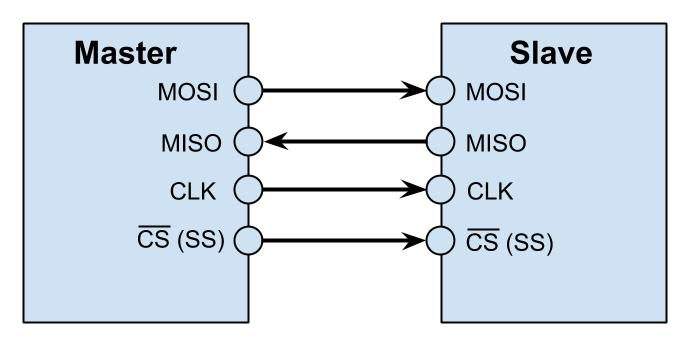

*[SPI Structure | USB-I2C/SPI/GPIO Interface Adapters](https://dlnware.com/sites/dlnware.com/files/images/spi-lines.png) · 搜索词：SPI master slave MOSI MISO SCLK CS wiring schematic diagram*

### 1. SPI 工作原理

主机产生时钟信号。

发送和接收双方按照约定的时钟边沿交换数据。

例如：

```text
ESP32-S3
    |
    |---- SCLK ---- 外设
    |
    |---- MOSI ---- 外设
    |
    |---- MISO ---- 外设
    |
    |---- CS ------ 外设
```

与 I2C 相比，SPI 通常具有更高的数据传输能力，但需要更多信号线。

### 2. SPI 的四种工作模式

SPI 的工作模式由 CPOL 和 CPHA 决定。

| 模式 | CPOL | CPHA |
| --- | --- | --- |
| Mode 0 | 0 | 0 |
| Mode 1 | 0 | 1 |
| Mode 2 | 1 | 0 |
| Mode 3 | 1 | 1 |

如果主控和外设配置不一致，就可能出现数据错误。

### 3. SPI 在 XIAO 项目中的用途

- TFT 彩色显示屏；
- SD 卡；
- 外部 Flash；
- 高速传感器；
- 某些 ADC 和 DAC。

如果你以后设计带显示屏的智能终端，SPI 很值得重点掌握。

---

## 十一、UART：串口通信为什么仍然非常重要？

UART 是异步串行通信接口。

常见信号：

- TX：发送；
- RX：接收；
- GND：公共地。

连接方式：

```text
XIAO ESP32S3       USB转串口模块

TX  -------------- RX

RX  -------------- TX

GND -------------- GND
```

注意 TX 和 RX 需要交叉连接。

### 1. 波特率是什么？

波特率表示每秒传输的符号数量。

常见设置：

- 9600；
- 115200；
- 921600。

双方必须使用匹配的通信参数。

### 2. UART 还有哪些配置？

- 数据位；
- 停止位；
- 校验位；
- 硬件流控。

例如：

```text
115200
8 Data Bits
No Parity
1 Stop Bit
```

通常称为 115200 8N1。

### 3. 一个重要的电气问题

UART 是逻辑通信协议，不代表所有 UART 电气接口都兼容。

XIAO ESP32S3 GPIO 使用 3.3V 逻辑。

不能直接把传统 RS-232 的正负电压信号接到 GPIO。

如果需要连接工业设备，应使用适当的 RS-232 或 RS-485 收发器。

---

## 十二、I2S：智能语音终端最重要的音频接口之一

前面我们学习过音频采集和播放。

现在从硬件角度理解 I2S。

I2S 是数字音频串行接口。

常见信号：

| 信号 | 作用 |
| --- | --- |
| BCLK | 位时钟 |
| WS / LRCLK | 左右声道时钟 |
| DOUT | 数据输出 |
| DIN | 数据输入 |
| MCLK | 某些设备需要的主时钟 |

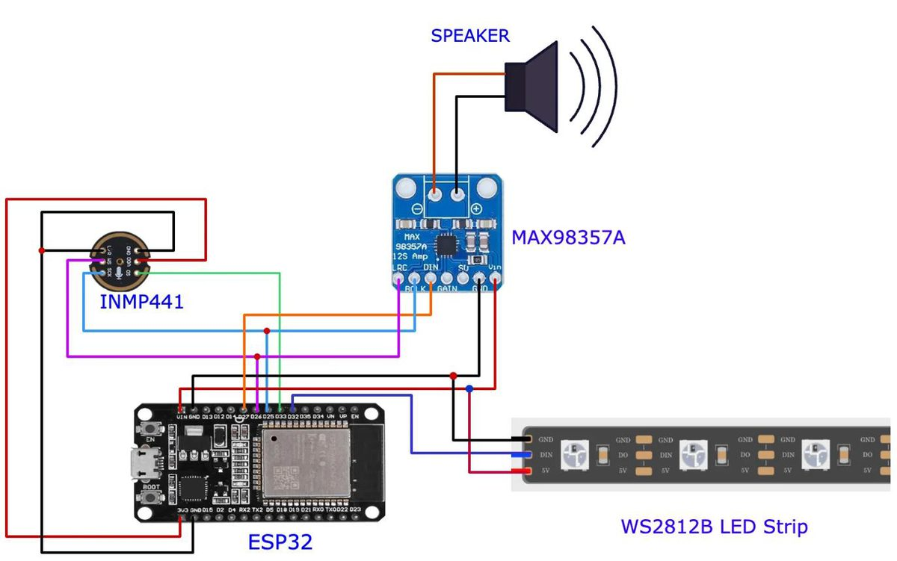

*[My Local Voice Assistant Device With Wake Word In Home Assistant | Smart Home Circle](https://smarthomecircle.com/static/images/2023/voice-assistant-device-with-wake-word/voice-assistant-circuit-diagram.webp) · 搜索词：ESP32 I2S digital microphone MAX98357A amplifier connection BCLK WS DIN schematic*

### 1. 麦克风采集

例如使用数字 I2S 麦克风：

```text
I2S 麦克风
    |
    | BCLK
    | WS
    | DOUT
    |
XIAO ESP32S3
```

麦克风将声音转换为数字采样数据。

ESP32-S3 通过 I2S 接收。

### 2. 扬声器播放

例如使用带 I2S 输入的数字功放：

```text
XIAO ESP32S3
    |
    | BCLK
    | WS
    | DOUT
    |
I2S 功放
    |
    |
扬声器
```

### 3. 为什么不能直接用 GPIO 驱动扬声器？

因为 GPIO 只能提供有限的数字输出驱动能力。

扬声器需要相对较大的驱动电流。

因此通常需要：

- 音频功放；
- 合适的扬声器阻抗；
- 电源去耦；
- 合理的地线和音频布局。

对于你正在研究的语音终端，I2S 麦克风和功放是后续必须深入掌握的部分。

---

## 十三、GPIO 电气保护：为什么硬件设计不能只考虑能不能接通？

很多初学者能够把传感器连接起来，但没有考虑电气保护。

这可能导致设备偶尔异常，甚至损坏芯片。

### 1. 过压保护

ESP32-S3 GPIO 不能直接承受任意电压。

如果外部传感器输出 5V，需要根据接口情况设计：

- 电阻分压；
- 电平转换芯片；
- 缓冲器；
- 专用保护电路。

### 2. ESD 静电保护

如果设备有外露 USB、按钮和外部连接器，静电可能通过接口进入电路。

可以在适当接口使用 ESD 保护器件。

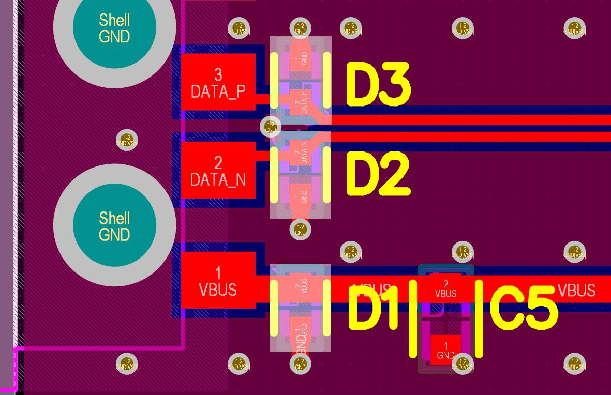

*[PCB Surge Protection: Designing Your PCB for Transient Voltage Suppression](https://files.resources.altium.com/sites/default/files/styles/max_width_1300/public/inline-images/usb-uart-tvs.png?VersionId=UmGEae76urUqHa7B36GC.Nb5CsfN3_EU&itok=n2q8-9-G) · 搜索词：USB connector ESD protection TVS diode PCB schematic layout*

### 3. 反接保护

如果设备使用外部电池或直流电源，需要考虑反接保护。

常见方法：

- 串联二极管；
- MOSFET 理想二极管结构；
- 专用电源保护芯片。

不同方案在压降、效率和成本上有所区别。

### 4. 电源去耦

芯片和外设在工作过程中会产生瞬态电流变化。

去耦电容可以帮助降低局部电源阻抗。

常见配置会包括：

- 0.1μF 陶瓷电容；
- 1μF 陶瓷电容；
- 10μF 或更大的储能电容。

但实际数量、位置和容量应根据芯片参考设计、稳压器数据手册以及 PCB 布局确定。

---

## 十四、XIAO ESP32S3 的接口调试工具

建议你逐步准备以下工具。

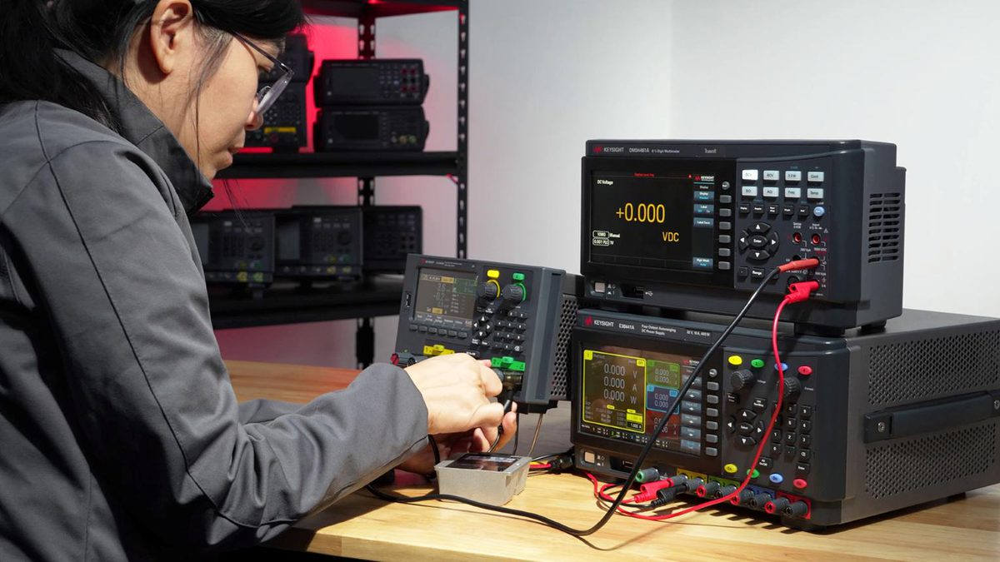

*[Smart Bench Essentials Plus | Keysight](https://www.keysight.com/content/dam/keysight/de/img/prd/smart-bench-essentials/sbe-plus/Smart-Bench-Essentials-Plus_In-Use_1600x900.png?fmt=png-alpha&hei=219&op_sharpen=1&resMode=sharp2&wid=388) · 搜索词：digital multimeter electronic measurement bench*

- **数字万用表** 测量电压、电阻、通断和静态电流。

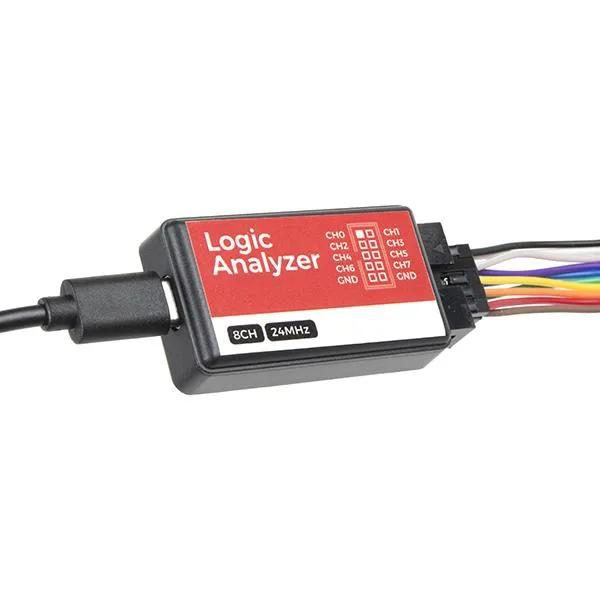

*[SparkFun USB Logic Analyser, 24MHz / 8 channels - buy at BerryBase](https://www.berrybase.de/media/74/3f/1c/1726353103/SparkFunUSBLogicAnalyzer24MHz8Kanle-163032.webp?ts=1750874015) · 搜索词：USB logic analyzer 8 channel electronics*

- **逻辑分析仪** 分析 I2C、SPI、UART、数字时序。

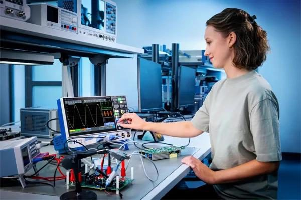

*[Rohde & Schwarz Unveils Compact MXO 3 Oscilloscopes with Four and Eight Channels | Signal Integrity Journal](https://www.signalintegrityjournal.com/ext/resources/images/Newsletters/News/News_1/RS-10-15-25.webp?t=1760530883) · 搜索词：digital oscilloscope electronics laboratory*

- **示波器** 观察 PWM、时钟、噪声和电源波形。

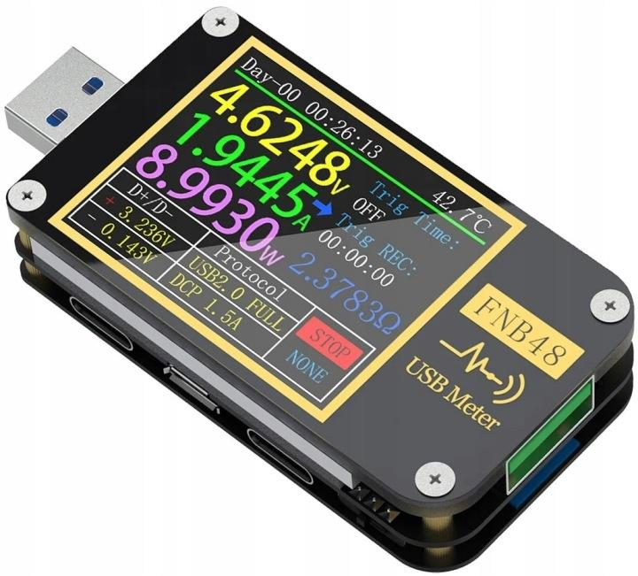

*[Amperometr Fnirsi cyfrowy FNB48, 5905191065973 • Cena • Opinie - Allegro](https://a.allegroimg.com/s720/118d13/9159159544569117a5af7ff09652/Wielofunkcyjny-miernik-tester-portu-USB-Fnirsi-FNB48-bez-Bluetooth-LCD-TFT) · 搜索词：electronics USB current meter power measurement*

- **USB 电流表** 观察开发板工作电流和功耗变化。

### 不同问题应该用什么工具？

| 问题 | 首选工具 |
| --- | --- |
| GPIO 是否输出高电平 | 万用表 |
| 按钮是否抖动 | 示波器 |
| I2C 地址是否正确 | 逻辑分析仪 |
| SPI 时钟是否正常 | 逻辑分析仪 |
| 电源是否瞬间跌落 | 示波器 |
| Wi-Fi 工作时功耗 | 电流测量设备 |
| 软件异常 | 串口日志、GDB |

---

## 十五、综合实战：建立 XIAO ESP32S3 硬件接口实验室

建议在你的项目仓库中建立独立的硬件实验工程。

```text
XIAO-ESP32S3-Projects/
└── projects/
    └── hardware_interface_lab/
        ├── 01_gpio_output/
        ├── 02_gpio_input/
        ├── 03_gpio_interrupt/
        ├── 04_button_debounce/
        ├── 05_adc/
        ├── 06_pwm/
        ├── 07_i2c/
        ├── 08_spi/
        ├── 09_uart/
        ├── 10_i2s_microphone/
        ├── 11_i2s_amplifier/
        └── docs/
            ├── pin_mapping.md
            ├── electrical_design.md
            ├── wiring_guide.md
            └── measurement_guide.md
```

### 实验顺序与验收标准

| 实验 | 验收目标 |
| --- | --- |
| GPIO 输出 | 正确控制 LED |
| GPIO 输入 | 正确读取按钮 |
| GPIO 中断 | 按键触发任务通知 |
| 按键消抖 | 一次按下只产生一次有效事件 |
| ADC | 能够读取电位器变化 |
| PWM | 能够控制 LED 亮度 |
| I2C | 能够识别 OLED |
| SPI | 能够读取或写入外设 |
| UART | 能够与外部设备通信 |
| I2S 麦克风 | 能够采集数字音频 |
| I2S 功放 | 能够正常播放声音 |

注意：所有实验的 GPIO 都应先核对普通版 XIAO ESP32S3 引脚表，不能直接使用示例代码中的 GPIO 编号。

---

## 十六、给 Codex 的第二十一课实践任务

**XIAO ESP32S3 Hardware Interface Lab** **独立实验工程**

要求 Codex 在现有项目中创建硬件接口实验室，不能修改已经正常工作的工程。

实施要求：

1. 核对普通版 XIAO ESP32S3 官方引脚映射。
2. 建立 GPIO 输入输出实验。
3. 建立 GPIO 中断实验。
4. 建立按钮消抖实验。
5. 建立 ADC 电压采集实验。
6. 建立 LEDC PWM 实验。
7. 建立 I2C OLED 实验。
8. 建立 SPI 外设实验。
9. 建立 UART 通信实验。
10. 建立 I2S 麦克风实验。
11. 建立 I2S 功放实验。
12. 为每个实验编写接线图和测试说明。
13. 记录 GPIO 占用和外设冲突。
14. 为每个实验提供独立构建方式。

**复制 Codex 实践任务**

---

## 十七、本课学习验收

**第二十一课学习进度**/

---

## 十八、下一课：XIAO ESP32S3 电源系统与 PCB 设计

**第二十二课：电源电路、锂电池、稳压器与 PCB 布局**

下一课将进一步深入硬件设计，重点学习：

1. XIAO ESP32S3 电源输入结构。
2. USB 5V 与 3.3V 电源关系。
3. LDO 和 DC-DC 稳压器。
4. 锂电池充电和保护。
5. 电池电量检测。
6. Wi-Fi 发射瞬态电流。
7. 电容选型与去耦布局。
8. 地平面与电源走线。
9. 模拟地和数字地。
10. ESD 与 USB 接口保护。
11. PCB 层数和布线规则。
12. PCB 电源完整性。
13. 电路板尺寸与连接器布局。
14. KiCad 原理图和 PCB 设计。
15. FreeCAD 外壳与 PCB 尺寸协同。

特别是你之前正在研究的电路板外壳项目，下一课会把电源、电路板、接口和外壳的设计联系起来。

**第二十一课最重要的结论：**

GPIO 不只是一个能够输出高低电平的引脚。它背后涉及数字电路、电气特性、时序、外设复用和中断机制。掌握这些原理，才能从单纯使用开发板，逐步走向独立设计 XIAO ESP32S3 产品。

官方参考资料：

- [Seeed XIAO ESP32S3 官方入门指南](https://wiki.seeedstudio.com/xiao_esp32s3_getting_started/)
- [ESP32-S3 GPIO 驱动](https://docs.espressif.com/projects/esp-idf/en/stable/esp32s3/api-reference/peripherals/gpio.html)
- [ADC One-shot 驱动](https://docs.espressif.com/projects/esp-idf/en/stable/esp32s3/api-reference/peripherals/adc_oneshot.html)
- [LEDC PWM 驱动](https://docs.espressif.com/projects/esp-idf/en/stable/esp32s3/api-reference/peripherals/ledc.html)
- [I2C 驱动](https://docs.espressif.com/projects/esp-idf/en/stable/esp32s3/api-reference/peripherals/i2c.html)
