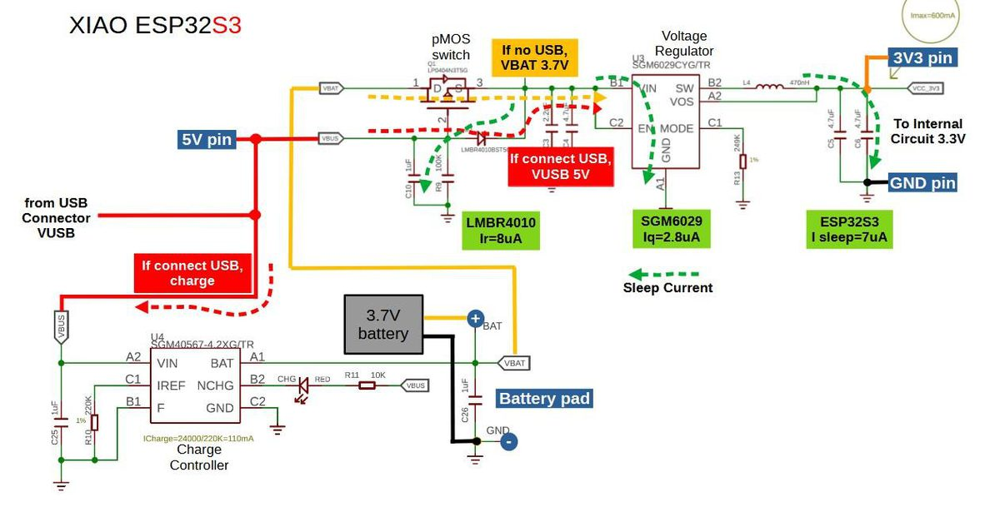
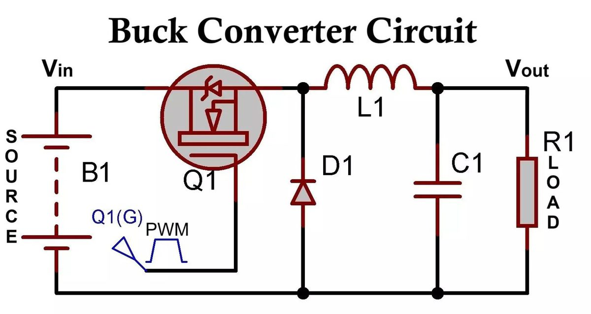
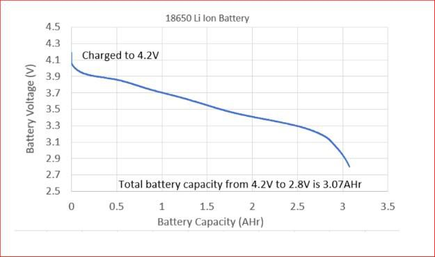
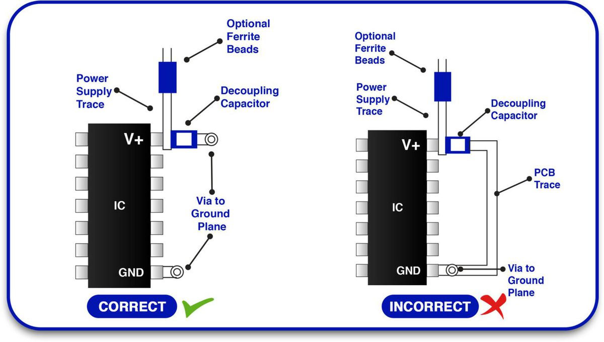
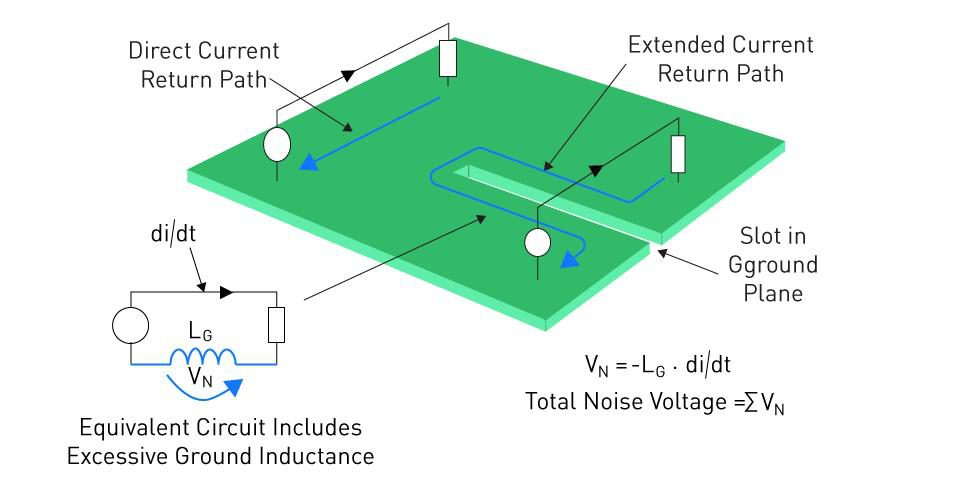
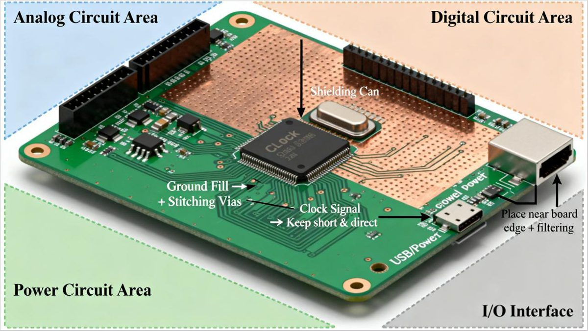
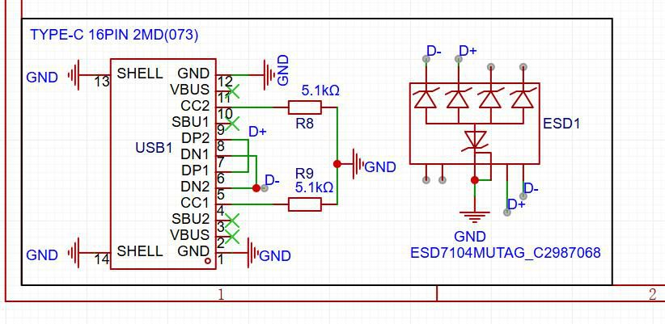
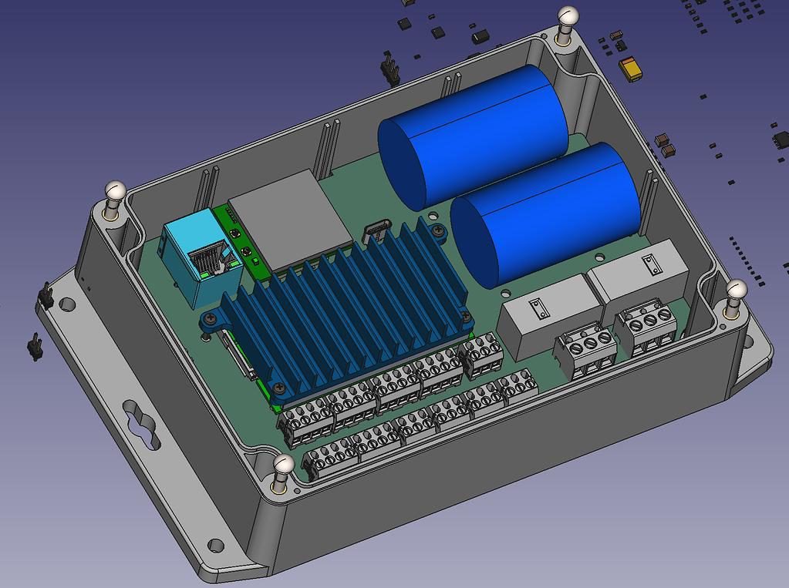
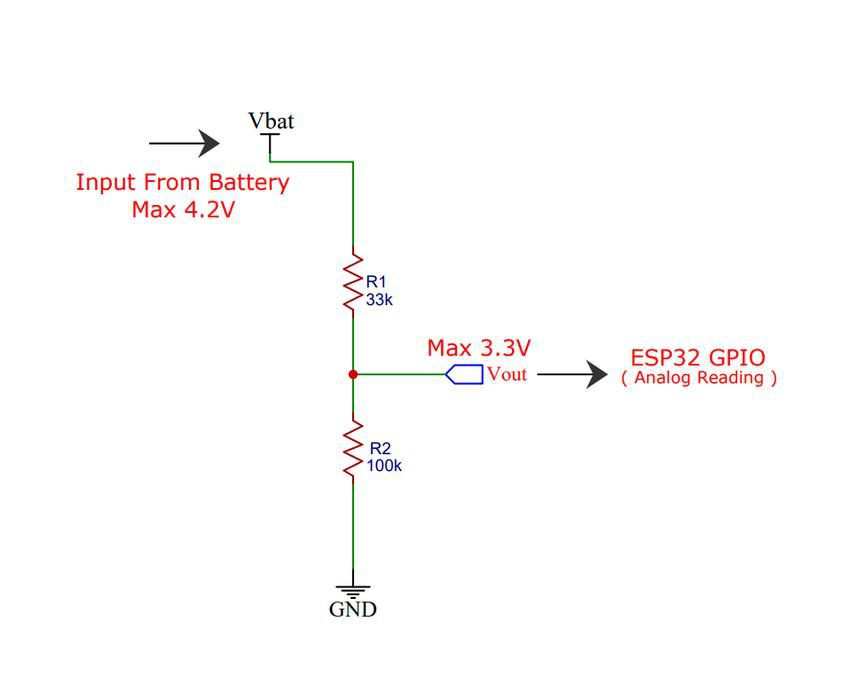

# 第二十二课：XIAO ESP32S3 电源系统与 PCB 设计原理

本课开始进入真正的硬件工程设计。

前面第二十一课，我们学习了 GPIO、ADC、PWM、I2C、SPI、UART 和 I2S。

现在要解决一个更基础、但也更容易导致硬件损坏的问题：

**如何给 XIAO ESP32S3 设计稳定、可靠、安全的电源系统？**

假设你正在设计一台智能语音终端，里面包含：

- XIAO ESP32S3 普通版；
- I2S 数字麦克风；
- 音频功放；
- 扬声器；
- OLED 显示屏；
- Wi-Fi 无线通信；
- 锂电池；
- USB 充电接口。

为什么有些设备会出现：

- Wi-Fi 发送时突然重启；
- 扬声器播放时 ESP32-S3 断电；
- ADC 读数不断跳动；
- 麦克风产生明显噪声；
- 电池明明有电，设备却无法启动；
- USB 插上后，电路板某个器件异常发热？

这些问题往往不是软件错误，而是电源设计问题。

本课将从电源原理、计算、实际电路、PCB 布局、测试和 Codex 协作六个方面展开。

---

## 一、先理解 XIAO ESP32S3 的电源结构



*[Comparison of Sleep Currents for XIAO ESP32C6, S3, and C3 - XIAO - Seeed Studio Forum](https://forum.seeedstudio.com/uploads/default/original/2X/5/50bd56aee6e732787e8a255af207b6289fd05b31.jpeg) · 搜索词：Seeed Studio XIAO ESP32S3 standard board power circuit schematic USB battery pinout*

XIAO ESP32S3 普通版开发板可以通过 USB 等支持的供电方式工作，也提供与电源相关的接口。

首先需要区分三个概念：

| 名称 | 含义 |
| --- | --- |
| USB 5V / VBUS | USB 接口提供的电源 |
| 3V3 | 板载稳压后的 3.3V 电源轨 |
| BAT | 与板载电池电源电路相关的接口 |

这里有一个非常重要的区别：

**XIAO ESP32S3 的 3V3 引脚不是可以随意输入 5V 的电源接口。**

必须根据实际供电路径和官方电路确认允许的电压。

### 1. 电源系统的基本工作路径

**典型电源架构**

- **USB 输入** 5V 电源
- **锂电池** 单节电池电压

↓

**电源管理与稳压电路** 保护、充电、稳压、供电路径

↓

**3.3V 电源轨**

- **ESP32-S3**
- **传感器**
- **OLED**
- **其他外围电路**

上图是理解电源系统的通用架构，不代表 XIAO 板载电路的精确拓扑。

实际设计时，应以官方原理图确认 USB、BAT、3V3、充电管理和稳压器之间的连接关系。

---

## 二、为什么 ESP32-S3 需要稳定的 3.3V 电源？

ESP32-S3 内部包含：

- 双核 CPU；
- SRAM；
- Wi-Fi 射频；
- Bluetooth LE；
- GPIO；
- ADC；
- I2S；
- SPI；
- USB 控制器。

这些模块在工作时会消耗电流。

尤其是 Wi-Fi 无线发射阶段，电流需求可能快速变化。

### 1. 电源电压为什么会突然下降？

假设电源输出 3.3V。

设备正常工作时：

```text
3.3V ───────────────────
```

当 Wi-Fi 开始发射时，瞬间电流增加。

如果稳压器响应不足、电源路径阻抗过大或电容配置不合理：

```text
3.3V ──────\___/────────
```

电压可能短暂下降。

当电压下降到芯片工作允许范围之外，就可能出现：

- Brownout；
- 系统复位；
- Wi-Fi 断开；
- 音频数据异常；
- 外设重新初始化。

### 2. 什么是 Brownout？

Brownout 是欠压检测机制。

当芯片供电电压低于设定的安全阈值时，系统可能触发欠压复位。

ESP-IDF 可以读取复位原因：

```c
#include "esp_system.h"
#include "esp_log.h"

void print_reset_reason(void)
{
    esp_reset_reason_t reason =
        esp_reset_reason();

    ESP_LOGI(
        "POWER",
        "Reset reason: %d",
        (int)reason
    );
}
```

如果怀疑电源问题，应结合示波器测量电压波形，而不是只依靠软件日志。

---

## 三、LDO 稳压器：最容易理解的稳压电路

LDO 的全称是 Low Dropout Regulator，即低压差线性稳压器。

它的作用是把较高的输入电压稳定为较低的输出电压。

例如：

```text
5V 输入
   |
   ↓
LDO
   |
   ↓
3.3V 输出
```

### 1. LDO 的工作原理

LDO 通过内部调整元件控制输出电压。

当负载变化时，内部控制环路调整输出，使电压尽量保持稳定。

### 2. LDO 的功耗计算

线性稳压器的主要损耗为：

$P=(V_-V_)\times I$

假设：

- 输入电压：5V；
- 输出电压：3.3V；
- 负载电流：300mA。

那么：

$P=(5-3.3)\times0.3$

$P=0.51W$

也就是说，LDO 需要消耗约 0.51W 的功率。

这部分能量主要转化为热量。

**LDO 功耗示例**

- 输入功率 **1.50W**
- 输出功率 **0.99W**

理论损耗

**0.51W**

主要以热量形式耗散

### 3. LDO 效率

忽略静态电流时：

$\eta\approx\frac{V_{out}}{V_{in}}\times100\%$

因此：

$\eta\approx\frac{3.3}{5}\times100\%=66\%$

这意味着输入和输出之间有相当一部分能量被消耗掉了。

### 4. LDO 适合什么场景？

适合：

- 小电流传感器；
- 低噪声模拟电路；
- 电源电流较小的模块；
- 输入输出压差较小的场景。

但不一定适合大电流、长时间工作的电池供电系统。

---

## 四、DC-DC 降压转换器：为什么效率通常更高？

DC-DC 是开关型电源转换技术。

常见的降压转换器叫 Buck Converter。

它通过开关管、电感、电容和控制电路实现电压转换。



*[Buck Converter Circuit Diagram, Working and Applications](https://www.hackatronic.com/wp-content/uploads/2025/05/Buck-Converter-Circuit.webp) · 搜索词：buck converter DC DC step down power supply circuit schematic inductor MOSFET diode capacitor*

### 1. 基本工作过程

```text
输入电压
   |
   ↓
开关管快速开关
   |
   ↓
电感储能与释放
   |
   ↓
电容滤波
   |
   ↓
稳定输出电压
```

### 2. 为什么效率更高？

因为它不是简单地把多余电压转化为热量。

它通过开关和储能元件传递能量。

假设：

- 输入 5V；
- 输出 3.3V；
- 输出电流 500mA；
- 效率 90%。

输出功率：

$P_=3.3\times0.5=1.65W$

输入功率：

$P_=\frac{1.65}{0.9}
\approx1.833W$

损耗：

$P_=1.833-1.65
=0.183W$

与前面 LDO 示例相比，损耗明显降低。

### 3. LDO 和 DC-DC 对比

| 项目 | LDO | Buck DC-DC |
| --- | --- | --- |
| 电路复杂度 | 低 | 较高 |
| 效率 | 与压差有关 | 通常较高 |
| 发热 | 较明显 | 通常较低 |
| 输出噪声 | 通常较低 | 有开关纹波 |
| 外围元件 | 少 | 电感、电容等 |
| 适用场景 | 小电流、低噪声 | 较大功率、电池供电 |

### 4. 智能语音终端如何选择？

我的建议是：

- 主控供电：使用经过验证、满足瞬态电流要求的 3.3V 电源。
- 功放供电：根据功放芯片要求独立设计电源支路。
- 模拟音频：必要时增加低噪声电源滤波。
- 电池供电：优先评估 DC-DC 的效率和静态功耗。

不要认为所有模块都必须从同一个 3.3V 电源直接取电。

---

## 五、锂电池供电：单节电池的工作原理

你的智能终端如果要脱离 USB 使用，就需要电池供电。

常见方案是单节锂离子电池或锂聚合物电池。

典型参数：

| 参数 | 典型值 |
| --- | --- |
| 标称电压 | 3.7V |
| 满充电压 | 4.2V |
| 放电截止电压 | 依电池规格确定 |
| 电池容量 | 由产品需求决定 |

注意：不同电池化学体系和规格可能不同，必须以电池厂商数据手册为准。

### 1. 电池电压变化



*[Solar Panels V/s Batteries - Understanding the key Difference](https://media.licdn.com/dms/image/v2/D5612AQGmHPAWR4E-fA/article-inline_image-shrink_400_744/article-inline_image-shrink_400_744/0/1723315159574?e=2147483647&t=exyNOovdGCE45fCu0ItxlnChWmAo8SVQb2mMUe7Dxoo&v=beta) · 搜索词：single cell lithium ion battery voltage discharge curve 4.2V 3.7V 3.0V graph*

锂电池放电过程中，电压不是恒定的。

可以粗略理解为：

```text
满电：4.2V

正常工作：约 3.7V

低电量：电压逐渐下降

达到保护或截止条件：停止放电
```

所以，不能简单地把电池直接连接到要求稳定 3.3V 的负载上。

### 2. 电池供电架构

**单节锂电池** 3.0～4.2V，示意范围

↓

**电池保护与电源管理** 过充、过放、过流及供电路径

↓

- **Buck-Boost** 稳定 3.3V
- **功放电源** 按功放要求设计

↓

**主控与外围设备**

这里的 Buck-Boost 是一种可升可降压的转换器。

它适合输入电压可能高于或低于目标输出电压的场景。

但是否需要使用，要看电池电压范围、效率和成本。

### 3. 充电和供电不是一回事

电池充电电路负责按照规定的充电曲线给电池充电。

电源管理电路负责给系统供电。

如果设备需要一边充电一边工作，还需要考虑 Power Path 电源路径管理。

不能简单地把一个充电芯片和一个电池接上，就认为整个系统已经具备完善的边充边用功能。

---

## 六、Wi-Fi 瞬态电流：为什么电源必须留有余量？

这是 ESP32-S3 电源设计的关键。

假设系统平时消耗 100mA。

当 Wi-Fi 发射时，负载电流可能短时间显著增加。

如果电源设计只按照平均电流计算，就可能导致电压跌落。

### 1. 计算电源容量

假设一个示意项目：

| 模块 | 设计电流预算 |
| --- | --- |
| XIAO ESP32S3 | 500mA |
| OLED | 30mA |
| I2S 麦克风 | 10mA |
| 其他传感器 | 40mA |
| 合计 | 580mA |

这里的数值是设计预算示例，不是板卡的实测电流。

如果预留 30% 设计余量：

$I_=580\times1.3$

$I_=754mA$

这时就不能随意选择一个标称输出只有 500mA 的稳压器。

还要检查：

- 瞬态响应；
- 输入电压范围；
- 输出电容要求；
- 温升；
- 限流保护；
- PCB 铜箔承载能力。

### 2. 为什么功放要单独考虑？

假设功放在大音量播放时需要较大电流。

如果主控和功放共用一条细长的 3.3V 供电走线，就可能产生：

- 电源压降；
- 地弹噪声；
- 音频底噪；
- 主控重启。

因此建议根据实际功放芯片的供电要求设计独立的电源支路。

---

## 七、去耦电容：电源设计中最容易被忽视的元件

电容不仅用于滤波，还可以在负载电流快速变化时提供局部电荷。

例如：

```text
3.3V 电源
    |
    +------ ESP32-S3
    |
   0.1uF
    |
   GND

    |
   10uF
    |
   GND
```

这只是简化示意。

### 1. 为什么常见 0.1μF？

0.1μF 陶瓷电容常用于高频去耦。

它能够为芯片附近的快速电流变化提供局部电荷，并降低电源线上高频噪声。

### 2. 为什么还要 10μF？

较大容量的电容可以帮助处理较低频率的电源波动和负载变化。

### 3. 电容应该放在哪里？



*[Decoupling Capacitors Matter in PCB Design](https://blindburiedcircuits.com/wp-content/uploads/2025/04/Decoupling-Capacitors-1536x872.jpg) · 搜索词：PCB decoupling capacitor placement close to IC power pin ground plane layout example*

核心原则：

**去耦电容应尽可能靠近对应芯片的电源引脚，并形成短而低阻抗的回流路径。**

不是把电容放在 PCB 上任意一个位置就能发挥相同效果。

---

## 八、PCB 电源走线：为什么走线宽度非常重要？

PCB 铜箔并不是理想导线。

它存在电阻和寄生电感。

当电流通过走线时：

$V_=I\times R$

如果走线太细、太长，压降和发热可能增大。

### 1. 走线电阻

对于一段均匀铜箔：

$R=\rho\frac{L}{Wt}$

其中：

- $\rho$：铜的电阻率；
- $L$：走线长度；
- $W$：走线宽度；
- $t$：铜厚。

可以看出：

- 走线越长，电阻越大；
- 走线越宽，电阻越小；
- 铜厚越大，电阻越小。

### 2. 为什么大电流走线需要更宽？

假设电源支路需要承载较大的功放电流。

如果走线过细，就可能出现：

- 压降；
- 局部发热；
- 电源稳定性下降。

因此在 PCB 设计中，电源走线需要根据电流、铜厚、允许温升和走线长度进行计算。

不能只凭肉眼判断。

---

## 九、GND 地线设计：为什么所有模块都需要共同参考地？

GND 是电路中的参考电位。

假设 XIAO ESP32S3 和一个外部传感器分别使用独立电源。

如果两者需要通过普通 GPIO 进行数字通信，就必须确保信号电平具有共同参考。

典型连接：

```text
XIAO ESP32S3          外部传感器

3.3V  --------------- VCC

GPIO  --------------- DATA

GND   --------------- GND
```

如果没有公共地，双方可能无法正确识别对方的高低电平。

### 1. 什么是地线压降？

地线也存在电阻。

当大电流通过地线时，地线两端会产生电压差：

$V_=I\times R$

假设：

- 电流为 1A；
- 地线等效电阻为 0.05Ω。

则：

$V_=1\times0.05=0.05V$

也就是 50mV。

对于数字电路，这可能影响噪声裕量；对于音频和模拟测量，也可能产生明显干扰。

### 2. 什么是地弹噪声？

当功放、电机或其他大电流负载快速变化时，地线电流也会变化。

如果不同模块共用一段阻抗较大的地线，就可能导致局部地电位发生变化。

这种现象称为 Ground Bounce，也常被称为地弹。



*[EMC and Interference Management and Suppression](https://media.monolithicpower.com/wysiwyg/Educational/Automotive_Chapter_12_Fig6-_960_x_504.png) · 搜索词：PCB ground bounce shared ground impedance high current circuit return current path illustration*

### 3. 推荐的 PCB 接地方式

对于你的语音终端，建议优先考虑：

- 使用连续、完整的地平面；
- 缩短大电流回流路径；
- 功放电流不要经过主控敏感区域的狭窄地线；
- ADC 输入附近避免高噪声开关节点；
- 音频输入和功放输出合理分区；
- 不要随意切割地平面。

这里有一个重要知识：

**模拟地和数字地不意味着一定要在 PCB 上物理分割。**

很多情况下，连续的完整地平面比随意分割地线更可靠。

如果确实需要分区，应根据实际电流回流路径设计，而不是简单地把 AGND 和 DGND 分开后只用一根细线连接。

---

## 十、模拟电路与数字电路如何分区？

XIAO ESP32S3 的 Wi-Fi、数字时钟、USB 和高速开关电路都可能产生电磁干扰。

而麦克风、ADC 和音频模拟输入通常对噪声比较敏感。

所以 PCB 应当合理分区。



*[EMC Design Guidelines in PCB Layout Design - PCB Design & Layout - PCBway](https://pcbwayfile.s3.us-west-2.amazonaws.com/web/25/09/17/1349501996831ab8d7e734129bac0d33ce3b5c0c15584t.png) · 搜索词：PCB mixed signal analog digital layout partitioning ground plane microphone audio power amplifier RF circuit example*

### 1. 推荐的功能分区

**智能语音终端 PCB 分区示意**

- **数字主控区** XIAO ESP32S3、USB、数字接口
- **音频输入区** 麦克风、输入信号
- **功放输出区** 功放芯片、扬声器接口
- **电源管理区** 稳压器、电池、充电管理

这是功能布局示意，并非经过电磁兼容验证的 PCB 布局。

### 2. 麦克风为什么应该远离功放？

功放输出可能存在较大的电流变化。

扬声器线缆也可能产生电磁干扰。

如果麦克风输入电路靠近功放输出走线，就可能出现：

- 音频底噪；
- 电源噪声；
- 啸叫；
- 高频干扰；
- 信号失真。

建议：

1. 麦克风尽量靠近设备的声音入口。
2. 麦克风信号线尽量短。
3. 功放与麦克风输入保持合理距离。
4. 扬声器输出走线避免穿越敏感模拟输入区域。
5. 功放电源和回流路径尽量靠近功放自身。

对于数字 I2S 麦克风，还需要考虑 BCLK 和数据线的串扰、时钟边沿以及信号完整性。

---

## 十一、USB 接口保护：为什么外部接口需要 ESD 防护？

XIAO ESP32S3 使用 USB 接口进行供电、下载和通信。

如果未来设计自己的外围 PCB，可能还会引出：

- USB-C；
- UART；
- 外部按键；
- 音频接口；
- 传感器接口。

这些接口都有可能接触外部环境。

静电放电可能直接损坏芯片或导致设备异常。

### 1. ESD 保护电路



*[usb c - ESD protection at CC pins of USB C - Electrical Engineering Stack Exchange](https://i.sstatic.net/cwI8bFKg.png) · 搜索词：USB Type C D+ D- TVS ESD protection diode schematic circuit*

对于 USB 数据线，通常可以考虑专用低电容 ESD 保护器件。

对于外部 GPIO 接口，则应根据电压范围、信号速度和接口环境选择保护方案。

### 2. ESD 器件应该放在哪里？

基本原则：

**尽量靠近外部连接器放置。**

原因是静电应当在进入 PCB 内部敏感电路之前被泄放。

布局时还应注意：

- ESD 器件到连接器的走线尽量短；
- 接地回路低阻抗；
- 避免保护器件接地过孔过远；
- 高速 USB 信号线保持合理阻抗和对称性；
- 避免形成过长的支路。

### 3. USB-C 接口还有什么需要注意？

USB-C 不仅仅是一个插座。

还涉及：

- CC1、CC2；
- VBUS；
- GND；
- D+、D-；
- 屏蔽层；
- 电源输入保护。

如果设计 USB-C 供电接口，还必须考虑正确的 Type-C 电源角色配置。

不能简单地认为只要连接了 USB-C 的 5V 和 GND，就完成了所有接口设计。

---

## 十二、PCB 电源布局：从原理图进入实际板子

前面讲了电源、去耦和接地，现在把这些原则落实到 PCB。

### 1. 一个推荐的布局顺序

### 2. 两层 PCB 还是四层 PCB？

| 对比 | 两层 PCB | 四层 PCB |
| --- | --- | --- |
| 制造成本 | 较低 | 较高 |
| 设计难度 | 较低 | 中等 |
| 地平面完整性 | 较难保持 | 更容易 |
| 电源完整性 | 需要精心布线 | 更容易优化 |
| 高速信号 | 设计空间有限 | 通常更有优势 |
| 适合场景 | 简单外围电路 | 复杂、高密度设计 |

对于初期的 XIAO ESP32S3 外围扩展板，可以优先考虑两层 PCB。

但如果同时包含：

- Wi-Fi 主控；
- 音频功放；
- 电源转换；
- USB 高速信号；
- 多种外部接口；

那么四层板也值得评估。

### 3. 四层板的典型叠层

**四层 PCB 叠层示意**

注意：这只是常见的四层板参考结构，实际叠层、阻抗、铜厚和介质材料要与 PCB 制造商确认。

---

## 十三、FreeCAD、KiCad 与 Codex 如何协同？

这部分与你之前的 PCB 外壳设计项目直接相关。

我建议将工具职责明确分开。

> 图示：KiCad PCB editor circuit board design screenshot

**KiCad** 原理图、元件库、PCB 布局、布线、DRC、Gerber。[KiCad 官方网站](https://www.kicad.org/)

---



*[KiCad + FreeCad 3D workflow - Hardware - TMPDIR](https://community.tmpdir.org/uploads/default/optimized/2X/9/9d9b6e4f97f0bd9500d8bd9b582fbab65ff3b430_2_1023x763.png) · 搜索词：FreeCAD CAD enclosure mechanical engineering PCB design*

**FreeCAD** PCB 外壳、结构尺寸、卡扣、螺丝柱、接口开孔、装配检查。[FreeCAD 官方网站](https://www.freecad.org/)

---


*[Voice Dictation for AI Prompts on Mac: Real Speakmac Workflow](https://www.speakmac.app/blog/voice-prompting-codex-on-mac-hero.webp) · 搜索词：OpenAI Codex code editor programming workspace*

**Codex** 生成和检查原理图设计数据、器件清单、引脚映射、PCB 约束及 FreeCAD 参数化脚本。[Codex 官方介绍](https://openai.com/codex/)

### 推荐协同流程

```text
硬件需求
   ↓
KiCad 原理图
   ↓
ERC 检查
   ↓
PCB 元件布局
   ↓
PCB 布线
   ↓
DRC 检查
   ↓
导出 STEP / 3D 模型
   ↓
FreeCAD 外壳装配
   ↓
检查接口、卡扣、散热和尺寸
   ↓
修改 PCB 或外壳
   ↓
最终制造
```

需要特别强调：

**Codex 可以协助生成和修改设计文件，但不能代替电气规则检查、真实器件数据手册核对和 PCB 实物测试。**

---

## 十四、针对你的 XIAO ESP32S3 智能终端，推荐的电源设计思路

假设目标设备包括：

- 普通版 XIAO ESP32S3；
- I2S 麦克风；
- I2S 功放；
- OLED；
- 单节锂电池；
- USB-C 充电接口。

建议把电源设计拆成以下几个独立功能区。

**智能终端电源架构**

**USB-C 5V 输入** 接口保护、输入检测

↓

**充电管理与 Power Path** 管理 USB 与电池供电

↓

**单节锂电池** 保护和电量检测

↓

- **主控电源** XIAO ESP32S3 原有供电路径，或经过验证的专用供电方案
- **功放电源** 根据功放芯片电压和电流独立设计

↓

**音频、显示及其他外围设备**

这里需要注意：

如果直接使用 XIAO 开发板的 BAT 接口和板载电源管理电路，就必须遵守官方规定的连接方式。

不能再额外并联一个充电电路，或者同时从多个电源点向板载电源轨反向供电，除非已经明确验证其供电路径和防倒灌设计。

---

## 十五、电池电量检测：如何让设备知道还剩多少电？

如果设备采用锂电池供电，就需要检测电池状态。

最简单的方法是 ADC 测量电池电压。

### 1. 电阻分压原理

假设电池电压最高为 4.2V，而 ADC 输入不能超过允许范围。

可以使用电阻分压：



*[Solar Powered WiFi Weather Station V3.0 - Redeem Hardware Products, DIY Electronics, and Kits by PCBWay Beans - PCBWay](https://content.instructables.com/ORIG/FGW/LL49/KMNGJC41/FGWLL49KMNGJC41.png?auto=webp&fit=bounds&frame=1&md=fae7d8ecaa4c49087b523440e0f74a8a&width=842) · 搜索词：battery voltage sensing resistor divider ESP32 ADC schematic two resistors*

电压计算：

$V_{ADC}=V_{BAT}\times\frac{R_2}{R_1+R_2}$

假设：

- R1 = 100kΩ；
- R2 = 100kΩ；
- 电池电压 = 4.2V。

则：

$V_=4.2\times\frac{100}{200}$

$V_=2.1V$

ADC 可以在满足其输入范围的前提下测量这个电压。

### 2. 为什么不能简单地用电压判断电量？

锂电池的电压与剩余容量并不是严格线性关系。

例如：

```text
4.2V ≠ 100% 电量

3.7V ≠ 精确的 50% 电量

3.3V ≠ 精确的 0% 电量
```

实际电量还受到：

- 电池化学特性；
- 温度；
- 放电电流；
- 电池老化；
- 内阻；
- 静置时间；

影响。

### 3. 更专业的方式：Fuel Gauge

如果产品需要准确显示剩余电量，可以使用专用电量计芯片。

例如：

- MAX17048；
- MAX17049；
- 其他适合目标电池的 Fuel Gauge。

这类芯片通常可以通过 I2C 与 XIAO ESP32S3 通信。

但具体型号要结合电池、供电结构、采购渠道和数据手册选型。

---

## 十六、PCB 热设计：为什么电源芯片会发热？

电源设计不仅要看电气参数，还要看温度。

假设一个 LDO 损耗为 0.5W。

如果 PCB 面积很小，散热铜面积不足，芯片温度可能明显上升。

### 1. 温升基本原理

$T_J=T_A+P\times\theta_{JA}$

其中：

- $T_J$：芯片结温；
- $T_A$：环境温度；
- $P$：功耗；
- $\theta_{JA}$：结到环境的热阻。

假设：

- 环境温度 25℃；
- 功耗 0.5W；
- 热阻 100℃/W。

那么：

$T_J=25+0.5\times100$

$T_J=75℃$

这是简化的估算，真实温度需要结合芯片封装、PCB 铜面积、过孔、气流和外壳条件分析。

### 2. 3D 打印外壳为什么也要考虑？

你的设备采用 3D 打印外壳。

这意味着还需要考虑：

- 外壳材料导热能力；
- PCB 与外壳之间的空气间隙；
- 电源芯片周围的散热空间；
- 扬声器和功放的位置；
- 长时间 Wi-Fi 工作产生的热量；
- 外壳内部热量积累。

建议后续在 FreeCAD 中将电源芯片、功放和主要热源标记为独立的热设计区域。

但不要仅靠外壳模型推测芯片温度，最终仍需要实物温度测试。

---

## 十七、电源调试：如何确认你的电路设计正确？

完成电路设计后，不能直接连接所有模块然后上电。

建议采用分阶段测试。

### 第一步：检查电路是否短路

使用万用表测量：

- 3.3V 与 GND；
- 5V 与 GND；
- BAT 与 GND。

检查是否存在异常低阻或明显短路。

电容充电可能造成电阻读数变化，因此不能只根据一次蜂鸣器提示判断电路短路。

### 第二步：检查空载电压

在没有连接主控负载的条件下，按照电路设计测试：

| 测量位置 | 检查内容 |
| --- | --- |
| USB 输入 | 输入电压 |
| 稳压器输入 | 输入是否正常 |
| 稳压器输出 | 是否达到设计值 |
| 功放电源 | 是否符合芯片规格 |
| 电池接口 | 极性和电压 |

### 第三步：逐步增加负载

建议顺序：

1. 单独测试稳压器。
2. 连接 XIAO ESP32S3。
3. 连接 OLED。
4. 连接麦克风。
5. 连接功放。
6. 最后测试 Wi-Fi 和最大音量。

### 第四步：测量瞬态波形

使用示波器观察：

- Wi-Fi 发射时的 3.3V 电压；
- 功放启动时的电源波动；
- 扬声器大音量播放时的电源噪声；
- USB 插拔时的电源变化。

这一步非常重要，因为万用表通常无法准确捕捉微秒或毫秒级的瞬态电压跌落。

### 第五步：进行长时间测试

建议至少覆盖：

- Wi-Fi 持续连接；
- 音频持续播放；
- 音频采集；
- USB 供电；
- 电池供电；
- 充电过程中运行；
- 高温环境下运行。

还需要确认是否存在异常发热、意外重启和电池保护触发。

---

## 十八、第二十二课综合实战：建立 XIAO ESP32S3 电源设计实验室

建议在现有项目仓库中增加：

```text
XIAO-ESP32S3-Projects/
└── projects/
    └── power_design_lab/
        ├── docs/
        │   ├── power_architecture.md
        │   ├── battery_design.md
        │   ├── ldo_vs_buck.md
        │   ├── capacitor_selection.md
        │   ├── grounding_guide.md
        │   ├── pcb_power_layout.md
        │   └── power_test_plan.md
        │
        ├── hardware/
        │   ├── power_schematic/
        │   ├── battery_circuit/
        │   ├── usb_protection/
        │   └── pcb/
        │
        ├── measurements/
        │   ├── voltage_test.csv
        │   ├── current_test.csv
        │   └── thermal_test.csv
        │
        └── README.md
```

### 实验验收标准

| 实验 | 验收目标 |
| --- | --- |
| LDO 实验 | 测量输入输出和温升 |
| DC-DC 实验 | 测量转换效率和纹波 |
| 电池实验 | 确认充放电路径 |
| 电量检测 | ADC 读取电池电压 |
| 去耦实验 | 观察电源瞬态变化 |
| 地线实验 | 分析不同回流路径 |
| USB 保护 | 核对接口保护方案 |
| PCB 实验 | 完成电源布局与 DRC |
| 热设计 | 测量主要芯片温度 |

---

## 十九、给 Codex 的第二十二课实践任务

**XIAO ESP32S3 Power Design Lab** **工程实践**

让 Codex 建立电源系统设计资料和验证工程。

主要工作：

1. 检查普通版 XIAO ESP32S3 官方电源原理图。
2. 梳理 USB、BAT、3V3 的实际供电关系。
3. 建立 LDO 与 DC-DC 计算工具。
4. 建立单节锂电池供电设计文档。
5. 建立充电和 Power Path 方案比较。
6. 建立电阻分压电池检测计算工具。
7. 建立去耦电容选型指南。
8. 建立 PCB 电源与地平面设计规范。
9. 建立 USB ESD 保护方案。
10. 建立功放与主控电源分区方案。
11. 建立温升和电流测试记录模板。
12. 整理 FreeCAD 与 KiCad 的协同接口。

**复制 Codex 实践任务**

---

## 二十、第二十二课学习验收

**第二十二课学习进度**/

---

## 二十一、下一课：XIAO ESP32S3 原理图设计与 KiCad 实战

**第二十三课：从零开始设计自己的 XIAO ESP32S3 扩展 PCB**

下一课开始，我们不再只讲单个电路原理，而是进入完整的 PCB 工程流程。

具体学习：

1. KiCad 工程结构。
2. 原理图编辑器。
3. XIAO ESP32S3 模块符号。
4. 官方引脚映射导入。
5. 元器件符号和封装。
6. 连接器和接口设计。
7. 原理图网络标号。
8. ERC 电气规则检查。
9. PCB 元件布局。
10. 两层 PCB 布线。
11. 电源与地平面。
12. DRC 设计规则检查。
13. Gerber 制造文件。
14. STEP 三维模型导出。
15. FreeCAD 外壳装配。
16. PCB 打样和实物测试。

特别是下一课，我们将围绕一个实际目标展开：

**设计一块能够与普通版 XIAO ESP32S3 配合使用的智能语音终端扩展 PCB，并且能够与 FreeCAD 中的 3D 打印外壳准确装配。**

官方参考资料：

- [Seeed XIAO ESP32S3 官方硬件资料](https://wiki.seeedstudio.com/xiao_esp32s3_getting_started/)
- [ESP32-S3 硬件设计指南](https://docs.espressif.com/projects/esp-hardware-design-guidelines/en/latest/esp32s3/)
- [KiCad 官方网站](https://www.kicad.org/)
- [KiCad 官方文档](https://docs.kicad.org/)
- [TI LDO 稳压器技术资料](https://www.ti.com/power-management/linear-regulators/ldo-regulators/overview.html)

**第二十二课最重要的结论：**

电源系统不是简单地把 5V 转成 3.3V。它涉及瞬态电流、稳压效率、电池管理、地线回流、去耦、散热和 PCB 布局。

这些设计直接决定 XIAO ESP32S3 产品能否稳定运行，尤其是 Wi-Fi、音频和电池供电同时工作的场景。
